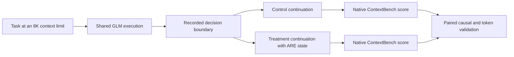
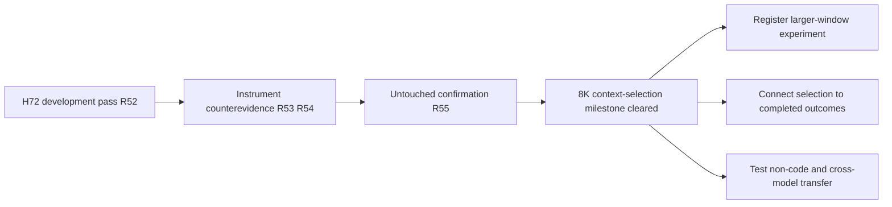

# ARE, GLM-5.3-flash, and ContextBench

**Research snapshot:** 2026-09-15, after the successful Round 55 independent confirmation  
**Audience:** readers with no prior knowledge of CyberAlchemy, ARE, GLM, or
ContextBench  
**Status:** GLM-5.3-flash 8K ContextBench context-selection milestone cleared;
larger-window, completed-outcome, non-code, and cross-model qualification remain open

## Executive summary

This project asks whether an external reasoning system can help an AI agent keep
and use the right evidence during a long task while consuming fewer total model
tokens. The external system is the **Agent Reasoning Engine (ARE)**. The model
currently under study is **GLM-5.3-flash**. The active experiment gives GLM an
8,000-token context window, deliberately creating the pressure under which
useful earlier observations may be displaced.

The work ultimately produced a successful development result and an untouched
independent confirmation:

- In **Round 48**, eight matched control/treatment pairs all passed the causal
  and accounting checks. ARE state raised macro Span-F1 from **3.06% to 8.22%**,
  a gain of **5.17 percentage points**, and treatment used **26,343 fewer**
  cumulative logical model tokens. Valid context selections rose from 3/8 to
  4/8.
- In **Round 49**, the unchanged treatment was tested on a larger fresh cohort.
  The run stopped at Pair 2 because treatment used **21,522 more tokens** than
  control on that pair, far above the frozen 3,072-token limit. Only one of the
  two observed pairs was causally valid, so Round 49 provides no aggregate
  quality estimate.
- In **Round 50**, terminal-only structured state converted the one observed
  control failure into a valid three-file treatment selection, but the
  treatment's first request was 28 tokens larger instead of at least 128 tokens
  smaller. The frozen run stopped after that pair.
- In **Round 51**, full evidence identifiers were replaced with three short,
  request-local handles. Both observed treatments returned valid selections
  while both controls were invalid, and treatment used 1,956 fewer logical
  tokens across those pairs. The run stopped because the second pair violated
  an absolute non-disclosure rule, even though the offending identifier had
  been inherited identically by both arms rather than added by treatment.
- In **Round 52**, the corrected incremental-disclosure treatment passed its
  fresh development canary: Span-F1 improved by **17.16 percentage points**,
  treatment produced 7 valid selections versus 5 for control, and used
  **2,401 fewer** conservative logical tokens. Seven pairs were complete and
  one bounded transport failure remained as a symmetric fixed zero.
- After two confirmation attempts exposed instrument edge cases, **Round 55**
  completed all eight untouched pairs with no censoring. Span-F1 improved by
  **13.15 percentage points**, valid selections improved from 6/8 to 8/8, every
  coverage and precision metric was non-degrading, and treatment used **3,568
  fewer** logical tokens.

Together, these results show that structured ARE state can improve terminal
context selection at GLM's 8K experimental window and replicate on unseen
tasks while reducing tokens. The evidence is
phase-specific: terminal-decision state repeatedly produced the useful quality
signal, while early effect-phase state had unstable token behavior. The
representation also matters: full identifiers consumed too much context;
short handles reduced that cost.

The confirmed mechanism, **H72**, uses short request-local handles at a held
terminal decision. Treatment-added state and schema contain no full evidence
identifiers; inherited identifiers must occur identically in both arms; handles
resolve privately to exact receipt-bound evidence before scoring. The 8K
ContextBench context-selection chapter is now closed. This is a bounded claim,
not a completed-repair or general-model qualification.

## The project in plain language

An agent solving a substantial task repeatedly reads files, calls tools, edits
artifacts, encounters errors, and revises its plan. The model conversation is
not an ideal database for this work. When the context window fills, old material
must be dropped, summarized, or reconstructed. The model can then forget:

- which evidence it actually received;
- what it changed;
- which commands succeeded or failed;
- whether a proposed answer was checked;
- what decision is currently unresolved.

ARE is intended to keep selected operational facts outside the conversation and
present them when they can improve the next decision. It can record tool
receipts, evidence identifiers, paths, outcomes, and exact ancestry
deterministically. It does not make those facts useful merely by storing them.
The research must separately determine **what state to present, when to present
it, and whether its value exceeds the tokens it consumes**.

The enduring objective is:

> Improve reusable ARE reasoning, useful continuity, recovery, correctness,
> and completed outcomes within cumulative model input plus output tokens.

GLM and coding tasks are the first controlled setting, not the intended limit
of the engine. A mechanism can be called general only after it transfers to
other context sizes, task domains, and models.

For the experiments in this report, **control** and **treatment** are the same
GLM-5.3-flash model with the same 8K window, task, repository revision, shared
history, and token cap. Control receives the neutral terminal-review path.
Treatment receives the candidate ARE representation. A **pair** is those two
continuations from one shared boundary. A **fixed denominator** is the complete
set of tasks frozen before the run; an incomplete denominator cannot support an
aggregate treatment claim. A **causally valid pair** is one for which the
validator proves that all registered equality, difference, provenance, and
token-accounting rules held.

## Where this research started

Earlier GLM experiments focused more directly on whether the model repaired
code. Those studies exposed real failure modes, including late candidate
construction, output-budget exhaustion, terminal schema errors, and lost
evidence after context recycling. They did not isolate whether retained
reasoning state itself was useful. Some control and treatment arms also produced
the same repair result despite different process behavior.

The active research was therefore narrowed to a more precise question:

> After context pressure, does ARE help GLM select the source evidence relevant
> to the task, with no increase in total input-plus-output tokens?

ContextBench was chosen for that question. SWE-bench repair scoring was removed
from the active loop because repair correctness and context retention are
different measurements. Correct repair remains a later outcome to test after a
stable context mechanism exists.

## How the experiment works

For each task, GLM follows one shared execution history until a frozen decision
boundary. The runtime then creates two isolated continuations with the same
model, task, repository revision, receipts, delivered evidence, and budget:

The shared-prefix design matters because two independent model runs could differ
for many unrelated reasons. Forking at an exact receipt-bound boundary makes the
ARE presentation the intended difference between the branches.

Round 48 allowed three boundary phases:

1. **Effect:** a later model receipt confirmed that an edit result was delivered.
2. **Terminal:** the model produced its first final context selection, which was
   held without acceptance so the branches could review it.
3. **Pressure:** a typed output or context-capacity failure was recorded.

Control received a neutral review instruction. Treatment received the same
review plus one phase-tagged `decision-state/v1` projection. The state could
contain no more than eight evidence records, 4,096 bytes, and 1,024 measured
tokens.

Rounds 50–52 narrow that design to the held terminal candidate. Round 50
substituted a compact state for repeated review instructions, but its full
64-character evidence identifiers consumed too many tokens. Round 51 replaced
those identifiers with up to three short handles such as `h0`, `h1`, and `h2`.
The model sees each handle with a path and line range; outside the prompt, ARE
keeps the exact receipt-bound mapping and resolves accepted handles back to the
full delivered-evidence identifiers before scoring.

Round 52 keeps the same model-visible treatment. Its change is in validation:
it separates shared inherited prompt content from content added only to the
treatment. This avoids attributing an identifier already visible in both arms
to the handle treatment while still failing closed if treatment state or its
tool schema discloses a full identifier.

## What ContextBench measures

ContextBench scores the source context selected by the model against expected
relevant source locations. It does **not** directly score whether a code patch is
correct.

| Metric | Meaning |
|---|---|
| Span coverage | Of all expected relevant source lines, the fraction the model selected. |
| Span precision | Of all source lines the model selected, the fraction that were relevant. |
| Span-F1 | Harmonic mean of span coverage and span precision; rewards finding relevant lines without selecting excessive unrelated text. |
| File coverage | Of all expected relevant files, the fraction selected. |
| File precision | Of all selected files, the fraction that were relevant. |
| Valid selection | The response used the complete required schema and referred only to source evidence actually delivered for the pinned repository revision. |
| Cumulative tokens | Every model input and output token across the path, including failed calls and repeated requests. |

For example, if 100 source lines are relevant and the model selects 80 lines,
of which 60 are relevant, span coverage is 60%, span precision is 75%, and
Span-F1 is about 67%.

**“pp” means percentage points.** Moving from 3.06% to 8.22% is an increase of
5.17 percentage points. It is not a 5.17% relative increase.

The project treats tokens as its scientific cost. Disk space, elapsed time,
latency, and price are operational concerns, but they are not added to the
quality-versus-token comparison.

## Controls added during the research

Many numbered rounds repaired the experiment rather than testing a new model
intervention. The main controls now include:

- exact request-to-receipt binding;
- deterministic identifiers for delivered source evidence;
- exact shared-prefix ancestry for both branches;
- proof of the allowed first-prompt differences;
- whole-schema validation with all defects returned together;
- native ContextBench scoring against pinned repository commits;
- cumulative accounting for every model input and output token;
- conservative debit for bounded calls whose exact use is indeterminate;
- zero automatic model retries;
- a fixed task denominator with no post-freeze replacement or rerun;
- immediate stopping when a frozen causal or token gate fails;
- no benchmark-gold data in the state shown to the model;
- zero executor effects from terminal responses held for review;
- disk guards and cleanup of reconstructible source checkouts.

These controls explain why several apparently promising earlier scores were not
accepted. A good number is evidence only when the experiment can prove what the
model saw, what differed between arms, and what tokens were consumed.

## Research method

Every round is intended to preserve this chain:

> objective → gap → question → competing hypotheses → selection →
> experiment/tasks/criteria → results → observations → reviewed decision →
> successor

The intervention, tasks, budget, pass criteria, and stopping rules are frozen
before live outcomes are observed. Failed and inconclusive rounds remain in the
record. A failed hypothesis leads to a new registered explanation rather than a
rerun with relaxed criteria.

The round number is therefore not a count of comparable benchmark runs. The
sequence also contains analysis rounds, runtime repairs, scorer checks, freeze
attempts, and instrument failures.

## Result history

| Round | Span-F1 result | Treatment − control tokens | What the result means |
|---|---:|---:|---|
| 20 | +5.28 pp | −107,102 | Promising, but failed completion and exposure gates. |
| 21 | +3.30 pp | −150,348 | Saved tokens, but file-level quality degraded. |
| 22 | +2.50 pp | −94,797 | Promising, but the full instrument contract failed. |
| 24 | +0.77 pp | +51,045 | Small quality gain with increased token use. |
| 33 | +13.40 pp | +65,914 | Largest raw gain, but contradicted the token objective. |
| 44–46 | No estimate | Fully charged | Boundary and validator defects prevented a valid pair. |
| 47 | No estimate | 180,913 known prefix tokens | Exact accounting worked, but the required boundary was too rare. |
| 48 | **+5.17 pp** | **−26,343** | Eight valid pairs passed every frozen development-canary gate. |
| 49 | No aggregate estimate | +22,547 across two started pairs | Frozen replication stopped when Pair 2 exceeded its paired-token ceiling. |
| 50 | No aggregate estimate | +124 on one started pair | Treatment recovered a valid selection, but failed the frozen first-request token-reduction gate. |
| 51 | No aggregate estimate | −1,956 across two started pairs | Both treatments were valid and both controls invalid; the run stopped on an over-broad non-disclosure gate. |
| 52 | **+17.16 pp** | **−2,401** | Fresh development canary passed all semantic, causal, and token gates. |
| 53 | No aggregate estimate | Negative on two completed pairs | Independent confirmation stopped on a zero-model tokenizer transport instrument gap. |
| 54 | No aggregate estimate | Negative on two completed pairs | Independent confirmation stopped on a nonterminal output-pressure boundary. |
| 55 | **+13.15 pp** | **−3,568** | Eight untouched pairs passed every confirmation gate; 8K milestone cleared. |

The table shows why the project cannot select the largest positive score and
declare success. Round 33 improved the measured quality most, but spent more
tokens. Rounds 20–22 saved tokens, but failed gates required to make their
quality numbers trustworthy. Rounds 50 and 51 stopped before their frozen
denominators were complete, so their pair observations guide the next
hypothesis but are not treatment-effect estimates.

## Round 48: the strongest completed result

All eight scheduled pairs passed causal validation and all 737,572 physical
model tokens were known exactly.

| Metric | Control GLM | GLM with ARE state | Difference |
|---|---:|---:|---:|
| Span coverage | 1.86% | 6.88% | **+5.02 pp** |
| Span precision | 19.00% | 23.91% | **+4.91 pp** |
| Span-F1 | 3.06% | 8.22% | **+5.17 pp** |
| File coverage | 6.79% | 12.86% | **+6.07 pp** |
| File precision | 29.17% | 35.42% | **+6.25 pp** |
| Valid selections | 3/8 | 4/8 | +1 task |
| Logical cumulative tokens | 624,911 | 598,568 | **−26,343** |

The aggregate result hides two different behaviors:

- The four **terminal-boundary** pairs supplied all measured quality gain. In
  that stratum, treatment improved Span-F1 by 10.33 percentage points and valid
  selections from three to four, but used 3,232 more tokens.
- The four **effect-boundary** pairs supplied 29,575 tokens of savings, but
  neither arm produced a valid selection on those tasks.

Pair 3 is the clearest quality example: control returned an invalid selection;
treatment inherited the same prefix, received one structured state, made one
model call, and returned a valid selection containing measurable relevant
context.

Pairs 4 and 7 dominate the token saving. Treatment made fewer post-fork calls
than control on those tasks. This was a useful observation, but it was also a
warning that the aggregate token result could depend on high-variance behavior
from only two tasks.

## Round 49: why the replication failed

Round 49 froze 16 fresh task identities and kept the Round 48 intervention
unchanged. Its purpose was to test stability, not to tune the result.

The first terminal pair stayed within the gate. Control selected no context,
treatment produced a context selection, and treatment used 1,025 more tokens.
The second pair forked at an effect boundary. Control made six post-fork model
calls and produced a context selection; treatment made 13 calls, used 21,522
more tokens, and ended with an invalid response.

The frozen maximum was +3,072 tokens per pair. The runner therefore stopped
before dispatching the remaining 14 identities. This early stop spent 169,355
known physical model tokens while preventing an invalid experiment from
consuming the full cohort.

Round 49 does not say that treatment quality was worse in aggregate because its
fixed denominator was not completed. It does provide strong counterevidence to
the proposed mechanism: additive state at an early effect boundary can amplify
exploration instead of reducing it. The universal Round 48 intervention was
rejected as unstable.

## Round 50: useful evidence in an expensive representation

Round 50 tested H68, terminal prompt substitution. Both branches inherited the
same archived history and held candidate, then made exactly one review call.
Control selected no context. Treatment returned a valid three-file selection
with 75% file coverage and 100% file precision.

That quality observation did not clear the experiment. The treatment state was
286 tokens and 726 bytes, and its first request was 28 input tokens larger than
control. The frozen rule required treatment to be at least 128 tokens smaller.
Total treatment cost was 124 tokens higher. The runner stopped after Pair 1,
leaving seven identities unstarted.

This localized the problem. Terminal evidence still appeared useful, and the
one-call design avoided the exploration amplification seen in Round 49. The
JSON structure and full 64-character evidence identifiers simply cost too much.

## Round 51: short evidence handles

Round 51 tested H70. ARE assigned up to three deterministic short handles to
receipt-bound evidence records. The model selected handles through a small
terminal tool, and ARE privately resolved them back to exact full identifiers.
Provider calibration reduced the treatment request from 790 to 594 tokens, a
196-token saving before the live run.

The frozen run produced two observations before stopping:

| Observation | Control | Handle treatment | Treatment token difference |
|---|---|---|---:|
| Pair 1 | Invalid final response | Valid selection; Span-F1 20.41%, file coverage 60%, file precision 100% | −1,507 |
| Pair 2 | Invalid final response | Valid selection; zero native overlap | −449 |

Pair 1 passed every causal check. Pair 2 failed the absolute non-disclosure
rule because one full identifier mapped to a private handle was also present in
the held candidate. Inspection showed that this identifier existed in the
shared prompt before the fork and occurred identically in control and
treatment. The treatment-added handle list and tool schema contained no full
identifiers.

The stop was still correct under the frozen H70 contract. It means the complete
eight-task denominator was never observed: one pair was causally valid, one
failed its gate, and six were never started. The two valid treatment responses,
the zero valid controls, and the 1,956-token directional saving are useful
successor evidence, not an aggregate H70 score.

## Confirmed hypothesis: causal incremental non-disclosure

Round 52 selects H72 against three alternatives: rewriting inherited candidate
identifiers, exposing one full identifier, and the null hypothesis that no
terminal representation transfers. H72 keeps the Round 51 model-visible
mechanism and changes only what the causal validator attributes to treatment.

The validator must prove all of the following before a fresh live run:

1. control and treatment inherited the same prefix receipts and held candidate;
2. treatment-added handle state contains zero full read identifiers;
3. the treatment-only handle tool schema contains zero full read identifiers;
4. removing registered arm-specific messages leaves byte-equivalent prompts;
5. inherited mapped-identifier occurrences have identical counts in both arms;
6. every accepted handle resolves one-to-one to an exact delivered read;
7. each branch makes one review call and treatment input is at least 128 tokens
   smaller;
8. treatment exposes at most three handles, 1,024 bytes, and 160 state tokens.

The validator replayed both Round 51 pairs and rejected mutations that added a
full identifier to state, schema, or treatment-only content. Round 52 then
passed on a fresh development cohort, and Round 55 passed on a separately
selected untouched cohort. This confirms H72 for the defined GLM 8K
context-selection milestone.

## What has been demonstrated

The evidence currently supports these claims:

1. ARE can store reasoning-relevant operational facts without asking the model
   to restate them.
2. The runtime can construct exact shared-prefix control and treatment branches
   and account for all model tokens.
3. A structured state can be the only registered semantic difference between
   paired continuations.
4. The Round 48 boundary design produced eight valid comparisons, improving
   every reported context-selection metric while reducing aggregate tokens.
5. The benefit is phase-dependent: terminal state carried the observed quality
   gain, while effect state showed unstable token behavior.
6. Frozen pair-level stopping rules successfully prevented a known-invalid
   Round 49 replication and invalid Round 50–51 instruments from continuing.
7. Terminal-only state produced a valid selection where control was invalid in
   the observed Round 50 pair and both observed Round 51 pairs.
8. Request-local evidence handles preserve exact external provenance while
   reducing measured provider input; the Round 51 calibration saved 196 tokens.
9. The harness distinguishes inherited prompt content from arm-specific
   content well enough to expose the Round 51 validator's attribution error.
10. H72 passed both a fresh development canary and an untouched independent
    confirmation while reducing aggregate logical tokens.

## What has not been demonstrated

The evidence does not establish that:

- the full 1,136-identity ContextBench contract is cleared;
- ARE improves code-repair correctness;
- the mechanism transfers to larger GLM windows, other models, or non-code
  tasks;
- the treatment is ready to become a default engine policy.

Absolute quality remains limited. Round 55 treatment Span-F1 was 15.85%, much
better than the 2.70% control score in that cohort, but the model still missed
substantial expected context.

## Current status and ordered next work

The current state is **a confirmed short-handle mechanism for GLM-5.3-flash at
the 8K ContextBench context-selection milestone**. Development and independent
confirmation both passed their frozen contracts.

The historical Round 55 field `benchmark_cleared: true` is scoped to that 8K
milestone. The preregistered [full acceptance contract](acceptance.json) also
requires all 1,136 identities, 10K and 12K windows, two confirmation
repetitions, and its declared statistical checks. The release wrapper records
the normalized status as `milestone_cleared: true` and
`full_contextbench_acceptance_cleared: false` while leaving raw evidence
unchanged.

Round 55 met the fixed rules: all eight identities were accounted for, all eight
pairs were causally valid, macro Span-F1 gained more than 5 percentage points,
every other reported quality metric was non-degrading, aggregate tokens were
lower, and each treatment stayed within its pair-level token ceiling.

The next separately registered work should test larger GLM context sizes, then
measure whether better selected context improves completed outcomes. Non-code
retention and another model family remain necessary before claiming a reusable
general mechanism.

## Operational storage

Earlier runs left many full repository checkouts under cache directories and
nearly exhausted the WSL virtual disk. Reconstructible checkouts are now treated
as temporary execution material. Retained evidence, receipts, predictions,
scores, manifests, and commit bindings live under `~/.local/share/are`, while
branch and prefix worktrees are deleted after scoring. Dispatch checks Linux and
host free space before a model call.

This storage policy protects the machine and preserves reproducibility. Disk
bytes are not mixed into the model-token research metric.

## Evidence map

- Project objective: [ARE lighthouse](../../LIGHTHOUSE.md)
- Round 48 plan: [PLAN-round48.md](PLAN-round48.md)
- Round 48 frozen contract: [freeze-round48-execution.json](freeze-round48-execution.json)
- Round 48 scored result: [round48-outcome.json](round48-outcome.json)
- Round 48 analysis: [round48-analysis.json](round48-analysis.json)
- Round 48 closeout: [round48-closeout.json](round48-closeout.json)
- Round 49 plan: [PLAN-round49.md](PLAN-round49.md)
- Round 49 frozen contract: [freeze-round49-execution.json](freeze-round49-execution.json)
- Round 49 stopped outcome: [round49-interrupted-outcome.json](round49-interrupted-outcome.json)
- Round 49 analysis: [round49-analysis.json](round49-analysis.json)
- Round 49 closeout: [round49-closeout.json](round49-closeout.json)
- Round 50 plan: [PLAN-round50.md](PLAN-round50.md)
- Round 50 stopped outcome: [round50-interrupted-outcome.json](round50-interrupted-outcome.json)
- Round 50 analysis: [round50-analysis.json](round50-analysis.json)
- Round 50 closeout: [round50-closeout.json](round50-closeout.json)
- Round 51 plan: [PLAN-round51.md](PLAN-round51.md)
- Round 51 stopped outcome: [round51-interrupted-outcome.json](round51-interrupted-outcome.json)
- Round 51 analysis: [round51-analysis.json](round51-analysis.json)
- Round 51 closeout: [round51-closeout.json](round51-closeout.json)
- Round 52 plan: [PLAN-round52.md](PLAN-round52.md)
- Round 52 work DAG: [work-plan-v52.json](work-plan-v52.json)
- Round 52 development outcome: [round52-outcome.json](round52-outcome.json)
- Round 53 instrument stop: [round53-interrupted-outcome.json](round53-interrupted-outcome.json)
- Round 54 instrument stop: [round54-interrupted-outcome.json](round54-interrupted-outcome.json)
- Round 55 frozen confirmation: [freeze-round55-confirmation.json](freeze-round55-confirmation.json)
- Round 55 confirmation outcome: [round55-confirmation-outcome.json](round55-confirmation-outcome.json)
- Round 55 reviewed closeout: [round55-closeout.json](round55-closeout.json)
- 8K release candidate: [releases/glm-5.3-flash-8k-v1/README.md](releases/glm-5.3-flash-8k-v1/README.md)
- Larger-window plan: [larger-window-v1/PLAN.md](larger-window-v1/PLAN.md)
- Storage lifecycle: [STORAGE-LIFECYCLE-PLAN.md](STORAGE-LIFECYCLE-PLAN.md)
- H70 handle implementation: [terminal-evidence-handles-v1.mjs](../../../implementation/agent-reasoning-engine/benchmarks/contextbench-v1/terminal-evidence-handles-v1.mjs)
- H70 frozen validator: [terminal-evidence-handle-validation.mjs](../../../implementation/agent-reasoning-engine/benchmarks/contextbench-v1/terminal-evidence-handle-validation.mjs)

## Open questions

- Do identifiers inherited equally by both arms influence model behavior even
  when they are not part of the treatment?
- Was Round 48's effect-phase saving real but rare, or mainly variance from two
  tasks?
- Which evidence fields are necessary for terminal review, and which merely
  consume context?
- Does improved context selection lead to more correct completed work?
- How should the state policy change as the available context window grows?
- Which non-code task can independently score useful retained evidence?
- Which parts of the mechanism transfer to another model without model-specific
  tuning?
