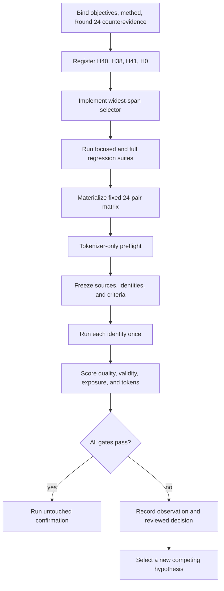

# ContextBench Round 25 — Widest Evidence Handle

## Objective hierarchy

- Enduring objective: improve reusable ARE reasoning, continuity, recovery, correctness, and completed outcomes within cumulative model input plus output tokens.
- Initial GLM objective: finish GLM-5.3-flash qualification, beginning with the 8K small-window chapter.
- **Current milestone:** clear the fixed ContextBench development gate, then untouched confirmation, before larger windows or other models.
- **Round objective:** test whether preserving the widest observed span for each recent path prevents the measurable context loss caused by newest-handle replacement.

## Research method

Every transition follows:

`objective → gap → question → competing hypotheses → selection → experiment/tasks/criteria → results → observations → reviewed decision → successor`

Round 24 is counterevidence, not a reason to change the benchmark. It completed all 24 registered pairs with zero unknown model usage, but produced only +0.007717 scheduled span F1, +0.011806 file F1, one fewer valid treatment completion, and 51,045 more treatment model tokens. Its selector chose a narrower handle despite an available wider same-path handle in 82 of 183 state slots.

## Question and hypotheses

Does selecting the widest delivered receipt-bound span within each of the eight newest paths improve useful post-recycle continuity within the same state-slot budget?

- **H40, selected:** widest span per recent path preserves more recoverable implementation context.
- **H38:** mixed early/recent path horizons matter more than handle width.
- **H41:** delta-only evidence reduces stale anchoring and token cost.
- **H0:** deterministic evidence-handle projection has no stable positive causal effect at 8K within non-increasing tokens.

The canonical records and selection rationale are in `hypotheses-round25.json`.

## Fixed experiment

- Same exposed eight-task cohort and three repetitions per arm.
- Exact shared-prefix fork; control receives no task state.
- Treatment receives at most eight newest paths and one handle per path.
- Within each selected path, choose the greatest inclusive line span; break equal-width ties by newest receipt; emit chosen handles in chronological order.
- Evidence remains receipt-bound and labeled observed, never inferred relevant.
- Context window 8K; cumulative model input plus output cap 96K per trajectory.
- No task, prompt, order, threshold, cap, source, or scorer tuning after freeze.
- Every identity runs once; failures and prefix-ineligible pairs remain in the denominator.

## Fixed decision rule

- Scheduled zero-filled paired macro span F1 gain ≥ +0.05.
- Scheduled file F1 does not degrade.
- Treatment valid completions do not degrade.
- Treatment cumulative branch model tokens do not exceed control.
- Zero unknown model-token receipts.
- Exact post-recycle treatment exposure, zero control exposure, deterministic widest-span selection, receipt binding, and fixed bounds all pass.

A development pass advances to untouched confirmation. It does not clear ContextBench by itself. Full clearance remains the pinned 1,136-identity evaluation plus untouched confirmation at 8K, 10K, and 12K. SWE-bench repair scoring remains outside the active stage.

## DAG

## Open questions

- Will wider recoverable spans reduce repeated search enough to offset all state-prompt tokens?
- Does span width help tasks with several relevant files without anchoring the model to broad but weak evidence?
- If H40 fails, do per-generation deltas or mixed-horizon paths provide the next clean causal test?
