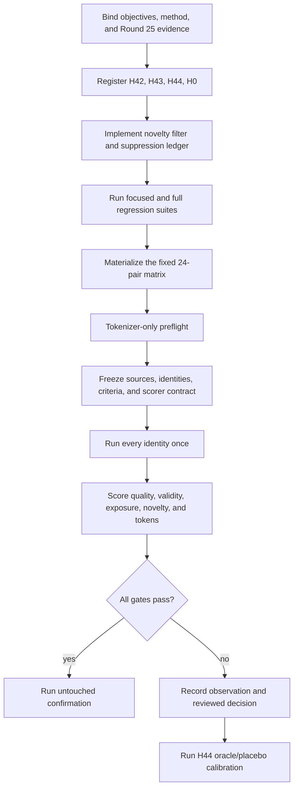

# ContextBench Round 26 — Novelty-Gated Widest State

## Objective hierarchy

- Enduring objective: improve reusable ARE reasoning, continuity, recovery, correctness, and completed outcomes within cumulative model input plus output tokens.
- Initial GLM objective: finish GLM-5.3-flash qualification, beginning with the 8K small-window chapter.
- **Current milestone:** clear the fixed ContextBench development gate, then untouched confirmation, before larger windows or other models.
- **Round objective:** retain Round 25's measured retrieval-quality gain while removing repeated state that increased total model work.

## Research method

Every transition follows:

`objective → gap → question → competing hypotheses → selection → experiment/tasks/criteria → results → observations → reviewed decision → successor`

Round 25 is mixed evidence with a decisive mechanism split. Widest-span state crossed the fixed quality, file, validity, exposure, and selector gates: +0.070339 scheduled Span-F1, +0.192130 File-F1, and two additional valid completions. It nevertheless used 234,147 more known branch tokens. One timed-out control receipt cannot reverse that result because its maximum reserved cost was 6,182 tokens, leaving a treatment-token lower bound of +227,965. Half of the 220 projected evidence slots repeated handles already shown, and 24 of 86 state presentations contained no new handle.

## Question and competing hypotheses

Was Round 25's token overhead caused by repeatedly presenting unchanged evidence handles?

- **H42, selected:** present only changes to the H40 widest-handle set; omit model-facing state when there is no new selected handle.
- **H43:** present H40 widest state only at the first recycle.
- **H44:** use a sealed oracle/placebo diagnostic to measure the available state-recovery ceiling.
- **H0:** no deterministic receipt-bound state can retain positive quality under the fixed token gate.

Canonical records and the evidence-led selection are in `hypotheses-round26.json`.

## Fixed experiment

- Same exposed eight-task cohort, shared prefixes, three repetitions per arm, and alternating pair order.
- Control receives no task-state message.
- Treatment first selects the H40 widest receipt-bound handle for each of the eight newest paths.
- A selected handle may be presented at most once per branch. Later generations emit only newly selected handles.
- If no selected handle is new, omit the model-facing task-state message and record a deterministic suppression decision.
- Evidence remains receipt-bound and labeled observed, never inferred relevant.
- Context window 8K; cumulative model input plus output cap 96K per trajectory.
- No task, prompt, order, threshold, cap, source, or scorer tuning after freeze.
- Every identity runs once; all failures and prefix-ineligible pairs remain in the denominator.

## Fixed decision rule

- Scheduled zero-filled paired macro Span-F1 gain ≥ +0.05.
- Scheduled File-F1 does not degrade.
- Treatment valid completions do not degrade.
- Treatment cumulative branch model tokens do not exceed control.
- Zero unknown model-token receipts.
- Every post-recycle treatment dispatch has exactly one auditable presentation or suppression decision.
- Every presented handle is receipt-bound, follows H40 widest selection, and appears at most once per branch.
- Control has zero state presentations and suppressions.

A development pass advances immediately to untouched confirmation. If quality or token efficiency fails, selector iteration stops and H44 oracle/placebo calibration becomes the next experiment. Development alone does not clear ContextBench: full clearance still requires the pinned 1,136-identity evaluation and untouched confirmation at 8K, 10K, and 12K. SWE-bench repair scoring remains outside this stage.

## DAG

## Open questions

- How much of the 61,157 direct state-token cost disappears after fitting JSON framing around only novel handles?
- Does removing unchanged reminders also reduce the 41 extra model calls observed in Round 25?
- Is repeated evidence necessary for any task family to retain Round 25's quality gain?
