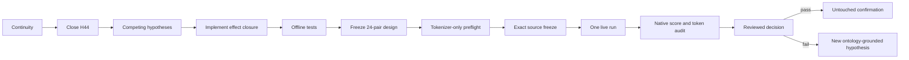

# ContextBench Round 28 — Effect-evidence closure

## Objective hierarchy

Enduring objective: Improve reusable ARE reasoning, useful continuity, recovery, correctness and completed outcomes within cumulative model input plus output tokens.

Initial GLM objective: Finish GLM-5.3-flash qualification, beginning with small context windows and useful reasoning-state recovery under pressure.

Current milestone: Clear the fixed ContextBench contract through frozen evidence-led rounds while keeping ContextBench diagnostics distinct from semantic retention and repair correctness.

## Research method

objective → gap → question → competing hypotheses → selection → experiment/tasks/criteria → results → observations → reviewed decision → successor

Round 27 established that correctly selected, receipt-bound evidence beats an equal-token placebo. The remaining gap is a deployable, non-gold signal. The selected hypothesis is that evidence overlapping entities changed by the agent is the strongest causal completion-time signal.

## DAG

## Fixed decision rule

The development comparison contains eight exposed tasks, three repetitions, and paired control/treatment branches after the same first-recycle prefix. Missing and invalid results remain zero on the scheduled denominator.

The treatment passes only when scheduled paired macro Span-F1 improves by at least 0.05, File-F1 and valid completion do not degrade, unknown model usage is zero, and treatment cumulative model input plus output tokens do not exceed control. No identity is rerun and no threshold, prompt, cap, scorer, source, task, order, or policy changes after freeze.

Passing advances to the untouched confirmation matrix required by `acceptance.json`. Failure closes the mechanism and returns to competing hypotheses; it does not authorize an in-round variant.

## Open questions

- How often do completed effects have a previously delivered overlapping base observation?
- Does replacing stale retained history at finalization save enough input tokens to offset the bounded closure message?
- If the development gate passes, does the mechanism transfer to untouched tasks and larger windows?
