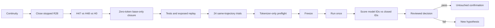

# ContextBench Round 29 — Same-trajectory effect closure

## Objective hierarchy

Enduring objective: Improve reusable ARE reasoning, useful continuity, recovery, correctness and completed outcomes within cumulative model input plus output tokens.

Initial GLM objective: Finish GLM-5.3-flash qualification, beginning with small context windows and useful reasoning-state recovery under pressure.

Current milestone: Clear the fixed ContextBench contract through frozen evidence-led rounds while keeping ContextBench diagnostics distinct from semantic retention and repair correctness.

## Research method

objective → gap → question → competing hypotheses → selection → experiment/tasks/criteria → results → observations → reviewed decision → successor

H44 established a selection bottleneck. Round 28 then revealed that a post-response deterministic mechanism must be evaluated on the same model trajectory, and that only pinned-base observations can receive closure credit. The exposed replay selects a six-observation cap: the smallest cap on the best measured plateau.

## DAG

## Fixed decision rule

Run eight exposed GLM-5.3-flash tasks three times at 8K. Each model trajectory supplies both outcomes: its validated model-selected IDs are baseline and the deterministic union with at most six receipt-bound pinned-base observations overlapping actual effect hunks is treatment. Missing or invalid trajectories contribute zero to both outcomes.

Pass only if scheduled macro Span-F1 improves by at least 0.05, File-F1 and valid selection do not degrade, all closures export, unknown usage is zero, and added model calls and model input plus output tokens are exactly zero. No identity, response, threshold, cap, scorer, source, task, or closure policy changes after freeze.

## Open questions

- Will a complete 24-trajectory denominator retain the +4.84 pp all-executed and +8.72 pp changed-selection exposed signal?
- Does the six-observation cap preserve File-F1 non-degradation on fresh trajectories?
- If development passes, how should the exact same-trajectory estimator be bound across untouched 8K, 10K, and 12K confirmation?
