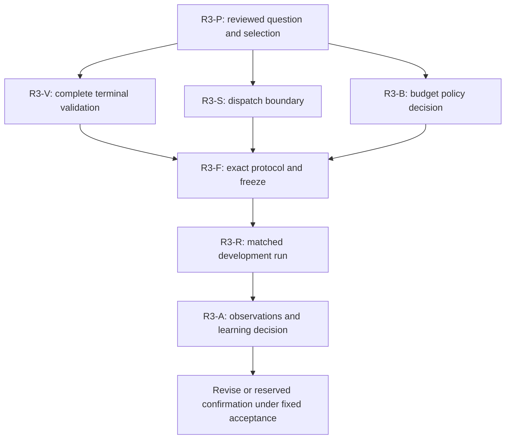

# ContextBench successor after the round-two instrument failure

Status: candidate construction plan; no live dispatch or frozen successor yet.
Authority effect: none. Continuity binding: [round3-continuity.json](round3-continuity.json).

## Objective and remaining gap

Finish GLM small-window useful-state qualification within the enduring ARE
objective: reusable reasoning continuity, correctness and completed outcomes at
cumulative model input-plus-output token budgets. ContextBench remains the active
fixed milestone; SWE-bench is excluded. Native retrieval scores do not establish
semantic retention or patch correctness. Passing this round cannot close the
full benchmark, the small-window chapter, or broader GLM qualification.

[Round two](round2-closeout.json) attempted 13 cells, consumed 718,565 model tokens,
and produced two native scores but no complete scored pair. Three valid final
selections failed source-version export. Six cells exhausted the separate 24-call
ceiling. Three cells remain unstarted under the frozen stopping rule. Preserve
the delayed-stop deviation, all failures and all development exposure.

## Question, alternatives and selection

Can complete source-version feedback delivered before terminal acceptance remove
instrument missingness without inventing source evidence or reducing precision's
denominator? H5 predicts that known invalid selections become actionable feedback;
valid base-compatible selections still pass unchanged. H6 proposes that the call
ceiling independently truncates usable token budgets. H0 retains task understanding
as an alternative even after both instrument problems are addressed. Typed records:
[successor hypotheses](hypotheses-round3.json).

Select H5 first for bounded instrument construction and deterministic replay.
It directly addresses a reproduced shared defect. Verify schema, delivered-ID
binding and source provenance together, with bounded complete diagnostics. Keep
normal source/recovery tools available when correction requires retrieving base
evidence. All corrective calls and presentation count toward the original token
budget; never automatically replace or discard a model-selected read.

The model-visible contract must explain that native final selection names relevant
evidence in the pinned base revision. Current-source reads remain available for
editing and debugging and remain in the trace. A read containing changed lines
cannot silently contribute only its unchanged fragments. Explicit base reads or
recovery must precede any new base selection. Do not expose gold paths or IDs.

H6 needs a separate budget-policy decision before the successor freeze: assess
token-driven continuation and explicit finalization against the inherited transport
ceiling. Do not silently increase limits or treat cross-round differences as a
controlled H6 effect. Any selected common instrument repair applies identically
to baseline and index; H1 remains the primary matched state comparison.

## Work DAG and criteria

| Task | Depends on | Required evidence |
| --- | --- | --- |
| R3-P | Round-two reviewed decision | Exact objectives, ontology version, hypotheses, selection rationale and retained counterevidence. |
| R3-V | R3-P | Complete schema/binding/provenance diagnostics; actionable in-budget recovery; unchanged valid selections; no gold or automatic substitution; regressions and replay. |
| R3-S | R3-P | Dispatcher halts on any exporter failure; completed-result identity/integrity and scoring artifacts checked together. Existing six tests and real-evidence integration must bind exact candidate hashes. |
| R3-B | R3-P | Explicit budget-policy decision: call ceiling, token admission and finalization rules; tests of premature truncation, unknown usage and correction exhaustion. No claim that more calls guarantee success. |
| R3-F | R3-V, R3-S, R3-B | Exact successor matrix/protocol, source hashes, prepared tasks, exposure, live initial-envelope checks, D08 criteria, continuity review and stopping rules. |
| R3-R | R3-F | Matched baseline/index runs, every scheduled ID accounted, shared faults stop future dispatch, no within-round tuning or replacements. |
| R3-A | R3-R | Native paired metrics and token totals; missingness and retained failures; scoped observations and reviewed decision; remaining objective gaps. |

This is a work dependency projection, not an admitted D08 research DAG. Bind
question-bound tasks through the existing constructors before freeze. The research
chain remains objective → gap → question → competing hypotheses → selection →
experiment/tasks → results → observations → reviewed decision → successor.

Current product frontier: R3-V is runnable, R3-S has candidate passing evidence,
R3-B is an explicit unresolved decision. Executing agent owns construction,
validation and live-environment checks. Credentials, prepared repository caches
and scorer availability are exact operational prerequisites for R3-F/R3-R only;
they do not block offline construction. Deployment and other benchmarks remain
deferred and are not prerequisites.

## Acceptance and stopping

[acceptance.json](acceptance.json) is unchanged, including full task scope,
8K/10K/12K windows, token tiers and reserved confirmation. Development evidence
does not establish clearance. Retain the three empty-gold annotation gaps for
the full-scope decision; do not quietly exclude or count them as successes.

Before another live run, reproduce each observed instrument failure offline and
verify it is either recoverable before terminal acceptance or an explicit shared
failure that pauses dispatch. A repaired parser or scheduler is not an ARE benefit.
If the next matched comparison remains missing or inconclusive, preserve it and
revise the explanation; do not lower thresholds or repeat unchanged until lucky.

## Open Questions

- R3-B: what finite call safety bound permits the selected token budget to govern
  continuation, and how can finalization remain honest when no correction fits?
- R3-V: how should complete diagnostics retain actionable version information
  without overwhelming an 8K window or revealing all archived evidence?
- R3-F: exact successor cell limits and criterion-bound work-plan freeze remain
  unresolved; no live dispatch is authorized by this draft alone.
- Broader metric, annotation and qualification gaps remain in
  [README.md](README.md#open-questions) and the GLM finish tracker.
