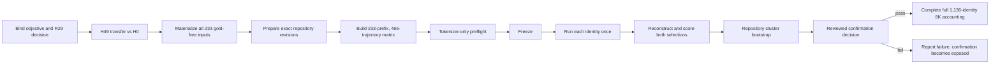

# ContextBench Round 30 — Untouched 8K confirmation

## Objective hierarchy

Enduring objective: Improve reusable ARE reasoning, useful continuity, recovery, correctness and completed outcomes within cumulative model input plus output tokens.

Initial GLM objective: Finish GLM-5.3-flash qualification, beginning with the 8K small-window chapter before larger windows.

Current milestone: Confirm the Round 29 six-read effect closure on every preregistered untouched confirmation identity at 8K without tuning on confirmation outcomes.

## Research method

objective → gap → question → competing hypotheses → selection → experiment/tasks/criteria → results → observations → reviewed decision → successor

Round 29 supported H47 on the complete exposed development denominator. Round 30 changes only exposure: it applies the frozen mechanism to the reserved partition. Confirmation outcomes may decide acceptance or rejection but may not tune another confirmation run.

## DAG

## Fixed decision rule

Account all 233 reserved identities at the 96,000 cumulative model-token tier and 8K context window, with two repetitions. Each model trajectory supplies a baseline from its validated model-selected IDs and a treatment from the deterministic union with at most six receipt-bound pinned-base observations overlapping actual effect hunks. Missing, failed, skipped, and input-unavailable trajectories remain zero in both outcomes.

Pass only if treatment minus baseline scheduled macro Span-F1 is at least 0.05, the repository-cluster paired-bootstrap 95% lower bound is above zero, both repetition-level gains are positive, final span coverage and precision and final file coverage and precision do not degrade, every identity is accounted, independently reconstructed exports and scores agree, unknown model usage is zero, and closure adds exactly zero model calls and model input plus output tokens.

The frozen bootstrap uses 10,000 resamples and seed `contextbench-round30-repository-cluster-v1`. Each resample draws the sorted repository identifiers with replacement, retains every scheduled trajectory belonging to each drawn repository, and computes the macro paired Span-F1 delta. The 2.5th percentile is the fixed lower bound. Execution uses four deterministic task shards by frozen prefix index modulo four; a prefix and its two continuations always remain in the same shard.

## Open questions

- Does the +8.50 percentage-point development gain transfer to all 233 untouched identities?
- Does the gain remain positive in each repetition and under repository-cluster resampling?
- After a pass, which existing exposed trajectories can support full 1,136-identity 8K accounting and which require fresh candidate execution?
