# ContextBench Round 31 — Hybrid terminal evidence closure

## Objective hierarchy

Enduring objective: improve reusable ARE reasoning, useful continuity, recovery,
correctness, and completed outcomes within cumulative model input plus output
tokens.

Initial GLM objective: finish GLM-5.3-flash qualification, beginning with useful
reasoning-state recovery at the 8K small context window.

Current milestone: clear the fixed ContextBench contract through evidence-led,
separately frozen development and confirmation rounds. Round 30 remains a failed
confirmation and is now exposed development evidence.

## Research method

objective → gap → question → competing hypotheses → selection → experiment/tasks/criteria → results → observations → reviewed decision → successor

## Observation and question

Round 30 accounted for all 466 scheduled trajectories. Six-item effect closure
improved Span-F1 by 0.047754 with a positive repository-cluster lower bound, but
missed the fixed 0.05 gate. Closure applied to 194 trajectories and gained
0.114708 within that subset; 187 completed trajectories had no effect hunks and
therefore received no closure.

The exact post-hoc reconstruction in `round30-closure-sensitivity.json` falsified
cap-only tuning, fragment cropping, changed ranking, novel-path admission, and
uncovered-hunk admission. It also recovered the previously proposed H45
no-effect rule after correcting its source-provenance defect: when no effect
exists, union the widest pinned-base observation from each of the four most
frequently observed paths. Combined with unchanged effect closure, this produced
an exposed diagnostic gain of 0.070059 with zero model calls or tokens.

Question: does this hybrid effect-or-attention closure exceed +0.05 Span-F1 on a
fresh, gold-blind, eight-identity GLM-5.3-flash 8K development canary?

## Competing hypotheses

- **H50:** actual effects are the strongest completion anchor; absent effects,
  repeated investigation is the best observable proxy. Union at most six
  effect-overlap reads or, only without effects, one widest pinned-base read from
  each of four most observed paths.
- **H51:** the no-effect fallback is an exposed-data artifact; retain H49 effect
  closure alone.
- **H0:** neither observable closure transfers to fresh identities.

H50 is selected because its no-effect policy was recorded before Round 30 in
`round27b-feature-analysis.json`; Round 31 repairs pinned-base admission and uses
union rather than replacement. The four-path rule is therefore not selected by
searching Round 30 for an arbitrary favorable cutoff. The complete one-to-four
diagnostic grid remains counterevidence against that stronger interpretation.

## Research DAG

```mermaid
flowchart LR
  O[Bind three objective levels] --> A[Verify R30 reconstruction and alternatives]
  A --> H[Select H50 against H51 and H0]
  H --> T[Select eight never-exposed tasks without gold]
  T --> I[Implement versioned hybrid closure]
  I --> U[Unit and provenance tests]
  U --> P[Tokenizer and storage preflight]
  P --> F[Freeze task, source, scorer, runner, policy, and thresholds]
  F --> R[Run eight trajectories once]
  R --> S[Score model-only and same-trajectory hybrid selections]
  S --> V[Review observation and learning decision]
  V -->|pass| X[Freeze a larger fresh development replication]
  V -->|fail| N[Retain result and select a new mechanism]
```

## Fixed decision rule

The canary uses the eight identities in `round31-task-selection.json`, one per
language/repository group plus a second C identity, selected without reading gold
annotations. Each identity runs once at 8K with a 96,000 cumulative model-token
ceiling. Its validated terminal response supplies both outcomes:

- baseline: model-selected receipt-bound context;
- treatment: baseline union hybrid terminal closure.

The canary passes only with a complete eight-trajectory denominator, at least
+0.05 scheduled macro Span-F1 gain, non-degradation of span coverage, span
precision, file coverage, file precision, and valid-selection count, known model
usage, exact independent reconstruction, and zero additional model calls or
model input plus output tokens. The maximum physical model budget is 768,000
tokens. A pass authorizes only a separately frozen larger fresh development
replication; it cannot clear ContextBench.

Execution must use the storage-bounded runners. Linux and WSL host disk guards
run before dispatch; each branch checkout is deleted after scoring and the
prefix checkout after its branch. Experimental receipts, events, state,
snapshots, predictions, scores, and source commit bindings remain.

## Measurement mapping

- Native Span-F1 and File metrics test useful final context selection.
- Same-trajectory comparison isolates deterministic closure from model variance.
- Closure provenance checks establish delivered pinned-base identity and the
  declared effect/attention selector, not semantic reasoning or repair success.
- Total input plus output tokens report physical model cost; local analysis,
  storage, tokenizer probes, and cached-token subsets are not added to it.
- Fresh canary performance is development evidence only. It cannot establish
  transfer to all ContextBench identities, larger windows, other models, or
  non-code domains.

## Open questions

- Does the no-effect fallback retain its direction on all seven language groups?
- Is four-path repeated attention stable in a larger fresh development sample?
- If H50 replicates, what untouched partition remains adequate for confirmation?
- Can the same effect-or-attention abstraction be evaluated outside code without
  treating human preference as deterministic correctness?
