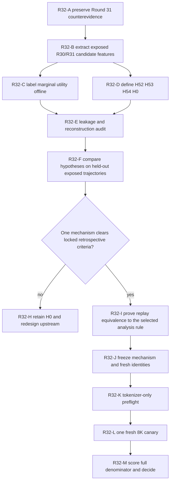

# ContextBench Round 32 — Zero-token relevance discrimination

## Objective continuity

The enduring objective remains to improve reusable ARE reasoning, useful continuity, recovery, correctness, and completed outcomes within cumulative model input plus output tokens. The current milestone remains GLM-5.3-flash at 8K. ContextBench quality, retention integrity, and token cost remain separate measurements; SWE-bench repair is outside this active loop.

Round 31 exposed two failures. The live implementation counted repeated receipt presentations and gained only 1.45 Span-F1 points. The declared H50 rule counted distinct read observations; exact post-response reconstruction on the same sealed trajectories lost 2.26 points and degraded precision. The implementation mismatch prevents treating the run as a clean H50 replication, while both results show that raw attention frequency is insufficient. The next round must identify relevance before adding evidence.

## Research question and competing hypotheses

Which deterministic signal can distinguish helpful from harmful pinned-base observations without adding model calls or tokens?

- **H52 — task-conditioned relevance:** lexical and structural agreement among the task statement, observed path, symbol neighborhood, and model-selected paths ranks useful evidence better than observation frequency alone.
- **H53 — causal tool-chain relevance:** reads connected to later edits, tests, errors, or explicit model-selected evidence are more useful than frequently revisited but causally disconnected reads.
- **H54 — calibrated abstention:** no-effect closure should apply only when an observable confidence rule predicts positive utility; abstention preserves already-good model selections.
- **H0:** no deployable zero-token fallback discriminates useful evidence well enough; retain effect closure only and move improvement upstream.

No hypothesis may use gold, reference patches, or task identity at runtime. Gold is allowed only to label exposed evidence during retrospective discrimination.

## DAG

## Fixed analysis discipline

1. Split exposed trajectories by repository before fitting or choosing thresholds.
2. Measure marginal Span-F1 utility, precision loss, file coverage, validity, and abstention.
3. Reject features that depend on gold, reference patches, hidden reasoning, current-revision bytes, or task identity.
4. Require exact reconstruction from receipts, captures, snapshots, and pinned-base repositories.
5. Count model input plus output tokens. Candidate selectors must add zero calls and zero tokens.
6. Select one mechanism before choosing the next fresh identities; run each fresh identity once.
7. Before freeze, replay the implementation over the analysis cohort and require exact selected-ID equality with the rule that produced the hypothesis.

## Advancement rule

Retrospective analysis may select a candidate but cannot establish support. A selected candidate advances to a separately frozen fresh development canary only if it improves held-out exposed Span-F1, does not degrade span/file precision or validity, and abstains on known harmful cases using runtime-visible evidence alone. A later fresh canary still cannot clear ContextBench; it can only justify a larger replication.

## Open Questions

- Does causal connection to edit and test events outperform lexical task-path similarity?
- Can confidence be calibrated across repositories without encoding repository identity?
- Should effect-overlap closure remain unchanged while only the no-effect branch is revised?
- What minimum number of fresh identities is affordable after the retrospective discriminator is locked?
