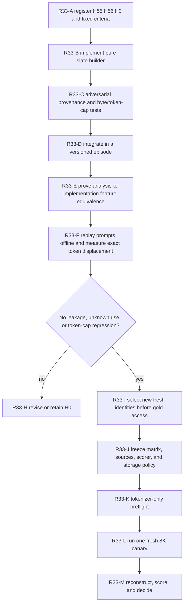

# ContextBench Round 33 — Model-adjudicated evidence slate

## Objective hierarchy

Enduring objective: Improve reusable ARE reasoning, useful continuity, recovery, correctness and completed outcomes within cumulative model input plus output tokens.

Initial GLM objective: Finish GLM-5.3-flash qualification, beginning with small context windows and useful reasoning-state recovery under pressure.

Current milestone: Clear the fixed ContextBench contract through frozen evidence-led rounds while keeping ContextBench diagnostics distinct from semantic retention and repair correctness.

## Objective and gap

The enduring objective remains reusable ARE reasoning and correct completed outcomes within cumulative model input plus output tokens. GLM-5.3-flash at 8K remains the current milestone. The fixed ContextBench criteria remain unchanged.

Rounds 30–32 show that deterministic post-response closure can recover coverage, but runtime-visible frequency and relevance proxies cannot reliably decide which unselected evidence is useful. The selector is acting after the model has finished and therefore cannot use the model's semantic judgment. Round 33 moves the decision before final selection while keeping it inside the existing 96,000-token trajectory cap.

## Competing hypotheses

- **H55 — model-adjudicated evidence slate:** before a finalization request, present a compact deterministic slate of delivered pinned-base candidates with handles, paths, ranges, observation counts, and task-term overlap. The model chooses; ARE never appends an unchosen path.
- **H56 — diagnostic correction:** issue one normal-budget correction only when the terminal selection omits all high-confidence candidates, explaining the complete relevance diagnostic and allowing the model to revise or retain its choice.
- **H0 — upstream guidance does not help:** the slate consumes useful context or distracts the model, so same-cap quality does not improve.

The slate is a reusable evidence-choice abstraction. Code paths and ranges are the ContextBench projection; another domain can supply evidence identities, provenance, observation counts, and objective-alignment features through the same contract.

## Research method

objective → gap → question → competing hypotheses → selection → experiment/tasks/criteria → results → observations → reviewed decision → successor

## DAG

## Fixed candidate contract

- Evidence must be confirmed as delivered and match the pinned base.
- The slate contains metadata and retrieval handles, never gold or reference-patch information.
- It appears only during reserved finalization and fits a measured maximum of 1,024 tokens.
- It consumes part of the existing reserved-finalization budget and displaces other prompt context; it does not enlarge the 96,000-token cap.
- The fixed policy accepts at most eight candidates. Exact token eviction yielded at most four retained candidates in the 192-trajectory offline replay.
- Total model input plus output remains capped at 96,000 tokens per trajectory.
- H55 does not append evidence after the response; the model's submitted IDs are the treatment.
- Effect-overlap closure remains a separately measured diagnostic until H55 establishes independent value.
- Before a live run, the implementation must reproduce every feature used by the offline extractor exactly.

## Fixed decision rule

The fresh canary contains eight paired task outcomes, eight shared-prefix cells, and sixteen control/treatment branch trajectories (24 physical cells). It requires a complete fixed denominator, at least +0.05 macro Span-F1, non-degradation in span/file coverage and precision and validity, known usage, exact reconstruction, and no violation of the 96,000-token cap. Passing advances to a larger fresh development replication; it does not clear ContextBench.

## Open questions

- What metadata order minimizes tokens without implying relevance as fact?
- Can H56 be tested without confounding H55 in the same small canary?
- Do the realized 352–981 public-envelope tokens of slate displacement buy enough quality to justify their cost?
