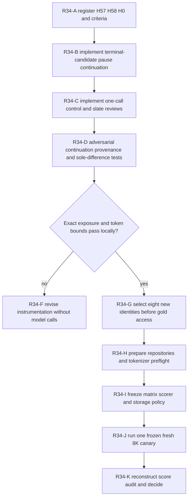

# ContextBench Round 34 — Terminal-candidate review fork

## Objective hierarchy

Enduring objective: Improve reusable ARE reasoning, useful continuity, recovery, correctness and completed outcomes within cumulative model input plus output tokens.

Initial GLM objective: Finish GLM-5.3-flash qualification, beginning with small context windows and useful reasoning-state recovery under pressure.

Current milestone: Clear the fixed ContextBench contract through frozen evidence-led rounds while keeping ContextBench diagnostics distinct from semantic retention and repair correctness.

## Gap and question

Round 33 produced a fresh +13.40 percentage-point macro Span-F1 signal and passed every quality gate, but only five of eight scheduled treatment pairs received a slate. Four of those five selected slate candidates and accounted for all positive Span-F1 gain. The first-recycle fork occurs too early for efficient shared execution and too late to guarantee treatment before a terminal submission. Independent continuations also allowed the slate arm to consume 65,914 more logical tokens, dominated by one long trajectory.

Can a shared trajectory pause at its first terminal candidate and then use exactly one bounded review call per arm, making the evidence slate the sole prompt difference and preserving the quality gain at sharply bounded token cost?

## Competing hypotheses

- **H57 — terminal-candidate review fork:** hold the first terminal candidate without accepting it. Fork identical state into a control review and a slate review. Both branches receive the same terminal-only instruction and exactly one model call; treatment additionally receives one receipt-bound slate.
- **H58 — first-evidence guidance:** if terminal review is too late, fork after the first confirmed pinned-base evidence and present the slate during continued reasoning.
- **H0 — Round 33 was branch variance:** the apparent gain came from stochastic independent continuations or extra reasoning length rather than the slate.

## Research method

objective → gap → question → competing hypotheses → selection → experiment/tasks/criteria → results → observations → reviewed decision → successor

## DAG

## Fixed mechanism

- The prefix owns every exploratory model and tool call through the first terminal candidate.
- The candidate is held before semantic acceptance. A terminal tool call receives a common non-executing “held for review” tool result so both branch histories are protocol-valid.
- Each branch makes exactly one further model call with terminal submission as its only tool.
- Both branches receive the same neutral review instruction and the same original history.
- Treatment receives one additional evidence slate; control receives none.
- No branch may call repository or recovery tools, retry a truncated response, or receive a schema correction.
- The per-path cumulative input-plus-output cap remains 96,000 tokens.

## Fixed decision rule

The eight-pair fresh canary passes only if all 8 prefixes reach the review fork, all 16 branches are accounted, every treatment receives exactly one slate, every control receives none, each branch makes exactly one model call, treatment gains at least +0.05 macro Span-F1, no span/file coverage or precision or validity metric degrades, all reconstructions agree, usage is known, each logical path stays within 96,000 tokens, and each treatment-minus-control token difference is at most 3,072 tokens. Passing advances to a larger fresh development replication; it does not clear ContextBench.

## Open questions

- Does holding a valid first terminal candidate itself alter calibration when both arms must review?
- Can one terminal-only review preserve the Round 33 quality signal without the long Rust continuation?
- If some prefix never emits a terminal candidate, should H58 become the next test rather than weakening the denominator?
