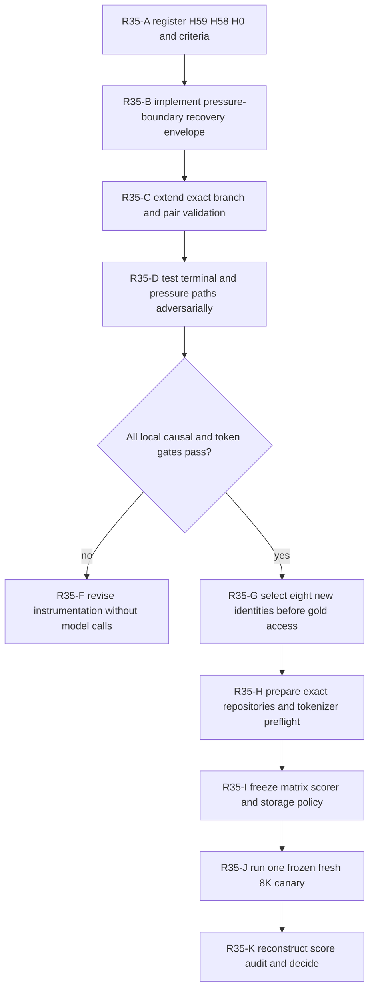

# ContextBench Round 35 — Outcome-or-pressure review boundary

## Objective hierarchy

Enduring objective: Improve reusable ARE reasoning, useful continuity, recovery, correctness and completed outcomes within cumulative model input plus output tokens.

Initial GLM objective: Finish GLM-5.3-flash qualification, beginning with small context windows and useful reasoning-state recovery under pressure.

Current milestone: Clear the fixed ContextBench contract through frozen evidence-led rounds while keeping ContextBench diagnostics distinct from semantic retention and repair correctness.

## Gap and question

Round 34 isolated the slate to one terminal-only call and gained 5.53 percentage points macro Span-F1 on the full denominator. All seven executed pairs passed exact ancestry and prompt-difference validation with 355–1,162 extra treatment tokens. The eighth prefix stopped at `recycling.fresh-context-too-large` before it emitted a terminal candidate, despite having a receipt-bound candidate available.

Can ARE make the review boundary inevitable by using the first terminal candidate when available and converting fresh-context pressure into the same bounded terminal review when it arrives first?

## Competing hypotheses

- **H59 — outcome-or-pressure review:** use the H57 terminal boundary normally. If fresh-context rendering would stop first, discard the oversized pending exchange, create a bounded common recovery envelope from already confirmed pinned-base observations, and fork the same one-call control/slate review.
- **H58 — first-evidence guidance:** fork after the first confirmed pinned-base observation and allow the slate to guide continued reasoning.
- **H0 — nonreplicating slate signal:** Round 33 and Round 34 gains will not persist on another fresh fixed cohort.

## Research method

objective → gap → question → competing hypotheses → selection → experiment/tasks/criteria → results → observations → reviewed decision → successor

## DAG

## Fixed mechanism

- The prefix owns exploratory model and tool calls until the first terminal candidate or a fresh-context-too-large boundary.
- At context pressure, the oversized pending exchange is removed from the next prompt only after its confirmed observations are represented by a bounded, deterministic common recovery envelope.
- The envelope contains only receipt-bound identifiers and source locations already delivered. It is identical across arms and asserts no relevance.
- Each branch receives a fresh context and makes exactly one terminal-only model call.
- Treatment receives one additional evidence slate; control receives none.
- No branch uses repository or recovery tools, schema corrections, truncation retries, or additional model calls.

## Fixed decision rule

The fresh canary passes only if all eight prefixes reach either an outcome or pressure review boundary, all 16 branches are accounted, every treatment receives exactly one slate, every control receives none, each branch makes exactly one model call, treatment gains at least +0.05 macro Span-F1, no registered quality or validity metric degrades, all reconstructions agree, usage is known, every logical path remains within 96,000 tokens, and every treatment-minus-control difference is at most 3,072 tokens. Passing advances to a larger fresh development replication; it does not clear ContextBench by itself.

## Open questions

- Does a metadata-only common recovery envelope retain enough evidence for a useful control decision?
- Will pressure boundaries occur only for rare oversized exchanges, or reveal a broader failure mode?
- Does the Round 34 slate gain replicate on a wholly fresh cohort?
