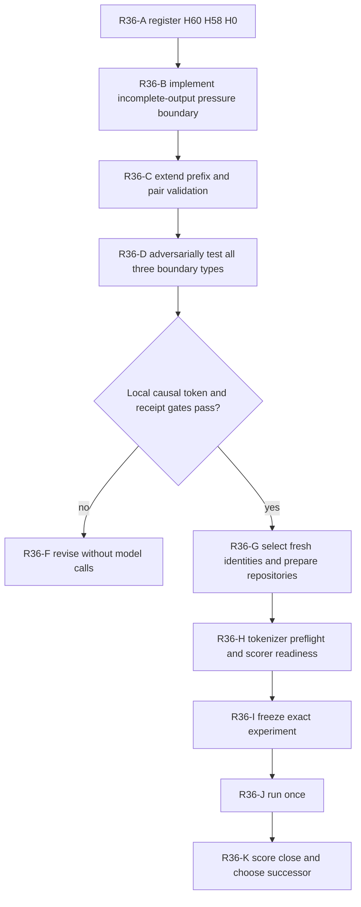

# ContextBench Round 36 — Completion-or-capacity decision boundary

## Objective hierarchy

Enduring objective: Improve reusable ARE reasoning, useful continuity, recovery, correctness and completed outcomes within cumulative model input plus output tokens.

Initial GLM objective: Finish GLM-5.3-flash qualification, beginning with small context windows and useful reasoning-state recovery under pressure.

Current milestone: Clear the fixed ContextBench contract through frozen evidence-led rounds while keeping ContextBench diagnostics distinct from semantic retention and repair correctness.

## Gap and question

Round 34 showed a +5.53 percentage-point full-denominator macro Span-F1 signal from one bounded slate review but missed a fresh-context-pressure boundary. Round 35 added that boundary, then stopped when a prefix produced a length-limited response under a frozen zero-correction policy. The failed response was safely counted and never retried, but ARE did not convert its recoverable checkpoint into a final decision opportunity.

Can a single completion-or-capacity policy convert terminal output, fresh-context overflow, and incomplete-output pressure into the same exact one-call review without hiding failed tokens or permitting retries?

## Competing hypotheses

- **H60 — completion-or-capacity boundary:** use a terminal-candidate boundary normally; use a bounded common recovery envelope at fresh-context pressure; on incomplete output, retain the failed receipt, acknowledge it without retry, create a fresh shared boundary, and use the same one-call review.
- **H58 — first-evidence guidance:** terminal/capacity review is too late, so slate guidance must happen after the first confirmed source observation.
- **H0 — nonreplicating signal:** the positive bounded-review evidence will not survive another complete fresh cohort.

## Research method

objective → gap → question → competing hypotheses → selection → experiment/tasks/criteria → results → observations → reviewed decision → successor

## DAG

## Fixed decision rule

The canary retains Round 35’s full-denominator, +0.05 macro Span-F1, nondegradation, exact reconstruction, known usage, 96,000-token logical-path, one-call branch, 1,024-token slate, and 3,072-token paired-difference gates. All eight prefixes must reach exactly one of the three registered boundary kinds. A failed length-limited response remains in token accounting and may trigger no replacement generation before the review fork.

## Open questions

- Does acknowledging a length-limited response leave an exact idle checkpoint suitable for causal branching?
- Do confirmed observations from the failed request safely enter the common recovery envelope?
- After all boundary failures are covered, will the positive quality signal replicate on a complete fresh cohort?
