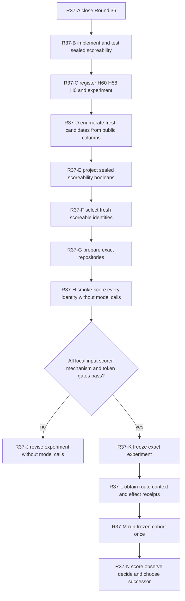

# ContextBench Round 37 — Scoreability-gated completion-or-capacity replication

## Objective hierarchy

Enduring objective: Improve reusable ARE reasoning, useful continuity, recovery, correctness, and completed outcomes within cumulative model input plus output tokens.

Initial GLM objective: Finish GLM-5.3-flash qualification, beginning with small context windows and useful reasoning-state recovery under pressure.

Current milestone: Clear the fixed ContextBench contract through frozen evidence-led rounds while keeping ContextBench diagnostics distinct from semantic retention and repair correctness.

## Gap and question

Round 36 stopped because public-only selection admitted a task with empty sealed gold context. Two earlier pairs were structurally valid, but the run could not test the completion-or-capacity mechanism on its full fixed denominator.

After filtering only on sealed scoreability and proving each selected identity can traverse the native scorer before freeze, does H60 complete a fresh eight-task GLM 8K cohort and clear the unchanged quality, integrity, and token gates?

## Competing hypotheses

- **H60 — completion-or-capacity boundary:** a receipt-bound slate at terminal, context-pressure, or output-pressure review improves final context selection within the fixed token limits.
- **H58 — first-evidence guidance:** a final review happens too late; evidence guidance must occur after the first confirmed source observation.
- **H0 — nonreplicating signal:** the positive bounded-review results will not clear a complete fresh cohort.

Sealed scoreability is an experiment-admission prerequisite. It is not a model-quality feature and cannot use gold paths, spans, patches, or content in prompts or public selection order.

## Research method

objective → gap → question → competing hypotheses → selection → experiment/tasks/criteria → results → observations → reviewed decision → successor

## DAG

## Fixed decision rule

The canary retains Round 36's eight-pair full denominator, +0.05 macro Span-F1, nondegradation, exact reconstruction, known usage, 96,000-token logical-path, one-call branch, 1,024-token slate, and 3,072-token paired-difference gates. All prefixes must reach one registered boundary. No identity may be rerun or replaced after freeze.

Admission passes only when all eight identities have a nonempty valid sealed context and a gold-blind prediction traverses the pinned native scorer successfully. The public selection process may observe only identity, boolean eligibility, and stable reason codes.

## Open questions

- How many otherwise public-eligible ContextBench identities are unscoreable under the pinned native contract?
- Will any prefix exercise context-pressure or output-pressure recovery in the completed cohort?
- If H60 misses quality gates on a complete run, do pair-level observations support H58 or H0?
