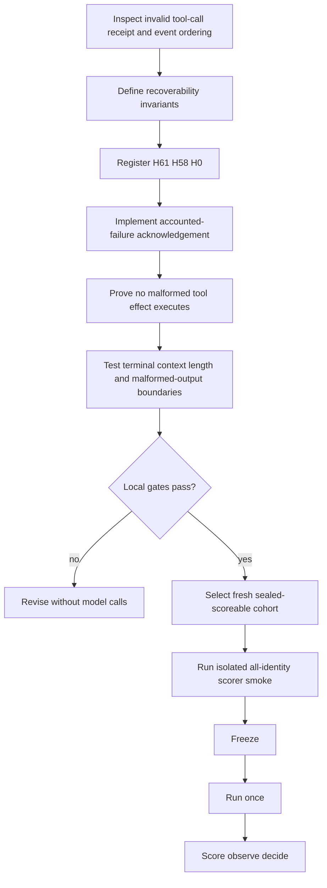

# ContextBench Round 38 — Accounted response-failure boundary

## Objective hierarchy

Enduring objective: improve reusable ARE reasoning, continuity, recovery, correctness, and completed outcomes within cumulative input plus output tokens.

Initial GLM objective: finish GLM-5.3-flash qualification, beginning with small context windows.

Current milestone: clear the fixed ContextBench contract before larger-window work.

## Gap and research question

Round 37 completed five valid pairs, then an HTTP-success response with known usage contained invalid tool-call structure. ARE retained its receipt but left the recycler model-pending and stopped instead of reaching the bounded review.

Can ARE safely convert an accounted response-format failure into the same shared review boundary when the receipt is bound, usage is known, and no tool effect executed?

## Competing hypotheses

- **H61:** terminal completion, context pressure, length pressure, and accounted response-format failure are one decision-boundary class when recovery invariants hold.
- **H58:** useful guidance must occur after first evidence because final recovery remains too fragile.
- **H0:** the positive slate signal will not clear a complete fresh cohort.

## Research method

objective → gap → question → competing hypotheses → selection → experiment/tasks/criteria → results → observations → reviewed decision → successor

## DAG

## Fixed decision rule

Keep the Round 37 quality, nondegradation, reconstruction, exposure, 96K logical-token, 3,072-token paired-overhead, and zero-retry gates. Recovery is allowed only for an HTTP-success response with known usage, an exact bound receipt, no accepted or executed tool call, and a deterministic checkpoint transition. All failed input and output tokens remain counted.

## Open questions

- Where does tool-call validation fail relative to receipt persistence and recycler acknowledgement?
- Can malformed tool arguments and malformed tool-call envelopes share one safe transition?
- Will H61 finally expose a live capacity boundary across a complete eight-task cohort?
