# ContextBench Round 39 — Compact evidence representation

## Objective hierarchy

Enduring objective: Improve reusable ARE reasoning, useful continuity, recovery, correctness, and completed outcomes within cumulative model input plus output tokens.

Initial GLM objective: Finish GLM-5.3-flash qualification, beginning with the 8K small-window chapter and useful reasoning-state recovery under pressure.

Current milestone: Clear the fixed ContextBench contract through frozen evidence-led rounds. SWE-bench repair scoring is outside this stage.

## Research method and hypotheses

objective → gap → question → competing hypotheses → selection → experiment/tasks/criteria → results → observations → reviewed decision → successor

Round 38 showed that a terminal slate can recover relevant files and valid selections while losing Span-F1 because its representative rule always selects the widest delivered observation on each path. The next question is whether compact, task-agreeing representatives preserve discovery while improving exact evidence selection.

- **H62 — compact representation:** rank paths using observable task agreement and attention, then represent each path by maximum task-body overlap followed by minimum width.
- **H58 — first-evidence guidance:** final review remains too late; inject guidance after the first confirmed source observation.
- **H0:** observable trajectory state does not yield a transferable improvement.

H62 is selected because it changes the failure mechanism directly, adds no construction model calls, and improved exposed diagnostic Span-F1 by 3.57 points over the widest-representative projection. That diagnostic selects a hypothesis only; it is not supporting evidence.

## Work DAG

```mermaid
flowchart LR
  A[Bind R38 closeout] --> B[Register H62 H58 H0]
  B --> C[Implement compact slate v2]
  C --> D[Unit and integration tests]
  D --> E[Select eight fresh scoreable tasks]
  E --> F[Prepare exact repositories]
  F --> G[Native scorer smoke]
  G --> H[Tokenizer-only preflight]
  H --> I[Freeze sources matrix and gates]
  I --> J[Run one shared prefix and two review arms per task]
  J --> K[Independent native scoring]
  K --> L[Observations and reviewed decision]
  L -->|pass| M[Larger fresh replication]
  L -->|fail| N[Select H58 or evidence-led successor]
```

## Fixed decision rule

Use eight new scoreability-gated public development identities at 8K and a 96,000 cumulative input-plus-output token cap. Each task has one shared completion-or-pressure prefix and one model call per control/treatment review. Control receives no slate; treatment receives one v2 compact slate. No retries, replacements, or post-freeze changes.

Pass only if all eight pairs are accounted and valid, treatment gains at least +0.05 macro final Span-F1, span/file coverage and precision and valid-selection rate do not degrade, usage is known, reconstruction agrees, each logical path stays within 96,000 tokens, and treatment-minus-control tokens remain at most 3,072 per pair. Terminal, context-pressure, output-pressure, and response-pressure boundaries are accepted explicitly.

A development pass advances to fresh replication. It cannot clear the 1,136-identity ContextBench acceptance contract by itself.

## Open questions

- Does compact representation preserve the large Round 38 file coverage and validity gains on fresh identities?
- If H62 misses, do live pair traces support H58 early guidance or a selector that abstains when compact and wide evidence disagree?
- Can the eventual accepted mechanism remove its review-call token overhead through deterministic projection?
