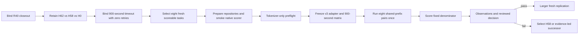

# ContextBench Round 41 — Complete compact-representation canary

## Objective hierarchy

Enduring objective: Improve reusable ARE reasoning, useful continuity, recovery, correctness, and completed outcomes within cumulative model input plus output tokens.

Initial GLM objective: Finish GLM-5.3-flash qualification, beginning with the 8K small-window chapter and useful reasoning-state recovery under pressure.

Current milestone: Clear the fixed ContextBench contract through frozen evidence-led rounds. SWE-bench repair scoring is outside this stage.

## Research method and hypotheses

objective → gap → question → competing hypotheses → selection → experiment/tasks/criteria → results → observations → reviewed decision → successor

Round 40 did not resolve H62. Four valid pairs were effectively neutral on the fixed eight-task denominator, then task five reached the 300-second model deadline with no response bytes or usage. Round 41 raises the request timeout to 900 seconds because latency is outside the token objective, retains zero retries, and still stops on unknown usage.

- **H62 — compact representation:** rank paths using observable task agreement and attention, then represent each path by maximum task-body overlap followed by minimum width.
- **H58 — first-evidence guidance:** final review remains too late; inject guidance after the first confirmed source observation.
- **H0:** observable trajectory state does not yield a transferable improvement.

H62 remains selected because Round 40 stopped on provider-latency counterevidence before a complete quality estimate. Its semantic mechanism and thresholds remain unchanged.

## Work DAG

## Fixed decision rule

Use eight new scoreability-gated public development identities at 8K and a 96,000 cumulative input-plus-output token cap. Each task has one shared completion-or-pressure prefix and one model call per control/treatment review. Control receives no slate; treatment receives one unchanged compact slate v2. No retries, replacements, or post-freeze changes.

Pass only if all eight pairs are accounted and valid, treatment gains at least +0.05 macro final Span-F1, span/file coverage and precision and valid-selection rate do not degrade, usage is known, reconstruction agrees, each logical path stays within 96,000 tokens, and treatment-minus-control tokens remain at most 3,072 per pair. Terminal, context-pressure, output-pressure, and response-pressure boundaries are accepted explicitly.

A development pass advances to fresh replication. It cannot clear the 1,136-identity ContextBench acceptance contract by itself.

## Open questions

- Will H62 clear every quality gate on a complete fresh denominator?
- Will the 900-second timeout eliminate unaccounted provider deadline failures?
- If H62 misses, do pair traces justify H58 or selective abstention when coarse and compact evidence disagree?
