# ContextBench Round 42 — Cost-bounded independent continuation

## Objective hierarchy

Enduring objective: Improve reusable ARE reasoning, useful continuity, recovery, correctness, and completed outcomes within cumulative model input plus output tokens.

Initial GLM objective: Finish GLM-5.3-flash qualification, beginning with the 8K small-window chapter and useful reasoning-state recovery under pressure.

Current milestone: Obtain an interpretable compact-slate canary despite independently occurring provider transport failures, without understating possible token use. SWE-bench repair scoring remains outside this stage.

## Research method

objective → gap → question → competing hypotheses → selection → experiment/tasks/criteria → results → observations → reviewed decision → successor

Round 42 applies this chain first to the measurement instrument and then, only if the instrument gate passes, to H62's semantic result.

### Gap and competing hypotheses

Round 41 showed 29 successful responses and seven context recycling transitions, followed by one zero-byte response that exceeded 900 seconds. Exact provider usage was absent, but the frozen admission record bounded that request by 3,736 tokens and the whole prefix by 81,440 tokens. A global stop therefore protected exact telemetry while discarding the remaining independent observations.

- **H63 — conservative debit and independent continuation:** when a model transport failure has zero response bytes, zero retries, one terminal unknown-usage receipt, and an exact admitted input-plus-output bound, debit that full bound, retain the affected pair as symmetric fixed zeros, and continue later independent tasks.
- **H64 — exact-only global stop:** any missing provider usage must end the cohort even when pre-dispatch bounds prove the maximum possible cost.
- **H58 — earlier semantic guidance:** compact evidence at final review is too late; inject guidance after the first confirmed source observation. This remains the next semantic alternative if H62 receives an interpretable negative result.

H63 is selected as an instrument hypothesis. H62 remains the semantic treatment under measurement; its slate, prompt, ranking, token cap, and one-call review remain unchanged.

## Work DAG

```mermaid
flowchart LR
  A[Bind R41 closeout] --> B[Register H63 vs H64 and H58]
  B --> C[Validate every bounded-failure field]
  C --> D[Continue independent tasks and censor failed pairs symmetrically]
  D --> E[Add conservative-debit scoring]
  E --> F[Run local failure-path and full-suite tests]
  F --> G[Select fresh scoreable tasks]
  G --> H[Prepare repos, scorer smoke, and zero-model preflight]
  H --> I[Freeze task, cost, and quality rules]
  I --> J[Run one fresh 8K cohort]
  J --> K[Score all identities once]
  K --> L[Observations and reviewed decision]
  L -->|H63 passes and at least six pairs complete| M[Interpret H62 quality]
  L -->|H63 fails| N[Repair the instrument before another semantic round]
  M -->|H62 passes| O[Larger fresh replication]
  M -->|H62 fails| P[Select H58 or evidence-led successor]
```

## Fixed decision rule

All eight identities remain in the fixed denominator. A task with a bounded prefix failure contributes zero to both arms. If either review branch has a bounded failure, both arms for that task contribute zero. This symmetric rule prevents provider failure from favoring either arm.

An indeterminate call is cost-bounded only when the validator proves all of these fields: supported transport failure code, zero response bytes, zero automatic retries, absent provider input/output usage only on the terminal model receipt, known usage on every earlier model receipt, a matching final recycling dispatch, `projected_upper_bound = input_upper_bound + output_reservation`, a matching admitted request reservation, and total admitted cost within the 96,000-token logical ceiling. The full projected bound is debited. Any missing or inconsistent field stops the cohort.

The instrument succeeds only if all eight task outcomes are accounted, every indeterminate call is conservatively debited, no call is retried, no pair is asymmetrically scored, and at least six structurally valid pairs complete. Quality is interpreted only after that instrument gate. H62 then keeps the fixed eight-identity denominator and its existing +0.05 macro Span-F1, nondegradation, reconstruction, exposure, one-review-call, and 3,072 paired-token-difference gates.

Use a 120-second request deadline. Round 41's 29 valid responses completed within 20.32 seconds, while the failing request returned no bytes after 900.526 seconds. The shorter deadline limits wall time; it does not reduce the pre-dispatch token debit or permit a retry.

A development pass advances to a larger fresh replication. It cannot clear the 1,136-identity ContextBench acceptance contract by itself.

## Open questions

- Does the provider return any slow but valid responses between 120 and 900 seconds, or are observed long requests zero-byte stalls?
- Will at least six of eight fresh pairs complete under independent continuation?
- Once the instrument produces an interpretable cohort, does H62 clear the unchanged semantic quality gates?
