# ContextBench Round 43 — First-evidence guidance

## Objective hierarchy

Enduring objective: Improve reusable ARE reasoning, useful continuity, recovery, correctness, and completed outcomes within cumulative model input plus output tokens.

Initial GLM objective: Finish GLM-5.3-flash qualification, beginning with the 8K small-window chapter and useful reasoning-state recovery under pressure.

Current milestone: Clear the fixed ContextBench contract through frozen evidence-led rounds while keeping ContextBench diagnostics distinct from semantic retention and repair correctness.

## Research method

objective → gap → question → competing hypotheses → selection → experiment/tasks/criteria → results → observations → reviewed decision → successor

Round 42 produced a complete, interpretable result: H62 improved every aggregate quality measure and never lost pair-level Span-F1, but missed the primary threshold by 0.497 percentage points because two tasks remained zero in both arms. The next question is whether guidance must change exploration before the final review.

- **H58 — first-evidence guidance:** after the first receipt-confirmed pinned-base source observation, one compact slate review redirects subsequent exploration and improves final useful-context selection.
- **H62 — final compact review:** the same compact slate is sufficient only at the terminal-or-pressure boundary; Round 42 is its retained completed estimate.
- **H0 — no transferable observable-state gain:** earlier slate guidance does not clear the fixed quality and token gates.

H58 is selected. The H63 conservative-debit validator, symmetric pair censoring, independent-task continuation, exact-versus-conservative accounting, zero retries, and global stop for every unbounded unknown state remain instrument policy.

## Exact first-evidence boundary

1. Run one shared trajectory until a pinned-base source read has been returned by the tool.
2. Require a later successful model receipt whose exact prompt contains that read result. This receipt confirms delivery; tool execution alone is insufficient.
3. Hold and discard the confirming response's proposed next actions identically in both arms, with zero tool effects after the fork point.
4. Persist one exact shared continuation checkpoint, including receipts, history, recycling generation, delivery ledger, source snapshots, token accounting, and the held-response digest.
5. Fork control and treatment from that checkpoint. Both receive the same one-call mid-trajectory review instruction. Treatment alone receives one evidence slate v2, capped at eight candidates, 4,096 bytes, and 1,024 provider-measured input tokens.
6. Resume normal tools and reasoning from each review response until the existing terminal, context-pressure, output-pressure, response-pressure, or token boundary. No final compact-slate review is added.

The first-evidence slate may contain only one confirmed path. That is intentional: H58 tests whether even the earliest truthful task-agreement signal changes what the model investigates next. No repository map, gold data, inferred relevance, or unobserved source is added.

## Work DAG

```mermaid
flowchart LR
  A[Bind R42 closeout] --> B[Register H58 vs H62 and H0]
  B --> C[Define receipt-confirmed first-evidence boundary]
  C --> D[Implement held-action zero-effect shared checkpoint]
  D --> E[Implement neutral/slate mid-trajectory fork]
  E --> F[Resume divergent branches under original caps]
  F --> G[Apply retained H63 failure accounting]
  G --> H[Adversarial boundary, ancestry, effect, and token tests]
  H --> I[Select eight fresh scoreable identities]
  I --> J[Prepare repos, scorer smoke, and zero-model preflight]
  J --> K[Freeze mechanism, tasks, scorer, order, and gates]
  K --> L[Run one fresh 8K cohort]
  L --> M[Score the fixed denominator once]
  M --> N[Observations and reviewed decision]
  N -->|pass| O[Larger fresh replication]
  N -->|fail| P[Select H0 or evidence-led successor]
```

## Fixed decision rule

Use eight new, never-matrix-exposed, scoreability-gated public tasks at 8K and a 96,000 cumulative model input-plus-output token cap per logical path. Each identity has one shared prefix and one control/treatment continuation. Branch order alternates. No reruns, replacements, post-freeze changes, automatic retries, hidden tool effects, or gold-informed state are allowed.

Pass the instrument only if all identities are accounted; at least six pairs complete; every branch has exact shared ancestry; the held confirming response causes zero tool effects; each eligible treatment sees exactly one slate and each control sees none; every indeterminate call is either exactly reported or fully debited by H63; affected pairs are symmetric fixed zeros; reconstruction agrees; and every logical path stays within 96,000 tokens.

Interpret quality only after the instrument passes. On the fixed eight-identity denominator, require treatment-minus-control macro Span-F1 of at least +0.05, no degradation in span coverage, span precision, file coverage, file precision, or valid-selection rate, and no pair with treatment cumulative tokens more than 3,072 above control. Report exact known tokens and conservative upper-bound tokens separately.

A development pass advances to a larger fresh replication. It does not clear the 1,136-identity ContextBench acceptance contract by itself.

## Open questions

- Can the runtime checkpoint after confirmed delivery while discarding the confirming response's proposed effects identically in both arms?
- Is one early confirmed observation enough to form useful guidance, or will a later evidence-count boundary be needed?
- Does earlier guidance improve the two failure modes seen in Round 42: wrong evidence selected and no context selected?
- Can divergent continuation remain within the +3,072 treatment token ceiling?
