# ContextBench Round 44 — Effect-confirmed completion state

## Objective hierarchy

Enduring objective: Improve reusable ARE reasoning, useful continuity, recovery, correctness, and completed outcomes within cumulative model input plus output tokens.

Initial GLM objective: Finish GLM-5.3-flash qualification, beginning with the 8K small-window chapter and useful reasoning-state recovery under pressure.

Current milestone: Clear the fixed ContextBench contract through frozen evidence-led rounds while keeping ContextBench diagnostics distinct from semantic retention and repair correctness.

## Research method

objective → gap → question → competing hypotheses → selection → experiment/tasks/criteria → results → observations → reviewed decision → successor

Round 43 proved that an exact first-evidence fork is feasible, but H58 failed its first paired token gate: treatment used 12,527 more tokens and both arms ended with invalid current-revision evidence after producing candidate patches. The next question is whether ARE should intervene at the transition from exploration to completion rather than at first evidence or final response.

- **H65 — effect-confirmed completion state:** after a candidate effect and a later verification observation are both receipt-confirmed, one compact state projection reduces redundant exploration and improves valid useful-context completion.
- **H62 — final compact evidence review:** completion-time evidence ranking remains sufficient; Round 42 is its retained near-threshold estimate.
- **H0 — no transferable observable-state gain:** deterministic completion state does not improve quality per cumulative token.

H65 is selected. H63 conservative failure accounting remains instrument policy.

## Exact readiness boundary

1. Run one shared trajectory until `apply_edits` succeeds and its tool result is included in a later successful exact-request receipt.
2. Continue until a later successful receipt confirms either `get_patch` or a current-revision read of an affected path. This is observable verification activity, not proof that the patch is correct.
3. Hold the confirming response and return deterministic zero-effect results for every proposed tool call.
4. Persist and clone one exact shared checkpoint with receipts, history, recycling state, snapshots, effect paths, patch digest, verification observation, held-response digest, and token accounting.
5. Both arms receive the same completion-review instruction. Treatment alone receives one compact readiness projection containing the objective digest, affected paths, patch digest and size, confirmed verification kind, admissible pinned-base evidence handles for affected paths, and explicit unresolved semantic/test status.
6. Resume normal tools and reasoning. The projection advises the minimum remaining verification followed by completion; it does not force a final answer, claim correctness, select evidence, or execute effects.

The projection is capped at eight evidence items, 4,096 bytes, and 1,024 provider-measured input tokens. It uses only tool results and source evidence already proven delivered.

## Work DAG

```mermaid
flowchart LR
  A[Bind R43 closeout] --> B[Register H65 vs H62 and H0]
  B --> C[Define effect and verification receipt predicates]
  C --> D[Build compact completion-readiness projection]
  D --> E[Implement held-action exact shared checkpoint]
  E --> F[Implement neutral/state continuation fork]
  F --> G[Apply retained H63 accounting]
  G --> H[Adversarial receipt, effect, ancestry, and token tests]
  H --> I[Select eight fresh scoreable identities]
  I --> J[Repositories, scorer smoke, zero-model preflight]
  J --> K[Freeze]
  K --> L[Run one fresh 8K cohort]
  L --> M[Score fixed denominator]
  M --> N[Observations and reviewed decision]
  N -->|pass| O[Larger fresh replication]
  N -->|fail| P[Select observation-led successor]
```

## Fixed decision rule

Use eight fresh, never-matrix-exposed, scoreability-gated public tasks at 8K and a 96,000 cumulative model input-plus-output cap per logical path. Require at least six exact effect-readiness pairs. No reruns, replacements, post-freeze changes, automatic retries, hidden effects, or gold-informed state.

Pass the instrument only if every identity is accounted; each eligible prefix has a receipt-confirmed effect followed by a receipt-confirmed verification observation; held actions have zero effects; ancestry is exact; treatment receives exactly one bounded readiness projection and control receives none; H63 bounds every indeterminate call; reconstruction agrees; and all paths remain within 96,000 tokens.

Interpret quality only after the instrument passes. Require treatment-minus-control macro Span-F1 of at least +0.05; no degradation in span coverage, span precision, file coverage, file precision, or valid-selection rate; and aggregate treatment model tokens no greater than aggregate control model tokens. No individual treatment path may exceed control by more than 3,072 tokens.

A development pass advances to a larger fresh replication. It does not clear the 1,136-identity ContextBench acceptance contract.

## Open questions

- Will at least six fresh tasks produce an effect plus a verification observation before another terminal boundary?
- Is `get_patch` or a current affected-path read a sufficiently general observable verification predicate?
- Does the readiness projection shorten exploration without prematurely ending incorrect repairs?
- Should a later round include one bounded validator correction for otherwise valid terminal schemas with inadmissible source provenance?
