# ContextBench Round 45 — Receipt-complete completion readiness

## Objective hierarchy

Enduring objective: Improve reusable ARE reasoning, useful continuity, recovery, correctness, and completed outcomes within cumulative model input plus output tokens.

Initial GLM objective: Finish GLM-5.3-flash qualification, beginning with the 8K small-window chapter and useful reasoning-state recovery under pressure.

Current milestone: Clear the fixed ContextBench contract through frozen evidence-led rounds while keeping ContextBench diagnostics distinct from semantic retention and repair correctness.

## Research method

objective → gap → question → competing hypotheses → selection → experiment/tasks/criteria → results → observations → reviewed decision → successor

Round 44 did not measure H65. Its first task produced a receipt-confirmed successful edit and later delivered a receipt-confirmed current read of the affected path, but the verification-bearing response ended at the fixed output cap. The detector evaluated the readiness predicate only after parsing a complete response, so it missed an already proven input-delivery boundary and stopped with no pair.

- **H65 — receipt-complete completion readiness:** the unchanged completion-readiness treatment reduces redundant exploration and improves valid completion when its detector accepts exact successful delivery receipts even if the confirming output is discarded as incomplete.
- **H66 — effect-only readiness:** waiting for later verification is too late; state should appear immediately after the first confirmed effect.
- **H0 — no transferable observable-state gain:** deterministic completion state does not improve quality per cumulative token.

H65 remains selected because Round 44 failed its instrument before exposing either arm. H63 conservative failure accounting remains instrument policy.

## Instrument repair

1. Require a successful `apply_edits` tool result to appear in an exact later model request receipt.
2. Require a still later exact receipt whose request contains either `get_patch` output or a current-revision read of an affected path.
3. Treat HTTP 200 with known input/output usage as proof that this request was delivered even when `finish_reason` is `length`.
4. Discard the incomplete assistant output, acknowledge the typed recoverable response, execute none of its proposed effects, and persist the common concise retry notice.
5. Fork one exact idle checkpoint. Both arms inherit the failed receipt and common retry notice. Treatment alone receives the bounded completion-readiness projection on its next measured request.
6. Preserve the original call and cumulative input-plus-output token budgets. The discarded output is fully charged and is never replayed.

The projection remains capped at eight evidence items, 4,096 bytes, and 1,024 provider-measured input tokens. It uses only receipt-confirmed tool results and source evidence already delivered.

## Work DAG

```mermaid
flowchart LR
  A[Close R44 as instrument-inconclusive] --> B[Retain H65 vs H66 and H0]
  B --> C[Repair receipt-first boundary]
  C --> D[Replay incomplete-response fixture]
  D --> E[Run full local suite]
  E --> F[Select eight fresh scoreable identities]
  F --> G[Repositories and native scorer smoke]
  G --> H[Zero-model preflight]
  H --> I[Freeze]
  I --> J[Run one fresh 8K cohort]
  J --> K[Score fixed denominator]
  K --> L[Observations and reviewed decision]
  L -->|pass| M[Larger fresh replication]
  L -->|fail| N[Select observation-led successor]
```

## Fixed decision rule

Use eight fresh, never-matrix-exposed, scoreability-gated public tasks at 8K and a 96,000 cumulative model input-plus-output cap per logical path. Require at least six exact effect-readiness pairs. No reruns, replacements, post-freeze changes, automatic retries, hidden effects, or gold-informed state.

Pass the instrument only if every identity is accounted; each eligible prefix has a receipt-confirmed effect followed by a later receipt-confirmed verification observation; any incomplete confirming response is discarded with zero effects and fully charged; ancestry is exact; treatment receives exactly one bounded readiness projection and control receives none; H63 bounds every indeterminate call; reconstruction agrees; and all paths remain within 96,000 tokens.

Interpret quality only after the instrument passes. Require treatment-minus-control macro Span-F1 of at least +0.05; no degradation in span coverage, span precision, file coverage, file precision, or valid-selection rate; aggregate treatment model tokens no greater than aggregate control model tokens; and no individual treatment path more than 3,072 tokens above control.

A development pass advances to a larger fresh replication. It does not clear the 1,136-identity ContextBench acceptance contract.

## Open questions

- Will at least six fresh tasks reach the repaired effect-plus-verification boundary?
- Does retaining the discarded-response receipt and common retry notice preserve causal equivalence?
- Does completion readiness shorten exploration without prematurely ending incorrect repairs?
- If H65 fails with a valid instrument, does the trace support H66 timing or H0?
