# ContextBench Round 46 — Validator-complete H65

## Objective hierarchy

Enduring objective: Improve reusable ARE reasoning, useful continuity, recovery, correctness, and completed outcomes within cumulative model input plus output tokens.

Initial GLM objective: Finish GLM-5.3-flash qualification, beginning with the 8K small-window chapter and useful reasoning-state recovery under pressure.

Current milestone: Clear the fixed ContextBench contract through frozen evidence-led rounds while keeping ContextBench diagnostics distinct from semantic retention and repair correctness.

## Research method

objective → gap → question → competing hypotheses → selection → experiment/tasks/criteria → results → observations → reviewed decision → successor

Round 45 did not measure H65. The first prefix ended before an effect with a fully accounted HTTP-200 incomplete response. The existing schema-wide dispatch validator classified this result correctly, but the sequential runner bypassed it for prefixes and used a separate status allowlist.

- **H65 — validator-complete completion readiness:** after applying the same complete result validator at prefix and branch boundaries, the unchanged readiness projection reduces redundant exploration and improves valid completion.
- **H66 — effect-only readiness:** waiting for later verification is too late.
- **H0 — no transferable observable-state gain:** deterministic completion state does not improve quality per cumulative token.

H65 remains selected because neither Round 44 nor Round 45 exposed a treatment branch. H63 conservative failure accounting remains instrument policy.

## Complete cell disposition

For every completed prefix or branch, the same validator checks artifact integrity, identity, status, selection/export shape, receipts, known usage, conservative unknown bounds, and forbidden clearance claims. It returns exactly one disposition:

1. Continue with paired branches only for a valid `shared_prefix_ready` result with the exact H65 boundary.
2. Retain a symmetric fixed zero for a valid normal terminal prefix or a fully accounted known-cost local failure.
3. Retain a symmetric fixed zero and full admitted reservation debit for a validator-proven bounded indeterminate failure.
4. Stop globally for malformed artifacts, unbounded unknown usage, unsupported failures, identity drift, boundary drift, or cost violations.

No status-specific fallback exists outside this validator.

## Work DAG

```mermaid
flowchart LR
  A[Close R45] --> B[Retain H65 vs H66 and H0]
  B --> C[Apply one validator to every cell]
  C --> D[Test all result families]
  D --> E[Full local suite]
  E --> F[Select eight fresh scoreable identities]
  F --> G[Repositories and scorer smoke]
  G --> H[Zero-model preflight]
  H --> I[Freeze]
  I --> J[Run fresh 8K cohort]
  J --> K[Score fixed denominator]
  K --> L[Observations and reviewed decision]
```

## Fixed decision rule

Use eight fresh, never-matrix-exposed, scoreability-gated public tasks at 8K and a 96,000 cumulative input-plus-output cap per logical path. Require at least six exact H65 pairs. No reruns, replacements, post-freeze changes, automatic retries, hidden effects, or gold-informed state.

Pass the instrument only if all eight identities receive a validator disposition; every eligible H65 boundary, receipt, held effect, ancestry, sole treatment projection, reconstruction, and token bound is exact; and every unknown call is conservatively bounded or stops the run.

Then require treatment-minus-control macro Span-F1 of at least +0.05; no degradation in span coverage, span precision, file coverage, file precision, or valid-selection rate; aggregate treatment tokens no greater than control; and no individual treatment path more than 3,072 tokens above control.

A development pass advances to larger fresh replication and does not itself clear the 1,136-identity contract.

## Open questions

- Will at least six fresh prefixes reach H65 after complete disposition prevents avoidable global stops?
- Does H65 reduce or preserve tokens while improving context quality?
- If H65 fails validly, do traces favor H66 timing or H0?
