# ContextBench Round 48 — Universal decision-bound state

## Objective hierarchy

Enduring objective: Improve reusable ARE reasoning, useful continuity, recovery, correctness, and completed outcomes within cumulative model input plus output tokens.

Initial GLM objective: Finish GLM-5.3-flash qualification, beginning with the 8K small-window chapter and useful reasoning-state recovery under pressure.

Current milestone: Clear the fixed ContextBench contract through frozen evidence-led rounds while keeping ContextBench diagnostics distinct from semantic retention and repair correctness.

## Research method

objective → gap → question → competing hypotheses → selection → experiment/tasks/criteria → results → observations → reviewed decision → successor

## Evidence-led question

Round 47 validated complete cell disposition but rejected H65 as a standalone benchmark boundary: zero of three completed prefixes produced effect plus later verification, and the six-pair minimum became impossible. Across six retained recent prefixes, effect plus verification occurred once and any confirmed effect occurred twice. How can ARE expose useful reasoning state at a causal boundary that covers both effectful and no-effect trajectories?

- **H67 — universal decision-bound state:** fork at the first receipt-confirmed effect when one occurs; otherwise fork at the first terminal, response-pressure, or context-pressure commitment. Treatment receives one bounded, phase-tagged state projection. Control receives the same neutral review without the projection.
- **H66 — effect-only readiness:** fork only after a confirmed effect and expose verification as unresolved. Round 47 supports its timing but observed effect prevalence is too low for a standalone six-pair instrument.
- **H62 — terminal compact review:** use only the terminal/pressure review that previously produced full paired coverage and near-threshold quality.
- **H0 — no transferable observable-state gain:** no bounded observable state improves quality per cumulative token.

Select H67. It composes the supported timing of H66 with the coverage of H62 under one explicit state-machine transition. H63 remains the conservative accounting policy.

## Treatment contract

The common prefix stops at the earliest of:

1. A later exact receipt confirms delivery of a successful repository effect. The confirming response is held or discarded with zero effects. State phase is `effect`; affected paths and patch identity are observable, while verification and semantic correctness remain unresolved.
2. The model proposes its first terminal selection. The candidate is held with zero effects. State phase is `terminal`; admissible pinned-base evidence, selection provenance gaps, and unresolved completion checks are observable.
3. A typed response or context-pressure boundary occurs. State phase is `pressure`; the exact failure/capacity fact and bounded recoverable evidence handles are observable.

Both arms inherit identical receipts, history, retry notices, budgets, and neutral review instructions. Treatment alone receives one `decision-state/v1` projection capped at eight evidence items, 4,096 bytes, and 1,024 measured tokens. The state never uses benchmark gold, chooses evidence, executes tools, or claims correctness.

## Work DAG

```mermaid
flowchart LR
  A[Bind R47 feasibility result] --> B[Register H67 vs H66 H62 H0]
  B --> C[Define universal boundary state machine]
  C --> D[Define phase-tagged decision-state schema]
  D --> E[Implement earliest-boundary orchestration]
  E --> F[Validate exact receipts zero effects and sole prompt difference]
  F --> G[Replay retained effect terminal and pressure traces]
  G --> H[Run full local and continuity suites]
  H --> I[Select eight fresh scoreable public tasks]
  I --> J[Repository and native-scorer gates]
  J --> K[Zero-model preflight]
  K --> L[Freeze]
  L --> M[Run one fresh 8K cohort]
  M --> N[Score fixed denominator]
  N --> O[Observations and reviewed decision]
  O -->|pass| P[Larger fresh replication]
  O -->|fail| Q[Select H66 H62 H0 or new evidence-led successor]
```

## Fixed decision rule

Use eight fresh, never-matrix-exposed, scoreability-gated public tasks at 8K and a 96,000 cumulative input-plus-output cap per logical path. Require at least six exact decision-bound pairs. No reruns, replacements, post-freeze changes, automatic retries, hidden effects, or gold-informed state.

Pass the instrument only if every identity receives a schema-wide role-aware disposition; every eligible pair has one exact boundary phase, zero held-response effects, exact ancestry and prefix receipts, one treatment projection and zero control projections; all unknown usage is conservatively bounded or stops globally; and infeasibility stops as soon as the minimum pair count becomes unreachable.

Interpret quality only after the instrument passes. Require treatment-minus-control macro Span-F1 of at least +0.05; no degradation in span coverage, span precision, file coverage, file precision, or valid-selection rate; aggregate treatment tokens no greater than control; and no individual treatment path more than 3,072 tokens above control.

A development pass advances to a larger fresh replication and does not itself clear the 1,136-identity contract.

## Open questions

- Can `effect`, `terminal`, and `pressure` share one bounded schema without creating incomparable treatments?
- Does earliest-boundary selection remain deterministic when a response contains both an effect confirmation and a terminal candidate?
- Will H67 achieve at least six pairs and improve completion without adding aggregate tokens?
- Should the larger replication stratify results by boundary phase?
