# ContextBench Round 50 — Terminal prompt substitution

## Objective hierarchy

Enduring objective: Improve reusable ARE reasoning, useful continuity, recovery, correctness, and completed outcomes within cumulative model input plus output tokens.

Initial GLM objective: Finish GLM-5.3-flash qualification, beginning with the 8K small-window chapter and useful reasoning-state recovery under pressure.

Current milestone: Clear the fixed ContextBench contract through frozen evidence-led rounds while keeping ContextBench diagnostics distinct from semantic retention and repair correctness.

## Research method

objective → gap → question → competing hypotheses → selection → experiment/tasks/criteria → results → observations → reviewed decision → successor

## Evidence-led question

Round 48 terminal-boundary state improved context quality but added about the state size to each one-call branch. Round 49 then showed that early effect-boundary state can amplify exploration and exceed the token ceiling. The runtime audit confirmed that both arms already archive completed history. Can a small terminal decision state improve selection while replacing more repeated prompt material than it adds?

- **H68 — terminal prompt substitution:** fork only at the first held terminal candidate. Control receives the existing neutral review. Treatment replaces the verbose held-candidate review and repeated finalization messages with one compact receipt-bound state.
- **H62 — additive terminal state:** preserve the Round 48 terminal mechanism without substitution; expected to retain quality but add tokens.
- **H69 — bounded effect closure:** retain effect timing but cap treatment continuation; rejected for this round because observed effect state has no valid-selection gain.
- **H0 — no transferable observable-state gain:** terminal improvements do not survive a token-reducing representation.

Select H68. It directly tests whether ARE state can substitute for prompt tokens rather than create overhead.

## Fixed decision rule

The treatment must preserve the system contract, task identity, terminal tool schema, shared prefix, held-response zero effects, and exact evidence provenance. It may remove only duplicated terminal-review prose and repeated finalization instructions. Its state is terminal-only, at most three evidence entries, 1,536 bytes, and 384 measured tokens.

Before live execution, fixture tests must prove:

1. both branches inherit the same prefix receipts and archived history boundary;
2. control receives the existing terminal review;
3. treatment receives exactly one compact state and omits only the registered replaceable messages;
4. treatment's first request input tokens are lower than control by at least 128 tokens in every calibration fixture;
5. both branches make exactly one review call with repository tools unavailable;
6. no effect-boundary fork is used;
7. all model use remains cumulative input plus output tokens with zero retries.

Use a fresh eight-task canary only after these conditions pass. Require all eight identities accounted, at least six causal pairs, no metric degradation, macro Span-F1 gain of at least +0.05, aggregate treatment tokens no greater than control, and no treatment path more than 3,072 tokens above control. No reruns, replacements, or post-freeze changes.

## Work DAG

```mermaid
flowchart LR
  A[Bind R49 counterevidence] --> B[Audit existing history compaction]
  B --> C[Register corrected H68 vs H62 H69 H0]
  C --> D[Specify replaceable terminal prompt fields]
  D --> E[Implement compact terminal substitution]
  E --> F[Prove ancestry one-call behavior and token reduction]
  F --> G[Replay terminal fixtures]
  G --> H[Select fresh scoreable cohort]
  H --> I[Repositories scorer and zero-model preflight]
  I --> J[Freeze]
  J --> K[Run and score]
  K --> L[Review and select successor]
```

## Open questions

- Is a 384-token state small enough to save tokens on short problem statements?
- Which held-candidate fields are necessary to preserve the Round 48 quality effect?
- Should the 128-token calibration margin be increased to cover output-token variance?
- If H68 passes, does it replicate before the 8K chapter closes?
