# ContextBench Round 51 — Token-efficient evidence handles

## Objective hierarchy

Enduring objective: Improve reusable ARE reasoning, useful continuity, recovery,
correctness, and completed outcomes within cumulative model input plus output
tokens.

Initial GLM objective: Finish GLM-5.3-flash qualification, beginning with the 8K
small-window chapter and useful reasoning-state recovery under pressure.

Current milestone: Clear the fixed ContextBench contract through frozen
evidence-led rounds while keeping context selection distinct from repair
correctness.

## Research method

objective → gap → question → competing hypotheses → selection → experiment/tasks/criteria → results → observations → reviewed decision → successor

## Evidence-led question

Round 50 treatment recovered a valid three-file selection with 75% file coverage
and 100% file precision while control selected no context. Its 286-token state
still made the treatment request 28 tokens larger instead of at least 128 tokens
smaller. Can ARE preserve exact evidence identity outside the prompt while the
model uses short, unambiguous handles?

- **H70 — token-efficient evidence handles:** assign deterministic short handles
  to at most three receipt-bound evidence records. Present handle, path, and line
  range. Accept only listed handles in a terminal tool, then resolve them to the
  exact delivered read IDs before native export.
- **H71 — one full identifier:** retain the existing terminal schema but present
  one full evidence identifier. This reduces tokens but may lose the observed
  multi-file coverage.
- **H62 — additive terminal state:** retain full identifiers and add state. Round
  50 contradicts its token direction.
- **H0 — no transferable terminal-state gain:** the one-pair completion signal
  does not survive a truly token-reducing representation.

Select H70 because it targets the measured cost source while preserving three
evidence choices and exact provenance.

## Fixed decision rule

The handle mapping is created only from delivered, pinned-base evidence. Handles
are deterministic by ranked position, unique within the request, and stored with
their exact read IDs outside the model prompt. The model may submit only handles
listed in that request. The runtime rejects unknown or duplicate handles,
resolves accepted handles one-to-one, and runs the unchanged source-provenance
validator and native scorer on full read IDs.

Before live execution, tests and provider-tokenized calibration must prove:

1. both branches inherit the same prefix receipts and archived history;
2. only treatment receives the handle state and handle terminal schema;
3. the prompt contains no full read ID from the private handle mapping;
4. accepted handles reconstruct the exact delivered read IDs;
5. unknown and duplicate handles return complete schema diagnostics;
6. both branches make one review call with repository tools unavailable;
7. treatment first-request input is at least 128 tokens below control on the
   captured Round 50 prompt and the local orchestration fixture;
8. the handle state has at most three entries, 1,024 bytes, and 160 measured
   tokens.

Use a fresh eight-task canary only after all local conditions pass. Require every
identity accounted, at least six causal pairs, no degradation in span coverage,
span precision, file coverage, file precision, or valid-selection rate, macro
Span-F1 gain of at least 0.05, aggregate treatment tokens no greater than
control, and no treatment path more than 3,072 tokens above control. There are
no reruns, replacements, or post-freeze changes.

## Work DAG

```mermaid
flowchart LR
  A[Bind Round 50 counterevidence] --> B[Register H70 vs H71 H62 H0]
  B --> C[Implement private handle mapping and complete validator]
  C --> D[Prove exact resolution and prompt non-disclosure]
  D --> E[Run provider-token calibration]
  E --> F[Select and screen 8 fresh tasks]
  F --> G[Verify repositories scorer tests and zero-model preflight]
  G --> H[Freeze]
  H --> I[Run and score]
  I --> J[Review and select successor]
```

## Open questions

- Does path and line range preserve enough meaning without full IDs?
- Should handles remain request-local or become stable within an episode?
- Does changing the terminal schema introduce a model-compliance cost?
- If H70 passes, what independent confirmation closes the 8K chapter?
