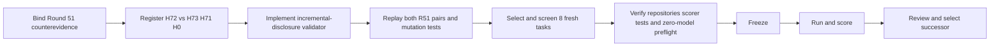

# ContextBench Round 52 — Causal incremental non-disclosure

## Objective hierarchy

Enduring objective: Improve reusable ARE reasoning, useful continuity, recovery,
correctness, and completed outcomes within cumulative model input plus output
tokens.

Initial GLM objective: Finish GLM-5.3-flash qualification, beginning with the 8K
small-window chapter and useful reasoning-state recovery under pressure.

Current milestone: Clear the fixed ContextBench contract through frozen
evidence-led rounds while keeping context selection distinct from repair
correctness.

## Research method

objective → gap → question → competing hypotheses → selection → experiment/tasks/criteria → results → observations → reviewed decision → successor

## Evidence-led question

Round 51 stopped because one private handle binding also appeared in the held
terminal candidate inherited identically by both branches. The treatment-added
state and handle schema contained no full identifiers. Both observed treatments
returned valid selections while both controls were invalid, and treatment saved
1,956 logical tokens across the two incomplete pairs.

Can request-local handles retain that completion and token direction when
non-disclosure is measured causally: zero full identifiers in treatment-added
state and schema, with every inherited full-identifier occurrence identical
between control and treatment?

- **H72 — causal incremental non-disclosure:** preserve the H70 handle mechanism
  and validate treatment-added material separately from identical inherited
  history.
- **H73 — translate held candidates:** replace full identifiers already present
  in the held candidate with handles. This adds a semantic transformation not
  required by the observed token mechanism.
- **H71 — one full identifier:** retain one full identifier and risk losing the
  observed multi-file signal.
- **H0 — no transferable gain:** the two-for-two completion direction is task
  variance and will not survive a complete fresh cohort.

Select H72 because the Round 51 stop was caused by classifying shared-prefix
content as treatment disclosure. The successor tightens causal accounting
without changing model-visible treatment behavior.

## Fixed decision rule

The validator must reconstruct the exact provider request for each first branch
call. It must prove:

1. control and treatment inherit the exact same prefix receipts and held
   terminal candidate;
2. treatment-added handle state contains zero full read IDs;
3. treatment's dynamic handle tool schema contains zero full read IDs;
4. after removing the registered control review, treatment handle state, and
   arm-specific terminal tools, the remaining prompts are byte-equivalent;
5. every mapped full-ID occurrence in the remaining prompt has the same count
   in both arms;
6. accepted handles resolve one-to-one to exact delivered read IDs;
7. both branches make one review call and treatment input is at least 128 tokens
   smaller;
8. at most three handles, 1,024 state bytes, and 160 state tokens are exposed.

Before any fresh live run, replay the new validator against both stopped Round
51 pairs. Pair 1 must remain valid. Pair 2 must pass with inherited occurrences
reported and zero treatment-added occurrences. Mutations that add an ID to the
state, schema, or treatment-only common content must fail.

Use eight fresh tasks. Keep the Round 51 quality, cumulative-token, pair-token,
minimum-pair, no-rerun, no-replacement, and immediate-stop criteria unchanged.

## Work DAG

## Open questions

- Will the two-for-two completion direction survive a complete denominator?
- Do inherited held-candidate IDs influence the treatment even though both arms
  receive them identically?
- If H72 passes, what untouched confirmation cohort closes the 8K chapter?
- Should a later representation remove inherited IDs for token savings common
  to both arms?
