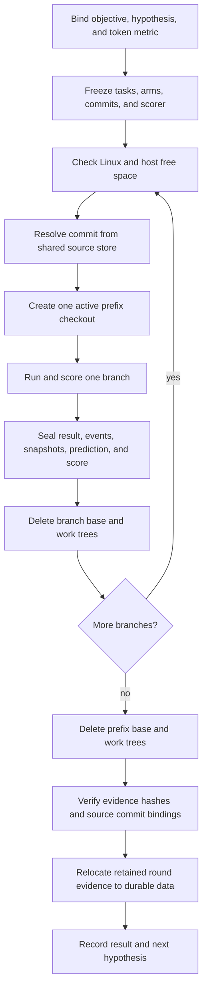

# ContextBench Storage Lifecycle

## Objective binding

ContextBench exists to test whether ARE improves retained reasoning quality for
GLM-5.3-flash within fixed model-token budgets and small context windows. Disk
use is an operational constraint, not part of the scientific cost metric. The
only scientific cost comparison remains model input plus output tokens.

This lifecycle supports the research ontology method: each round starts from a
falsifiable hypothesis, preserves the frozen intervention and observations, and
retains enough evidence to reproduce every score. Repository checkouts are
reconstructible execution material and are never experimental evidence.

## Lifecycle DAG

## Enforced controls

1. Before dispatch, `assertStorageCapacity` checks the output filesystem, the
   WSL host filesystem when `/mnt/c` exists, and the number of active `base` and
   `work` trees. Defaults are 8 GiB free in Linux, 12 GiB free on the host, and
   fewer than 32 active source trees.
2. A completed branch or standalone cell deletes its exact `base` and `work`
   directories after native scoring. Results, receipts, event logs, state,
   snapshots, predictions, and scores remain.
3. A shared prefix remains only while its branches need to clone it. The
   dispatcher removes it when those branches finish or the prefix is ineligible.
4. Dispatcher startup prunes source trees from previously completed non-prefix
   cells. Interrupted runs keep their diagnostic evidence, while their exact
   source trees can be removed with `requireCompleted: false`.
5. Native scoring reconstructs only the required commit and sparse union of gold
   and predicted paths from the shared source store. It must not retain a full
   checkout after scoring.
6. Round closeout writes a hash manifest before deletion, verifies every retained
   evidence file and commit binding, deletes only named source trees, and writes
   a cleanup receipt. Retained roots live under `~/.local/share/are`; historical
   cache paths may remain as compatibility symlinks for frozen references.

Future freezes must select the versioned `*-storage-bounded.mjs` entry points.
The unversioned runners remain unchanged because completed round freezes bind
their bytes. The bounded shared dispatchers invoke the bounded branch runner;
the bounded sequential dispatcher invokes the bounded standalone runner.

The thresholds can be raised deliberately with
`ARE_CONTEXTBENCH_MIN_FREE_BYTES`, `ARE_CONTEXTBENCH_MIN_HOST_FREE_BYTES`, and
`ARE_CONTEXTBENCH_MAX_SOURCE_TREES`. Lowering them is visible in the environment
that launched the round and should be recorded in the round freeze.

## Acceptance gates for the next iteration

- Storage lifecycle tests pass before any model dispatch.
- A dry run leaves no `base` or `work` directory after cell completion.
- A shared prefix is available through its final branch and absent afterward.
- The host free-space guard blocks before a call when its reserve is breached.
- The round closeout verifier resolves every evidence hash and source commit.
- The score report separately records model tokens and operational storage; it
  never adds bytes, tokenizer probes, retries without dispatch, or cached-token
  subsets to the scientific token cost.

## Open Questions

- Should the host reserve be proportional to planned shard concurrency instead
  of the current fixed default?
- Should compatibility symlinks be retired by rewriting future freezes to use a
  stable retained-data root?
- Can shared-prefix cloning use a read-only object store plus copy-on-write
  worktrees without weakening checkout independence or evidence provenance?
