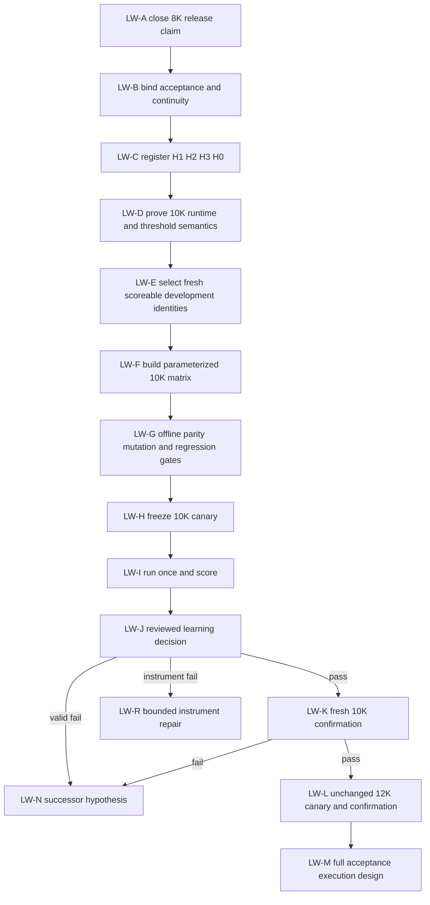

# GLM-5.3-flash larger-window ContextBench plan

Revision: candidate-v1, 2026-09-16. Status: offline gates passed; ready for immutable freeze.
Authority effect: none.

## Objective hierarchy

**Enduring objective:** Improve reusable ARE reasoning, useful continuity,
recovery, correctness and completed outcomes within cumulative model input plus
output tokens.

**Initial GLM objective:** Finish GLM-5.3-flash qualification, beginning with
small context windows and useful reasoning-state recovery under pressure.

**Current milestone:** Continue the fixed ContextBench contract after the
confirmed 8K milestone by testing the same mechanism at 10K and then 12K. Keep
context selection distinct from semantic retention and repair correctness.

The contribution is specific: determine whether H72 is a reusable
context-pressure mechanism or an 8K specialization, without changing both the
window and intervention at once.

## Research method

`objective → gap → question → competing hypotheses → selection → experiment/tasks/criteria → results → observations → reviewed decision → successor`

The scientific record DAG and work-task DAG are separate. Every live comparison
must be frozen before outcomes are observed. A failed window creates a reviewed
successor hypothesis; it is never rerun unchanged until favorable.

The exact objective, policy, acceptance, predecessor, counterevidence, and
criterion review is bound in [continuity-binding.json](continuity-binding.json).

## Gap and question

Round 52 development and Round 55 independent confirmation support H72 at 8K.
The preregistered acceptance contract also names 10K and 12K, and the result does
not show whether extra native context weakens, preserves, or changes the value of
terminal handles.

**Question:** With model, tasks, terminal boundary, handle representation,
accounting, and scoring held fixed, does increasing the experimental window to
10K preserve useful context selection per cumulative model token?

## Competing hypotheses

- **LW-H1, selected — pressure transfer.** The terminal evidence-selection
  bottleneck persists at 10K. Unchanged H72 will improve macro Span-F1 by at
  least 5 percentage points, will not degrade coverage/precision or valid
  selections, and will not use more aggregate tokens than control.
- **LW-H2 — benefit dilution.** More native context retains enough evidence that
  H72's quality gain falls below 5 percentage points, although handle
  substitution may still reduce tokens. This would support an 8K-specific
  policy rather than a common default.
- **LW-H3 — displacement-conditioned policy.** At 10K, benefit exists only when
  a receipt-bound diagnostic proves relevant evidence was displaced. An
  unconditional terminal treatment will dilute or distract on other pairs.
- **LW-H0 — no transfer.** H72 provides no net context-selection benefit at 10K
  within the token constraint.

LW-H1 is selected because the first transfer test should change only the window.
Adapting the trigger before observing unchanged transfer would confound the
window effect with a new mechanism.

## Fixed decision rule

The first live stage is one frozen 10K development canary on eight fresh,
scoreable identities. It uses the Round 55 H72 representation and validators
unchanged except for window-derived recycling thresholds and identifiers.

The canary advances only when all instrument gates pass and:

- at least six of eight pairs are complete, with every identity accounted for;
- paired macro Span-F1 gain is at least 0.05;
- span coverage, span precision, file coverage, file precision, and valid
  selection count do not degrade;
- aggregate treatment logical input-plus-output tokens do not exceed control;
- treatment minus control is no more than +3,072 tokens for every complete pair;
- there are zero unbounded unknown receipts and zero automatic retries;
- terminal boundary, ancestry, exact private handle resolution, incremental
  non-disclosure, fixed denominator, and independent score reconstruction pass.

A development pass advances to a separately frozen fresh 10K confirmation. A
valid failure selects among LW-H2, LW-H3, LW-H0, or a new observation-led
hypothesis. An instrument failure repairs only the instrument and preserves the
same exposed cohort status. No 12K live work begins before the reviewed 10K
decision.

A 10K confirmation pass permits an unchanged 12K transfer canary followed by
fresh confirmation. Neither small-cohort result clears the full ContextBench
contract. Full clearance still requires the 1,136-identity and two-repetition
requirements in `../acceptance.json`.

## DAG and ordered tasks

The machine-readable dependencies and criteria are in `work-plan.json`; the
scientific ancestry is in `dag.json`.

## Measurement mapping

| Measurement | Establishes | Does not establish |
| --- | --- | --- |
| Native Span-F1 and coverage/precision | Usefulness of selected source context | Repair correctness or causal retention by itself |
| Valid-selection count | Schema and delivered-evidence validity | Semantic completeness |
| Receipt/ancestry validators | Intended paired difference and provenance | That the treatment helps |
| Cumulative input-plus-output tokens | Scientific cost under the user objective | Disk, latency, or monetary cost |
| Window comparison | Whether unchanged H72 transfers across pressure levels | Other-model or non-code transfer |
| Full outcome evaluation, later | Whether selection improves completed work | General reasoning without more domains/models |

## Scope, construction, and storage

This plan remains inside ContextBench; SWE-bench is not restored. The mechanism
is a candidate implementation under CAV2-D65. Planning and research records do
not grant production admission or operational release.

Each run uses one temporary worktree root, deletes reconstructible checkouts
after scoring, and retains only receipts, manifests, predictions, scores, and
commit bindings. A disk guard runs before repository preparation and before live
dispatch. Disk use is operational safety and is not mixed with the model-token
metric.

## Retained counterevidence

- Round 49 showed that early additive state can amplify exploration and tokens.
- Round 50 showed that full identifiers can erase the token benefit.
- Round 51 showed that absolute non-disclosure misattributes shared inherited
  identifiers.
- Rounds 53 and 54 exposed tokenizer and nonterminal-boundary accounting gaps.
- Round 55 absolute treatment Span-F1 was only 15.85%.
- The successful cohorts do not satisfy the full 1,136-identity acceptance
  denominator or the 10K/12K requirements.

## Release and execution gates

LW-D through LW-G passed: the exact recycle threshold, fresh task identities,
matrix, endpoint and initial-envelope preflights, physical call cap, storage
location, native scorer, runtime regressions, and continuity prerequisites are
bound in the Round 56 local gate. The next boundary is the immutable freeze;
live dispatch remains one later bounded experiment effect.

## Open questions

- Should the 10K recycle point preserve the 8K absolute safety margin or the 8K
  pressure ratio? LW-D must decide this from runtime semantics before task
  selection.
- How many fresh eligible identities remain after excluding every prior matrix?
- After 10K and 12K transfer, what staged sample design can reach the fixed
  1,136-task acceptance denominator within finite round budgets?
