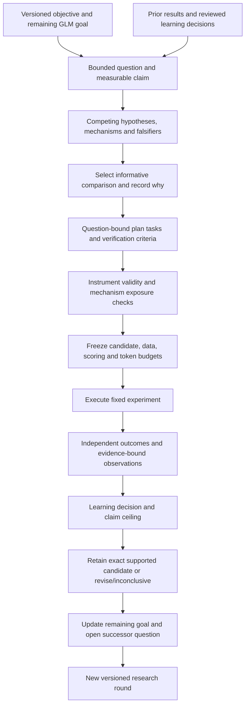

# Proposed bridge into the current ARE plan

Audit recommendation; not an executed plan, frozen experiment, or admitted Goal.
Findings and source authority are in [AUDIT.md](AUDIT.md). The existing
[objective](../tool-state-audit-v1/OBJECTIVE.md) and [A–K plan](../tool-state-audit-v1/PLAN.md)
remain the starting point. No historical records should be rewritten.

## The complete loop

The final successor is a new record/version, not an edge back into an immutable
historical DAG. Archive integrity, mechanism exposure, correct outcomes and
product qualification each need their own evidence.

## Exact insertions into the existing plan

| Placement | Work and owned question | Evidence required to finish |
| --- | --- | --- |
| After C, before experimental design | C1: bind objective version, remaining GLM milestone and bounded research question | Exact source refs/digests, explicit claim-to-outcome mapping, and predecessor decision refs. Owner: executing agent. |
| After C1, before G | C2: generate/revise competing hypotheses from audited evidence | Each has mechanism, scope, falsifier, prediction, metrics, supporting/counterevidence and null/alternative explanations. Use ARE's existing constructors. |
| After C2, before G | C3: select one discriminating study | Recorded comparison of alternatives, why this intervention can answer the question, exposure assumptions and separate engineering fixes. Do not merely choose the latest failing field. |
| During D/E | E1: validate the experimental instrument | Rejected input produces actionable diagnostics; every recovery action remains reachable; terminal rules agree; no effect before validation. Passing this certifies the tool contract, not ARE's reasoning benefit. |
| During F | F1: bind observable outcomes and token accounting to the question | Total input/output cap, failed/missing usage semantics, export lineage, exposure records, independent scoring and explicit unknowns. |
| Before H | G1: freeze the typed experiment and question-bound work plan | Exact baseline/treatment/data/candidate/scorer versions, paired design, repetitions, token tiers, stopping rules, exposure check, named task criteria and verifier. No unresolved run-critical refs. |
| After H and again after I | L1: evaluate, observe, decide and update the plan | Typed observations cite exact results; retain negative and inconclusive outcomes. Name reviewed decision precedence, permitted conclusion and next action. |
| Before J adoption/qualification conclusions | L2: retain only a supported current candidate; update the remaining GLM goal | Exact implementation/evidence/measurement binding, scope of benefit, unresolved transfer questions. A null study completes without retention. |

D/F may proceed as bounded preparation while C1–C3 are constructed. G/H must not
skip the question and hypothesis chain. No gate here requires global ontology
runtime activation; use exact selected method contracts and a reviewed adapter.
D08's current loader is registration-bound, so compatibility must be established
before claiming its verifier has accepted this plan.

## Candidate question decomposition

These are audit recommendations, not selected hypotheses or empirical findings.

| Question | Link to objective | What would distinguish explanations |
| --- | --- | --- |
| Can the model recover from tool-contract errors within its token allowance? | Recovery and completion without repeated unproductive token consumption | Valid diagnostic/retry paths versus identical baseline; preserve independently scored task outcomes and premature inability. Separate model misunderstanding from unreachable host actions. |
| Does bounded working state help after decisive evidence was delivered and then displaced? | Useful continuity and correctness | Matched-prefix state intervention under genuine post-delivery pressure; hold tools/policy fixed. Existing H21/H23 are controls and scope evidence, not a substitute for this test. |
| Can lossless presentation changes reduce tokens without losing useful evidence? | Token efficiency with maintained outcomes | Exact payload equivalence and measured cumulative tokens plus task outcomes. Repetition may improve salience, so fewer bytes alone is insufficient. |

The first question is closest to the audited failure evidence. This is a proposed
ordering, not evidence that its solution will improve all models or domains.

## Objective and claim ledger to create

For each next round, bind:

`objective_ref + version → goal_gap → question_ref → hypothesis_ref → experiment_ref
→ plan_task_ids → result_ref + digest → observation_refs → reviewed_decision_ref
→ candidate/retention or successor_question_ref`.

Keep research aggregation distinct from findings. Keep the scientific DAG
(record dependencies) distinct from the work DAG (tasks and completion evidence),
with explicit links between them. Reuse the existing research ontology; a new
schema should only be considered for a demonstrated gap in the bridge.

## Open Questions

[AUDIT.md](AUDIT.md#open-questions) owns unresolved identifier, adapter, exposure
and decision-precedence choices. Product owner selects subsequent execution scope;
the executing agent owns exact bindings and evidence verification.
