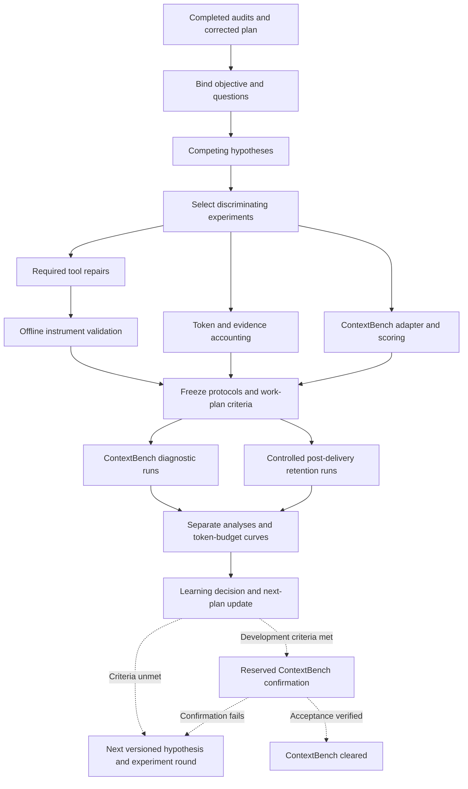

# ARE ContextBench hypothesis and experiment loop

Revision: continuity-v4, 2026-09-10, user-directed correction.
Status: objective and audits complete; define ContextBench acceptance and research bindings next.
Owner: ARE product owner; executing agent owns construction and evidence.
Authority effect: none. Candidate planning; Goals admission remains blocked.

## Objective and agreed scope

The [saved objective](OBJECTIVE.md) remains: improve correctness, useful reasoning
continuity, recovery and completion for the same model within cumulative
input-plus-output token budgets. Tokens are the optimization cost, not elapsed
time, local computation, storage or prices. Cheaper abandonment is not a benefit.

**Clear ContextBench before selecting another benchmark.** The active work is:

- **ContextBench:** complete native integration/scoring on exact matching annotated
  tasks and repository revisions; iteratively improve the candidate against a
  fixed, explicit acceptance contract.
- **Controlled ARE retention experiments:** supporting diagnostic work where
  needed to explain ContextBench failures and test useful state after decisive
  evidence was delivered and displaced. H22/H23 inform these experiments; custom
  retention metrics must not be labelled native ContextBench scores.

SWE-bench-Live is removed from the active task graph, including any automatic
follow-on after this chapter. Its historical results remain evidence, not deleted
or reinterpreted. The [original benchmark selection](../../../implementation/agent-reasoning-engine/benchmarks/glm-episodes-v1/analysis/provider-study-v1/research/benchmark-landscape-v1/PLAN.md)
is superseded for current scope by this user-directed revision.

The [GLM finish tracker](../../../implementation/agent-reasoning-engine/GLM-FINISH-PLAN.md)
remains the broader product record. Clearing ContextBench does not finish all GLM
qualification or prove transfer to other models/domains. No other benchmark is a
prerequisite or an automatic next task here.

## Evidence and method

Use the [tool/data synthesis](SYNTHESIS.md), [experiment recap](experiment-recap/RECAP.md),
[research-method audit](../research-method-audit-v1/AUDIT.md) and
[bridge recommendations](../research-method-audit-v1/PLAN-BRIDGE.md).
The [ARE research-learning ontology](../../../implementation/agent-reasoning-engine/packages/evolution-runtime/ontology/research-learning-v1.json)
owns the selected method meanings: ARE-RL-D01–D05, D07 and D08.

Carry this chain explicitly:

`objective version → remaining goal → question → competing hypotheses → selection
→ experiment → question-bound plan tasks → results → observations → reviewed
learning decision → retention/revision → updated goal and successor question`.

Scientific record dependencies and work-task dependencies are separate graphs
with explicit links. Reuse existing constructors and criterion-bound work-plan
verification where compatible. The current [dag.json](dag.json) is a planning
projection, not an already verified D08 work plan. C1–C3/G bind that bridge;
do not invent registered Goal IDs or claim a global runtime gate has run.

## Mandatory continuity at every round

Follow the [research continuity contract](../CONTINUITY.md) and scoped
[research instructions](../AGENTS.md). Every successor plan and hypothesis must
bind all three levels: enduring ARE objective, initial GLM/small-window useful
retention work, and current ContextBench acceptance milestone. Benchmark progress
must not silently replace the original purpose.

Before finalizing a successor, record a continuity review of exact objective and
method versions, predecessor decisions/counterevidence, its contribution to the
remaining goal, falsifiers, metric-to-claim mapping and scope exclusions. Typed
hypotheses may bind a companion through provenance; do not add unsupported fields.
Before freeze, resolve all run-critical bindings and verify task criteria. At
closeout, carry the learning decision and remaining goal gap into the next round.
Missing bindings leave a draft incomplete; mismatched meaning requires revision.
These are explicit planning/review requirements, not an installed runtime hook.

## Task order and acceptance

A–C from the prior revision remain completed: saved objective, two Sol medium
audits plus recap, and verified synthesis. M is the completed research-method
audit. R is this completed plan correction. All tasks below remain planned.

| Order / ID | Task | Depends on | Completion evidence |
| --- | --- | --- | --- |
| 1 / C1 | Define ContextBench acceptance and bind research questions | R | Exact objective version, benchmark scope, named native metrics, numerical thresholds, comparison requirements, repetitions and reserved confirmation protocol; predecessor reviewed decisions and source digests. No live run until clear/unclear is decidable; objective/method continuity review required. |
| 2 / C2 | Generate/revise competing hypotheses | C1 | Typed mechanisms, predictions, falsifiers, metrics, scope, supporting/counterevidence and null alternatives. Distinguish tool recovery, state retention and presentation; attach reviewed objective/method/predecessor bindings. |
| 3 / C3 | Select discriminating experiments | C2 | Recorded selection rationale, exposure assumptions and alternatives rejected/deferred; separate ContextBench diagnostic protocol from custom retention protocol. |
| 4a / D | Bind and repair only required tool contracts | C3 | Exact source/construction binding and minimal required fixes; each defect demonstrably threatens the selected experiment or recovery. Unrelated improvements stay deferred. |
| 4a / E | Validate instrument and recovery paths offline | D | Rejected argument/staging → usable diagnostic → permitted corrective action → valid retry; whole-batch zero effects on invalid input; coherent terminal actions; exposure controls. |
| 4b / F | Complete token/evidence accounting | C3 | Stable attempts and export lineage, input/output totals, missing usage as unknown, delivery/archive/presentation provenance and independently scored outcomes. |
| 4c / CB | Finish ContextBench adapter and scoring verification | C3 | Pin task/annotation/revision/scorer versions; reproduce known scoring fixtures and negative controls; keep native metrics distinct from custom ARE metrics; prevent gold-label leakage. |
| 5 / G | Freeze experiments and criterion-bound work plan | E, F, CB | Exact control/treatment, model, tools, task sets, token tiers, repetitions, scorer, stopping rules, exposure test, paired analysis and verifier per task; no unresolved run-critical references; continuity review passes against the frozen artifact versions. |
| 6a / HC | Run frozen ContextBench diagnostic cohort | G | Every scheduled outcome retained, valid traces and native scores, separate custom metrics and token usage; no replacement or in-cohort tuning. |
| 6b / HR | Run frozen post-delivery retention cohort | G | Confirm decisive evidence delivered before common-prefix split; actual pressure/displacement; bounded continuation with independent correctness checks and explicit not-exercised outcomes. |
| 7 / I | Analyze context evidence and token-budget curves | HC, HR | Separate per-track results, paired uncertainty and outcome-versus-total-token curves; retained failures, missingness, premature inability and exposure caveats. |
| 8 / L | Review results against ContextBench acceptance | I | Typed observations, reviewed learning decision and acceptance check; distinguish completed round, supported mechanism and cleared benchmark. |
| 9a / N | If not cleared: create the next hypothesis and experiment round | L | Exact failure/counterevidence → revised question/hypothesis → discriminating protocol and updated plan. Recheck all three objective levels and the method before continuing; no unchanged rerun to seek a favorable sample. |
| 9b / Q | If development criteria met: run reserved ContextBench confirmation | L | Freeze exact candidate, protocol and confirmation scope before outcomes; preserve all repeats and independently verify native scoring and total-token results. |
| 10 / U | Close ContextBench only when the acceptance contract passes | Q | Criterion-by-criterion verified confirmation, candidate/evidence binding, limitations and remaining GLM goal record. Failed confirmation returns to N with exposure recorded; it does not close the chapter. |

Task 4 has independent lanes; this is not authorization to spawn agents or run
concurrent provider jobs. D/E must stop at their bounded instrument acceptance
criteria. No generic tool-cleanup campaign should replace context research.

## Scientific and measurement gates

G must define which question each score answers. ContextBench measures only its
supported native diagnostics; custom retention measures require their own oracle.
Neither a correct repair nor an intact archive alone proves useful retention.

The retention comparison uses only evidence available at the common prefix,
with no reference solution, private-test hints or future outcomes. Hold model,
tools, workflow policy and remaining cumulative token allowance fixed while
varying the selected state treatment. Model-assisted state construction and
correction tokens count. Report end-to-end and continuation-only totals with
the common prefix accounted consistently; report model-based evaluation tokens
separately and inclusively. Cached input remains input; reasoning already inside
output is not added twice. Missing usage is unknown, not zero.

Freeze token tiers from measured usage and the selected endpoint profile before
running any cells. Context capacity, output cap and cumulative token allowance
are distinct. Full-history controls are feasible only when history fits; a
larger-window reference is separately labelled. Near-boundary envelope savings,
pre-delivery admission failure and post-delivery retention loss are different
conditions. Reuse H21/H23 controls without overstating their scope.

Before live dispatch, prove offline that intended evidence exposure and recovery
paths are possible. Natural cohorts that fail to exercise the mechanism are
not-exercised/inconclusive, not retroactively expanded or padded. Any injected
fault corpus is a separate diagnostic study. Score observable evidence use and
outcomes, not hidden reasoning, verbosity or reduced rereading alone.

## What “clear ContextBench” means

C1 must pin the benchmark version, task scope, native metric definitions and
numerical acceptance thresholds from its actual scoring contract, plus our
objective-specific equal-total-token comparison and correctness requirements.
There is no assumed universal upstream pass threshold and no invented 100% target.
C1 records which scores are native and which are custom, and freezes this chapter's
acceptance contract before development runs. Missing values are an explicit
pre-dispatch dependency, not permission to decide success after seeing results.

Clearing requires a validated adapter/scorer, all required tasks and repetitions,
complete or explicitly bounded token accounting, and independently checked
confirmation that meets every declared criterion. A pipeline smoke test, one
passing example, intact archives or a completed negative study is not clearance.
Claims are limited to the frozen scope; a subset is not full-benchmark clearance.

## Persistent research loop

The chapter continues until the acceptance contract is satisfied. A negative or
inconclusive study completes its round, not the chapter. At L, explain failures
and competing causes, retain observations, revise/generate falsifiable hypotheses,
select a discriminating intervention and materialize the next versioned C2–L
round. Reuse verified tooling unless findings require bounded repairs. Rerun
supporting custom retention tests only when needed for the current hypothesis;
they must not become an unrelated second benchmark completion requirement.

Each round has a finite frozen cohort, token allowance, stopping rules and a
terminal decision. Keep all attempts; no replacements or within-round tuning.
Do not lower acceptance thresholds after failure. If the target itself must be
revised, record a separate objective decision and do not claim the old target passed.
Budgets bound each round; continuation requires an available exact run envelope,
not silent cap expansion. Genuine access, integrity or budget blockers pause
execution with the next research task preserved, rather than falsely declaring
ContextBench complete.

Use development tasks for iterative learning and reserved evidence for Q. Once
confirmation outcomes inform a change, mark those tasks as exposed development
evidence; a new confirmation must follow the predeclared fresh/reserved policy.
Record repeated selection and confirmation attempts so selective reporting cannot
turn repeated testing into a false reliability claim. If no eligible confirmation
remains, report the limitation and resolve it before claiming clearance.

The recurring process is a loop, but each evidence DAG remains acyclic: N creates
new record versions linked to predecessor decisions, then a successor work DAG.
No edge mutates or loops back into frozen historical nodes. Clearing ContextBench
ends this chapter; there is no automatic transition to SWE-bench or another benchmark.

## Construction and operational lanes

Current product frontier: C1. Runnable work: define ContextBench acceptance and
bind existing objective/evidence to questions and predecessor decisions, then
C2/C3. Tasks D–U are planned, not executed by this plan update. Continue versioned
research rounds until ContextBench acceptance passes; no live runs occurred here.

D65 construction remains: product/capability meaning → business ontology →
DomainSpec/compiled graph → system ontology → implementation candidate → product
tests → product approval. Bind exact relevant records before implementation;
plan status and route receipts do not grant admission or operational effects.

| Operational item | Owner | Affected stages | Exact prerequisite or deferred residue |
| --- | --- | --- | --- |
| Research-record/work-plan adapter compatibility | Executing agent | C1–C3/G | Required for claimed criterion-bound validation; no global ontology activation prerequisite. |
| Pinned ContextBench data, revisions and scoring environment | Executing agent | CB/G/HC | Required for native diagnostic scores; source availability must be verified before implementation choices. |
| Minimal tool fixes and fixture isolation | Executing agent | D/E/G | Block only experiments that depend on the affected contracts. |
| Token usage completeness and endpoint/run envelope | Executing agent; owner selects live scope | F/G/HC/HR | Required for interpretable equal-budget comparisons and bounded dispatch. |
| Reserved confirmation tasks, independent scoring and source isolation | Executing agent | Q/U | Exact prerequisite for clearance; exhausted or exposed confirmation data cannot be silently reused as fresh. |
| Other benchmarks, models/domains, deployment and publication | Product owner | Outside this plan | No automatic follow-on; no activation required to clear the declared ContextBench scope. |

## Revision provenance and Open Questions

[Previous plan](PLAN.contextbench-loop-v3.md) and [previous DAG](dag.contextbench-loop-v3.json)
preserve the prior revision. Older snapshots and audit completion hashes remain
historical. [Revision review](continuity-revision.json) binds this update.
Frozen experiment inputs/results are unchanged. Prior feedback/recovery rounds
remain completed development evidence, not ContextBench qualification.

Open questions: Which native metric thresholds and frozen scope define clearance?
Which ContextBench version and fixtures satisfy the scoring contract? Which
state representation and token tiers provide informative comparisons? Which
existing D08 adapter verifies the linked tasks? What reserved confirmation policy
prevents repeated development from contaminating the final claim?
