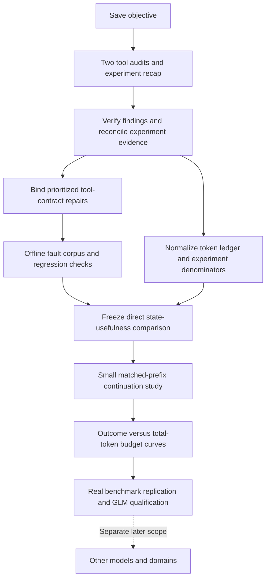

# ARE audit-first plan

Status: audit and synthesis complete; next implementation packages are planned.
Authority effect: none. Candidate planning only; Goals admission remains blocked.
Owner: ARE product owner; executing agent coordinates the bounded audit.

## Objective

Adopt the [saved objective](OBJECTIVE.md): improve correctness, useful reasoning
continuity, recovery and task completion for the same model within cumulative
input-plus-output token budgets. GLM and real coding tasks remain current outcome
evidence; the [existing GLM finish plan](../../../implementation/agent-reasoning-engine/GLM-FINISH-PLAN.md)
retains M0 and M2–M7. Closing this audit does not complete GLM or authorize more runs.

Machine-readable companion: [dag.json](dag.json). Evidence and priorities: [SYNTHESIS.md](SYNTHESIS.md).

## Ordering and gates

A–C are the work authorized by this request. D–J are the candidate next plan,
with separate exact implementation/run bindings before execution. K is deferred.
Do not add another live tuning loop while the tools or measurement cannot support
an interpretable comparison. Source preservation and envelope reduction already
have narrow evidence; reuse their controls rather than claim they were never tested.

## Planned acceptance boundaries

| Stage | Deliverable | Acceptance |
| --- | --- | --- |
| A | Saved objective and lighthouse update | Token cost is explicit; correctness, continuity, recovery and completion retained; memory/presentation/policy separated. |
| B | Two Sol medium audit reports and one recap | Coverage manifests, concrete evidence, unknowns, historical/current distinction and explicit export/attempt identity limits; no unsupported pooled denominator. |
| C | Verified synthesis and prioritized backlog | Parent checks top source/event claims; earlier supporting and negative results remain; no global pooled success score. |
| D | Exact construction binding for selected repairs | Each repair has a source contract, observed or reproduced failure, permitted recovery behavior and counterexample. No field-by-field task patches. |
| E | Offline tool-regression corpus | Invalid requests do not silently consume an entire run; batch effects and terminal calls are coherent; recovery advice is executable; source/evaluator boundaries stay intact. |
| F | Unified token/evidence ledger | Stable attempt and request identities; copied exports deduplicated but legitimate retries counted; input/output/reasoning rules explicit; missing usage remains unknown. |
| G | Frozen state-usefulness protocol | One state variable changes; same model/tools/policy/token allowance; critical evidence delivered before split; no hindsight; exposure and failure conditions preregistered. |
| H | Bounded continuation comparison | State fidelity, evidence use, recovery and independent outcomes reported with total tokens; repeated matched cases; no automatic treatment tuning. |
| I | Budget curve | Predeclared cumulative token tiers, adequate repetitions and paired uncertainty; premature abandonment retained; no substitution of call counts for tokens. |
| J | Real-task and GLM integration evidence | Exact tested candidate, repeated private evaluation, fresh-task separation, original GLM milestones and product review. Broader claims require their own evidence. |

## First implementation packages

Start D with **recoverable tool-contract failures**, using TC-001/002/007 from
[the audit](tool-contracts/AUDIT.md). Preserve complete pre-effect validation;
return bounded, actionable diagnostics to the model; ensure every recommended
recovery action remains available. Reproduce the exact-match/read-removal deadlock
and a malformed native call offline before changing code. A valid retry must be
possible without relaxing source boundaries or completion gates.

Then address terminal-action coherence (TC-005/010), followed by paging before
the result cap and source-bound edit arguments (TC-003/004/006). Keep these as
separate reviewable changes with counterexamples. Do not select schema features
until the provider and shared validator support them. Existing multi-field patch
diagnostics and sanitized staging feedback should be reused, not replaced.

Build F alongside the offline work: explicit attempt/request identities, canonical
export lineage, per-family denominators, provider usage completeness, failure
categories and archive/presentation/delivery provenance. Missing historical usage
is unknown; prospective collection must close the gap before efficiency claims.
Repeated reads and repeated payload bytes are investigation signals, not automatic
waste. Do not treat copied exports as retries or collapse legitimate retries.

Only after E/F pass, select one state representation for G. Compare against the
existing source-preservation and envelope-reduction controls, holding tool policy
fixed. Specify cumulative token tiers from observed usage distributions and the
current endpoint profile; freeze them before dispatch. Require delivered decisive
evidence before pressure, repeated paired continuations, explicit timeout/missing
usage handling, and independently checked task outcomes. A null result must still
be a completed, interpretable study; do not tune repeatedly until a win appears.

## Experimental distinctions to preserve

Full-history controls are feasible only where the complete request fits the
same window. Under genuine capacity pressure, compare admitted compact state
representations; a larger-window full-history reference is separately labelled.
Near-boundary metadata savings, ordinary source masking and post-delivery loss
under genuine pressure are different conditions, not interchangeable positives.

Use only evidence available at the common prefix. Charge arm-specific state
construction and correction tokens. Report end-to-end and continuation-only totals
with the common prefix accounted consistently. Include any model-based evaluation
tokens separately and in an inclusive total; do not hide them as free overhead.
Native input/output usage is primary; tokenize failed/partial records only under
an explicitly labelled measurement protocol. Byte or character counts can locate
suspected duplication but cannot establish exact GLM token savings.

Useful-state scoring concerns observable decisions: respecting known constraints,
using source evidence, revising falsified hypotheses, completing valid corrective
actions and producing correct outcomes. Do not grade hidden reasoning, prose
fluency, explicit hypothesis verbosity, or rereading counts as automatic quality.

## Construction and operational lanes

Audit frontier: A–C complete; all three reports and parent verification are bound. Next candidate frontier: D and F, tool-contract repair bindings and the
token ledger. Agent
outputs are isolated under the [delegation sheet](DELEGATION.md). No runtime
changes, new provider calls, evaluator runs, publication or activation are part
of this request.

D65 sequence for D onward: product/capability meaning → business ontology →
DomainSpec/compiled graph → system ontology → implementation candidate → product
tests → product approval. Bind exact applicable source records when selecting D;
a routing receipt and this plan grant no conformance or admission.

| Operational item | Owner | Affected stage | Causal prerequisite |
| --- | --- | --- | --- |
| Complete audit coverage and source access | Executing agent | B/C | Missing artifacts limit historical claims; do not fabricate them. |
| Exact tool/runtime construction and selected fixture isolation | Executing agent | D/E | Required before implementation/effects. |
| Complete token usage and attribution | Executing agent | F/G | Required for token-efficiency conclusions; missing data narrows claims. |
| Current model/endpoint profile, total-token caps and clean evaluator | Executing agent, owner selects run envelope | G/H/I/J | Required before new live dispatch, not before this plan. |
| Deployment, publication, other models and domains | Product owner selects future scope | After J/K | Deferred; not a blocker for the audit or bounded candidate work. |

## Open Questions

Which findings are current reusable defects versus historical fixed failures?
How much token duplication is measured versus merely suspected? Which tool
contract must be repaired first to enable reliable continuation? Which existing
state representation should be tested under genuine post-delivery pressure?
What cumulative budget range is informative without opening an unbounded campaign?
