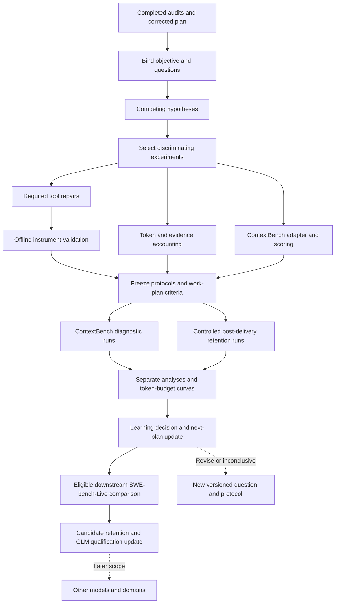

# ARE context retention and GLM qualification plan

Revision: retention-v2, 2026-09-10, user-directed correction.
Status: objective and audits complete; research binding is the next task.
Owner: ARE product owner; executing agent owns construction and evidence.
Authority effect: none. Candidate planning; Goals admission remains blocked.

## Objective and agreed scope

The [saved objective](OBJECTIVE.md) remains: improve correctness, useful reasoning
continuity, recovery and completion for the same model within cumulative
input-plus-output token budgets. Tokens are the optimization cost, not elapsed
time, local computation, storage or prices. Cheaper abandonment is not a benefit.

**Context retention is the main experimental question.** Preserve the two external
benchmarks selected in the [original benchmark plan](../../../implementation/agent-reasoning-engine/benchmarks/glm-episodes-v1/analysis/provider-study-v1/research/benchmark-landscape-v1/PLAN.md):

- **ContextBench:** context diagnostics on exact matching annotated tasks and
  repository revisions. Native integration/scoring remains unfinished. ARE
  visibility, delivery and retention measurements are separate custom metrics.
- **SWE-bench-Live MultiLang:** downstream repository repair outcomes. Recent
  runs used an adapted harness; they are not official leaderboard scores or
  direct causal evidence of retention benefit.
- **Controlled ARE retention experiment:** a distinct internal track that tests
  useful state after decisive evidence was delivered and displaced under genuine
  context pressure. H22/H23 inform its design; they do not replace ContextBench.

These task pools and scores remain separate. Never apply ContextBench gold
annotations to unrelated SWE-bench-Live tasks. Archive integrity, useful evidence
retention and correct task completion are different claims. Historical repair
results stay valid within their scope; they did not finish the retention track.

The [GLM finish tracker](../../../implementation/agent-reasoning-engine/GLM-FINISH-PLAN.md)
retains its remaining M0 and M2–M7 requirements. Other models and domains remain
later transfer work, not prerequisites for this bounded GLM chapter.

## Evidence and method

Use the [tool/data synthesis](SYNTHESIS.md), [experiment recap](experiment-recap/RECAP.md),
[research-method audit](../research-method-audit-v1/AUDIT.md) and
[bridge recommendations](../research-method-audit-v1/PLAN-BRIDGE.md).
The [ARE research-learning ontology](../../../implementation/agent-reasoning-engine/packages/evolution-runtime/ontology/research-learning-v1.json)
owns the selected method meanings: ARE-RL-D01–D05, D07 and D08.

Carry this chain explicitly:

`objective version → remaining goal → question → competing hypotheses → selection
→ experiment → question-bound plan tasks → results → observations → reviewed
learning decision → retention/revision → updated goal and successor question`.

Scientific record dependencies and work-task dependencies are separate graphs
with explicit links. Reuse existing constructors and criterion-bound work-plan
verification where compatible. The current [dag.json](dag.json) is a planning
projection, not an already verified D08 work plan. C1–C3/G bind that bridge;
do not invent registered Goal IDs or claim a global runtime gate has run.

## Task order and acceptance

A–C from the prior revision remain completed: saved objective, two Sol medium
audits plus recap, and verified synthesis. M is the completed research-method
audit. R is this completed plan correction. All tasks below remain planned.

| Order / ID | Task | Depends on | Completion evidence |
| --- | --- | --- | --- |
| 1 / C1 | Bind objective, remaining GLM goal and research questions | R | Exact objective version, bounded questions and claim-to-outcome mapping; predecessor reviewed decision IDs and source digests. |
| 2 / C2 | Generate/revise competing hypotheses | C1 | Typed mechanisms, predictions, falsifiers, metrics, scope, supporting/counterevidence and null alternatives. Distinguish tool recovery, state retention and presentation. |
| 3 / C3 | Select discriminating experiments | C2 | Recorded selection rationale, exposure assumptions and alternatives rejected/deferred; separate ContextBench diagnostic protocol from custom retention protocol. |
| 4a / D | Bind and repair only required tool contracts | C3 | Exact source/construction binding and minimal required fixes; each defect demonstrably threatens the selected experiment or recovery. Unrelated improvements stay deferred. |
| 4a / E | Validate instrument and recovery paths offline | D | Rejected argument/staging → usable diagnostic → permitted corrective action → valid retry; whole-batch zero effects on invalid input; coherent terminal actions; exposure controls. |
| 4b / F | Complete token/evidence accounting | C3 | Stable attempts and export lineage, input/output totals, missing usage as unknown, delivery/archive/presentation provenance and independently scored outcomes. |
| 4c / CB | Finish ContextBench adapter and scoring verification | C3 | Pin task/annotation/revision/scorer versions; reproduce known scoring fixtures and negative controls; keep native metrics distinct from custom ARE metrics; prevent gold-label leakage. |
| 5 / G | Freeze experiments and criterion-bound work plan | E, F, CB | Exact control/treatment, model, tools, task sets, token tiers, repetitions, scorer, stopping rules, exposure test, paired analysis and verifier per task; no unresolved run-critical references. |
| 6a / HC | Run frozen ContextBench diagnostic cohort | G | Every scheduled outcome retained, valid traces and native scores, separate custom metrics and token usage; no replacement or in-cohort tuning. |
| 6b / HR | Run frozen post-delivery retention cohort | G | Confirm decisive evidence delivered before common-prefix split; actual pressure/displacement; bounded continuation with independent correctness checks and explicit not-exercised outcomes. |
| 7 / I | Analyze context evidence and token-budget curves | HC, HR | Separate per-track results, paired uncertainty and outcome-versus-total-token curves; retained failures, missingness, premature inability and exposure caveats. |
| 8 / L | Make learning decision and update research plan | I | Typed source-bound observations and reviewed decision precedence; support/revise/inconclusive, permitted claims, remaining goal gap and successor question. Negative results complete the round. |
| 9 / J | Validate downstream repairs with SWE-bench-Live MultiLang | L | Exact separately frozen candidate and eligible comparison, fresh-task separation, all outcomes and repeat verification of passing patches. Retention-transfer claim requires supported retention evidence; a diagnostic run needs its own question. |
| 10 / U | Retain supported candidate and update GLM qualification | J | Exact candidate/evidence/comparison binding if supported; otherwise explicit no-retention decision. Update remaining GLM milestones, integration tests and product-review requirements. |
| Later / K | Test transfer to other models and domains | U | Separately selected scope and evidence; deferred, no automatic dispatch. |

Task 4 has independent lanes; this is not authorization to spawn agents or run
concurrent provider jobs. D/E must stop at their bounded instrument acceptance
criteria. No generic tool-cleanup campaign should replace context research.

## Scientific and measurement gates

G must define which question each score answers. ContextBench measures only its
supported native diagnostics; custom retention measures require their own oracle.
Neither a correct repair nor an intact archive alone proves useful retention.

The retention comparison uses only evidence available at the common prefix,
with no reference solution, private-test hints or future outcomes. Hold model,
tools, workflow policy and remaining cumulative token allowance fixed while
varying the selected state treatment. Model-assisted state construction and
correction tokens count. Report end-to-end and continuation-only totals with
the common prefix accounted consistently; report model-based evaluation tokens
separately and inclusively. Cached input remains input; reasoning already inside
output is not added twice. Missing usage is unknown, not zero.

Freeze token tiers from measured usage and the selected endpoint profile before
running any cells. Context capacity, output cap and cumulative token allowance
are distinct. Full-history controls are feasible only when history fits; a
larger-window reference is separately labelled. Near-boundary envelope savings,
pre-delivery admission failure and post-delivery retention loss are different
conditions. Reuse H21/H23 controls without overstating their scope.

Before live dispatch, prove offline that intended evidence exposure and recovery
paths are possible. Natural cohorts that fail to exercise the mechanism are
not-exercised/inconclusive, not retroactively expanded or padded. Any injected
fault corpus is a separate diagnostic study. Score observable evidence use and
outcomes, not hidden reasoning, verbosity or reduced rereading alone.

L is a real decision boundary. A negative/inconclusive result ends this fixed
round and opens a successor question; it does not trigger another tuning loop or
support a retention-transfer claim. A later diagnostic coding experiment may
still be useful, but must state its independent question and receive its own
exact binding. No positive result is required to declare a study complete.

## Construction and operational lanes

Current product frontier: C1. Runnable work: bind existing objective/evidence to
questions and reviewed predecessor decisions, then C2/C3. Tasks D–U are planned,
not executed by this plan update. The two external benchmarks remain visible
until their separate acceptance criteria are satisfied.

D65 construction remains: product/capability meaning → business ontology →
DomainSpec/compiled graph → system ontology → implementation candidate → product
tests → product approval. Bind exact relevant records before implementation;
plan status and route receipts do not grant admission or operational effects.

| Operational item | Owner | Affected stages | Exact prerequisite or deferred residue |
| --- | --- | --- | --- |
| Research-record/work-plan adapter compatibility | Executing agent | C1–C3/G | Required for claimed criterion-bound validation; no global ontology activation prerequisite. |
| Pinned ContextBench data, revisions and scoring environment | Executing agent | CB/G/HC | Required for native diagnostic scores; source availability must be verified before implementation choices. |
| Minimal tool fixes and fixture isolation | Executing agent | D/E/G | Block only experiments that depend on the affected contracts. |
| Token usage completeness and endpoint/run envelope | Executing agent; owner selects live scope | F/G/HC/HR | Required for interpretable equal-budget comparisons and bounded dispatch. |
| Independent coding evaluator and clean task environments | Executing agent | J/U | Downstream prerequisite; not a blocker for C1 or ContextBench preparation. |
| Deployment, publication, other models and domains | Product owner | After U/K | Deferred; no activation required to complete research. |

## Revision provenance and Open Questions

[Previous plan](PLAN.pre-retention-v1.md) and [previous DAG](dag.pre-retention-v1.json)
preserve exact pre-revision bytes. Earlier audit completion hashes remain historical;
[revision review](retention-plan-revision.json) binds this update. Frozen experiment
inputs/results are unchanged. The original feedback/recovery experiments remain
completed development evidence, not completed ContextBench qualification.

Open questions: Which exact question/hypothesis should be selected first? Which
ContextBench version and fixtures satisfy the native scoring contract? Which
state representation and token tiers provide an informative pressure comparison?
Which existing D08 adapter can verify the linked GLM tasks? What fresh downstream
cohort can test transfer without reusing development tasks as holdouts?
