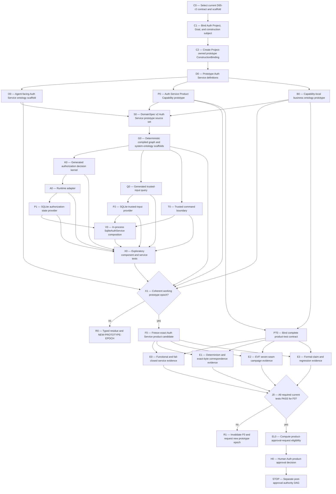

# Auth Service — D65 Revision 2 Construction DAG

Status: **local non-EVF implementation candidate complete through W4; full F0/J0 remains open**
Current implementation route: `CA2-ROUTE-IMPLEMENT`
Construction subject: complete in-process Auth Service
Authority effect: none

## Outcome

Construct one testable Auth Service product candidate through the current
prototype-first `CAV2-D65` chain. The product is the end-to-end in-process
service that resolves trusted inputs, constructs a trusted authorization
command, evaluates exact session-role-permission state, and returns only
`ALLOW` or `DENY`.

EVF is not the product and does not own this plan. It is one product-test branch
that challenges the exact frozen Auth Service candidate across binding,
derivation, lineage, observation, provider, scope, and semantic seams.

This plan does not restore implementation bytes, register a Project, admit an
ontology, accept an implementation, approve a product, commit, publish, deploy,
or authorize an external effect.

## Product boundary

Included in the Auth Service candidate:

- bounded inbound request containing correlation-only `request_id`, an
  authentication-evidence reference, and `route_id`;
- SQLite trusted-input resolution for authentication evidence and route binding;
- trusted command-boundary construction;
- SQLite authorization-state resolution;
- generated exact session-role-permission decision kernel;
- in-process service composition;
- binary `ALLOW`/`DENY` result with fail-closed behavior.

## Construction and operations separation

Current recorded product-construction frontier: the repository-wide
ConstructionBinding remains at Product Capability. This document does not
advance it. Local implementation evidence has reached W3/X0: the in-process
service, explicit migration operation, component checks, and 14-case service
suite are runnable and passing locally.

Product-construction work completed in this local non-EVF round:

- E1-local deterministic replay of the three generated DomainSpec runtimes in
  two isolated runs each, with exact checked-in byte equality;
- W4-local deterministic freeze of the 98-file non-EVF implementation
  candidate;
- one deterministic non-EVF whole-service validation command covering five
  Rust crates, 48 tests, strict checks, replay, and freeze verification.

Operational-support residue, routed separately:

| Task | Owner | Affected D65 stage | Construction effect |
| --- | --- | --- | --- |
| Product approval | Auth Service product owner | H0, only after all W5 branches | none now; not requested |
| EVF evidence refresh | EVF/product-test owner | E2 | no block on the non-EVF local freeze; required for full J0 |
| Registration/admission | Define, ontology, and DomainSpec owners | post-prototype owner gates | none; unavailable from this implementation |
| Publication/deployment | publication and operations owners | no construction stage | deferred and unauthorized |

The causal blocker for full F0/J0 is the missing complete sibling evidence join,
including current EVF evidence. It does not block local prototype validation or
the explicitly labeled non-EVF freeze. No operational residue is treated as a
routine gate on dependency-ready prototype work.

Excluded from this candidate:

- credential verification and login;
- token creation, validation, refresh, or revocation transport;
- HTTP or other remote transport;
- administrative mutation APIs;
- audit transport, multi-node operation, deployment, and production-security
  claims.

## D65 construction DAG

One graph instance represents one prototype epoch. Failed prototype work emits
typed residue and a new epoch request. It never creates a back-edge into a
frozen candidate, so the construction record remains acyclic.

## Node contracts

| Node | Primary responsibility | Output | Exit evidence |
| --- | --- | --- | --- |
| C0 | Select current construction law | Exact D65-r2 definition section, tested Governance prototype contract, scaffold, schemas, evaluator, and digests | Narrow Governance and Goals D65 validators pass |
| C1 | Establish ownership | One Auth Foundation Project, one Auth Service Goal, one bounded construction subject | Project uniquely owns Goal and subject; no ownership inferred from DomainSpec project files |
| C2 | Root construction | Project-owned prototype ConstructionBinding | Exact C0 references; all Auth stages are `prototype` or `absent`; authority requests empty |
| D0 | Prototype vocabulary | Service, trusted input, authorization command, authorization state, decision, and fail-closed definitions | Explicit prototype epoch, selectors, owners, challenge routes |
| O0 | Help agents navigate | Non-authoritative Auth Service ontology scaffold | Every record traces to D0; `authority_effect: none` |
| P0 | Define product behavior | Auth Service Product Capability prototype | Complete outcome, actors, inputs, outputs, exclusions, failure behavior, and test obligations |
| B0 | Define capability-local meaning | Auth Service business ontology prototype | Complete property/control denominator and no hidden transport or credential scope |
| S0 | Author technical intent | One DomainSpec source set composing decision, command boundary, trusted-input query, and service integration | Source lint and exact source-set manifest pass |
| G0 | Materialize deterministic scaffolds | Compiled graph and system ontology derived from S0 | Two isolated compiles produce equal paths and bytes |
| K0 | Decide authorization | Generated exact session-role-permission kernel | Generated-source receipt and kernel tests |
| A0 | Supply kernel context | Pure runtime adapter | Port failures and invalid inputs map to `DENY` |
| P1 | Resolve authorization state | SQLite session, role, permission, revision, and scope provider | In-memory and file-backed provider tests |
| Q0 | Specify trusted-input resolution | Generated typed `Resolved(TrustedInputSnapshot)` query | Generated replay and query behavior tests |
| P2 | Resolve trusted request inputs | SQLite authentication-evidence and route-binding provider | Missing, duplicate, stale, revoked, disabled, and incomplete records remain visible and fail closed |
| T0 | Construct trusted command | Boundary from inbound request to authorization command | Caller cannot supply authoritative permission or scope; ambiguity returns `DENY` |
| V0 | Compose the product | `SqliteAuthService::authorize` end-to-end prototype | One permitted path and complete fail-closed integration matrix pass |
| X0 | Learn before freezing | Exploratory test receipts for every component and composition | Current local tests pass or typed residue names the failed assumption |
| F0 | Create product candidate | Immutable manifest of D0–V0 and required build/test tools | Sorted inventory and canonical digest reproduce twice |
| PT0 | Close test denominator | Exact required product-test contract | Functional, hostile, determinism, EVF, formal/regression test IDs are complete and unique |
| E0 | Prove service behavior locally | Functional and fail-closed evidence | Permitted request allows; every missing, ambiguous, stale, revoked, mismatched, or provider-failure case denies |
| E1 | Prove reproducibility | Deterministic build and implementation-correspondence evidence | Two runs agree; all declared artifacts and compiler/runtime/tool bytes match F0 |
| E2 | Challenge external validity | EVF profile, plan, observations, detector results, closure, and receipt | All seven seams detected exactly once; survivor, empty denominator, caller-supplied PASS, and stale-byte cases fail closed |
| E3 | Preserve earlier guarantees | Formal-claim characterization and historical regression evidence | Lean declarations/checks and unchanged predecessor test surfaces remain current for F0 |
| J0 | Join product evidence | Collect-all product-test result | Every PT0 test is evaluable and PASS; otherwise downstream is `not_evaluable` or blocked |
| EL0 | Evaluate request eligibility | Product-approval-request eligibility only | Exact F0 + complete current evidence; authority eligibility remains false |
| H0 | Decide product value | Approve, reject, or defer exact F0 digest | Immutable owner decision; approval grants no operational authority |
| STOP | Preserve authority separation | Terminal handoff boundary | Any authorization/admission/activation/publication/deployment begins in a separate owner-selected DAG |

## Product-test contract

EVF is one sibling branch in the evidence join:

| Evidence branch | Required checks |
| --- | --- |
| E0 — Service behavior | permitted end-to-end path; missing/duplicate evidence; expiry; revocation; disabled/incomplete route; scope/resource/action mismatch; storage/query/conversion failure; default deny |
| E1 — Exactness | DomainSpec compile replay; generated Rust replay; implementation-map hashes; candidate manifest replay; stale compiler/runtime/tool rejection |
| E2 — EVF | binding, derivation, lineage, observation, provider, scope, semantic controls; non-empty denominator; exact observation cardinality; survivor rejection; zero-row/caller-supplied PASS rejection |
| E3 — Formal/regression | authorization characterization; exact mismatch deny; historical kernel, adapter, provider, trusted-boundary, and trusted-input regressions |

No single branch can close J0. In particular, EVF PASS does not imply that the
Auth Service works, that the candidate is approved, or that any authority is
available.

## Implementation layering

### L0 — Minimum working Auth Service

Decision question: **After this layer, do we know whether one inbound request can
flow through trusted SQLite inputs and authorization state to a correct binary
decision without letting the caller construct authoritative permission data?**

Minimum working unit: S0, G0, K0, A0, P1, Q0, P2, T0, V0, plus one permitted
integration case and representative fail-closed cases. Existing candidate bytes
may seed the prototype, but the layer closes only when the complete service path
is locally reproducible.

Deferred: EVF campaign, frozen manifest, production transport, credentials,
tokens, administrative writes, scale, and deployment.

### L1 — Repeatable DomainSpec-governed prototype

Decision question: **After this layer, do we know whether the complete service
can be rebuilt from one exact DomainSpec source set with deterministic compiled
scaffolds and exact implementation correspondence?**

Adds D0, O0, P0, B0, the full G0 determinism check, exact implementation map,
and all component regressions. L0 behavior must remain unchanged.

### L2 — Frozen candidate with complete product evidence

Decision question: **After this layer, do we know whether one immutable Auth
Service candidate satisfies its full functional, exactness, EVF, and formal
test denominator now?**

Adds F0, PT0, E0–E3, and J0. Any candidate-bound byte change invalidates all
dependent evidence and creates a new prototype epoch.

### L3 — Product decision boundary

Decision question: **After this layer, is the exact tested Auth Service candidate
eligible for, and resolved by, an Auth product-owner decision?**

Adds EL0 and H0, then stops. Product approval does not authorize admission,
activation, publication, release, deployment, or external effects.

## Delivery waves and Smallest Working Units

| Wave | SWU | Depends on | Acceptance boundary | Planned validation |
| --- | --- | --- | --- | --- |
| W0 | `AUTH-D65-SWU-ROOT` — C0+C1+C2 | none | Project/Goal/subject and exact D65-r2 prototype contract close without Auth implementation mutation | Governance D65 evaluator; Goals prototype-binding validator; independent ownership review |
| W1 | `AUTH-D65-SWU-MEANING` — D0+O0+P0+B0 | W0 | One coherent prototype meaning and non-authoritative scaffold | selector closure; ontology/property denominator checks; no-authority scan |
| W2 | `AUTH-D65-SWU-SOURCE` — S0+G0 | W1 | One service-level DomainSpec source set compiles deterministically | source lint; two clean compiles; graph/system-ontology byte equality |
| W3 | `AUTH-D65-SWU-SERVICE` — K0+A0+P1+Q0+P2+T0+V0+X0 | W2 | Complete in-process service admits one permitted case and denies every representative unsafe case | Rust checks/tests; generated replay; service integration matrix |
| W4 | `AUTH-D65-SWU-FREEZE` — F0+PT0 | W3 | Exact service candidate and complete test denominator reproduce | manifest freeze twice; denominator uniqueness/coverage validator |
| W5 | `AUTH-D65-SWU-EVIDENCE` — E0+E1+E2+E3+J0 | W4 | Collect-all evidence is current and bound to F0 | two full service runs; exactness audit; seven-seam EVF campaign; formal/regression checks |
| W6 | `AUTH-D65-SWU-PRODUCT-DECISION` — EL0+H0+STOP | W5 | Only product-approval eligibility and exact owner decision are resolved | D65 eligibility evaluator; digest-bound decision validation |

Each SWU has one primary behavior and one independently reviewable boundary.
No wave may interpret its planned validator as already executed evidence.

## Distill validation

- Mode and budget: Standard; one proposal track, two reduction rounds, local
  Proposer/Balancer role simulation because repository delegation requires a
  separately selected route and explicit helper contract.
- Proposer round 1: make the EVF campaign the central implementation unit.
- Balancer objection (`wrong-abstraction-level`): EVF validates external-validity
  seams but does not compose or deliver the Auth Service.
- Reconciliation: V0 is the product composition; E2 is one test branch.
- Proposer round 2: make Project registration the minimum product layer.
- Balancer objection (`not-a-working-unit`): ownership is a prerequisite, not an
  end-to-end product proof.
- Reconciliation: W0 remains the governance root, while L0 is the smallest
  working Auth Service slice through V0.
- Selected optimization point: the complete in-process `authorize` path with
  fixed SQLite fixtures and binary output. Splitting it further loses the service
  behavior; adding HTTP, credentials, or deployment smuggles later products into
  the proof.
- Recomposition proof: L0 proves the service path; L1 binds it to the prototype
  meanings and deterministic DomainSpec projection; L2 freezes and tests it;
  L3 resolves product approval and stops before authority.
- Premortem: the likely failure is allowing strong EVF evidence to hide an
  incomplete service composition. Guardrail: E0–E3 are sibling prerequisites of
  J0 and none can substitute for another.
- Frame expiry: regenerate this DAG if the D65-r2 contract, Auth Service product
  boundary, DomainSpec source set, implementation composition, test denominator,
  or frozen candidate bytes change.
- Verdict: **continue**. The Project, Goal, prototype ConstructionBinding,
  service Definition Pack, and service Product Capability prototype establish
  the current definitions-first construction basis. Continue directly through
  the remaining dependency-ready D65 prototype nodes. No external execution
  wrapper is an Auth construction prerequisite.

## Dispatch technique trace

| Technique | Concrete effect |
| --- | --- |
| `sequence` | Establishes W0–W6 and prerequisite edges |
| `residue_ledger` | Failed prototype/test gates emit a new epoch instead of rewriting a frozen one |
| `owner_boundary_check` | Isolates C1/C2 and H0 as owner-bound decisions |
| `artifact_contract_bridge` | Places existing Auth and recovered EVF bytes under a new service-level candidate manifest |
| `validation_loop` | Requires clean two-run compilation and product evidence |
| `concrete_path_evidence` | Binds service composition and every product-test artifact by exact path/digest |
| `scu_swu_reduction` | Selects the end-to-end in-process service as L0 and seven reviewable SWUs |
| `recomposition_proof` | Shows how component work becomes one tested product candidate |
| `authority_split_gate` | Terminates the graph before any post-approval effect request |

A full dispatch document is deferred because this artifact authorizes no
execution or delegation. It becomes required if a later execution plan crosses
multiple owners, delegates work, or carries protected scope.

## Current gaps and next route

1. The proposed Auth Foundation Project, draft Auth Service Goal, and
   prototype-only D65-r2 ConstructionBinding root this candidate but remain at
   their recorded Product Capability frontier; this local work does not advance
   that binding or prove product meaning.
2. The service Definition Pack, Product Capability, business ontology,
   contracts, context policies, obligation registry, and DomainSpec composition
   source set are now materialized as prototype candidates. They remain
   non-admitted and do not prove product meaning.
3. EVF remains a separate sibling E2 evidence branch and is excluded from the
   local non-EVF freeze. Therefore full F0, J0, and product-approval eligibility
   remain unavailable.
4. The historical continuous-construction program is blocked on its removed
   `CAV2-C19` selector and is not a dependency of this DAG.

## Implementation candidate handoff

The Rust implementation candidate owns one already-migrated SQLite database
connection and one deferred query-only transaction per valid `authorize` call.
It validates bounded identifiers, captures decision time once, allocates a
checked non-reusing epoch identifier, resolves trusted inputs through that
transaction, constructs opaque lifetime-bound snapshot and command values,
resolves one typed authorization-state snapshot, checks exact subject/session
and revision joins, invokes the generated boundary and permission kernel, then
rolls back after fixing the binary decision. Normal startup cannot create or
migrate schema; an explicit operation installs unified schema v2 or atomically
upgrades v1. Private typed diagnostics collapse to public `ALLOW` or `DENY`.

The component and service suites have been executed locally under strict Rust
warnings: 48 tests pass across five crates, including 14 service tests and a
real WAL concurrent-writer snapshot test. This closes local W3/X0 and the
deterministic 98-file non-EVF W4 freeze now verifies. That freeze is not the
complete F0 product candidate and cannot substitute for EVF or the complete W5
evidence join.
