# Authorization API v1 — construction DAG through node 13

Status: nodes 1–13 complete as one exact locally validated candidate. Node 14 remains unexecuted.
Route: `CA2-ROUTE-IMPLEMENT`
Authority effect: none

```mermaid
flowchart LR
  N1[1 definitions] --> N2[2 ontology scaffold]
  N1 --> N3[3 product contract]
  N2 --> N4[4 request and response types]
  N3 --> N4
  N4 --> N5[5 fail-closed router]
  N5 --> N6[6 SQLite transaction snapshot]
  N6 --> N7[7 shared unique epoch allocator]
  N7 --> N8[8 bounded connection pool]
  N8 --> N9[9 blocking-worker isolation]
  N9 --> N10[10 caller security boundary]
  N9 --> N11[11 aggregate observability]
  N10 --> N12[12 strict and adversarial validation]
  N11 --> N12
  N12 --> N13[13 exact local product-candidate freeze]
  N13 -. not executed .-> N14[14 EVF evidence join and product-owner decision]
```

## Product-construction lane

Node 13 is complete. The API admits only a fixed number of evaluations, uses independent read-only SQLite connections, gives every evaluation a unique shared epoch, and keeps each policy read inside one transaction snapshot. SQL structure is static and request values are bound parameters. The router binds no socket.

Node 12 includes deterministic DomainSpec replay, strict Rust format/check/clippy, service and API tests, concurrency and timeout behavior, and injection-shaped inputs. Node 13 binds the exact definitions, generated runtimes, service, API, tests, and validation scripts into one digest.

## Operational-support lane

| Task | Owner | Affected stage | Status |
| --- | --- | --- | --- |
| Select and implement mTLS/client identity boundary | security and edge owner | future security product before activation | deferred; blocks external activation only |
| Bind a listener and configure network policy | runtime operations owner | post-approval activation | deferred and unauthorized |
| Select production pool/deadline/load budgets | product and platform owners | node 14 evidence | deferred evidence input |
| Provision database and run migrations | Auth storage owner | deployment prerequisite | deferred; API startup never migrates |
| Publish, release, or deploy | publication and operations owners | after separate authority decisions | deferred and unauthorized |

These items do not hide runnable construction. They do prevent any production-ready or externally reachable claim.

## Node-13 claim ceiling

The freeze proves only which local bytes form the testable candidate. It is not EVF validation, a complete D65 evidence join, product approval, admission, activation, publication, release, deployment, or external-effect authority.
