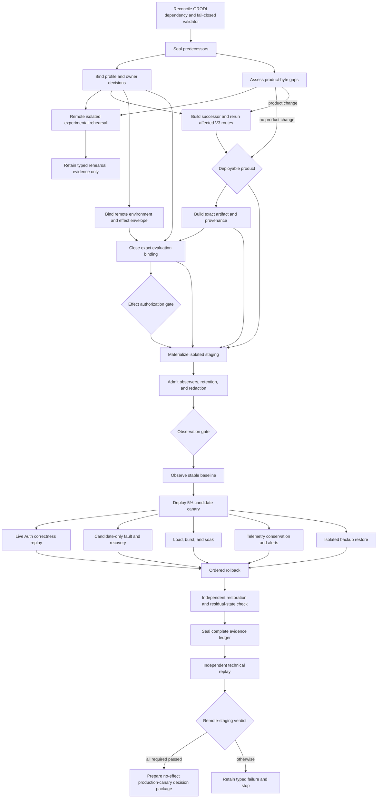

# Auth remote-staging ORODI DAG

## Execution waves

| Wave | Nodes that may run in parallel | Join |
| --- | --- | --- |
| 0 | `Z0`, then `S0` | current ORODI dependency and predecessor seal |
| 1 | `B0`, `P0` | owner profile and product-gap assessment |
| 2 | conditional `P1`; `O0` after B0; optional lower-claim `X0` | `G0`, environment/effect envelope; `X0` cannot satisfy them |
| 3 | `O1`, then `B1`; `G1` | exact binding and authorized artifact identity |
| 4 | `O2`, `O3` | `G2` |
| 5 | `O4`, then `O5` | live canary established |
| 6 | `C1`, `C2`, `C3`, `C4`, `C5` | all campaign states recorded |
| 7 | `O6`, `O7`, `E0`, `R0` | `G3` |
| 8 | `G4` or `STOP` | no production effect |

## Open Questions

See [PLAN.md](PLAN.md#open-questions).

`authority_effect: none`
