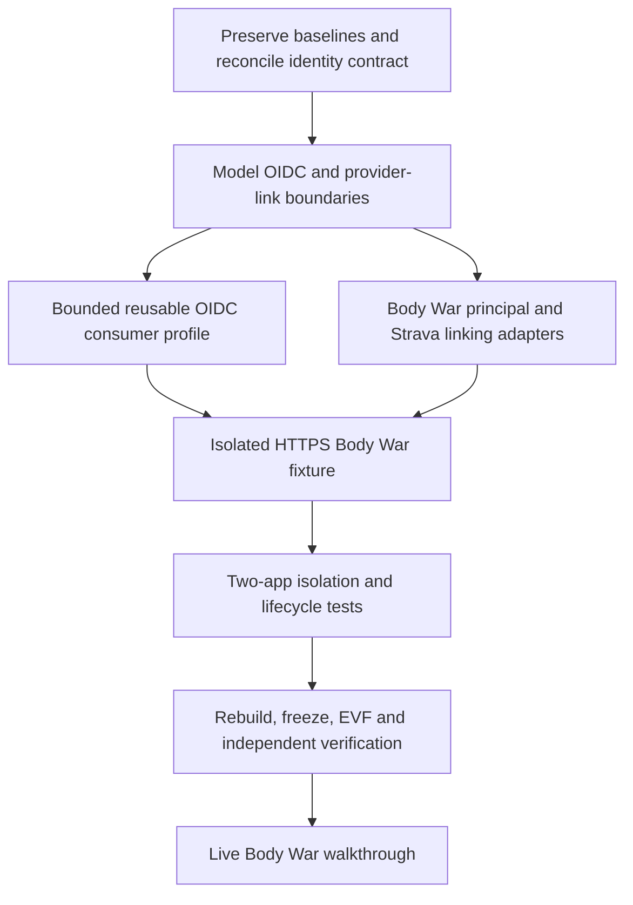

# Body War v2 as the second authentication consumer

Date: 2026-09-07. Status: candidate integration contract and plan.
User selection: `lets take the body-war-v2 project to test`.
Authority effect: none; no runtime integration or production approval claimed.

## Selected source and current behavior

Exact consumer: [body-war-v2](../../../body-war-v2/README.md), package
`@domainspec/body-war-v2`, at `domainspec-core/projects/body-war-v2`.
The older `projects/body-war` is upstream evidence, not this integration target.
The root README and package identity resolve the earlier lookup ambiguity.

Body War v2 owns a generated pilot application with source-bound adapters.
[model/identity.alch](../../../body-war-v2/model/identity.alch) currently declares
public Strava start/callback operations; the callback creates an app session.
[Strava adapter](../../../body-war-v2/app/src/auth/strava-oauth.ts) maps
`strava:<athlete id>` to a principal. The
[HTTP adapter](../../../body-war-v2/app/src/adapters/pilot-http.ts) currently uses
`bw_session` and a 30-day session lifetime. The vendored auth package owns local
principal, permission, session and token persistence/use cases. These are real
integration boundaries, not a blank sample application.

The [Auth Foundation session candidate](SESSION-LIFECYCLE-REPORT.md) supplies the
current OIDC/HTTPS/session behavior. Its verifier has fixed prototype client and
audience values; do not make it universal by accepting arbitrary clients or
issuers. Define explicit consumer profiles and retain hostile cross-profile tests.

## First testable outcome

A disposable Alice account signs into Body War through the existing self-hosted
Keycloak issuer, reaches a Body War profile before connecting Strava, explicitly
connects fake Strava, reads synthetic activities, and submits evidence only with
Body War's existing ownership and consent checks. Bob cannot see or relink Alice's
provider data. No live Strava account, GPS history, existing provider token or
production database is read or migrated for this increment.

| Boundary | Candidate contract |
| --- | --- |
| Issuer | Existing `https://localhost:18443/realms/auth-https` |
| Body War browser client | Dedicated confidential `body-war-v2-browser`, code + S256 PKCE, fixed callback |
| Body War API audience | Dedicated `body-war-v2-api`; deny prototype-api tokens and the reverse |
| External identity | Exact validated `(issuer, subject)` maps to a local runner principal |
| Provider identity | Strava athlete ID belongs to a linked provider account, not the primary sign-in key |
| Cookie and origin | Separate app cookie and hostname, proposed `https://body-war.localhost:14443`; no shared parent-domain cookie |
| App timing | 15-minute inactivity / 8-hour maximum; five-minute tokens do not reset these deadlines |
| Credential handoff | Existing HTTPS test identity; do not create another undocumented Alice password |
| Authorization | Body War keeps its generated operation permissions, consent and per-record ownership checks |

Use a distinct hostname because cookie isolation is not provided by different
ports on localhost. The local fixture must prove hostname resolution, certificate
SAN and isolated-browser trust without changing global trust or disabling TLS
checks. Select/check the exact callback path and available port during construction.

## Dependency DAG

| Node | Work and exact acceptance |
| --- | --- |
| A | Preserve both current candidates and uncommitted source evidence; capture Body War's actual baseline manifests and dependency hashes before edits. Reconcile primary identity, provider linkage, local permissions and session states. |
| B | Author changes in `model/identity.alch`, `model/infrastructure.alch`, relevant UI/assurance models and source-bound adapter declarations. Regenerate through the existing AlchLang/DomainSpec build; do not patch generated routes or policy guards by hand. |
| C | Implement a narrowly configured server-side OIDC adapter with fixed issuer/client/audience/redirect binding, state/nonce/PKCE, auth_time checks, online status checks and bounded requests. Reuse tested session semantics without broadening the original demo's trust profile. All tokens remain server-side. |
| D | Create an explicit external-identity mapping; sign-in grants only the candidate local runner role, never caller-selected permissions. Change Strava linking to require a signed-in principal and CSRF/origin protection; bind OAuth state to that principal and session and revalidate it at callback. A Strava callback cannot create an independent app login. Reject account-link conflicts and session/account switches atomically. Existing Strava-only accounts remain untouched in this isolated fixture; no automatic email/name merge or migration. |
| E | Separate loopback HTTPS host, cookie, backend boundary and disposable data store. Keep fake Strava enabled. Ensure an unlinked signed-in runner gets a useful profile and explicit Connect Strava action; do not require Strava merely to sign in. |
| F | Verify login, protected profile, fake provider linking, activity ownership, consented evidence and logout. Reject wrong audience/client/issuer, cross-app cookies, caller principal injection, provider-link CSRF/replay, Alice/Bob link takeover, revoked status, stale callbacks and expiry/renewal/logout races. Check that health/status polling does not count as user activity. |
| G | Rebuild model and app; run affected unit/API, isolated Postgres and browser suites plus the supported pilot validation campaign. Add explicit identity/linking assurance cases rather than relabel old Strava-only passes. Freeze successor hashes; run scoped EVF and independent verification; retain incomplete TDE/formal/ORODI coverage as such. |
| H | In a trusted browser, sign into Body War, view profile, connect fake Strava, review synthetic activity, submit with consent, sign out and demonstrate isolation from the Auth Foundation demo. Record human review separately. |

## SSO and logout semantics

First arrival with missing local session remains conservative fresh authentication,
as in the current Auth Foundation candidate. Active-session token renewal may use
SSO. This first integration proves a shared issuer and independent relying parties;
it must not be advertised as seamless initial cross-app SSO yet.

A later trusted cross-app handoff must distinguish first arrival from a prior local
lock, resist cookie deletion and direct-link bypass, and preserve each app's own
idle and absolute deadlines. It cannot reset those deadlines merely because another
app is active. That policy is a separately testable extension.

Expose local app sign-out explicitly. Do not silently treat Strava disconnection,
local sign-out and issuer-wide sign-out as equivalent. Global logout/revocation
requires explicit delivery and bounded invalidation tests across both apps; it
remains separate from the first integration. Local sign-out must cancel pending
login/link callbacks so they cannot silently reconnect the user.

## Construction frontier and operational lane

Current frontier: exact second consumer selected; candidate integration contract
prepared. Runnable next construction: A and B, followed by C/D. This follows D65:
meaning/contracts, model and adapter bindings, generated implementation, exact
tested successor, then human review. There is no new mandatory ontology-runtime
selector dependency, governance admission or public deployment effect.

| Operational task | Owner | Exact affected stage / blocker |
| --- | --- | --- |
| Preserve active auth idle test | Implementing agent | Avoid demo requests, restart, issuer/proxy changes or shared-session operations until the user's idle test completes; source planning can proceed |
| Local hostname, SAN certificate and isolated trust fixture | Implementing agent | E; use test-only configuration, not machine-wide trust |
| Isolated PostgreSQL and fake provider state | Implementing agent | D/E and persistence tests; no live token-store adoption |
| Existing real Strava account migration and consent | Body War owner | Later real-data pilot; not a first-increment prerequisite |
| Durable shared sessions and global revocation | Auth Foundation owner | Later multi-instance/global SSO behavior |
| Production domain, real provider registration and operations | Platform/provider owners, unassigned | Future deployment; not local contract/model work |

No running app, issuer, proxy, database or browser was changed during this planning
turn. No auth request was made against the user's idle-test session.

## Open Questions

- Which hostname and callback will the local fixture bind after port/DNS checks?
- Which future trusted handoff will enable seamless initial cross-app SSO without
  bypassing app inactivity locks?
- Which account migration policy, if any, will later map real Strava-only runners
  to primary OIDC identities with explicit proof and consent?
- Which application actions count as qualifying activity once UI polling is included?
- Which durable session/revocation mechanism will eventually span instances?

Planning is candidate output. Goals validation is not available for admitting an
execution state; no such registration is claimed.
