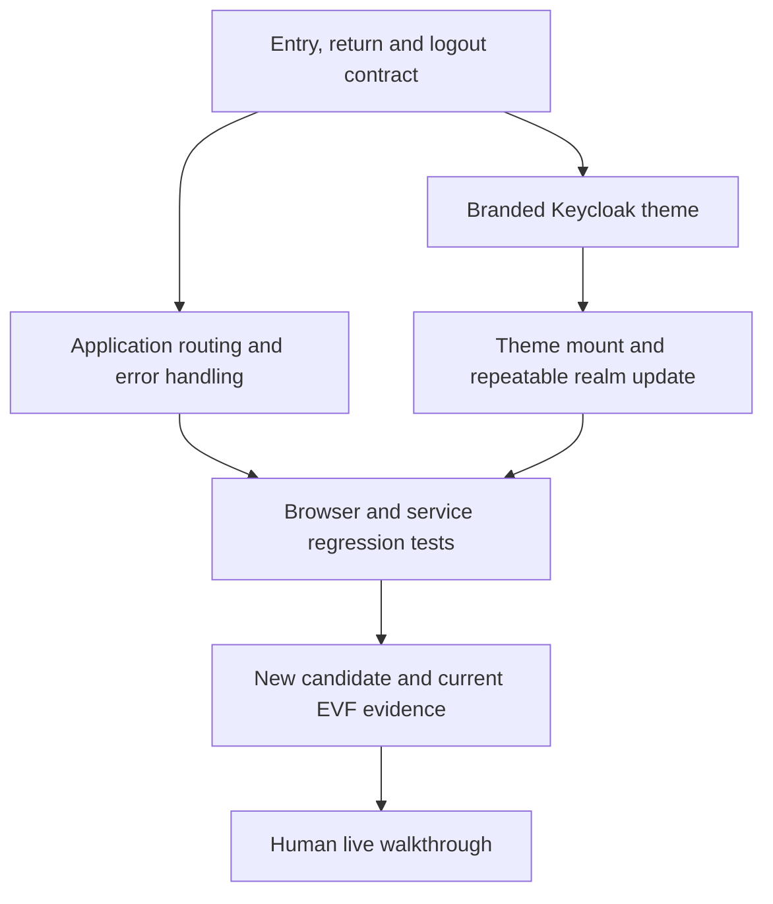

# Branded sign-in and direct application entry

Date: 2026-09-07. Status: candidate plan. Owner: Auth Foundation product owner.
Authority effect: none. This turn plans the change; it does not mutate runtime.
User feedback: the prototype worked; remove the extra transition into Keycloak.
Interpretation: remove the introductory click and give the identity-provider
form the application's branding. The underlying OIDC redirect remains visible
in the browser URL; branding does not make the two origins identical.

## Intended experience

Open application → branded sign-in when needed → authenticated application.
A valid existing application session opens the app directly. An existing
Keycloak SSO session may complete the authorization redirect without another
credential prompt, subject to the existing authentication-age policy.
Use the current Auth Foundation name, dark palette, green accent and typography
as the working design. These are reversible defaults, not a new brand decision.

| Situation | Proposed behavior |
| --- | --- |
| Visit `/` without an application session | Start the existing OIDC login transaction automatically; no introductory screen/button. |
| Visit `/` with a current application session | Show the authenticated application; protected actions retain their verification and policy checks. |
| Visit `/document` without a session | Start login with a server-owned destination identifier for this route, then return to the document. |
| Call `/api/document` without valid service credentials | Return the existing JSON authentication failure; never redirect a machine client to HTML. |
| Successful callback | Validate the transaction, establish a new session and return to the server-selected destination. |
| Login cancelled, expired or invalid callback | Render a branded error with an explicit retry; no automatic retry loop, raw provider error or token exposure. |
| Issuer unavailable | Render a bounded failure/retry page; deny protected actions. |
| POST `/logout` with valid CSRF | End local session, initiate Keycloak logout, then return to `/signed-out`. |
| Visit `/signed-out` | Remain signed out; show one explicit Sign in action. Do not auto-start authentication. |

Visiting `/signed-out` alone does not terminate an authenticated session; only
the protected logout action does. Logout should clear the local session even
if issuer logout cannot complete; show that limitation without claiming SSO
logout succeeded. Existing five-minute session/token policy remains in scope
as-is. Revisit its UX separately rather than changing security lifetimes here.

## Dependency DAG

| Node | Dependencies | Work and done criteria |
| --- | --- | --- |
| A | none | Record the route table, safe return destinations, brand defaults and security invariants in successor contract/scaffolds. |
| B | A | Share login initiation between `/` and `/login`; session-aware entry; bounded retry/error states; `/signed-out`; protect logout and return destinations. |
| C | A | Add an Auth Foundation login theme extending the pinned Keycloak theme. Prefer CSS, messages and local assets; preserve native form actions, hidden inputs, errors and accessible labels. |
| D | C | Mount theme read-only in the local container; select it for `auth-prototype`; update existing realm and browser-client logout URI idempotently as well as fresh setup. |
| E | B,D | Browser acceptance tests below pass; existing service/verifier/authorization tests remain valid; mobile and keyboard review recorded. |
| F | E | Preserve predecessor inputs/evidence before edits; freeze a new manifest including theme assets/configuration; run current scoped EVF and independent verification. |
| G | F | User can open app, sign in once, reach the intended page, sign out and remain signed out. Record feedback separately from product approval. |

B and C are independent after A. D joins the theme into the local runtime;
E joins route and theme work. This graph describes dependencies, not a request
for delegated agents. Full successor compiler/formal correspondence remains the
existing residue described in [the prototype report](PROTOTYPE-REPORT.md).

## Planned implementation surfaces

All paths below are relative to
[the prototype root](../../implementation/authentication-prototype/).

- `src/server.mjs`: shared login helper; route/session/error behavior; fixed
  internal destination map stored in the server-side login transaction.
- `themes/auth-foundation/login/theme.properties`,
  `themes/auth-foundation/login/resources/css/login.css`,
  `themes/auth-foundation/login/messages/messages_en.properties`: new theme.
  Add templates only if the required layout cannot be achieved safely through
  the inherited theme. No external fonts, analytics or theme JavaScript needed.
- `compose.yaml`: read-only theme mount while retaining pinned image and
  loopback-only exposure.
- `scripts/setup.mjs`: fresh configuration and a narrow update for existing
  realm/client; set `loginTheme`, display name and the exact `/signed-out`
  post-logout URI without replacing users, keys, client secrets or grants.
- `test/live.test.mjs`: update browser entry expectations and add transition,
  failure, safe-destination and logout scenarios; retain machine API cases.
- `scripts/freeze-evf.py`: include all new theme files in the new input manifest;
  preserve old manifest/profile/evidence/source snapshots before changing bytes.
- `README.md` and a new revision report/contract in this development directory:
  document entry, logout, retry behavior, tested revision and remaining limits.

Do not just edit the import JSON: the existing database already contains the
realm, so repeatable setup must explicitly update selected existing fields.
Keep the theme scoped to the application realm; the master administration
console is a separate surface.

## Authentication and evidence invariants

Retain code + PKCE S256, state, nonce, single-use login transactions, exact
redirect registration, server-held tokens, opaque session rotation, and current
issuer/audience/type/time verification. Keep direct password grants disabled
for application clients. The application must not collect passwords and forward
them through a replacement password endpoint. The themed form submits directly
to Keycloak's existing authentication flow, with its own form protections.

Only fixed internal destinations such as `home` and `document` may be stored
in login transactions. Reject external URLs, protocol-relative URLs and caller
supplied issuer/callback overrides. An attacker-controlled `returnTo` must
never become a redirect target. Automatic entry must not convert callback
errors or denials into unbounded login loops. Preserve strict Origin + CSRF
checks and the tested referrer-policy behavior on logout.

Retain old evidence as historical evidence for its exact input digest. New
source bytes require new evidence; a passing old EVF cannot certify the new
routing/theme. The offline EVF covers verifier/bridge behavior; browser tests
must establish the new visible flow. User feedback that the prototype worked
is valuable acceptance feedback, not an invented digest-bound product approval.

## Acceptance checks

1. Fresh browser opens `/` and reaches the branded credential form without
   clicking an intermediate Sign in button. Successful login returns home.
2. Existing application session opens home without unnecessary login; existing
   IdP SSO completes without forcing another prompt when its policy permits.
3. Direct navigation to `/document` returns there after login. Unapproved
   destination values and callback replay/state/nonce tampering fail closed.
4. Invalid credentials show readable native validation. Cancellation, expired
   transactions, issuer outage and refresh/back navigation cannot redirect-loop.
5. Sign-out clears the application session, completes the configured IdP logout,
   reaches `/signed-out`, and stays there. Missing/wrong CSRF or Origin denies.
   Old cookies cannot retrieve protected data.
6. `/api/document` preserves JSON failure/success behavior and the autonomous
   service identity. No browser redirect is introduced for machine requests.
7. Keyboard-only navigation, visible focus, labels, password-manager autofill,
   contrast and 320px-width layout work; inherited error pages remain usable.
   No passkey/MFA assurance claim is added by restyling an untested flow.
8. Fresh setup and repeat setup select the theme and logout URI; repeat setup
   preserves current principals, credentials and grants. Container recreation
   retains branding. New manifest includes every theme asset actually loaded.
9. Existing unit/live security controls plus the scoped fresh EVF and independent
   verifier pass before calling this successor ready for another live test.

## Construction frontier and operations

Current frontier: A, candidate UX/route contract. Runnable next construction:
implement that bounded contract and then B/C under a separately selected
IMPLEMENT route, carrying existing user authorization accurately. No new
product initiative, canonical definition admission or deployment is inferred.
The Goals package cannot register this as admitted execution state; this is a
local candidate plan with explicit dependencies.

| Operational item | Owner | Affected node / blocking basis |
| --- | --- | --- |
| Local container recreation and narrow realm/client update | Implementing agent when executing this change | D/E only; needed to exercise the theme against existing state. |
| Preserve old source and evidence snapshot | Implementing agent | Before B/C edits and F; exact prerequisite to keeping old evidence reviewable. |
| Production issuer domain, HTTPS and reverse proxy | Platform owner, unassigned | No local node; separate deployment residue. |
| Final brand assets or copy | Product owner | No blocker: use existing Auth Foundation styling as a reversible default. |
| Production key custody, recovery and administrator assurance | Security/operations owner, unassigned | No node in this UX slice; remains in original requirements. |

## Source basis

Current route behavior: [server](../../implementation/authentication-prototype/src/server.mjs).
Existing-state setup: [setup script](../../implementation/authentication-prototype/scripts/setup.mjs).
Regression baseline: [live tests](../../implementation/authentication-prototype/test/live.test.mjs).
Keycloak supports login themes, inherited resources and realm-level selection;
template overrides can require maintenance across upgrades. Extend its supplied
theme rather than editing bundled files. [Official theme documentation](https://www.keycloak.org/ui-customization/themes),
inspected 2026-09-07. This source supports the theming mechanism; route behavior
and acceptance checks above are our design decisions.

## Open Questions

- Final name/logo and whether other products need distinct themes. Current
  proposal uses Auth Foundation and a single realm theme; tenant theming is not
  added implicitly.
- Whether a future public marketing page should remain at a separate route.
  Current proposal treats `/` as the application entry.
- Production identity hostname and TLS remain separate; this plan promises a
  unified visual flow, not disappearance of the browser's origin transition.
- Broader passkey/recovery and production requirements remain owned by
  [requirements](REQUIREMENTS.v1-candidate.md#open-questions).
