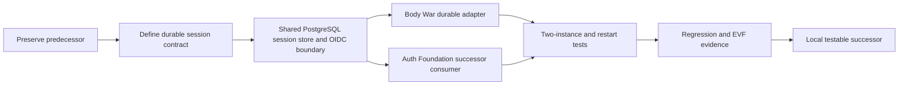

# Durable sessions construction plan

User authorization: “plan and do this”, following successful live validation of the Body War identity prototype. The current milestone is durable sessions, cross-instance revocation and one shared integration. MFA/recovery and production deployment remain subsequent milestones from the roadmap.

## Product frontier and DAG

The approved memory prototype is the predecessor. Preserve its source and running listeners, then:

Runnable product work: B–E. The shared package owns opaque cookie handles, family generations, expiry, transaction consumption, token custody and revocation. Applications retain local authorization and domain persistence. Body War's canonical AlchLang model binds its new adapter; generated files remain projections. The JSON contract in `implementation/session-core/contract.json` is the candidate scaffold for this package, not admitted ontology authority.

## Contract and acceptance

A session family has one current opaque random cookie handle, monotonic generation, last foreground activity and fixed absolute deadline. Renewed handles retain a mapping to the family until its absolute expiry so a stale-but-authentic handle can still revoke a racing renewal. Old handles cannot authenticate. PostgreSQL owns time and current state. Tokens, PKCE and local credential bindings are encrypted with AES-256-GCM with application/record AAD; cookie handles are stored only as SHA-256 hashes.

All mutations serialize using a transaction-scoped advisory lock per application namespace, with lock/statement timeouts. This conservative prototype trades per-application write throughput for simple reviewed concurrency. OIDC exchange occurs outside the database transaction; completion rechecks transaction claim, parent generation, cookie, deadlines, subject and issuer session inside the commit. Provider linking serializes against revocation. Database or identity failure denies protected access; no memory fallback.

Tests must prove: valid login and identity survive app/process/database restarts; login started on A can complete on B; logout on either instance invalidates both including copied/old handles; parallel callbacks have one winner; renewal/logout and pending-link/logout cannot resurrect identity; idle/absolute deadlines and database outage remain fail closed; different application namespaces cannot accept one another's handles. Existing local permission and provider ownership/consent tests remain required.

## Operational support

| Task | Owner | Affected stage / dependency |
| --- | --- | --- |
| Dedicated local PostgreSQL, volume and private fixture secrets | Implementing agent | F needs database; does not block contract/package implementation |
| Dedicated successor clients and SAN certificates | Implementing agent | F live OIDC; old clients, realm policy and listeners unchanged |
| Body War successor URL and two-worker front door | Implementing agent | H; distinct host/cookies from current app |
| Production DNS, CA, backup custody, secret rotation policy and HA | Future platform owner | Deferred; no production release claim |
| MFA/passkeys, recovery and global cross-application logout | Auth owner | Later bounded milestones; current logout revokes one app session family |

## Evidence basis

[OWASP session guidance](https://cheatsheetseries.owasp.org/cheatsheets/Session_Management_Cheat_Sheet.html) requires server-side expiration and invalidation. [PostgreSQL locking](https://www.postgresql.org/docs/17/explicit-locking.html) supplies transaction-scoped serialization. D65 construction ends at a tested candidate for user review; no publication, production migration or admission is implied.

## Open Questions

Future production throughput may require per-family locks and partitioning. Encryption-key rotation, database failover, retention/backup deletion, account recovery, MFA, global logout and release qualification require subsequent contracts and tests. The fixed local issuer and synthetic Strava remain this milestone's boundary.
