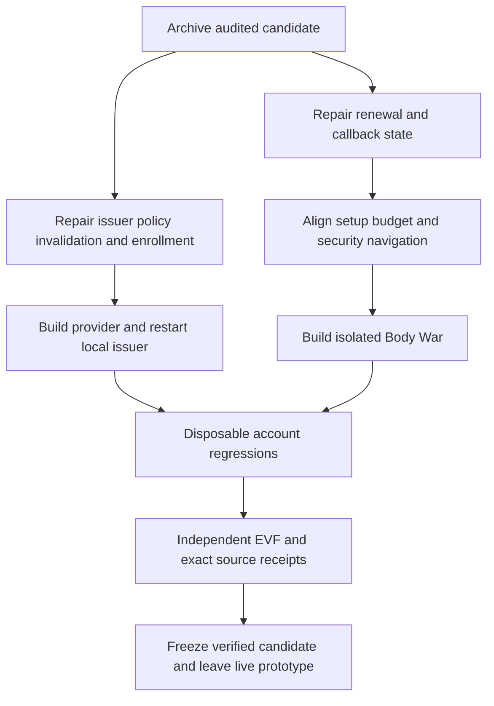

# Auth lifecycle repairs

Authorization: user “plan and implement” after the [audit](../../implementation/authentication-durable/evidence/audit-20260908/README.md). Candidate predecessor: `224b66895a413dc6887b55c3280fac7934f43a802a77b40481a85c9e20236c13`, 694 verified inputs archived under [history](history/before-lifecycle-repairs/). Original HTTPS inputs remain frozen.

## Construction DAG

Current product frontier: implement the nine bounded audit findings. Runnable work: B, C, D, test-helper repair and evidence binding. Causal blockers: live issuer regressions require the rebuilt provider; exact freeze requires passing receipts from unchanged source.

## Selected policies and acceptance

- A01: explicit sign-in requests fresh authentication. Silent renewal may fall back once on terminal issuer rejection; transient failures stop with an error. Failed renewal revokes its local family. No browser redirect loop.
- A02: direct or inherited MFA policy changes invalidate existing sessions. In this small prototype, group and role-graph administration conservatively revokes all realm user sessions; per-user membership changes revoke that user. Precision optimization is deferred.
- A03: disabling an account revokes sessions permanently; re-enabling requires fresh authentication.
- A04: expired-token security navigation renews authentication and returns to the server-selected security page. State-changing requests still require valid authentication, same origin and CSRF.
- A05: login transactions and cookies have a ten-minute interactive budget, aligned with issuer action/login limits. Session idle (15 minutes), absolute (8 hours), and token (5 minutes) limits stay separate.
- A06: a consumed callback may redirect only after independently authenticating the existing session cookie. Its code or status is never evidence of authentication.
- A07: privileged users with an authenticator but no recovery codes must resume recovery enrollment on their next login. Recovery-only users retain the existing factor policy.
- T01: normal enrollment helpers never revisit stale action URLs; stale navigation is an explicit separate scenario.
- T02: test run receipts bind pre/post source identity and output hashes. Freeze rejects missing, changed, or failed evidence; older tests are explicitly inherited rather than presented as current runs.

## Operational lane

Owner: local prototype operator/user. Local process restart and disposable test accounts are authorized implementation support for E–G. Public deployment, production certificates, external mail and Windows-native browser validation remain deferred operational work; they do not block local construction. No account password or authenticator changes to Alice.

## Open Questions

Production session scale and precise group-change invalidation, exhausted recovery-code policy, Windows-native certificate deployment and production operations remain owned by the MFA recovery plan. This candidate claims bounded prototype behavior only.
