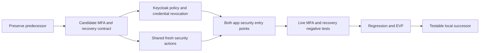

# MFA and recovery construction plan

Authorization: “plan and do this with your recommendation”. The recommendation is mandatory MFA for privileged accounts and optional enrollment for regular accounts. This is a local successor to durable candidate `bb1f146d998042f95db82f01e2e99ee5f08d1de1e9c37fe1c60ee0dbff731db7`, preserved with its evidence in `history/durable-before-mfa/`.

## Product frontier and DAG

Current product frontier: H, the tested local successor. Construction B–G is complete; startup verification and candidate recording close H. Production operations and passkeys remain separate residue below. Candidate definitions: privileged means an identity with the operator-assigned `auth-privileged` realm role; enrolled means possessing an OTP or recovery-code credential; recovery means email-assisted password reset or password plus a previously enrolled single-use recovery code for loss of OTP. No self-service role assignment or email-only MFA removal is permitted. Application authorization remains independent of this MFA classification.

The candidate scaffold is `implementation/authentication-durable/security/contract.json`; Keycloak flow configuration is its implementation projection, not admitted ontology authority. The existing Body War AlchLang model remains the route source. Keycloak owns credentials, verification, challenges and one-use recovery codes. A small pinned provider composes the privileged-or-enrolled condition and revokes issuer sessions on successful credential changes and recovery login; it does not implement credential validation.

## Acceptance

Regular accounts without enrollment can sign in. Privileged accounts cannot complete login without MFA enrollment; enrolled regular and privileged accounts must answer OTP or recovery-code challenges. Wrong/replayed factors and reset links fail. Security actions require fresh login and state/nonce/PKCE; their callbacks never issue an app session or adopt a different identity. Reset requires email possession and, for enrolled accounts, the existing second factor; reset never removes MFA. Credential changes commit the issuer user-token revocation timestamp, invalidate pre-change sessions after commit and deny access in both apps through online introspection. The shared code-exchange boundary also checks signed authentication time against the issuer's TLS-protected not-before policy, preventing older SSO authentication from silently renewing past that fence. Recovery-code login revokes other sessions. Neither application receives passwords, OTP seeds or recovery codes. The test harness may keep synthetic test credentials only in private runtime files.

## Operational support

| Task | Owner | Affected stage and causal dependency |
| --- | --- | --- |
| Local SMTP capture with no outbound relay | Implementing agent | F needs password-reset email delivery; no production email dependency |
| Pinned Java build image and Keycloak provider overlay | Implementing agent | C/F need a provider built against running Keycloak 26.7.3 |
| Dedicated privileged and regular synthetic test identities | Implementing agent | F; preserve alice credentials and previous app data |
| Keycloak restart and dedicated app worker restart | Implementing agent | F; bounded local interruption only |
| Production SMTP, DNS, trusted public HTTPS and backup custody | Platform owner | Deferred, not a blocker for local tests |
| Passkeys and production release assessment | Auth owner | Next milestone after stable domain/HTTPS; not part of current frontier |

Realm-level reset settings and credential-action reauthentication necessarily apply to the shared local issuer. The reviewed browser flow becomes the shared realm default so the built-in account console and predecessor clients cannot bypass the privileged policy; the two durable clients also bind it explicitly. The original source snapshot remains unchanged. SMTP goes only to the isolated capture service; no external mail is sent. Existing sessions can be invalidated when their user changes credentials; this is intended behavior.

## Evidence basis

Use the pinned [Keycloak 26.7.3 source](https://github.com/keycloak/keycloak/tree/26.7.3) and [server administration guide](https://www.keycloak.org/docs/latest/server_admin/) for built-in conditional flows, required actions and recovery codes. [UpdatePassword](https://github.com/keycloak/keycloak/blob/26.7.3/services/src/main/java/org/keycloak/authentication/requiredactions/UpdatePassword.java) makes other-session logout conditional on form input; this successor enforces revocation server-side. [OWASP MFA guidance](https://cheatsheetseries.owasp.org/cheatsheets/Multifactor_Authentication_Cheat_Sheet.html) informs recovery and factor-change boundaries.

## Open Questions

Lost password plus lost second factor with no saved recovery code remains locked out; an identity-proofing/support recovery policy requires a later owner decision. Production email delivery, rate/load qualification, provider operational monitoring, passkeys, backups and deployment are deferred. Finite EVF cases cannot prove Keycloak or distributed failure handling. Product tests produce a candidate for review, not product approval or production admission.

## Isolated consumer candidate

Concurrent Body War cleanup/builds changed its startup interface and removed compiled modules during auth tests. Preserve that work. The captured sibling `../../../body-war-v2-auth-mfa/` is an isolated product-test candidate, with `evidence/AUTH-MFA-INPUT.json` binding 407 copied source inputs from Body War. Auth workers use its stable compiled output. This adds no commit, submodule or publication effect.
