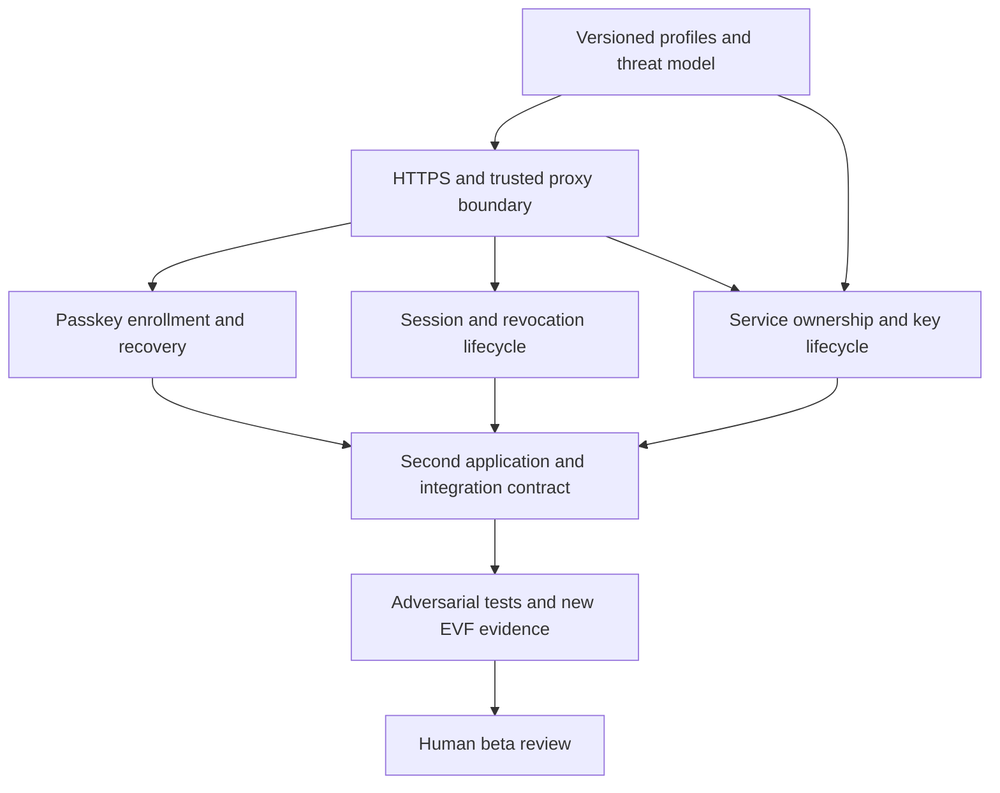

# Next milestone: reusable, hardened authentication beta

Date: 2026-09-07. Status: candidate plan. Owner: Auth Foundation product owner.
Authority effect: none. Planning output only; no admitted execution state.

## Approved baseline

User statement: `approved, lets plan the next steps`.
This plan carries that approval of the just-delivered branded-login prototype
forward. Association with the immediately preceding candidate is inferred from
conversation context, not a user-supplied digest:
`30f6b695de672a4c73f473ea933f6b5a7ec1c7f958a93c4e8795e0fb5f5dfaa8`.
All 149 input hashes were rechecked and match. The
[handoff report](BRANDED-LOGIN-REPORT.md) records 12 unit tests, 9 live scenarios,
scoped EVF and independent verification passing. Earlier test records retain
their historical approval posture; this planning note does not rewrite them or
register a formal governance approval receipt. Approval of this local result
is not production deployment approval.

## Outcome and proposed boundaries

A person can enroll a passkey, sign into two example apps, inspect/revoke
sessions and recover access under an explicit policy. A separately owned
service can obtain narrowly scoped access, rotate its key and be disabled.
Both use the self-hosted issuer and Auth Foundation authorization boundary.
The next beta runs in an isolated HTTPS test environment before any public pilot.

Working defaults for planning: one organization, invited test users, browser
apps and autonomous services, no delegated human authority. These are proposed
scope limits, not additional user-confirmed requirements. Keep Keycloak as the
credential/protocol implementation. Public signup, native/mobile/CLI profiles,
multi-tenant isolation, SPIRE and token exchange are later selected expansions.
“Universal” is demonstrated through explicit interoperable profiles and a
second consumer, not by accepting arbitrary issuers or merging trust boundaries.

## Dependency DAG

The independent branches express dependencies, not authorization to delegate.
Each node produces a reviewable increment; the first implementation slice is A+B.

| Node | Concrete work | Acceptance evidence | Requirement refs |
| --- | --- | --- | --- |
| A | Version browser/service profiles, trusted issuer/audience mappings, enrollment and recovery rules, threat model, and authentication-to-authorization evidence contract. Preserve current permission semantics. | Every allowed flow has an owner, trust boundary, failure behavior and test; no caller field can grant identity or permission. | A01, A09–A10, A13, A17, A21 |
| B | Separate local development from a production-mode test configuration; HTTPS, explicit hostname/redirect allowlists, Secure/HttpOnly cookies, trusted proxy rules, restricted administration, scoped bootstrap credentials and bounded readiness/overload behavior. | Fresh empty-database bootstrap plus repeat setup; successful browser/service flows over verified TLS; reject wrong certificates, Host and forged forwarded headers; direct backend/admin bypass denied. | A08, A12, A24–A25, A27 |
| C | Native Keycloak passkeys/security keys, user-verification policy, step-up for factor changes, backup authenticator enrollment and a bounded recovery flow. Administrators require phishing-resistant authentication; no weak silent fallback. | Enroll/sign in/revoke with virtual and real authenticators; reject wrong RP/origin, replay and missing verification; lost-device and concurrent recovery redemption tests; recovery cannot bypass administrator policy. | A02–A08 |
| D | Explicit server-side session storage and atomic transitions; session inventory/revoke, account disablement and compromise handling; separate local logout from issuer-wide revocation. | Restart and two-app revocation tests, concurrent state changes, fixation, expiry boundaries and issuer/store outage tests. A revoked session stays revoked after recovery/restore. | A12, A18–A20, A23 |
| E | Per-service owner, audience and least-privilege grant; enrollment/disable and planned/emergency asymmetric key rotation. | Wrong key/client/audience rejected; bounded planned overlap works; compromised old credentials cannot mint tokens; already-issued tokens follow the explicit revocation policy. | A13, A15, A17, A19, A25 |
| F | Extract the tested integration boundary into a small reusable package/configuration contract and add a second sample app with its own client, audience and session cookie. | Shared issuer SSO works; app A tokens cannot access app B resources without an explicit grant; browser/service profiles remain distinct. | A09–A10, A13, A17, A21 |
| G | Map selected requirements to tests; add sanitized audit events, abuse/load tests, signing-key rollover, recovery/restore drills and failure injection. Freeze new exact inputs, run live tests and scoped EVF with independent verification. | Working positive controls plus hostile cases, secret-redaction checks, measured revocation and recovery results, no stale evidence. Label each untested requirement explicitly. | A08, A23, A25–A28 |
| H | Walk through enrollment, both apps, session revocation, recovery and service key rotation; review the exact candidate and limitations. | Human beta acceptance recorded for the tested candidate. | Product review |

Proposed numeric defaults retain five-minute access tokens, zero accepted clock
skew and online status checking; measure the requirements' proposed 60-second
critical revocation ceiling. Do not silently extend the current five-minute app
session. D must choose either explicit reauthentication or a separately tested
refresh design before changing that UX. If refresh is selected, require atomic
rotation/reuse detection and family invalidation across instances. Service-client
private-key authentication does not sender-constrain its access tokens; A must
classify whether the intended API needs DPoP/mTLS before admitting that profile.

## First testable increment: A+B

Deliver an isolated HTTPS version of the current working flow, an explicit
browser/service security contract and reproducible fresh/repeat setup tests.
Use disposable local identities and an isolated browser trust configuration;
do not install machine-wide trust or migrate the approved test database as an
incidental step. Verify TLS normally, without disabling certificate checks.
Select the eventual RP hostname before enrolling long-lived real-user passkeys.

Expected implementation surfaces: a versioned successor contract/profile and
threat model under this development directory; a separate successor runtime
configuration, proxy/certificate fixtures, configurable allowlisted endpoints,
cookie policy and integration tests under the implementation package. Preserve
the current candidate's source and evidence before any implementation changes.
Pin exact files and tool versions when the implementation route is selected.

## Construction frontier and operational lane

Current frontier: approved local UX prototype; next candidate contract and HTTPS
construction slice ready to prepare. A+B are runnable locally after the bounded
implementation request; C/D/E follow their stated prerequisites. Carry D65 from
contract/definition reconciliation through scaffolds, implementation, frozen
candidate, tests and human review. Full successor DomainSpec compilation/formal
correspondence remains explicit residue; these plans and tests do not prove it.
No mandatory ontology-runtime dependency is selected. Goals validation remains
blocked for admitted execution registration; that does not block this candidate
plan or exact owner-directed local construction.

| Operational task | Proposed owner | Exact affected stage / blocker |
| --- | --- | --- |
| Isolated TLS test fixture and disposable database | Implementing agent | B; local construction dependency, no production DNS needed. |
| Final issuer/RP domain, infrastructure and certificate custody | Platform owner, unassigned | Persistent real-user enrollment and later pilot; does not block disposable A+B. |
| Recovery policy, privileged exceptions and security targets | Product/security owner, unassigned | C final policy and real-user recovery; design/test fixtures can proceed with explicit candidate rules. |
| Mail delivery and verified notification channel | Identity operations owner, unassigned | Any selected email-dependent recovery/notification path; use a local mail sink for tests. |
| Backup custody, restore objectives, monitoring and patch response | Operations owner, unassigned | G local drill design; real service pilot requires named owners and measured objectives. |
| External security review and public pilot deployment | Security/platform owners, unassigned | Later release/pilot gate after H; separate exact deployment scope and authorization. |

Production admission additionally requires closure of applicable ASVS findings,
independent review, actual hosting/retention/availability decisions and incident
readiness. These operational items remain visible rather than blocking unrelated
local construction or being implied complete by EVF.

## Source basis

The project's [28 requirements](REQUIREMENTS.v1-candidate.md) own the broader
security backlog; the [branded-login contract](BRANDED-LOGIN-CONTRACT.json) and
[report](BRANDED-LOGIN-REPORT.md) define the working baseline.

Rechecked 2026-09-07: Keycloak's [production configuration guide](https://www.keycloak.org/server/configuration-production)
supports TLS, hostname, administration exposure and capacity planning. Its
[proxy guide](https://www.keycloak.org/server/reverseproxy) describes proxy trust
and header-spoofing controls. [OAuth Security BCP, RFC 9700](https://www.rfc-editor.org/rfc/rfc9700.html)
is the protocol baseline for client/redirect and refresh-token protections.
These sources support the mechanisms; the milestone order and defaults are our
engineering proposals. Verify version-specific options against the selected
Keycloak image before implementation.

## Open Questions

- Which actual application should replace the second sample consumer?
- Is invitation-only, single-organization scope right for the first beta?
- What permanent issuer/RP hostname and hosting environment will be used?
- Which human recovery fallbacks are acceptable, especially for administrators?
- Should sessions transparently refresh, and what idle/absolute bounds apply?
- Which service APIs require sender-constrained tokens or delegated authority?
- Who owns security, recovery and operations, and what are capacity/RTO/RPO targets?

These decisions are resolved at their affected nodes; no decision is inferred
from elapsed time. They do not require stopping local A+B planning.
