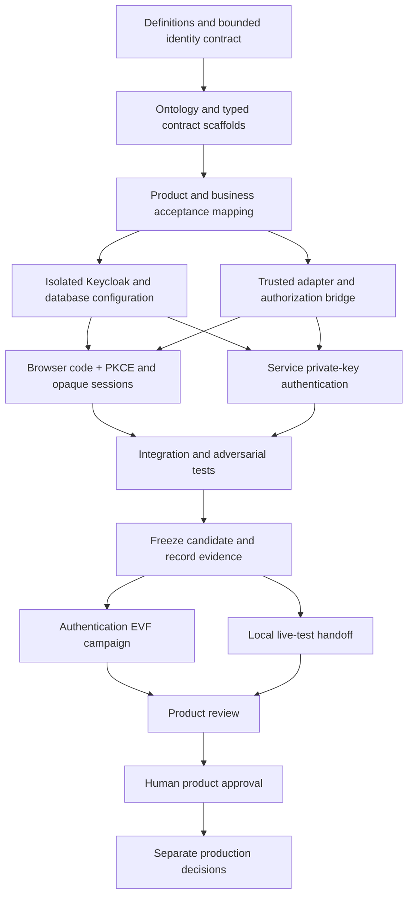

# Authentication prototype construction DAG

Status: candidate plan, 2026-09-07. Owner: Auth Foundation product owner.
Authorization: user requested planning and implementation through a prototype for
live testing. Local construction/testing only; no production deployment or
predecessor approval extension. Source: [requirements](REQUIREMENTS.v1-candidate.md)
and [selection](SELF-HOSTED-COMPARISON.v1-candidate.md).

## Dependency graph

## Nodes and completion criteria

| Node | Dependencies | Completion evidence |
| --- | --- | --- |
| D | none | Explicit issuer/subject identity, human/service kinds, server-owned grants, no delegation, test-only population. |
| O | D | Machine-readable contract and relationship scaffold; validation rejects missing/ambiguous identities. |
| P | O | Requirements and scope mapped to executable acceptance scenarios; limitations explicit. |
| K | P | Pinned self-hosted Keycloak/PostgreSQL, loopback-only ports, generated test credentials excluded from Git. |
| A | P | Cryptographic verifier to trusted local bridge; existing authorization engine invoked; caller evidence/roles ignored or rejected. |
| B | K,A | Real authorization-code + S256 login, state/nonce checks, opaque sessions, CSRF-protected logout and protected resource. |
| M | K,A | Separate registered service client with asymmetric assertion; real token accepted only for registered identity and audience. |
| T | B,M | Positive browser/service controls; wrong token, identity, session and permission cases fail closed; issuer outage denial. |
| F | T | Source/dependency manifest and current test report; prior frozen implementation bytes unchanged. |
| L | F | Start/stop instructions, test identities, local URLs, reproducible live walkthrough. |
| E | F | New authentication EVF with real verifier checks and independent verification; prior EVF cannot substitute. |
| R,H,X | E,L | Review then human decision for exact candidate; production decisions remain separate. |

## Current frontier and lanes

Product construction starts at D; execute dependency-ready nodes through L,
then complete the feasible local EVF evidence under the existing request.
Implementation is separately routed after this plan. This plan is not admitted
Goals execution state; no Goals runtime is required for native authorized work.
D65 stages remain candidate until their own evidence exists.

Initial prototype scope: one browser backend, one autonomous service, one
protected document, one locally configured organization. Principal kind is
explicit in the adapter/bridge contract. Any projection to the predecessor's
`user_id` storage column is an internal subject-key projection, never a claim
that a service is a human. The successor must test this distinction. Permissions
come from an operator-owned local policy, not IdP role claims. Unregistered
identities deny by default. No public signup, recovery or delegation in this
slice; their requirements remain open for later product scope.

Operational support: local Docker/cache setup is a prerequisite only of K and
owned by the implementing agent in this task. Production DNS/TLS, HA, backup,
key custody, incident response and recovery operators are unassigned deployment
residue; none blocks D/O/P/A. Use throwaway local credentials and databases.
Do not expose the prototype on public/LAN interfaces or change system trust.

## Open Questions

Production/client expansion decisions remain in the requirements Open Questions.
Prototype observations may require graph changes; preserve failures and update
node status from actual evidence in the final prototype report. Do not mark E
complete from ordinary test results or H complete from implementation consent.
