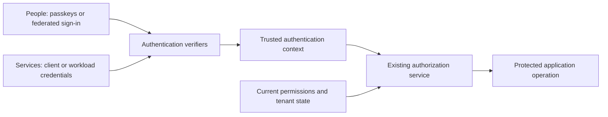

# Authentication for people and services: requirements candidate

Researched: 2026-09-07 UTC. Status: research-backed scope and requirements draft.
Owner: Auth Foundation product owner; security and operations owners remain to
be assigned. Consumer: the Auth Foundation product/design review.
Authority effect: none. No authentication implementation or security
certification is claimed by this document.

## Intent and scope

Explicit user intent: `both, it will be a "universal", search for the requeriments online so we can have a real secure auth system`.

Confirmed consumers are people and services. The interpretation proposed here
is one interoperable identity boundary with separate client profiles for web
applications, native applications/CLIs, external API clients, and internal
workloads. Multi-tenant support and delegated service calls are proposed scope,
not confirmed deployment requirements. Hosting is confirmed as **self-hosted**
by the user's follow-up: `self hosted`.

## Confirmed hosting requirement

The authentication system must run on infrastructure controlled by its operator.
The interpretation proposed for review is that core sign-in, credential/session
storage, verification, and token issuance must operate without a mandatory hosted
identity-provider service. Optional federation with external identity providers
remains a separate choice; self-hosting does not select a vendor or library.

The operating organization must assign responsibility for issuer domains, signing
keys, secret storage, recovery administration, backups and tested restoration,
security updates, monitoring, and availability. Exact people, infrastructure,
capacity, and recovery objectives remain open. Self-hosting does not require
writing cryptography or authentication protocols from scratch.

The approved predecessor is the in-process authorization service and socket-free
API, candidate `2e88296bf35469206e28be09f72235bf4fd2a9f947d80319e580a3f22daa9868`:
[product approval](../auth-service-d65-r2-plan/completion-v1/PRODUCT-APPROVAL.json),
[tested scope](../auth-service-d65-r2-plan/completion-v1/REVIEW.md).
It consumes trusted authentication evidence; it does not yet implement credential
verification, token issuance, network authentication, or their operational
lifecycle. Its approval does not extend to this new capability.

This is a requirements draft for defining the new scope, not an admitted
Definition Pack, construction handoff, or implementation plan. Standards inform
the proposal; they do not establish that the eventual deployment is secure.

## Working vocabulary

All six entries have disposition **propose**, decision owner **Auth product
owner**, and apply only to this candidate. Reconciliation with canonical local
definitions is required before promotion.

| Concept | Proposed meaning, invariant, and example |
| --- | --- |
| Principal | An identity that may act, with an explicit human/service kind. Identity keys are namespaced by their trusted issuer. Example: one person and one billing worker are different principals even if operated by the same owner. |
| Authenticator / credential | Evidence of control bound to a principal. Successful verification requires a valid binding and its applicable proof checks. Example: a passkey public key and assertion, or a workload certificate and proof of private-key possession. |
| Authentication context | Server-established facts about one successful verification: principal, issuer, method, authentication time, expiry, credential/session references, and assurance evidence. Caller claims alone cannot construct it. |
| Session | Revocable continuity of an authenticated interaction with explicit expiry. Valid(session, time) requires active state and time before expiry. A session is neither a permanent identity nor a permission grant. |
| Delegation | A constrained grant allowing an actor to act for a subject. Actor and subject remain distinguishable; delegated authority cannot exceed the approved grant. Example: a worker performs one user's permitted export. |
| Trust boundary | The boundary at which external proofs become internally trusted facts. Each issuer, tenant, audience, and workload trust domain has explicit acceptance rules. Sharing an authentication platform does not merge those boundaries. |

Authentication establishes a principal/context; authorization evaluates that
principal's requested action under current policy. Recovery changes credential
bindings and can revoke sessions. Delegation relates an actor, subject, grant,
target, and lifetime. These relations are proposed design constraints.

## Source baseline and interpretation

The baseline uses NIST SP 800-63B-4 (July 2025), OpenID Connect Core 1.0 errata
set 2, OAuth Security BCP RFC 9700, WebAuthn Level 2 as a stable Recommendation,
and OWASP ASVS 5.0.0. Referenced extensions apply only to profiles that select
them. Later WebAuthn features require their own compatibility review. [S1–S5]

Requirements below are proposed product requirements. They distinguish a
standard's conditions from stricter product choices. NIST AALs describe human
authentication; they are not machine-identity assurance labels or a blanket
compliance claim. Legal applicability, identity proofing, and any FIPS profile
remain open. The proposed verification target is ASVS Level 2 with a reviewed
set of Level 3 controls for privileged and identity-administration surfaces;
there is no ASVS certification claim. [S1, S5]

## Candidate requirements and acceptance evidence

Every row is pending implementation and verification. The last column names
required evidence, not tests already executed.

| ID | Proposed requirement and source basis | Required acceptance evidence |
| --- | --- | --- |
| A01 | Define a threat model, asset inventory, supported client profiles, issuer trust policy, and per-profile assurance target before implementation. Avoid making compatibility an automatic reason to weaken another profile. Product requirement. | Review covers phishing, account takeover, stolen tokens, compromised clients/workloads, malicious tenants, database theft, privileged misuse, and availability attacks. |
| A02 | Offer passkeys/security keys. Validate registration and assertions with a maintained WebAuthn implementation: challenge, origin, RP ID, credential binding, signature, presence, and required user verification. [S3] | Wrong origin/RP, stale/replayed challenge, wrong credential, missing verification, and corrupt signature all fail; legitimate enroll/sign-in succeeds. |
| A03 | Require phishing-resistant authentication for administrators as a product choice. Target AAL2-compatible human flows; AAL2 requires two factors and a phishing-resistant option. AAL3 requires non-exportable keys; synced credentials cannot automatically be called AAL3. [S1] | Assurance cannot be self-declared, inferred merely from a method's name, or silently downgraded through fallback. |
| A04 | If passwords are offered: adopt a 15-character minimum for our product, permit at least 64, block common/compromised values, allow password managers, avoid composition rules and periodic forced changes, and never truncate. NIST permits an 8-character minimum when used only within MFA; our 15-character policy is stricter. [S1] | Policy boundary, Unicode handling, breached-password, long-password, and manager/paste tests. |
| A05 | Store passwords using salted adaptive hashing. Proposed default: Argon2id, benchmarked at or above OWASP's 19 MiB / 2 iterations / parallelism 1 baseline. A FIPS requirement would need a different selected profile. [S6] | Inspect stored records, benchmark under attack/load, and test parameter upgrades without plaintext storage. |
| A06 | Enrollment, authenticator replacement, email changes, and recovery must require adequate verification, notify the owner, and prevent silent MFA bypass. Prefer backup authenticators and recovery codes; do not make SMS or email an unrestricted administrator fallback. [S7] | Lost-device, stolen-session, malicious support/reset, factor-replacement, and fallback-downgrade scenarios. |
| A07 | Recovery tokens must be unpredictable, securely stored, expiring, and single-use. Responses must resist account enumeration; recovery requests alone must not lock accounts. [S8] | Concurrent token redemption permits at most one success; expired tokens, guessing, enumeration, and reset flooding are challenged. |
| A08 | Apply account-aware and network-aware throttling, generic external failures, and step-up verification for sensitive changes. Avoid attacker-triggered permanent lockouts. Exact budgets are deployment parameters. [S9] | Credential-stuffing simulations, distributed limits, bounded resource use, and usable legitimate recovery. |
| A09 | Use OIDC for federated human sign-in; map users by trusted `(iss, sub)`, not email alone. Linking identities requires explicit ownership checks; provider email equality must not merge accounts automatically. [S2; linking rule is a product choice] | Same subject at different issuers stays distinct; changed email and malicious linking cannot take over an account. |
| A10 | Adopt authorization code + PKCE S256 for interactive OAuth clients. Enforce registered redirects, transaction binding, issuer checks, and applicable state/nonce validation. Disable implicit-token issuance and password grants in our profile. RFC 9700 prohibits the password grant and discourages implicit access-token issuance. [S4] | Code interception/injection, redirect manipulation, mix-up, replay, missing verifier, and PKCE downgrade fail. |
| A11 | Native apps use the system browser and appropriate registered redirect mechanisms; they cannot rely on an embedded client secret. CLI/device flows require a separately selected protocol profile. [S10] | External-browser and redirect tests; copying a public client's identifier/packaged secret confers no confidential-client identity. |
| A12 | For first-party browser applications, prefer server-managed opaque sessions with Secure, HttpOnly, narrowly scoped cookies, explicit SameSite behavior, and CSRF defenses. Rotate session identifiers after authentication or privilege change. Browser storage of long-lived bearer tokens is outside this baseline. [S11] | Session fixation, cookie scope, CSRF, logout, and idle/absolute timeout tests; cookies alone are not an XSS defense. |
| A13 | Give every external service client a separate identity, owner, allowed audiences, and bounded grant. Prefer mTLS or private_key_jwt client authentication over shared static secrets. Public clients must not receive equivalent trust through a client ID. [S4] | Unregistered/disabled client and wrong-key proofs fail; one client's credentials cannot mint another client's grant. |
| A14 | For internal workloads, evaluate SPIFFE/SPIRE or an equivalent attested workload identity provider. Use short-lived X.509 identities and mTLS where suitable; explicitly configure trust domains and federation. Credential isolation remains an infrastructure responsibility. [S12] | Unregistered workload, wrong trust root/domain, stolen/expired identity, and renewal/rotation failures. |
| A15 | Client authentication at the token endpoint does not by itself bind an access token to its presenter. For selected high-risk API profiles, require certificate-bound tokens or DPoP. DPoP is sender constraint, not client authentication. [S13, S14] | A stolen token without the bound key fails; mismatched certificate, wrong request binding, and repeated proofs are rejected. |
| A16 | Separate autonomous service authority from delegated human authority. Select token exchange only if needed; retain actor, subject, target, expiry, and permitted grant. Never pass unrestricted user tokens across arbitrary services. [S15; attenuation rule is a product requirement] | Delegation cannot widen permissions, cross an unapproved audience, or erase the acting service from audit evidence. |
| A17 | Validate token signatures and approved algorithms, issuer, audience, time claims, and required token type. Apply mutually exclusive validation rules to ID tokens, access tokens, and client assertions. Constrain key lookup; a token-supplied URL is not a trust root. [S16] | Reject unsigned/wrong-algorithm tokens, wrong audiences/issuers/types, invalid times, unknown keys, and attacker-directed key retrieval. |
| A18 | Use short-lived, audience-restricted access tokens. Protect refresh tokens with rotation/reuse detection or sender constraint; public clients require one of those mechanisms under RFC 9700. Rotation and replay handling must be atomic across instances. [S4; atomicity is a product requirement] | Refresh replay, concurrent refresh, cross-client use, family invalidation, and expiry-boundary tests. |
| A19 | Specify logout, account disablement, credential compromise, and grant revocation separately. Decide between online introspection/state checks and bounded offline acceptance. Revoking a refresh token alone cannot promise immediate rejection of every independently verified access token. [S17, S18; latency budget is a product decision] | Measure revocation propagation across every gateway, replica, cache, and relying application under normal and partitioned operation. |
| A20 | Set numeric access/refresh/session lifetimes, allowed clock skew, cache age, and revocation latency per profile. Proposed starting values for review: access 5 minutes; privileged session idle 15 minutes and absolute 8 hours; critical revocation within 60 seconds. These are engineering proposals, not universal standard requirements. | Boundary, delayed-message, restart, clock-jump, and multi-node tests prove the selected values. |
| A21 | Only a server-controlled verifier may create authentication evidence consumed by authorization. Bind it to principal, issuer, verifier, method, times, session/credential state, and tenant membership where applicable. Preserve current authorization revisions and the one-epoch decision behavior. [L1; proposed integration contract] | Caller-written subject, roles, trust flags, evidence references, and authentication strength cannot manufacture accepted identity or permissions. |
| A22 | Tenant membership is authoritative server state. Scope identities, client registrations, sessions, keys, caches, recovery, and administrative actions accordingly. A request's tenant label does not prove membership. [Product requirement] | Cross-tenant identifier collisions, account linking, cache pollution, recovery, and administrator-boundary tests. |
| A23 | Reject unverifiable or stale identity. During issuer, key, database, or revocation-service outages, use only explicitly permitted still-valid cached evidence; otherwise deny. Recovery from outages must not resurrect revoked credentials. [Product requirement] | Fault injection and partition/restart tests; documented availability behavior and bounded cached acceptance. |
| A24 | Use TLS 1.3 by default; retain TLS 1.2 only for reviewed compatibility, and disable older protocols. Validate certificates and define any trusted TLS-terminating proxy boundary. [S19] | TLS configuration assessment plus spoofed-forwarded-identity and wrong-certificate tests. |
| A25 | Establish signing-key and credential ownership, protected storage, least-privileged access, scheduled rotation, emergency compromise response, and backup/restore procedures. Keep production and test trust roots separate. [Product requirement; S4/S12 inform protocol-specific rotation] | Planned rotation and emergency replacement work without accepting unauthorized keys; restore does not roll back revocation state. |
| A26 | Audit enrollment, authentication, recovery, factor changes, client registration, delegation, revocation, and privileged changes. Protect event integrity and access; exclude passwords, private keys, bearer tokens, and raw session secrets. Set retention and privacy rules. [S20] | Secret-redaction tests, correlation without token exposure, alert exercises, access review, and retention/deletion checks. |
| A27 | Select maintained, self-hostable identity/protocol implementations against these requirements. Keep dependency inventory, vulnerability monitoring, secure configuration, patch response, licensing, and migration/export responsibilities explicit. [Engineering requirement; S19 supports patching] | Verify self-hosted operation and external dependencies; review dependencies/configuration, protocol interoperability, upgrades, and accountable patch ownership. |
| A28 | Before release, map applicable ASVS 5.0.0 requirements to exact versioned IDs and evidence. Require protocol conformance tests, independent security review, penetration testing, load/abuse testing, and incident/recovery drills in addition to local regression/EVF results. [S5; assurance activities are proposed release criteria] | No unresolved critical/high findings without an explicit risk decision; exact candidate, environment, limitations, and findings remain linked. |

## Proposed integration shape

This is a design hypothesis for requirements review, not an implementation selection:

The target application must enforce the authorization decision. Its authentication
adapter should create or resolve trusted evidence internally; an internet caller
must not gain access merely by naming a stored evidence reference. Service
principal and delegation support may require a successor authorization model:
compatibility with the approved human/session-oriented model is unproven.

My architectural recommendation is to reuse maintained identity/protocol
components and concentrate custom code on these explicit integration contracts.
Self-hosting is user-confirmed. The subsequent [self-hosted comparison](SELF-HOSTED-COMPARISON.v1-candidate.md) recommends Keycloak for the prototype; this is a research recommendation, not an approved implementation or deployment selection.

## Future EVF acceptance scope

The previous authorization EVF remains predecessor evidence only. A new campaign
would bind authentication source, libraries, configuration, issuer/key material
identities, and protocol profiles to one candidate. It should exercise real
verifiers and storage transitions, with working positive controls, then inject:

- WebAuthn origin/challenge/verification failures and MFA fallback bypass;
- code/nonce/PKCE substitution and attacker-controlled issuer/key retrieval;
- access/ID/client-assertion token substitution and refresh-family replay;
- workload identity without its private key and cross-domain certificates;
- recovery races, session fixation, revoked-session reuse, and tenant confusion;
- authority claims supplied by the caller and delegated privilege expansion;
- stale keys, delayed revocation, partitioned storage, and clock failures;
- stale evidence, forged PASS, missing observations, and surviving mutants.

These tests are requirements, not observed results. EVF cannot alone establish
phishing-resistant deployment, secure operator behavior, penetration-test
coverage, regulatory conformity, or resilience under real production load.

## Construction frontier and operational responsibilities

Current product frontier: define supported client profiles, threat/assurance
targets, and the authentication-to-authorization contract. Runnable work is
reviewing this draft and resolving the open decisions below. A later separately
routed construction plan can turn accepted requirements into a tested successor.

| Operational item | Proposed accountable role | Affected stage / current blocker |
| --- | --- | --- |
| Self-hosted infrastructure, issuer domain, TLS, availability | Platform owner, to be named | Deployment; platform, sizing, availability and recovery objectives remain open. |
| Credential/key custody, backups, incident response | Security/operations owner, to be named | Credential lifecycle and production readiness; key profile remains open. |
| Recovery and user support | Identity product/support owner, to be named | Recovery design; identity checks and privileged exceptions remain open. |
| Privacy, retention, applicable compliance | Privacy/compliance owner, to be named | Assurance selection and release; no jurisdiction or regulated use declared. |
| Application enforcement and migration | Consuming application owner, to be named | Integration; first application and migration population remain open. |

No operational effect is authorized by this candidate. No ambient ontology runtime
or unrelated source epoch is a prerequisite for this bounded research.

## Sources

Primary sources were inspected online on 2026-09-07. Links preserve source
ownership; this draft paraphrases selected requirements rather than importing
the standards. RFC section references and published versions should be pinned
again at implementation selection; living cheat sheets can change.

- **S1:** [NIST SP 800-63B-4](https://pages.nist.gov/800-63-4/sp800-63b.html), sections 2, 3.1.1, 4, 5, Appendix B; [final publication record](https://csrc.nist.gov/pubs/sp/800/63/b/4/final).
- **S2:** [OpenID Connect Core 1.0, errata set 2](https://openid.net/specs/openid-connect-core-1_0.html), sections 2, 3.1.3.7 and 5.7.
- **S3:** [W3C WebAuthn Level 2 Recommendation](https://www.w3.org/TR/webauthn-2/), sections 7.1 and 7.2.
- **S4:** [RFC 9700 — OAuth Security BCP](https://www.rfc-editor.org/rfc/rfc9700.html), sections 2, 4.8 and 4.14.
- **S5:** [OWASP ASVS 5.0.0 project and version guidance](https://owasp.org/www-project-application-security-verification-standard/).
- **S6:** [OWASP Password Storage](https://cheatsheetseries.owasp.org/cheatsheets/Password_Storage_Cheat_Sheet.html).
- **S7:** [OWASP Multifactor Authentication](https://cheatsheetseries.owasp.org/cheatsheets/Multifactor_Authentication_Cheat_Sheet.html).
- **S8:** [OWASP Forgot Password](https://cheatsheetseries.owasp.org/cheatsheets/Forgot_Password_Cheat_Sheet.html).
- **S9:** [OWASP Authentication](https://cheatsheetseries.owasp.org/cheatsheets/Authentication_Cheat_Sheet.html).
- **S10:** [RFC 8252 — OAuth for Native Apps](https://www.rfc-editor.org/rfc/rfc8252.html).
- **S11:** [OWASP Session Management](https://cheatsheetseries.owasp.org/cheatsheets/Session_Management_Cheat_Sheet.html).
- **S12:** [SPIFFE Concepts](https://spiffe.io/docs/latest/spiffe-about/spiffe-concepts/), workload isolation, trust domains, SVIDs and Workload API.
- **S13:** [RFC 8705 — OAuth mTLS and certificate-bound tokens](https://www.rfc-editor.org/rfc/rfc8705.html).
- **S14:** [RFC 9449 — DPoP](https://www.rfc-editor.org/rfc/rfc9449.html), especially sections 1 and 4.3.
- **S15:** [RFC 8693 — Token Exchange](https://www.rfc-editor.org/rfc/rfc8693.html), delegation/impersonation and actor semantics.
- **S16:** [RFC 8725 — JWT BCP](https://www.rfc-editor.org/rfc/rfc8725.html), sections 3.1 and 3.8–3.12.
- **S17:** [RFC 7662 — Token Introspection](https://www.rfc-editor.org/rfc/rfc7662.html), sections 2 and 4.
- **S18:** [RFC 7009 — Token Revocation](https://www.rfc-editor.org/rfc/rfc7009.html), sections 2 and 3.
- **S19:** [OWASP TLS](https://cheatsheetseries.owasp.org/cheatsheets/Transport_Layer_Security_Cheat_Sheet.html).
- **S20:** [OWASP Logging](https://cheatsheetseries.owasp.org/cheatsheets/Logging_Cheat_Sheet.html).
- **L1:** [Approved Auth predecessor and evidence](../auth-service-d65-r2-plan/completion-v1/PRODUCT-APPROVAL.json), exact candidate digest stated above.

## Open Questions

1. **Self-hosted operations:** which infrastructure and maintained identity
   implementation will be used? Who operates the issuer, signing keys, recovery,
   updates, and incident response? Hosting preference is resolved; these
   operational selections and optional external federation remain open.
2. **First consumers:** browser, native/mobile, CLI, internal workloads, external
   integrations—which require support in v1, and which need delegation?
3. **Identity population:** public signup, invitation-only staff, enterprise SSO,
   or combinations? Is verified contact enough, or is real-world identity
   proofing required? Login alone does not establish legal identity.
4. **Tenancy:** one organization or isolated customer organizations? Which actor
   may link identities, invite members, register clients, or administer tenants?
5. **Recovery/assurance:** are passwords, SMS, or email fallback required? What
   support process is allowed for privileged users who lose every authenticator?
6. **Deployment constraints:** regulated data, jurisdictions, FIPS, availability,
   scale, offline operation, and acceptable revocation delay?
7. **Compatibility:** can the existing authorization model represent service
   principals and actor/subject delegation without semantic changes? Any required
   change needs a new candidate and evidence; old approval cannot be reused.

Challenge/refresh route: the Auth product owner reviews proposed scope and
terms under Define; disputed source interpretations are checked against the
linked publisher. Confirmation of these requirements is distinct from any
later implementation or deployment authorization.
