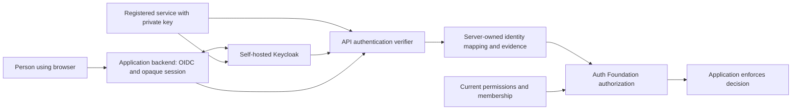

# Self-hosted authentication: candidate selection

Researched: 2026-09-07 UTC. Status: research recommendation for a prototype.
Owner: Auth Foundation product owner; security and operations owners unassigned.
Consumer: authentication scope and construction review. Authority effect: none.

## Recommendation and basis

Recommend **Keycloak** as the identity provider for the next authentication
prototype, with PostgreSQL as its proposed database. Keep Auth Foundation as
the application authorization decision service. This is an architectural
inference from the evidence below, not a claim that an installed configuration
has passed the requirements or that a new product has been approved.

The controlling scope is [the 28 candidate requirements](REQUIREMENTS.v1-candidate.md):
people and services, self-hosted. Browser/native/CLI priorities, tenancy and
delegation remain open. Ranking prioritizes documented human and machine
protocol coverage, supported rather than preview features, and predictable
self-hosted licensing. No numerical security score is defensible from docs alone.

Keycloak's feature inventory lists WebAuthn/passkeys, DPoP and standard token
exchange as supported. Its SPIFFE provider remains preview. [K2] The documented
Signed JWT client authenticator supports asymmetric assertions. [K3] These are
a good basis for people plus independent service clients without building an
identity provider ourselves. **ZITADEL is the strongest alternative** if customer
organization onboarding becomes the primary product concern. **authentik remains
a viable alternative** for a workflow-oriented identity deployment; its machine
identity and tenant boundaries need more investigation for our proposed scope.

## Shortlist and maintenance snapshot

Living documentation was inspected on the date above. Versions below are
observations, not installed binaries or immutable dependency selections. Pin a
release, image digest, dependencies and matching documentation before testing;
review security advisories again then. No product was run in this comparison.

| System | Observed release / license | Evidence relevant to this choice | Material caveat / decision |
| --- | --- | --- | --- |
| Keycloak | Download page: 26.7.3; Apache-2.0 source license. [K1, K8] | Broad supported protocol feature set; documented production deployment. [K2, K7] | Selected for prototype. Operating database, keys, clusters and upgrades remains our responsibility. |
| authentik | 2026.8 release line; MIT core with separately licensed enterprise directory. [A1, A2] | OIDC provider, passkey flow integration, machine JWT federation; new delegation support. [A3–A6] | Additional tenancy is Enterprise/alpha; expression policies can access all tenants. This is a conditional concern, not a rejection of single-tenant use. [A7] |
| ZITADEL | Latest-release redirect: v4.17.3; AGPL-3.0-only repository with directory exceptions. [Z1, Z2] | Self-hosting, organization onboarding, passkeys and private_key_jwt documented. [Z3–Z5] | Strong runner-up. Deployment-specific license review and sender-constraint/refresh semantics remain unresolved; no claim those capabilities are absent. |

Licenses are publisher declarations, not a legal conclusion about our future
integration. No paid feature or mandatory vendor cloud is selected. Optional
email delivery, federation, DNS, TLS provisioning and monitoring dependencies
must be inventoried when a deployment topology is chosen.

## Coverage against all 28 requirements

Legend: **C** documented component capability, configuration and tests still
needed; **I** our integration responsibility; **O** product/security/operations
responsibility; **G** known gap or excluded feature; **U** unresolved by this
bounded review. Combinations are deliberate. Nothing means verified PASS.
Alternative columns record only established evidence; U is not a negative
feature claim. Acceptance obligations in the final column apply to our selected
Keycloak architecture and inherit the full original requirement.

| ID | Keycloak | authentik | ZITADEL | Remaining work / acceptance obligation |
| --- | --- | --- | --- | --- |
| A01 | O | O | O | Bound client profiles, assets, attackers and assurance targets. |
| A02 | C [K2] | C [A6] | C [Z4] | Test WebAuthn challenge, origin, RP, signature and user verification. |
| A03 | C/O [K2] | U/O | U/O | Require administrator phishing resistance through enrollment and recovery; reject downgrade. |
| A04 | C/O [K3] | U | U | If passwords selected, implement the exact length/blocklist policy; test Unicode, long inputs and paste. |
| A05 | C/O [K3] | U | U | Argon2 documented; inspect actual Argon2id variant, salt and cost records against A05; benchmark memory pressure. |
| A06 | C/O [K2] | U/O | U/O | Recovery codes exist; prove factor changes and support recovery cannot bypass privileged authentication. |
| A07 | U/O | U/O | U/O | Prove single-use recovery under concurrent requests, expiry and enumeration resistance. |
| A08 | C/O [K3] | U/O | U/O | Brute-force controls need distributed network limits and attacker-lockout tests. |
| A09 | C/I [K4] | C/I [A3] | C/I [Z5] | Map trusted issuer + subject; explicitly test account-link ownership. |
| A10 | C/I [K4] | C/I [A3] | C/I [Z5] | Enforce S256, exact redirects and transaction binding; disable prohibited grants and test rejection. |
| A11 | I | I | I | Implement system-browser native client; select a separate device/CLI profile only if required. |
| A12 | I | I | I | Build application server sessions and CSRF protection; IdP cookies do not implement application sessions. |
| A13 | C/I [K3] | C/U [A4] | C/I [Z5] | Register distinct clients; prefer client-generated keys and bounded assertions. Test disabled client, wrong key and replay. |
| A14 | G/I [K2] | U/I | U/I | Evaluate independent SPIRE attestation; Keycloak preview SPIFFE integration is excluded from baseline. |
| A15 | C/I [K5] | U/I | U/I | Require DPoP for selected API profile and validate proof at every resource server; test stolen tokens. |
| A16 | C/G/I [K6] | C/I [A5] | U/I | Exchange is not proof of actor-preserving delegation. Keep delegation disabled pending contract and attenuation tests. |
| A17 | I | I | I | Maintained verifier with fixed issuer/audience/type/algorithm rules and bounded key retrieval; test token substitution. |
| A18 | C/U [K3, K5] | C/U [A3] | U | Rotation support is insufficient evidence of atomic family replay handling; test cross-node reuse and invalidation. |
| A19 | C/I [K4] | U/I | U/I | Measure account/client disable, logout and credential revocation across all application sessions and caches. |
| A20 | O/I | O/I | O/I | Choose numeric budgets, including clock skew/cache ages; test boundaries and partitions. |
| A21 | I | I | I | Verifier alone creates trusted evidence; preserve current revisions and single authorization epoch. |
| A22 | C/I [K2] | G/I [A7] | C/I [Z4] | Realm/organization labels are not proven application isolation. Test authoritative membership and admin boundaries. |
| A23 | O/I | O/I | O/I | Fail closed outside explicit cached-validity budget; no restored revocation rollback. |
| A24 | C/O [K7] | U/O | U/O | Test TLS versions, certificates and trusted proxy boundaries; reject spoofed identity headers. |
| A25 | O | O | O | Assign key custodians; demonstrate rotation, emergency replacement, encrypted backup and safe restoration. |
| A26 | C/I/O [K3] | U/I/O | U/I/O | Event support needs protected collection, secret redaction, correlation, retention and incident exercises. |
| A27 | C/O [K1, K7–K10] | C/O [A1, A2] | C/O [Z1–Z3] | Pin dependencies; assign patch owner; prove self-hosting, upgrades, exports and external-dependency behavior. |
| A28 | O | O | O | Fresh ASVS mapping, protocol tests, independent security review, load/abuse tests and authentication EVF. |

This matrix deliberately leaves unsupported detail unknown. It is enough for a
prototype recommendation, not a complete competitive audit. Revisit the ranking
if an unknown becomes a mandatory discriminator, especially multi-tenancy,
FIPS, delegation or public-client sender constraint.

## Findings that change the integration design

**Delegation:** Keycloak standard exchange supports same-realm internal token
exchange. Its documentation warns that requesting scopes can expand authority;
it provides a downscope enforcer. Do not equate exchange success or `azp` with
a complete actor/subject delegation chain. Keep exchange disabled in the first
slice; a later profile must establish actor evidence, target and grant limits.
Legacy exchange is preview/deprecated and is excluded. [K6]

**Machine alternatives:** authentik documents app-password and JWT-based M2M,
including automatically derived service accounts. JWT federation requires a
specific issuer/subject/audience acceptance policy; it should not be dismissed
as shared-secret-only. The exact equivalent of our registered-client asymmetric
profile remains unverified. [A4] Its 2026.8 delegation is documented, but its
security properties still need the same application tests. [A5]

**Revocation and replay:** DPoP protects only APIs that validate its proofs,
including request binding and replay handling; enabling issuance alone is
insufficient. [K5] Our five-minute access token proposal cannot alone meet a
60-second critical-revocation target. Select online active-state checks with a
strict freshness budget, or revise that target explicitly. Model service-client
revocation separately from human logout. Do not assume introspection handles
every compromise condition without testing it.

**Backup:** realm export is not a complete operational backup strategy; the
export guide describes its restrictions. [K10] Proposed recovery drills must
include database, configuration and protected key material plus a procedure
that prevents restored sessions or keys from reversing revocation decisions.

## Proposed integration contract

This is a design proposal; the diagram does not describe deployed components.

1. Browser backend completes code + PKCE, verifies OIDC responses and stores
   tokens server-side. It issues a fresh opaque application cookie. Session
   invalidation and IdP logout remain distinct operations with linked handling.
2. A registered service obtains an audience-limited token using an asymmetric
   client assertion. High-risk API clients additionally use the selected DPoP
   profile. An API verifier validates the access token and required proof.
3. The adapter resolves `(trusted issuer, subject)` to a server-owned principal
   with explicit human/service kind. For services, bind the expected client and
   owner too. Neither email, a caller's tenant label nor arbitrary token roles
   directly creates an application permission grant.
4. Produce internal evidence bound to principal, issuer, verifier/profile,
   authentication and expiry times, session/credential identifiers, current
   state revision, and membership where applicable. Assurance requires verified
   flow evidence; do not invent missing `auth_time`, `acr` or `amr` values.
5. Resolve evidence inside the trusted boundary and call authorization with
   server-derived references and route bindings. Public requests cannot choose
   another identity's stored evidence reference. Current authorization policy
   and membership are checked at decision time rather than copied from old JWTs.
6. The application enforces the decision before acting. Keycloak roles may
   constrain token issuance, but must not become a second competing source of
   application authorization policy.

Local source evidence:
[authorization service](../../implementation/authorization-service/src/lib.rs)
contains `ExactTrustedInputSnapshot`, `authentication_metadata`, revision checks
and epoch-bound authorization. It consumes `AuthenticatedSessionEvidence`;
this review does **not** establish that autonomous machine principals fit that
model. A successor must define the representation and preserve invariants before
claiming both consumers are integrated. Do not disguise services as human users.

The approved predecessor remains
[its exact approval](../auth-service-d65-r2-plan/completion-v1/PRODUCT-APPROVAL.json),
candidate `2e88296bf35469206e28be09f72235bf4fd2a9f947d80319e580a3f22daa9868`.
No acceptance-bound implementation bytes are changed by this recommendation.

## Next construction slice and evidence

Product-construction frontier: candidate requirements and identity-to-authorization
meaning. Next bounded proposal: one browser/backend client and one autonomous
service client accessing one protected operation; self-hosted Keycloak, real
cryptographic verification, server-created evidence, current authorization and
observed revocation. Native/CLI, delegation and SPIRE remain separately scoped.
This narrower first slice is a proposal, not a withdrawal of universal intent.

Before implementation, route the definition/contract and construction work
separately under CAV2-D65. Runnable product work is resolving principal kinds,
identity mappings, evidence freshness, initial client profiles and the testable
successor boundary. No production domain or hosting account is needed for that
local contract work.

Required prototype evidence: successful human and service controls, wrong
issuer/audience/key rejection, ID-token substitution rejection, copied evidence
reference denial, disabled principal/client denial, session fixation/CSRF tests,
refresh races, DPoP replay and missing-key rejection where selected, and measured
revocation with issuer/storage failures. Freeze source, configuration and pinned
third-party artifacts into a new candidate. Then run a fresh authentication EVF
with actual verifiers, meaningful mutants and independent result verification.
The earlier authorization EVF does not cover this new boundary.

Operational support is separate: platform owner selects deployment/HA topology;
security owner selects key custody and patch response; support owner defines
recovery; application owner owns enforcement. These owners and production
choices are unresolved deployment residue, not blockers to defining or testing
an isolated prototype. No installation, release or deployment happened here.

## Sources

All are publisher documentation or source repositories inspected on 2026-09-07.
Standards and detailed acceptance rationale remain in the linked requirements.

- K1: [Keycloak downloads](https://www.keycloak.org/downloads).
- K2: [Keycloak feature maturity](https://www.keycloak.org/server/features).
- K3: [Keycloak administration](https://www.keycloak.org/docs/latest/server_admin/index.html), password policies, client credentials, refresh rotation, brute-force protection and events.
- K4: [Keycloak OIDC endpoints and flows](https://www.keycloak.org/securing-apps/oidc-layers).
- K5: [Keycloak DPoP](https://www.keycloak.org/securing-apps/dpop).
- K6: [Keycloak token exchange](https://www.keycloak.org/securing-apps/token-exchange).
- K7: [Keycloak production configuration](https://www.keycloak.org/server/configuration-production), [database configuration](https://www.keycloak.org/server/db).
- K8: [Keycloak license](https://github.com/keycloak/keycloak/blob/main/LICENSE.txt).
- K9: [Keycloak security policy](https://github.com/keycloak/keycloak/security/policy).
- K10: [Keycloak export/import limitations](https://www.keycloak.org/server/importExport).
- A1: [authentik 2026.8 release](https://docs.goauthentik.io/releases/2026.8/).
- A2: [authentik license boundaries](https://github.com/goauthentik/authentik/blob/main/LICENSE).
- A3: [authentik OAuth provider](https://docs.goauthentik.io/add-secure-apps/providers/oauth2/).
- A4: [authentik machine authentication](https://docs.goauthentik.io/add-secure-apps/providers/oauth2/machine_to_machine).
- A5: [authentik token exchange](https://docs.goauthentik.io/add-secure-apps/providers/oauth2/token_exchange/).
- A6: [authentik identification and passkey integration](https://docs.goauthentik.io/add-secure-apps/flows-stages/stages/identification/).
- A7: [authentik tenancy limitations](https://docs.goauthentik.io/sys-mgmt/tenancy).
- Z1: [ZITADEL observed release v4.17.3](https://github.com/zitadel/zitadel/releases/tag/v4.17.3).
- Z2: [ZITADEL licensing](https://github.com/zitadel/zitadel/blob/main/LICENSING.md).
- Z3: [ZITADEL hosting options](https://zitadel.com/docs).
- Z4: [ZITADEL organization onboarding](https://zitadel.com/docs/guides/integrate/onboarding/b2b).
- Z5: [ZITADEL authentication methods](https://zitadel.com/docs/apis/openidoauth/authn-methods).

## Open Questions

1. Confirm the proposed first slice and whether any mandatory v1 requirement
   changes this ranking; especially tenant isolation, delegation or FIPS.
2. Define the service-principal successor and trusted evidence lifecycle without
   weakening existing current-state and one-epoch authorization invariants.
3. Verify remaining vendor unknowns on pinned releases: recovery atomicity,
   refresh-family invalidation, assurance claims and client-disable propagation.
4. Select numeric freshness/clock budgets and prove the proposed 60-second
   critical revocation target under failure, or explicitly revise it.
5. Assign operator/recovery/application owners and resolve remaining scope in
   [requirements Open Questions](REQUIREMENTS.v1-candidate.md#open-questions).

The recommendation may change when these answers or prototype observations
contradict its assumptions. Product approval must bind new tested bytes; this
research does not extend the predecessor's approval.
