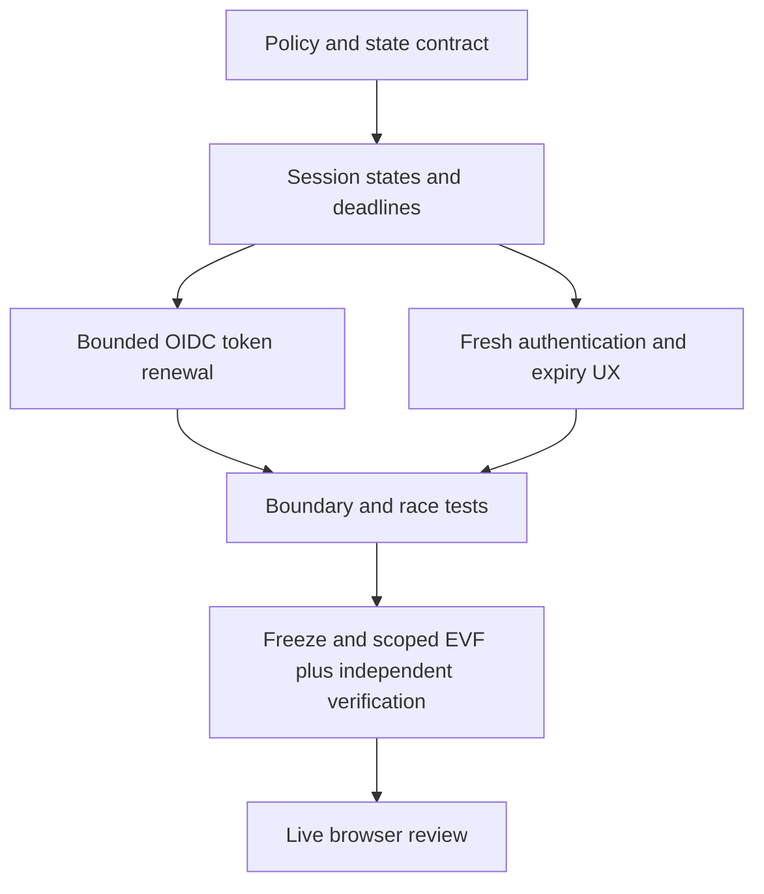

# Session lifecycle increment

Date: 2026-09-07. Candidate plan and implementation contract, authorized by
`plan and implement`. Owner: Auth Foundation product owner. Authority effect: none.
The session fields here supersede the baseline HTTPS-CONTRACT.json session maximum and SSO defaults; its TLS and token controls remain in force.
This refines node D of [NEXT-STEPS-PLAN.md](NEXT-STEPS-PLAN.md).

## Outcome and policy

An idle app locks and requires fresh authentication even while issuer SSO exists.
Access-token renewal cannot reset idle or absolute session deadlines. Browser
requests after a timeout show a stationary sign-in-again page; machine endpoints
continue returning JSON errors. Normal first login goes directly to Keycloak.

| Timer | Candidate value and owner |
| --- | --- |
| Access token | 300 seconds, issuer enforcement |
| App idle | 900 seconds, server checks before access or renewal |
| App maximum | 28800 seconds from creation, never reset by renewal |
| SSO idle / maximum | 1800 / 28800 seconds, Keycloak enforcement |
| Login transaction | 180 seconds, single-use and bound to browser and parent |

Qualifying activity is successful authenticated GET navigation to `/` or
`/document`. Health, CSS, failed requests and callback processing do not reset
idle time. There is no background polling/heartbeat in this UI. Server request
activity is not proof of physical human presence; future clients must explicitly
classify their background endpoints. Logout invalidates local state before
attempting issuer logout and reports an issuer outage separately.

This app uses conservative fresh authentication for missing/unknown session
cookies too. Clearing a cookie or restarting the process cannot evade the lock.
Consequently initial cross-app SSO without reauthentication is deferred to an
explicit trusted handoff design; existing active-session token renewal uses SSO.

## Construction DAG

D65 chain: this contract and existing HTTPS scaffolds, successor source,
exact frozen candidate, tests, then human review. This does not constitute
DomainSpec compilation, formal correspondence, governance admission or deployment.
Current frontier: implementation authorized; B/C/D runnable after A. No mandatory
ontology runtime or new ontology selectors are prerequisites.

## Implementation and acceptance

- `src/session-state.mjs`: explicit active/expired/terminal state and validated
  authentication time; exact idle and absolute boundary tests.
- `src/app.mjs` and `src/server.mjs`: reusable handler with in-process clock
  injection only for tests; production clock is fixed. No network test controls.
- Preserve original creation and activity timestamps through a code-flow renewal.
  Use prompt=none only for a known active parent. Renewed subject and issuer sid
  must match; no refresh tokens retained. Interaction-required errors end at an
  explicit retry, not an automatic redirect loop.
- Fresh authentication uses max_age=0 plus prompt=login, validates auth_time
  against transaction start and current time, and retains all OIDC verification.
- Track consumed/cancelled transactions while asynchronous validation runs.
  Recheck parent identity and deadlines after awaits; commit state synchronously.
  Session rotation invalidates other parent-bound callbacks. Logout invalidates
  pending renewals and fresh login attempts associated with that session.
- Test real Keycloak login, renewal, still-live SSO after idle, cookie deletion,
  concurrent callbacks, logout during renewal, issuer failure, direct links and
  two tabs. Clock-controlled handler tests bind the owner-only app socket through the real
  HTTPS proxy and issuer. Run them with the normal app stopped; the separate
  full live suite runs against the normal production-clock launcher.
- Preserve the 158-file baseline in `history/3bc71dc0fd1ba87984103586714f642afb38393920923d44ebbe655c88cde609/`.
  Bind new sources and this plan to a new freeze; never reuse baseline passes.

## Operational lane and blockers

| Task | Owner | Affected stage / blocker |
| --- | --- | --- |
| Restart isolated HTTPS app; scoped realm timer update | Implementing agent | Live tests; authorized local effect |
| Preserve baseline and capture new evidence | Implementing agent | Freeze and review |
| Durable shared sessions and cross-app revocation | Future session-store implementer | Later multi-instance beta; not this single-process increment |
| Production domains, trust, monitoring and persistent storage custody | Platform owner, unassigned | Public pilot; does not block local tests |

Process restart loses app sessions and transactions and requires fresh login.
Global session inventory, administrator revocation propagation, restore safety,
passkeys/recovery, refresh-token families and production operations remain in
the broader plan. Goals validation remains unavailable for admitted execution
registration; this candidate does not claim registration.

## Source basis

[OIDC Core authentication request and auth_time validation](https://openid.net/specs/openid-connect-core-1_0.html#AuthRequest)
defines max_age and prompt behavior; the returned auth_time is checked locally.
[Keycloak session administration](https://www.keycloak.org/docs/latest/server_admin/index.html)
owns issuer idle/client/max semantics. Numeric defaults and DAG are project
proposals, not universal requirements. Sources checked 2026-09-07.

## Open Questions

- Which deployed risk profiles need shorter idle/absolute limits?
- What trusted cross-app handoff should distinguish first arrival from local lock?
- Which durable session store and revocation delivery mechanism will serve the beta?
- Which actual app endpoints count as user activity when background work is added?
