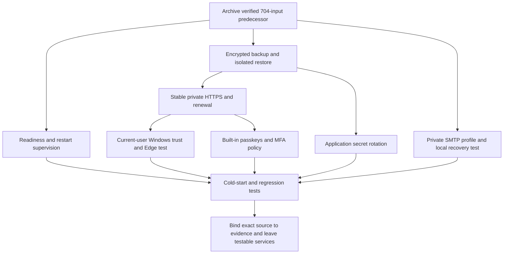

# Self-hosted operations candidate

Owner: local Auth Foundation operator. Authorization: user request “plan and implement this 4 steps”, 2026-09-08. This extends the local prototype; it is not public deployment or production admission.

## Construction DAG

Archive: ../../development/authentication-v1/history/before-operations (relative to the implementation directory). Predecessor digest: ac622c2e20c09702e515ef87e9a832994b98369906e8952ec83230f1a86b0ba6. Original authentication-https source stays frozen; only its private runtime certificates/configuration may change.

## Operational contract

- Keep issuer localhost:18443, Auth auth-durable.localhost:15443 and Body War body-war-durable.localhost:16443. Private Windows/WSL installation is the current assumption; a public hostname needs a separate deployment decision.
- Static Keycloak assets have a separate 100 requests/second, burst-200 allowance. Authentication keeps its existing 20 requests/second, burst-40 allowance. Safe proxy failure logs include only status, method and route class.
- Keycloak is capped at 2 GiB container memory with a 256 MiB initial / 1 GiB maximum Java heap. Browser regressions close contexts after their final assertion to avoid retaining every historical tab on this 8 GiB WSL host.
- Startup must await verified issuer discovery and both application health endpoints. Unexpected worker termination must trigger bounded recovery; intentional test restarts must stay deterministic.
- Backups use authenticated encryption with a separate private key. Restore tests run without published ports or a network. Restored authentication sessions, transactions and recovery codes are discarded; account/password/OTP/passkey records remain. Never restore a backup over the live database in a test.
- Private TLS retains a stable root, renews leaves before expiry, and verifies hostnames. Windows trust is limited to the current user. No certificate-error bypasses.
- Secret rotation invalidates old app sessions and rotates OIDC and app protection keys. Provider tokens must be re-encrypted without exposing plaintext. User passwords and authenticators remain unchanged.
- Passkeys use Keycloak's built-in verifier, resident credentials, user verification, and RP ID localhost. Password fallback must continue to require an enrolled factor. Security changes revoke sessions in both apps.
- SMTP secrets live in mode-0600 runtime configuration and never evidence. Local Mailpit is the default. Real delivery requires an operator-provided TLS SMTP service and sender; external delivery is not validated by a local inbox test.

## Evidence and gates

Each operation records safe results under evidence/operations. Test failures block a completion claim. Current-user service installation, local trust and disposable test identities are within the authorized implementation scope. No commits, push, public hosting, normal-browser profile changes, or real-account credential resets.

## Open Questions

- Does the operator want a public domain later? Passkeys registered for localhost cannot be moved to another RP ID.
- Which SMTP provider, sender and authorized test recipient should be used for real recovery delivery?
- A restored database contains point-in-time credentials, including any removed after the snapshot. Before real restore promotion, how will the operator reconcile subsequent password, OTP and passkey changes? The isolated drill does not authorize promotion.
- Where will the operator escrow the backup key and encrypted copies off this machine?
- Native Edge virtual-authenticator tests do not establish compatibility with the user's physical Windows Hello/security-key device.
- A service restart rehearsal is not an actual Windows hardware reboot.

## Sources

[Keycloak production configuration](https://www.keycloak.org/server/configuration-production), [Keycloak administration](https://www.keycloak.org/docs/latest/server_admin/index.html), [PostgreSQL backup](https://www.postgresql.org/docs/17/backup-dump.html). [Keycloak container memory](https://www.keycloak.org/server/containers#_specifying_different_memory_settings), [Nginx rate-limit inheritance](https://nginx.org/en/docs/http/ngx_http_limit_req_module.html). Implementation uses the pinned Keycloak 26.7.3 source contract.

## Operator commands

Run these from `implementation/authentication-durable`:

- `systemctl --user status auth-foundation.service` — supervised issuer/app startup status.
- `node operations/readiness.mjs` — certificate-verified issuer and app readiness.
- `node operations/backup.mjs` — encrypted snapshot; retain the separate `.runtime/operations/backup.key` in an operator-controlled off-machine location. The key is deliberately absent from archives.
- `node operations/restore-test.mjs /absolute/path/to/archive.afbak` — authenticate and restore into an isolated disposable database; never modifies live databases.
- `node operations/rotate.mjs` — stop apps, back up, rotate application secrets, re-encrypt provider tokens, invalidate sessions, restart. If interrupted, rerun this command; normal startup refuses an incomplete rotation journal. Database and operator passwords and CA keys are outside this rotation scope.
- `systemctl --user list-timers auth-foundation-maintenance.timer` — daily encrypted backup and TLS expiry check. TLS renewal restarts the local service only within the 30-day renewal window.
- `operations/windows-install.ps1` — import this installation's CA into CurrentUser Root and register a current-user Windows logon launcher. No machine-wide trust or normal browser profile is changed.

SMTP: create `.runtime/operations/smtp.json` with permissions 0600, containing `host`, `port`, `from`, optional `fromDisplayName`, `user`, `password`, and string-valued `ssl`/`starttls` with exactly one set to `"true"`. Restart the service to apply. Missing configuration selects local Mailpit; malformed configuration fails closed. Never put this file or its password in evidence, chat, or source control. A configured external relay does not imply delivery has been tested.

Backups are per-database consistent snapshots. They do not claim a distributed snapshot across all three databases. Restore removes transient authentication state and quarantines issuer authentication for 90 seconds. Used recovery codes cannot be recovered safely from an older snapshot, so all restored recovery-code credentials are discarded. The isolated drill is not a production restore/promotion tool. Keep backups and their key private; local-only storage does not protect against losing this PC. Automated retention/deletion is intentionally not enabled.
