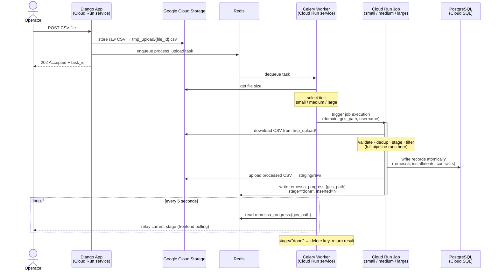

# Remessa Upload — Cloud Infrastructure

> Shows the infrastructure components and how they communicate during a remessa upload. Business logic and pipeline steps live in `architecture-installment-upload.md`.

---

## What is happening

**1. The operator submits the file.**
The browser POSTs the CSV to the Django HTTP view. Django immediately saves the raw file to GCS under `tmp_upload/` and drops a task onto the Redis queue. It then returns `202 Accepted` with a `task_id` — the operator's browser is done waiting at this point. Everything from here on is asynchronous.

**2. The Celery worker picks up the task.**
A Celery worker dequeues the task from Redis. Before doing any real work, it asks GCS for the file size. That number determines which Cloud Run Job tier will run — small, medium, or large — each backed by a separate GCP job definition with its own CPU and memory allocation. The worker then fires the job and hands it the GCS path, the domain, and the username.

**3. The Cloud Run Job does all the heavy lifting.**
The job downloads the CSV from GCS, runs the full upload pipeline (validation, deduplication, atomic DB write, filter evaluation), uploads the deduplicated CSV to `staging/raw/`, and finally writes a `done` entry into a Redis hash key named `remessa_progress:{gcs_path}`. The job then exits. At this point the remessa is fully staged and filtered in PostgreSQL — it is waiting for operator approval.

**4. The Celery worker relays progress to the frontend.**
While the job runs, the Celery worker polls that same Redis key every 5 seconds. Each time the job updates the `stage` field — e.g. "Validating…", "Staging records…", "Running filters…" — the worker relays it to the Celery task state, which the frontend polls to show a live progress indicator. When it reads `stage="done"`, it deletes the key and returns the final result (inserted and duplicated row counts) to the caller.

---

## Components

| Component | GCP service | Role |
|---|---|---|
| Django App | Cloud Run (HTTP service) | Receives CSV, saves to GCS, enqueues Celery task |
| Celery Worker | Cloud Run (worker service) | Dequeues task, picks tier, triggers Cloud Run Job, polls progress |
| Redis | Memorystore | Celery task broker + progress bus (`remessa_progress:*`) |
| GCS `tmp_upload/` | Cloud Storage | Raw uploaded CSV — 7-day lifecycle rule, cleaned automatically |
| GCS `staging/raw/` | Cloud Storage | Deduplicated CSV after staging commit — permanent |
| Cloud Run Job | Cloud Run Jobs | Three definitions (small/medium/large) — same image, different CPU/RAM |
| PostgreSQL | Cloud SQL | All remessa, staging, filter, and contract records |

---

## Tier Selection

The Celery worker checks the file size before dispatching. Thresholds are env-var-tunable without a code deploy:

| Tier | When | Job name |
|---|---|---|
| `small` | file < `CLOUD_RUN_REMESSA_TIER_SMALL_MB` | `{JOB_BASE}-small` |
| `medium` | file < `CLOUD_RUN_REMESSA_TIER_MEDIUM_MB` | `{JOB_BASE}-medium` |
| `large` | anything above | `{JOB_BASE}-large` |

---

## Connections

| Document | Type | Description |
|---|---|---|
| [[architecture-installment-upload]] | `detailed-by` | Pipeline services, events, and code locations |
| [[aquisicao-upload-flow]] | `detailed-by` | Step-by-step business flow diagram |
