---
tags:
  - remessa
  - aquisicao
  - liquidacao
  - architecture
  - installment-upload
layer: architecture
nature: [explanatory, reference]
status: active
veracidade: high
convicção: high
audience: agent, engineer
version: 1.0.0
last_updated: 2026-04-02
node_type: spec
is_session: false
---

# Remessa Upload — Architecture

> This document describes how the remessa upload feature is built: layers,
> services, execution flow, and code locations. What the feature does and
> why it exists lives in `context-installment-upload.md`.

---

## Layer Map

```
HTTP View (interfaces/)
    │  validates request, enqueues Celery task
    ▼
Celery Task (tasks/)
    │  receives file_path + username
    │
    ├─ [USE_CLOUD_RUN_JOBS_REMESSA=True]
    │       │  selects machine tier by file size
    │       ▼
    │   Cloud Run Job (infrastructure/cloud_run/)
    │       │  runs ProcessUploadService + StageRemessaService out-of-process
    │       │  reports progress via Redis key remessa_progress:{gcs_path}
    │       ▼
    │   Celery polls Redis → relays progress to frontend → returns result
    │
    └─ [USE_CLOUD_RUN_JOBS_REMESSA=False — default / local]
            ▼
        ProcessUploadService (infrastructure/remessa/)
            │  parses CSV, runs 3-layer dedup — no DB writes
            ▼
        StageRemessaService (infrastructure/remessa/)
            │  single transaction.atomic() — all DB writes
            │  two staging paths: COPY FROM STDIN (fast) or ORM bulk_create (fallback)
            ▼
        RunFiltersService (infrastructure/remessa/)
            │  evaluates FundFilterConfig gates, writes RemessaFilterResult
            ▼
Use Cases: Approve / Reject / Rollback (domains/*/use_cases/)
    │  promote staging → production or discard
    ▼
EventLog / EventLogEntities (infrastructure/database/)
    │  written exclusively via log_event_safe()
```

---

## Execution Flow

```mermaid
---
config:
  theme: dark
  themeVariables:
    primaryColor: '#1e3456'
    background: '#0d1b2a'
    mainBkg: '#16213e'
    nodeBorder: '#4a90d9'
    clusterBkg: '#0d1b2a'
    titleColor: '#e0e0e0'
    edgeLabelBackground: '#16213e'
    lineColor: '#4a90d9'
---
flowchart TB
 subgraph VIEW["📤 Phase 1 — Upload View (synchronous HTTP)"]
        A(["Operator uploads CSV"])
        GCS["Save CSV to GCS tmp_upload/ bucket"]
        ENQUEUE["Return 202 + task_id to frontend"]
  end

 subgraph CELERY["⚙️ Phase 2 — Celery Task"]
        TASK_START[["TASK_STARTED · ACQUISITION_UPLOAD_STARTED [w=9]"]]
        CR_CHECK{"USE_CLOUD_RUN_JOBS_REMESSA?"}
        CR_TIER["select_remessa_tier(file_size)\n→ small / medium / large"]
        CR_JOB["trigger_remessa_upload_job()\nCloud Run Job runs ALL phases out-of-process:\nvalidation · dedup · staging · filters"]
        CR_POLL["Poll Redis remessa_progress:{gcs_path} every 5s\nrelay stage → Celery state (frontend progress)\nWhen stage=done → return inserted/duplicated counts"]
        DOWNLOAD["Download CSV from GCS to local temp file"]
        VAL{"Valid headers, encoding, required columns?"}
        EVAL["ACQUISITION_UPLOAD_FAILED [w=9] — error response"]

        subgraph DEDUP_INTRA["Layer 1 — Intra-File Dedup"]
            INTRA_SPLIT["split_intra_file_duplicates on composite key\n(campo_chave + sacado_cnpj_cpf + data_aquisicao)"]
            INTRA_UNIQUE["unique_df — first occurrence of each key"]
            INTRA_DUPS["duplicates_df — subsequent occurrences\nskip_reason: parcela"]
        end

        EMPTY_AFTER_L1{"unique_df is empty?"}
        EMPTY_FAIL_L1["ACQUISITION_UPLOAD_FAILED — no valid rows"]

        subgraph DEDUP_DB["Layer 2 — Row-Level Dedup vs Production"]
            DB_QUERY["Query AquisicaoManual (production table)\non (campo_chave, sacado_cnpj_cpf, data_aquisicao)"]
            ANTI_JOIN["Anti-join: to_insert_df = rows NOT in production"]
            INNER_JOIN["Inner-join: db_duplicates_df\nskip_reason: contrato · origin: already_on_database"]
        end

        EMPTY_AFTER_L2{"to_insert_df is empty?"}
        EMPTY_FAIL_L2["ACQUISITION_UPLOAD_FAILED — all records exist in DB\nReturn duplicates CSV"]

        subgraph DEDUP_REMESSA["Layer 2.5 — Remessa-Level Dedup"]
            REM_AGG["Aggregate candidate remessa groups by identity_keys\n(cnpj_fundo, data_aquisicao, id_cessao)"]
            REM_CHECK{"Existing RemessaAquisicaoId\nwith same identity_keys?"}
            REM_PEND["Status PENDENTE/APROVADO → block ALL rows in group\nskip_reason: remessa"]
            REM_SUPER["Status REJEITADO/ROLLBACK →\nSet old to DELETADO · delete old staging\nACQUISITION_REMESSA_SUPERSEDED [w=8]"]
            REM_NONE["No existing remessa → rows pass through"]
        end

        EMPTY_AFTER_L25{"to_insert_df is empty?"}
        BLOCKED_ALL["ACQUISITION_UPLOAD_BLOCKED [w=9]\nSave + return duplicates CSV"]

        SAVE_DUPS["_save_duplicates_csv(all_duplicates_df)\nSave duplicates CSV if any exist\n(always runs — even on partial upload)"]
        CHECKSUM["Write to_insert_df to temp CSV\nCompute SHA-256 by streaming 64KB chunks"]
        AGG["Aggregate remessa groups\n(GROUP_COLS → valor_remessa, quantidade_linhas)"]
        RESULT["Return clean_df + checksum + agg_files_df + metadata"]
  end

 subgraph STAGE["💾 Phase 3 — StageRemessaService (atomic DB write)"]
        subgraph ATOMIC_TX["🔒 transaction.atomic()"]
          DB0["🟩 UploadFile · checksum · status: Imported · stream_id"]
          DB1["🟦 RemessaAquisicaoId · remessa_hash · status: Pendente\nlast_filter_result: pending · quantidade_contratos"]
          DB2["🟨 AquisicaoManualStaging · installment_hash · remessa_hash\nlast_filter_result: pending · complementary_data JSONB"]
          DB3["🟥 ContratoCCB · contract_hash · remessa_hash\nstatus: Pendente · cnpj_emissor · tipo_instrumento"]
        end
        S3["Upload deduplicated CSV → GCS staging/raw/"]
        S3FAIL["Log error — DB is committed, manual reconciliation needed"]
        EVENTS_DUP{"blocked_count > 0?"}
        DUPEV["ACQUISITION_REMESSA_DUPLICATED [w=7]"]
        COMPLETED["ACQUISITION_UPLOAD_COMPLETED [w=9]"]
  end

 subgraph FILTERGATE["🔍 Phase 4 — Filter Gates (RunFiltersService)"]
        FSTART["FILTER_RUN_STARTED · per remessa"]
        FCONFIG["Query FundFilterConfig\ncnpj_fundo · latest row per filter_def · is_active=true"]
        ZERO{"Active + implemented filters exist?"}
        VAC["FILTER_VACUOUS_PASSED [w=6]\nlast_filter_result → vacuous_pass"]
        subgraph RUNF["🧪 Filter Executor (sequential, parallel-ready)"]
          FEXEC["For each active FundFilterConfig:\nFILTER_REGISTRY → filter_cls.run()\n→ FilterOutcome(status, detail, metadata)"]
          FWRITE["Write RemessaFilterResult rows\n(update_or_create per filter)"]
        end
        PROPAGATE["_propagate_filter_status:\nUpdate last_filter_result on\nRemessa + Staging + Contracts"]
        ALLPASS{"Any filter failed?"}
        FDONE["FILTER_RUN_APPROVED [w=7]\nlast_filter_result → pass"]
        FFAILED["FILTER_RUN_REJECTED [w=8]\nlast_filter_result → fail"]
  end

 subgraph APPROVAL["✅ Phase 5 — Approval Gate"]
        READYAPPROVE(["🟢 Remessa: Pendente · last_filter_result: pass/vacuous_pass"])
        OPACTION{"Operator decides"}
        OPREJECT_A["REMESSA_USER_REJECTED [w=10] · delete staging + contracts"]
        OPAPPROVE["REMESSA_USER_APPROVED [w=10]\nAquisicaoManualStaging → AquisicaoManual\nContratoCCB: Pendente → Aprovado\nDelete staging rows (post-commit)"]
        FAILEDSTATE(["🔴 Remessa: Pendente · last_filter_result: fail"])
        ROLECHECK{"Role = Administrator?"}
        ROLEERR["403 INSUFFICIENT_ROLE"]
        JUSTCHECK{"Justification >= 20 chars?"}
        JUSTERR["400 JUSTIFICATION_TOO_SHORT"]
        OVERRIDE["FILTER_OVERRIDE_JUSTIFIED [w=9]\noverride_justification · override_by · override_at"]
        APROVADO_STATE(["🔵 Remessa: Aprovado"])
  end

 subgraph ROLLBACK["↩️ Rollback"]
        ROLLBACK_UC["REMESSA_USER_ROLLEDBACK [w=10]\nAquisicaoManual → Staging (Pendente, register_id=None)\nContratoCCB: Aprovado → Pendente (aquisicao only)\nDelete production rows"]
  end

 subgraph TTL["⏱️ TTL Job (Celery Beat)"]
        TTLCHECK["Remessas > 7 days · non-terminal status"]
        TTLACT["AquisicaoManualStaging: DELETE\nRemessa + Contratos: status → Deletado\nBATCH_TTL_EXPIRED [w=8]"]
  end

    %% Phase 1 — View
    A --> GCS --> ENQUEUE

    %% Phase 2 — Celery validation pipeline
    ENQUEUE --> TASK_START --> CR_CHECK
    CR_CHECK -- Yes --> CR_TIER --> CR_JOB --> CR_POLL
    CR_POLL -- "filter pass" --> READYAPPROVE
    CR_POLL -- "filter fail" --> FAILEDSTATE
    CR_CHECK -- No --> DOWNLOAD --> VAL
    VAL -- No --> EVAL
    VAL -- Yes --> INTRA_SPLIT
    INTRA_SPLIT --> INTRA_UNIQUE
    INTRA_SPLIT --> INTRA_DUPS
    INTRA_UNIQUE --> EMPTY_AFTER_L1
    EMPTY_AFTER_L1 -- Yes --> EMPTY_FAIL_L1
    EMPTY_AFTER_L1 -- No --> DB_QUERY
    DB_QUERY --> ANTI_JOIN
    DB_QUERY --> INNER_JOIN
    ANTI_JOIN --> EMPTY_AFTER_L2
    EMPTY_AFTER_L2 -- Yes --> EMPTY_FAIL_L2
    EMPTY_AFTER_L2 -- No --> REM_AGG
    REM_AGG --> REM_CHECK
    REM_CHECK -- "PENDENTE/APROVADO" --> REM_PEND
    REM_CHECK -- "REJEITADO/ROLLBACK" --> REM_SUPER
    REM_CHECK -- "None found" --> REM_NONE
    REM_PEND --> EMPTY_AFTER_L25
    REM_SUPER --> EMPTY_AFTER_L25
    REM_NONE --> EMPTY_AFTER_L25
    EMPTY_AFTER_L25 -- Yes --> BLOCKED_ALL
    EMPTY_AFTER_L25 -- No --> SAVE_DUPS
    SAVE_DUPS --> CHECKSUM
    CHECKSUM --> AGG --> RESULT

    %% Phase 3 — Atomic staging
    RESULT --> ATOMIC_TX
    DB0 --- DB1
    DB1 --- DB2
    DB2 --- DB3
    DB3 --> S3
    S3 -- success --> EVENTS_DUP
    S3 -. failure .-> S3FAIL
    EVENTS_DUP -- Yes --> DUPEV --> COMPLETED
    EVENTS_DUP -- No --> COMPLETED

    %% Phase 4 — Filters
    COMPLETED --> FSTART
    FSTART --> FCONFIG --> ZERO
    ZERO -- "None active" --> VAC
    ZERO -- "Yes" --> FEXEC
    FEXEC --> FWRITE --> PROPAGATE
    PROPAGATE --> ALLPASS
    ALLPASS -- "No failures" --> FDONE
    ALLPASS -- "Any failure" --> FFAILED
    FDONE --> READYAPPROVE
    VAC --> READYAPPROVE
    FFAILED --> FAILEDSTATE

    %% Phase 5 — Approval
    FAILEDSTATE -- "Admin override" --> ROLECHECK
    ROLECHECK -- No --> ROLEERR
    ROLECHECK -- Yes --> JUSTCHECK
    JUSTCHECK -- "Too short" --> JUSTERR
    JUSTCHECK -- OK --> OVERRIDE
    OVERRIDE --> READYAPPROVE
    READYAPPROVE --> OPACTION
    OPACTION -- Reject --> OPREJECT_A
    OPACTION -- Approve --> OPAPPROVE
    OPAPPROVE --> APROVADO_STATE
    APROVADO_STATE -- "Operator Rollback" --> ROLLBACK_UC
    ROLLBACK_UC -->|"re-enters approval gate"| OPACTION

    %% TTL
    TTLCHECK --> TTLACT
```



---

## Services

### Upload Stager Modules
`domains/aquisicao/tasks/upload_stager.py` · `domains/liquidacao/tasks/upload_stager.py`

Each domain owns an `upload_stager.py` module that:

- Defines the domain-specific `installment_builder_fn`, `contract_builder_fn`, and `staging_df_builder_fn`
- Imports `bulk_copy_staging` from its domain's repository as the `staging_copy_fn`
- Constructs and exports a singleton `AQUISICAO_STAGER` / `LIQUIDACAO_STAGER` (`StageRemessaService` instance)

Both `celery_tasks.py` and the Cloud Run job entrypoint import this singleton, ensuring
the same stager configuration is used regardless of where the work runs.

---

### Cloud Run Dispatch
`infrastructure/cloud_run/client.py` · `infrastructure/cloud_run/machine_tiers.py`

When `USE_CLOUD_RUN_JOBS_REMESSA=True`, the Celery task delegates the entire upload
(parse + stage + filter) to a Cloud Run Job instead of processing it inline:

1. `select_remessa_tier(file_size_bytes)` maps file size to a tier (`small`, `medium`, `large`),
   each backed by a separate GCP Cloud Run Job definition with its own CPU/memory allocation.
   Thresholds are set via `CLOUD_RUN_REMESSA_TIER_SMALL_MB` / `CLOUD_RUN_REMESSA_TIER_MEDIUM_MB`.
2. `trigger_remessa_upload_job()` fires the job, forwarding `domain`, `gcs_path`, and `username`
   as container environment variable overrides.
3. The Celery task then polls a Redis key `remessa_progress:{gcs_path}` every 5 seconds.
   The Cloud Run entrypoint writes `stage` and `detail` fields into that hash. The Celery task
   relays the current `stage` to its Celery state so the frontend shows real-time progress.
   When `stage == "done"`, the key is deleted and the result (`inserted`/`duplicated` counts)
   is returned.

---

### ProcessUploadService
`infrastructure/remessa/upload_service.py`

Stateless CSV processor. Accepts a file path and username, returns clean data.
**No DB writes.** Parameterised by domain at instantiation — the same class
serves both aquisição and liquidação.

Three-layer dedup pipeline:
1. **Intra-file** — split duplicate rows within the uploaded CSV
2. **DB-level** — query existing production records; tag matching rows
3. **Checksum** — compute hash of net-new rows; reject if already seen (409)

Returns a dict consumed by `StageRemessaService`.

---

### StageRemessaService
`infrastructure/remessa/stage_remessa_service.py`

Owns the single `transaction.atomic()` for the entire upload write:

1. `UploadFile` row
2. `RemessaAquisicaoId` / `RemessaLiquidacaoId` headers — status: `Pendente`
3. `AquisicaoManualStaging` / `LiquidacaoManualStaging` rows — with `complementary_data` JSONB
4. `ContratoCCB` rows — aquisição only, status: `Pendente`

After commit (best-effort, outside transaction): saves deduplicated CSV to **GCS**.

Domain-agnostic: configured at instantiation via `upload_stager.py` modules in each domain.
Constructor accepts optional `staging_df_builder_fn` and `staging_copy_fn` parameters to
enable the COPY FROM STDIN path (see below).

#### Staging installment write — two paths

Controlled by the `USE_COPY_STAGING` Django setting:

- **COPY FROM STDIN** (`USE_COPY_STAGING=True`): calls `staging_df_builder_fn` to build a
  Polars DataFrame, then pipes it into PostgreSQL via `COPY ... FROM STDIN` through
  `staging_copy_fn`. Vectorized — no Python-per-row overhead. Used in production for large
  batches.
- **ORM fallback** (`USE_COPY_STAGING=False`, default for local dev): uses
  `bulk_create` in chunks of `REMESSA_STAGING_CHUNK_SIZE` (env-tunable). Logs memory usage
  and chunk progress.

---

### RunFiltersService
`infrastructure/remessa/run_filters_service.py`

Called once per remessa after staging. Evaluates all active `FundFilterConfig`
entries for the fund via `FILTER_REGISTRY`. Each filter implementation is a
stateless `EligibilityFilter` subclass.

After evaluation:
- Writes one `RemessaFilterResult` row per `(remessa × FundFilterConfig)`
- Bulk-updates `last_filter_result` on staging rows, remessa header, and contracts
- Emits the appropriate run-level event

Vacuous pass: if no active `FundFilterConfig` exists for the fund, emits
`FILTER_VACUOUS_PASSED` and skips all evaluation.

Filter implementations live in `domains/aquisicao/domain/filters_criteria.py`
and are wired into `shared_services/filter_registry.py` (cross-domain registry).

---

### Approve / Reject / Rollback Use Cases
`domains/aquisicao/use_cases/` · `domains/liquidacao/use_cases/`

All three run inside `transaction.atomic()`.

**Approve** — checks that no uncleared mandatory filter failures exist, then
copies staging → production, promotes `ContratoCCB` to `Aprovado`, deletes
staging rows post-commit.

**Reject** — deletes staging rows and pending contracts, sets status `Rejeitado`.

**Rollback** — copies production rows back to staging (`register_id=None`),
resets `ContratoCCB` to `Pendente`, deletes production rows. The remessa
re-enters the approval gate without re-uploading.

---

### JustifyFilterOverrideUseCase
`shared_services/use_cases/justify_filter_override.py`

Cross-domain use case (handles both aquisição and liquidação). Validates that
the filter result is a failed mandatory filter on a `Pendente` remessa, writes
`override_justification`, `override_by`, `override_at` on `RemessaFilterResult`,
and emits `FILTER_OVERRIDE_JUSTIFIED`.

---

### TTL Job
`infrastructure/remessa/ttl_tasks.py` · Celery Beat, daily 03:00

Finds `Pendente` remessas older than 7 days. For each, in its own
`transaction.atomic()`: deletes staging installments, sets remessa and contracts
to `Deletado`, emits `BATCH_TTL_EXPIRED`.

---

## DB Tables

| Model | Table | Layer |
|---|---|---|
| `UploadFile` | `upload_files` | infrastructure |
| `RemessaAquisicaoId` | `remessas_aquisicao` | aquisicao domain |
| `RemessaLiquidacaoId` | `remessas_liquidacao` | liquidacao domain |
| `AquisicaoManualStaging` | `aquisicao_manual_staging` | aquisicao domain |
| `LiquidacaoManualStaging` | `liquidacao_manual_staging` | liquidacao domain |
| `AquisicaoManual` | `aquisicao_manual` | aquisicao domain |
| `LiquidacaoManual` | `liquidacao_manual` | liquidacao domain |
| `LiquidacaoManualSemParcela` | `liquidacao_manual_sem_parcela` | liquidacao domain |
| `ContratoCCB` | `contrato_ccb` | aquisicao domain |
| `FilterDefinition` | `filter_definitions` | infrastructure |
| `FundFilterConfig` | `fund_filter_config` | infrastructure |
| `RemessaFilterResult` | `remessa_filter_results` | infrastructure |

---

## Events Emitted

| Event | Tier | Emitted by | When |
|---|---|---|---|
| `ACQUISITION_UPLOAD_STARTED` | business | Upload view | CSV accepted, task enqueued |
| `ACQUISITION_UPLOAD_COMPLETED` | business | StageRemessaService | Atomic commit succeeded |
| `ACQUISITION_UPLOAD_FAILED` | business | Celery task | Unrecoverable failure |
| `ACQUISITION_UPLOAD_PARTIAL_ACCEPTED` | business | Upload view | Some rows deduplicated out |
| `ACQUISITION_UPLOAD_CHECKSUM_DUPLICATE` | business | Upload view | Exact duplicate batch rejected |
| `ACQUISITION_REMESSA_SUPERSEDED` | business | Upload view | New upload supersedes rejected/rollback remessa |
| `TASK_ENQUEUED` / `TASK_STARTED` / `TASK_SUCCEEDED` / `TASK_FAILED` | tech | Celery task | Task lifecycle |
| `FILTER_RUN_STARTED` | business | RunFiltersService | Filter evaluation begins |
| `FILTER_VACUOUS_PASSED` | business | RunFiltersService | No active filters for fund |
| `FILTER_RUN_APPROVED` | business | RunFiltersService | All filters passed |
| `FILTER_RUN_PARTIALLY_APPROVED` | business | RunFiltersService | Non-mandatory failures only |
| `FILTER_RUN_REJECTED` | business | RunFiltersService | ≥1 mandatory filter failed |
| `FILTER_OVERRIDE_JUSTIFIED` | business | JustifyFilterOverrideUseCase | Admin unlocks blocked batch |
| `REMESSA_USER_APPROVED` | business | ApproveUseCase | Batch promoted to production |
| `REMESSA_USER_REJECTED` | business | RejectUseCase | Batch discarded |
| `REMESSA_USER_ROLLEDBACK` | business | RollbackUseCase | Production reversed to staging |
| `BATCH_TTL_EXPIRED` | business | TTL Job | Stale batch auto-expired |

> Liquidação mirrors the aquisição upload events with `LIQUIDATION_` prefix.
> Full catalog: `infrastructure/messaging/event_catalog.py`.
>
> When `USE_CLOUD_RUN_JOBS_REMESSA=True`, the Celery task does not emit
> `TASK_STARTED`/`TASK_SUCCEEDED` itself — those are emitted by the Cloud Run
> entrypoint running out-of-process.

---

## Key File Locations

| Concern | Path |
|---|---|
| Upload view (aquisição) | `domains/aquisicao/interfaces/upload_views.py` |
| Upload view (liquidação) | `domains/liquidacao/interfaces/upload_views.py` |
| Celery tasks (aquisição) | `domains/aquisicao/tasks/celery_tasks.py` |
| Celery tasks (liquidação) | `domains/liquidacao/tasks/celery_tasks.py` |
| Upload stager — aquisição | `domains/aquisicao/tasks/upload_stager.py` |
| Upload stager — liquidação | `domains/liquidacao/tasks/upload_stager.py` |
| Cloud Run job client | `infrastructure/cloud_run/client.py` |
| Cloud Run machine tier selector | `infrastructure/cloud_run/machine_tiers.py` |
| ProcessUploadService | `infrastructure/remessa/upload_service.py` |
| StageRemessaService | `infrastructure/remessa/stage_remessa_service.py` |
| RunFiltersService | `infrastructure/remessa/run_filters_service.py` |
| EligibilityFilter ABC | `infrastructure/remessa/filter_registry.py` |
| Filter implementations | `domains/aquisicao/domain/filters_criteria.py` |
| FILTER_REGISTRY | `shared_services/filter_registry.py` |
| Approve use case (aquisição) | `domains/aquisicao/use_cases/approve_remessa.py` |
| Approve use case (liquidação) | `domains/liquidacao/use_cases/approve_remessa.py` |
| JustifyFilterOverrideUseCase | `shared_services/use_cases/justify_filter_override.py` |
| Filter override API | `shared_services/interfaces/filter_views.py` |
| TTL job | `infrastructure/remessa/ttl_tasks.py` |
| Entity identity hashes | `infrastructure/entity_identity.py` |
| Event log service | `infrastructure/database/event_log_service.py` |
| Event catalog | `infrastructure/messaging/event_catalog.py` |

---

## Connections

| Document | Type | Description |
|---|---|---|
| [[context-installment-upload]] | `contextualized-by` | Business meaning of the objects in this flow |
| [[event-system-constitution]] | `governed-by` | Rules for all event emission in this feature |
| [[folder-structure-constitution]] | `governed-by` | Layer rules: domain → infrastructure → shared_services |
| [[development-practices-constitution]] | `governed-by` | General engineering principles |
