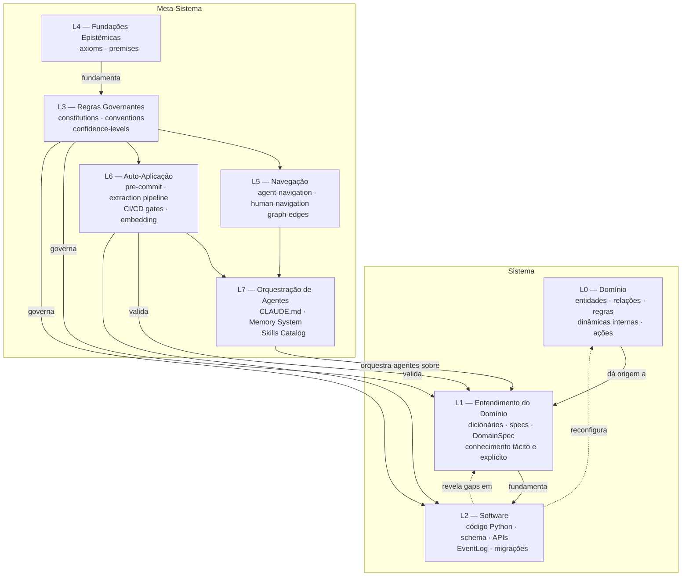

# Diagrama de Camadas Meta

Duas trilhas paralelas que se influenciam. A trilha da esquerda é o sistema em si — do domínio real até o software. A trilha da direita é o meta-sistema — as camadas que governam, validam e navegam a trilha da esquerda.

---

## L0 — Domínio

A realidade. Existe independente de qualquer sistema. Composto por entidades que se relacionam através de regras, orientadas por dinâmicas internas próprias, realizando ações que modificam o estado da realidade. No contexto deste projeto: cedentes, emissores, FIDCs, direitos creditórios, operações de liquidação.

## L1 — Entendimento do Domínio

O conhecimento que temos do domínio — não o domínio em si. Existe em dois registros simultâneos:

- **Tácito / operacional:** nas cabeças dos praticantes que executam ações no domínio. Local, situado, difícil de externalizar.
- **Explícito / arquitetural:** formalizado em dicionários, specs, DomainSpec docs. Macro, estrutural, transferível.

O software não implementa L0 diretamente — implementa L1. A qualidade do software é limitada pela qualidade desse entendimento.

## L2 — Software

A implementação do entendimento em forma executável. Código, schema, APIs, migrações. Tem duas relações de feedback com os níveis abaixo:

- Revela gaps em L1 — quando a implementação encontra casos que a spec não cobriu
- Reconfigura L0 — ao criar novas regras no domínio (novos formatos, novos fluxos, novas restrições)

## L3 — Regras Governantes

As constituições e convenções que prescrevem como L1 e L2 devem ser criados e mantidos. Não são diretrizes — são regras com consequências quando violadas. Derivam de L4.

## L4 — Fundações Epistêmicas

Os axiomas e premissas que justificam as regras de L3. Axiomas raramente mudam — revisá-los implica rever tudo construído acima. Premissas são apostas que podem ser atualizadas com evidência empírica.

## L5 — Navegação

Esquemas de travessia do meta-sistema. Descrevem como humanos e agentes devem navegar L1, L3 e L4 — por onde começar, o que priorizar, como resolver contradições.

## L6 — Auto-Aplicação

A camada que age. Transforma as regras de L3 em invariantes de infraestrutura: bloqueia código que viola o dicionário, valida eventos contra o catalog, gera embeddings semânticos. É o único nível que age sobre os outros em vez de apenas descrevê-los.

## L7 — Orquestração de Agentes

As instruções que governam o comportamento do agente de IA que constrói e mantém todos os níveis anteriores. O CLAUDE.md é a constituição do agente — equivalente a L3, mas aplicada ao colaborador de IA.
