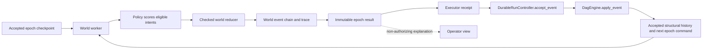

# Robot-Talks synthesis: interaction dynamics, emergence, and orchestration

## Scope

**Central question:** Can semantic interaction dynamics and RWO/DAG orchestration produce useful emergent cooperation while remaining explainable, recoverable, and governed?

**Assumptions challenged:**

1. Four semantic dimensions are sufficient for meaningful interaction.
2. Decay and steering can create stable emergent roles.
3. The orchestrator can govern events and commitments without choosing agent behavior.
4. Durable receipts and replay preserve emergence without making the world overly deterministic.
5. The two-agent all-to-all fixture predicts something useful about a larger indexed world.

Eight independent investigations ran as one orchestrator-owned DAG: constructive and adversarial agents for dynamics, orchestration, scaling, and governance. The rejected alternative was decomposition by files because it would obscure contradictions between policy, world, recovery, and operator semantics.

## Result boundary

The evidence supports deterministic, inspectable policy influence and durable acceptance of a complete worker result. It does not establish useful emergent cooperation, stable roles, large-population validity, or recovery of an interaction trajectory after a mid-run crash. This is candidate research evidence with `authority_effect: none` and `external_effect: none`.

## Cross-layer tensions

| ID | Layer A holds | Layer B actually does | Severity | Evidence |
|---|---|---|---|---|
| T1 | Cooperation should be an emergent system outcome. | The policy directly rewards useful delivery and construction, so the present result can be authored reward shaping. | Critical | [dynamics adversarial](reports/dynamics-adversarial.md#L3), [scaling adversarial](reports/scaling-adversarial.md#L9) |
| T2 | Persistent behavior may indicate stable complementary roles. | Fixed priors, lexicographic actor order, sequential contention, and hard saturation can manufacture persistence. | Critical | [dynamics adversarial](reports/dynamics-adversarial.md#L5), [dynamics adversarial](reports/dynamics-adversarial.md#L7), [scaling constructive](reports/scaling-constructive.md#L23) |
| T3 | Receipts and replay should preserve emergence through failure. | The orchestrator accepts one terminal event for a 1–100 tick episode; a crash at tick 99 has no admitted tick/epoch checkpoint. | Critical | [orchestration constructive](reports/orchestration-constructive.md#L12), [orchestration adversarial](reports/orchestration-adversarial.md#L11), [governance adversarial](reports/governance-adversarial.md#L3) |
| T4 | The orchestrator should remain behavior-neutral. | It does not calculate policy, but episode partitioning, readiness, accepted order, retry, and capacity can affect later observations when interaction is split across commands. | High | [orchestration adversarial](reports/orchestration-adversarial.md#L17), [orchestration constructive](reports/orchestration-constructive.md#L25) |
| T5 | A neighborhood index is expected to scale the same interaction model. | An exact global-semantics optimization and a local radius/top-k neighborhood are different interventions; the latter changes behavior and needs a new profile identity. | High | [scaling constructive](reports/scaling-constructive.md#L27), [scaling constructive](reports/scaling-constructive.md#L37), [scaling adversarial](reports/scaling-adversarial.md#L11) |
| T6 | Full traces make decisions explainable and governable. | Evidence grows at least quadratically in the present representation, and operator wording can collapse integrity, acceptance, benefit, and approval into a false notion of trust. | High | [scaling adversarial](reports/scaling-adversarial.md#L13), [governance adversarial](reports/governance-adversarial.md#L5), [governance adversarial](reports/governance-adversarial.md#L24) |
| T7 | Owner intervention is explicit and auditable. | `owner_decision_id` is shape-validated as a digest, without establishing the decision maker, reviewed evidence, scope, or authority. | High | [governance adversarial](reports/governance-adversarial.md#L7), [governance constructive](reports/governance-constructive.md#L21) |
| T8 | A command ID should identify execution-relevant work. | The current bare command-ID preimage omits contract and role; the larger receipt envelope binds them, so safety depends on preserving that envelope. | Medium, pending scope decision | [orchestration adversarial](reports/orchestration-adversarial.md#L15) |

## Ranked hypotheses and experiment DAG

### E1 — Cooperation surplus and role invariance

**Priority:** P0. **Purpose:** test the central behavioral claim before scaling infrastructure.

- **Intervention:** Run matched full, no-cooperation, no-steering, and no-memory branches across agent-ID permutations, rotating/seeded schedules, equal versus heterogeneous priors, and coefficient perturbations of ±5% and ±10%.
- **Observable:** construction per 100 agent-ticks, energy/opportunity-adjusted cooperation surplus, useful deposits, idle/invalid rate, productive-action Gini, role-cluster recurrence, transition entropy, and persistence excluding saturated windows.
- **Falsifier:** the full policy has no positive surplus over the best matched ablation, or roles track identity/order, vanish under small perturbations, or exist only during saturation.

### E2 — Receipt-bound epoch recovery

**Priority:** P0. **Purpose:** establish the bridge between world causality and durable orchestration.

- **Intervention:** Compare monolithic runs with fixed 10-, 50-, and 100-tick epochs. Each immutable epoch binds the prior and next world-event chain heads, complete checkpoint, trace digest, profile/population/order identities, pending impulses, semantic velocities, and tick interval. Inject crashes before effect, after checkpoint persistence, after receipt, and after accepted event.
- **Observable:** exact uninterrupted/recovered event, trace, checkpoint, and final-state hashes; duplicate actions/impulses; recovery classification; durable bytes and latency per tick.
- **Falsifier:** partitioning changes the trajectory, recovery duplicates or loses an accepted effect, hidden process state is needed, or the orchestrator must inspect semantic scores to choose an action.

### E3 — Exact all-to-all scaling

**Priority:** P1. **Purpose:** improve execution cost without changing semantics.

- **Intervention:** At `N = 2, 8, 32, 128, 512` and, if affordable, `2048`, compare the current implementation with global sums for cohesion/alignment and a deterministic 4D separation index that returns the exact same sorted neighbor set.
- **Observable:** neighbor membership/order, force terms, action/event/trace/final hashes, p50/p95 tick time, peak RSS, trace bytes, and crossover population.
- **Falsifier:** any declared same-profile behavior differs or no resource improvement appears at the target population.

### E4 — Separately versioned local-neighborhood phase sweep

**Priority:** P1. **Purpose:** study a new interaction profile rather than claiming replay equivalence.

- **Intervention:** Sweep semantic radius/top-k and population under both fixed-total-resource crowding and proportional-resource regimes. Record the neighborhood manifest and sampled edges.
- **Observable:** graph degree/components/clustering, semantic polarization, cooperation surplus, role recurrence, quiescence, saturation, resource/contribution inequality, and trace cost.
- **Falsifier:** no reproducible transition appears, the threshold moves arbitrarily under identity permutation/density normalization, or action eligibility explains the apparent cooperation change.

### E5 — Operator claim comprehension and owner decision envelope

**Priority:** P1 after E2 contract shape. **Purpose:** keep evidence, permission, benefit, and approval distinct.

- **Intervention:** Bind a deterministic, non-authorizing explanation envelope to each accepted epoch. Show separate labels for byte integrity, accepted history, invariant validation, behavioral hypothesis, and owner approval. Test a scope-bound owner decision record containing actor, run, command, fence, disposition, evidence, rationale, and expiry.
- **Observable:** operator accuracy for “occurred / permitted / beneficial / approved,” replay of decision provenance, and rejection of forged, expired, replayed, or cross-run decisions.
- **Falsifier:** category errors do not fall, explanation differs from replay, or the envelope cannot prevent scope/replay misuse.

## Proposed merged interaction

The world owns actions, semantic state, and domain truth. The executor proves what bounded work occurred. The orchestrator owns structural acceptance, recovery classification, and the next command. The operator owns uncertain-effect and product decisions. Epochs connect these layers without moving the world policy into the DAG engine.

## Human gate

No implementation action follows from this audit until the owner classifies each tension as:

- **Real + actionable** — create a separate implementation plan.
- **Real + deferred** — create a backlog link.
- **Misinterpretation** — close with the corrected explanation.
- **Uncertain** — run a targeted follow-up investigation.

Current status: **awaiting owner classification for T1–T8**.

## Open Questions

1. Which definition of useful cooperation is primary: causal surplus, fairness, resilience, energy efficiency, or a declared composite?
2. Is role recurrence under identity permutation the acceptance criterion for emergence?
3. What epoch size and trace budget fit the intended population and recovery objectives?
4. Must command IDs be globally meaningful outside their full receipt/run envelope?
5. Which owner identity and authentication mechanism is appropriate for this trusted-local candidate?

## Run evidence

- [Run summary](run-summary.json)
- [DAG definition](graph.json)
- [Durable accepted history](state/runs/149ce6b828b22fe359b5dc3d126a1f33aeb4d25009601c944c29054334fb894a/accepted-history.json)
- [Durable run manifest](state/runs/149ce6b828b22fe359b5dc3d126a1f33aeb4d25009601c944c29054334fb894a/run-manifest.json)
- Eight accepted report events, eight successful nodes, one attempt each.

# Independent agent reports

## Report: dynamics-adversarial

Source: `/home/vrondelli/projects/cya-orquestrator/cyberAlchemy-v2/work-orchestration-implementation/output/robot-talks/20260912-eight-agent/reports/dynamics-adversarial.md`  
SHA-256: `a765544c048e0961785c2150f7959616f1f7408781d5312a5c15a05b8663710a`

## Key Findings

1. **The current “cooperation” result is largely encoded by design, so it is weak evidence of emergence.** The contract defines cooperation as delivering useful stock and assigns that feature directly to deposit and workshop travel ([CONTRACT.md](/home/vrondelli/projects/cyberAlchemy-v2/development/robot-world-kep/interaction-dynamics/CONTRACT.md:13), [CONTRACT.md](/home/vrondelli/projects/cyberAlchemy-v2/development/robot-world-kep/interaction-dynamics/CONTRACT.md:68)). The policy then calculates cooperation from cargo and missing stock and scores candidates from those features ([interaction_world.py](/home/vrondelli/projects/cyberAlchemy-v2/development/robot-world-kep/runtime/interaction_world.py:117)). Successful shared construction therefore demonstrates that the scripted utility works, but does not distinguish emergent cooperation from direct reward shaping.

2. **Clamping creates a substantial information-collapse risk.** Semantic state and final utility weights are independently clamped to `[0,1]` ([interaction_dynamics.py](/home/vrondelli/projects/cyberAlchemy-v2/development/robot-world-kep/runtime/interaction_dynamics.py:32), [interaction_dynamics.py](/home/vrondelli/projects/cyberAlchemy-v2/development/robot-world-kep/runtime/interaction_dynamics.py:92)). Construction memory receives the largest impulse and slowest decay ([PROFILE.json](/home/vrondelli/projects/cyberAlchemy-v2/development/robot-world-kep/interaction-dynamics/PROFILE.json:16), [PROFILE.json](/home/vrondelli/projects/cyberAlchemy-v2/development/robot-world-kep/interaction-dynamics/PROFILE.json:37)). The observed scenarios already saturate roughly 24–28% of semantic components, and the report identifies this as a limitation ([REPORT.md](/home/vrondelli/projects/cyberAlchemy-v2/development/robot-world-kep/interaction-dynamics/REPORT.md:70)). Saturated agents can have different histories but identical policy-visible state, undermining role stability and causal explanations.

3. **Stable ID ordering is a causal confound that can masquerade as role specialization.** Every tick processes actors in sorted ID order, while later actors see task resources modified by earlier actors ([interaction_world.py](/home/vrondelli/projects/cyberAlchemy-v2/development/robot-world-kep/runtime/interaction_world.py:190)). The contract explicitly freezes semantic weights while allowing physical and task inputs to change during sequential allocation ([CONTRACT.md](/home/vrondelli/projects/cyberAlchemy-v2/development/robot-world-kep/interaction-dynamics/CONTRACT.md:51)). The fixtures also assign fixed “explorer” and “builder” IDs to strongly differentiated priors ([scenarios.json](/home/vrondelli/projects/cyberAlchemy-v2/development/robot-world-kep/interaction-dynamics/fixtures/scenarios.json:12)). Without ID permutation or allocation-order controls, observed roles cannot be attributed cleanly to semantic dynamics.

4. **The neighborhood rule has both behavioral and scaling degeneracies.** Every other robot is a semantic neighbor, influence is averaged across all neighbors, and semantic distance rather than physical proximity controls separation ([interaction_world.py](/home/vrondelli/projects/cyberAlchemy-v2/development/robot-world-kep/runtime/interaction_world.py:101)). Coincident semantic states generate zero separation, while distant agents still contribute alignment and cohesion ([CONTRACT.md](/home/vrondelli/projects/cyberAlchemy-v2/development/robot-world-kep/interaction-dynamics/CONTRACT.md:37)). The plan admits that population scaling and neighborhood indexing remain unmeasured ([PLAN.md](/home/vrondelli/projects/cyberAlchemy-v2/development/robot-world-kep/interaction-dynamics/PLAN.md:267)). Large groups may therefore dilute rare signals, synchronize globally without local interaction, and incur quadratic neighbor work.

5. **RWO recovery does not currently recover the interaction process at its meaningful boundary.** The interaction runtime seals a run after an internal tick failure and explicitly lacks process recovery ([CONTRACT.md](/home/vrondelli/projects/cyberAlchemy-v2/development/robot-world-kep/interaction-dynamics/CONTRACT.md:23)). The orchestrated worker runs 1–100 ticks as one command ([orchestrator-integration/README.md](/home/vrondelli/projects/cyberAlchemy-v2/development/robot-world-kep/orchestrator-integration/README.md:1)); incomplete attempts remain unresolved and are not resumed or replaced ([orchestrator-integration/README.md](/home/vrondelli/projects/cyberAlchemy-v2/development/robot-world-kep/orchestrator-integration/README.md:36)). Receipts preserve accepted whole-run artifacts, but do not yet provide tick-level recovery from partially committed interaction history.

## Gaps or Inconsistencies

- The experiment matrix uses five hand-authored scenarios, two fixed agents, deterministic priors, and no population, topology, noise, delayed-observation, adversarial-agent, or parameter-distribution sweep.
- “Action changed” is treated as mechanism activity, but it is not a quality measure. The report explicitly says aggregate action differences do not establish benefit ([REPORT.md](/home/vrondelli/projects/cyberAlchemy-v2/development/robot-world-kep/interaction-dynamics/REPORT.md:62)).
- There is no operational definition or metric for emergent cooperation, stable role formation, fairness, contribution balance, adaptability, or recovery fidelity.
- Twenty all-wait ticks terminate an experiment even though decaying memory could later change the decision; the measured terminal state is censored rather than stable ([CONTRACT.md](/home/vrondelli/projects/cyberAlchemy-v2/development/robot-world-kep/interaction-dynamics/CONTRACT.md:98)).
- Exact replay hashes are environment-specific and do not establish robustness to minor numerical, scheduling, or population perturbations ([CONTRACT.md](/home/vrondelli/projects/cyberAlchemy-v2/development/robot-world-kep/interaction-dynamics/CONTRACT.md:98)).
- The RWO receipt proves what worker output was accepted. It does not prove that the four semantic dimensions are sufficient, that the policy caused useful cooperation, or that the accepted trajectory remains desirable under another neighborhood model.

## Local Tensions

- Deterministic sorted execution improves replayability while embedding a persistent allocation advantage.
- Bounded normalized state aids inspection while saturation erases distinctions between different causal histories.
- All-to-all neighbors make the two-agent fixture simple while introducing global coupling and quadratic work.
- Caution preserves residual energy by waiting while the world offers no recharge or alternate low-cost task, producing policy deadlock.
- Exactly-once run receipts prevent blind redispatch while leaving partially completed ticks without a resumable checkpoint.
- Rich traces improve post-hoc inspection, but their volume will grow with agents, candidates, neighbors, and ticks; no trace-cost envelope exists.

## Questions for Synthesis

- What observable outcome would count as cooperation that was not directly encoded in the cooperation feature?
- Should a “role” mean persistent behavior, comparative advantage, an explicit commitment, or a temporary policy tendency?
- Which causal invariances are required: agent renaming, evaluation order, small prior perturbations, tick-size changes, or neighborhood substitution?
- Should semantic neighbors represent similarity, communication reach, task dependency, trust, or physical proximity?
- At what boundary must recovery be exact: accepted action, clock commit, complete tick, experiment segment, or entire worker run?
- Can explanations remain compact when a decision depends on every other agent’s semantic state?
- Which adverse behavior is acceptable: lower throughput, unequal contribution, indefinite waiting, oscillation, global synchronization, or role collapse?

## Candidate Hypotheses

1. **Cooperation-axis necessity hypothesis**
   - **Intervention:** Compare the current policy with a model that removes the cooperation axis and derives delivery pressure only from cargo, stock deficit, and task dependency. Randomize priors and agent IDs across held-out scenarios.
   - **Observable:** Completed constructions, wasted travel, stranded cargo, contribution balance, recovery after resource contention, and out-of-sample performance.
   - **Falsifier:** The four-axis model fails to outperform the derived-pressure model consistently, or its advantage disappears under ID/prior permutation.

2. **Saturation-induced role collapse hypothesis**
   - **Intervention:** Compare current hard clamps with lower gains/impulses and a smooth bounded transform while keeping action eligibility fixed.
   - **Observable:** Saturation frequency, distinguishable semantic states, role switches, decision sensitivity, throughput, energy, and explanation stability.
   - **Falsifier:** Reducing saturation does not preserve more predictive information or produces no measurable change in decisions and role adaptation.

3. **Allocation-order confound hypothesis**
   - **Intervention:** Run exact state-renaming tests, alternating deterministic order, and synchronous proposal followed by explicit contention resolution.
   - **Observable:** Per-agent resource acquisition, deposits, builds, energy, waiting, and total output grouped by semantic profile rather than ID.
   - **Falsifier:** Relabeling and order changes leave both individual contribution distributions and aggregate trajectories invariant within a predeclared tolerance.

4. **Local-neighborhood robustness hypothesis**
   - **Intervention:** At 2, 50, 200, and 500 agents, compare all-to-all steering with deterministic semantic k-nearest and task-dependency neighborhoods against a brute-force oracle.
   - **Observable:** Median/p95 tick cost, neighbor work, memory, behavioral divergence, local perturbation spread, role diversity, and task completion.
   - **Falsifier:** Indexed neighborhoods either fail the performance target or change declared behavioral outcomes beyond the accepted tolerance, while all-to-all remains within the resource envelope.

5. **Tick-level recoverability hypothesis**
   - **Intervention:** Add a receipt-bound checkpoint at the clock-commit boundary and inject termination before action acceptance, after action acceptance, before clock commit, after clock commit, and before whole-run receipt delivery.
   - **Observable:** Recovery classification, duplicate impulses, repeated effects, final state/trace equality, rejected stale work, and amount of recomputation.
   - **Falsifier:** Any accepted action is duplicated or lost, any committed tick replays to a different state, or recovery cannot distinguish safe replay from reconciliation-required residue.

## Report: dynamics-constructive

Source: `/home/vrondelli/projects/cya-orquestrator/cyberAlchemy-v2/work-orchestration-implementation/output/robot-talks/20260912-eight-agent/reports/dynamics-constructive.md`  
SHA-256: `9b17035f5206d8aa7747730ba4286b5955eab615eeb1f22984ed9f207f13ffc4`

## Key Findings

1. **Heterogeneous priors can create complementary task specialization.** The explorer and builder fixtures begin with different exploration and construction priors, while both retain cooperation preference ([`interaction-dynamics/fixtures/scenarios.json:13-25`](development/robot-world-kep/interaction-dynamics/fixtures/scenarios.json), [`interaction-dynamics/fixtures/scenarios.json:34-47`](development/robot-world-kep/interaction-dynamics/fixtures/scenarios.json)). Candidate scoring maps exploration to resource acquisition, construction to building, and cooperation to useful delivery, giving those prior differences concrete behavioral consequences ([`interaction-dynamics/CONTRACT.md:51-77`](development/robot-world-kep/interaction-dynamics/CONTRACT.md)). This provides a plausible mechanism for division of labor without assigning fixed roles.

2. **Action-derived memory supplies a bounded positive-feedback mechanism for role persistence.** Gather, build, deposit, and low-energy movement add different impulses; memory then decays at independently configured rates before the next semantic state is calculated ([`interaction-dynamics/CONTRACT.md:23-35`](development/robot-world-kep/interaction-dynamics/CONTRACT.md), [`interaction-dynamics/PROFILE.json:16-21`](development/robot-world-kep/interaction-dynamics/PROFILE.json), [`interaction-dynamics/PROFILE.json:37-61`](development/robot-world-kep/interaction-dynamics/PROFILE.json)). Thus successful construction can reinforce construction preference longer than exploration or caution, while decay still permits later behavioral change.

3. **Semantic steering can coordinate preferences while preserving individual task decisions.** Separation, alignment, and cohesion operate on normalized semantic state and velocity, and their combined force is capped before it affects utility weights ([`interaction-dynamics/CONTRACT.md:37-49`](development/robot-world-kep/interaction-dynamics/CONTRACT.md)). The implementation snapshots all agents’ semantic states, calculates neighbor influence, clamps final weights, and then selects only among actions validated by the existing reducer ([`runtime/interaction_world.py:101-115`](development/robot-world-kep/runtime/interaction_world.py), [`runtime/interaction_world.py:117-154`](development/robot-world-kep/runtime/interaction_world.py)). This separates peer influence from action eligibility.

4. **The mechanisms measurably affect simulated trajectories, with cooperation and memory having the largest observed influence.** Across the recorded experiment matrix, removing steering changed 145 action positions, memory 631, alignment 12, cooperation utility 906, and caution utility 411 ([`interaction-dynamics/REPORT.md:62-68`](development/robot-world-kep/interaction-dynamics/REPORT.md)). Full-policy runs also produced between five and seven constructed items in the ordinary, construction-ready, and partial-load long-horizon fixtures ([`interaction-dynamics/REPORT.md:50-60`](development/robot-world-kep/interaction-dynamics/REPORT.md)). These are promising sensitivity signals, though they do not yet establish causal benefit.

5. **The dynamics are unusually observable and compatible with durable orchestration.** Every tick records priors, memory transitions, impulses, neighbors, steering terms, candidate scores, chosen intent, receipts, and state hashes ([`interaction-dynamics/CONTRACT.md:91-105`](development/robot-world-kep/interaction-dynamics/CONTRACT.md)). Duplicate receipts add no impulse, and rejected or stale actions have no effect ([`interaction-dynamics/CONTRACT.md:15-20`](development/robot-world-kep/interaction-dynamics/CONTRACT.md)). The orchestrator contract further binds command, input, fence, output, and accepted event while refusing automatic redispatch after interruption ([`orchestrator-integration/CONTRACT.md:20-25`](development/robot-world-kep/orchestrator-integration/CONTRACT.md)). This makes exact replay and recovery tests possible without treating semantic policy as authority.

## Gaps or Inconsistencies

- The evidence uses two-agent fixtures. All-to-all semantic neighborhoods therefore reduce to one neighbor and cannot reveal density effects, clustering, information propagation, or neighborhood-index failure modes. Large populations and semantic-neighborhood indexing remain explicitly unimplemented ([`interaction-dynamics/REPORT.md:124-125`](development/robot-world-kep/interaction-dynamics/REPORT.md)).
- “Useful cooperation” is represented mainly by stock delivery and construction output. There are no direct measures of task allocation efficiency, redundant travel, fairness, coordination latency, specialization stability, or resilience after agent loss.
- The ablation counts show behavioral influence rather than improvement. The report explicitly warns that changed trajectories do not establish benefit outside the fixtures ([`interaction-dynamics/REPORT.md:62-68`](development/robot-world-kep/interaction-dynamics/REPORT.md)).
- Semantic saturation is already substantial: about 23.9% of observed components in the ordinary 80-tick run ([`interaction-dynamics/REPORT.md:70-74`](development/robot-world-kep/interaction-dynamics/REPORT.md)). Saturation may hide meaningful differences and create role lock-in.
- Stable agent-ID ordering resolves ties and contention deterministically but is not a fairness mechanism ([`interaction-dynamics/REPORT.md:118-121`](development/robot-world-kep/interaction-dynamics/REPORT.md)).
- Process recovery is absent inside the interaction runtime itself ([`interaction-dynamics/CONTRACT.md:23-28`](development/robot-world-kep/interaction-dynamics/CONTRACT.md)). The external world executor supports explicit reconciliation but treats a snapshot as insufficient for resumption ([`orchestrator-integration/CONTRACT.md:20-25`](development/robot-world-kep/orchestrator-integration/CONTRACT.md)).

## Local Tensions

- Cohesion and alignment may improve coordination while also erasing the prior diversity that produces specialization.
- Construction receives the largest impulse and slowest decay. This may stabilize a productive builder role or trap agents in construction preference after the useful construction phase ends.
- Cooperation is reinforced after delivery, so the feedback signal rewards completed cooperation rather than detecting unmet cooperative demand in advance.
- Caution conserves scarce energy, but waiting has no recharge. A locally rational caution policy can therefore create prolonged collective inactivity.
- Deterministic ordering supports replay and diagnosis, yet repeated first-mover advantage can distort emergent role formation.
- Exact recovery requires preserving accepted events and impulses. Re-executing a recovered action would double-reinforce semantic memory, so recovery correctness is behaviorally significant as well as operationally significant.

## Questions for Synthesis

- What observable distinguishes stable specialization from irreversible semantic lock-in?
- Should semantic neighbors be selected by semantic distance, physical distance, task relationship, recent interaction, or a measured combination?
- Which cooperation outcomes matter most: throughput, balanced energy use, low duplication, recovery from loss, or equitable task access?
- Should reinforcement represent the actor’s completed action, the world’s unmet need, or both?
- What diversity floor should constrain alignment and cohesion so agents remain complementary?
- Can deterministic fairness be added without losing exact replay?
- Which semantic state belongs in durable history: raw memory, normalized state, steering inputs, or the complete decision trace?
- After recovery, what equivalence is required: identical accepted events, identical semantic state, identical future decisions, or only equivalent world outcomes?

## Candidate Hypotheses

1. **Complementary priors increase productive division of labor.**  
   **Intervention:** Compare heterogeneous explorer/builder priors with identical mean-matched priors while holding dynamics and initial world state constant.  
   **Observable:** Items built, useful deliveries, duplicate trips, role-switch count, and energy consumed per constructed item.  
   **Falsifier:** Heterogeneous priors do not improve throughput or reduce redundant work across multiple resource layouts and seeds.

2. **Differential decay creates adaptable role persistence.**  
   **Intervention:** Compare the current per-axis decay rates with equal rates, then reverse resource and workshop demand halfway through each run.  
   **Observable:** Pre-change role duration, post-change adaptation latency, semantic saturation, and recovered throughput.  
   **Falsifier:** Differential rates neither stabilize roles before the change nor shorten recovery afterward, or they increase persistent obsolete behavior.

3. **Bounded semantic steering improves coordination only below a diversity-loss threshold.**  
   **Intervention:** Sweep alignment/cohesion coefficients and caps across populations of 2, 8, 32, and 128 agents using physical, semantic, and task-local neighborhood indexes.  
   **Observable:** Throughput, preference variance, coordination latency, redundant actions, neighborhood query cost, and cluster formation.  
   **Falsifier:** Steering provides no repeatable improvement over no steering, or any gain disappears once population size or indexing cost is included.

4. **Cooperation memory improves delivery-to-construction flow.**  
   **Intervention:** Compare the existing deposit impulse and cooperation utility with no cooperation, action-only reinforcement, and unmet-demand reinforcement.  
   **Observable:** Time from gathering to delivery, workshop starvation intervals, inventory stranded in cargo, items built, and cooperation saturation.  
   **Falsifier:** Cooperation variants do not outperform the no-cooperation policy on delivery latency and completed construction, or gains require near-total saturation.

5. **Receipt-based recovery preserves emergent dynamics exactly.**  
   **Intervention:** Interrupt runs immediately before action execution, after effect recording, after receipt persistence, and after accepted-event commit; reconcile each through the orchestrator.  
   **Observable:** Event hashes, impulse multiplicity, memory vectors, subsequent selected actions, final world hash, and worker invocation count.  
   **Falsifier:** A recovered run diverges from its uninterrupted control at an equivalent accepted-history point, or any accepted action contributes its impulse more than once.

## Report: governance-adversarial

Source: `/home/vrondelli/projects/cya-orquestrator/cyberAlchemy-v2/work-orchestration-implementation/output/robot-talks/20260912-eight-agent/reports/governance-adversarial.md`  
SHA-256: `87434abd7b991897ea4fdd1ce1b6ccb8de391bb8ce886f534449c091f29f2e53`

## Key Findings

1. **The system currently proves bounded batch execution, not recoverable emergence.** Robot World runs the entire 1–100 tick simulation as one isolated worker command, while the orchestrator owns only the command receipt and accepted completion event. The world snapshot is explicitly not a resume checkpoint, and interrupted attempts require reconciliation or a fresh run ([`development/robot-world-kep/orchestrator-integration/CONTRACT.md:20-25`](/home/vrondelli/projects/cyberAlchemy-v2/development/robot-world-kep/orchestrator-integration/CONTRACT.md:20)). Consequently, receipts can preserve the fact and exact output of a completed simulation, but they cannot reconstruct or govern individual cooperation decisions across a mid-simulation crash.

2. **The architecture carefully separates visibility, structural acceptance, and authority, but operator wording still creates a false-trust hazard.** The architecture states that a reducer result does not itself become execution authority and that accepted completion is not a quality or approval verdict ([`docs/merged-work-orchestrator/ARCHITECTURE.md:145-148`](/home/vrondelli/projects/cya-orquestrator/cyberAlchemy-v2/work-orchestration-implementation/docs/merged-work-orchestrator/ARCHITECTURE.md:145), [`docs/merged-work-orchestrator/ARCHITECTURE.md:175-179`](/home/vrondelli/projects/cya-orquestrator/cyberAlchemy-v2/work-orchestration-implementation/docs/merged-work-orchestrator/ARCHITECTURE.md:175)). The console repeats “Evidence does not grant acceptance” ([`frontend/src/App.tsx:250-257`](/home/vrondelli/projects/cya-orquestrator/cyberAlchemy-v2/work-orchestration-implementation/frontend/src/App.tsx:250)), yet its provenance drawer headline says “Trust the loaded record” ([`frontend/src/App.tsx:642-656`](/home/vrondelli/projects/cya-orquestrator/cyberAlchemy-v2/work-orchestration-implementation/frontend/src/App.tsx:642)). An operator could read integrity and visibility as truth, authorization, or behavioral validity despite the adjacent caveat.

3. **“Owner decision” is recorded, but owner authority is not technically established by the decision reference.** Reconciliation and unknown-effect resolution require an `owner_decision_id`, but the controller validates it only as a syntactically valid `sha256:` string ([`runtime/src/controller.rs:477-536`](/home/vrondelli/projects/cya-orquestrator/cyberAlchemy-v2/work-orchestration-implementation/runtime/src/controller.rs:477), [`runtime/src/receipt.rs:87-94`](/home/vrondelli/projects/cya-orquestrator/cyberAlchemy-v2/work-orchestration-implementation/runtime/src/receipt.rs:87)). The trusted-host envelope may make that acceptable for the candidate, but a hash-shaped string does not prove who decided, what evidence they reviewed, or that they possessed authority for this run and effect class.

4. **The recovery model is conservative, but the shipped console exposes only the mechanically safe case.** Runtime classification distinguishes execution, reconciliation, unknown-effect blocking, and receipt-event acceptance ([`runtime/src/controller.rs:598-664`](/home/vrondelli/projects/cya-orquestrator/cyberAlchemy-v2/work-orchestration-implementation/runtime/src/controller.rs:598)). The L4 contract deliberately makes only `accept_recorded_event` actionable and leaves reconcile/retry/unknown decisions blocked ([`docs/merged-work-orchestrator/L4-CONTRACT.md:22-25`](/home/vrondelli/projects/cya-orquestrator/cyberAlchemy-v2/work-orchestration-implementation/docs/merged-work-orchestrator/L4-CONTRACT.md:22)). This prevents unsafe clicks, but operators lack an integrated evidence-review and decision-recording journey for the cases where judgment matters most.

5. **Current evidence shows causal influence inside fixtures, not useful or stable cooperation.** Every ablation changes at least one trajectory, but the report explicitly says this does not establish benefit outside the fixtures; it also records semantic saturation and censored low-energy quiescence ([`development/robot-world-kep/interaction-dynamics/REPORT.md:62-74`](/home/vrondelli/projects/cyberAlchemy-v2/development/robot-world-kep/interaction-dynamics/REPORT.md:62)). Stable-ID allocation is deterministic rather than fair, and large populations and semantic-neighborhood indexing remain open ([`development/robot-world-kep/interaction-dynamics/REPORT.md:116-125`](/home/vrondelli/projects/cyberAlchemy-v2/development/robot-world-kep/interaction-dynamics/REPORT.md:116)). No present result justifies calling the observed behavior useful emergence.

## Gaps or Inconsistencies

- The world emits one orchestration-level result for a complete simulation. Tick actions, memory impulses, and semantic changes live inside the artifact rather than as individually accepted orchestration events. This prevents testing whether orchestration recovery preserves an emergent trajectory at meaningful interaction boundaries.
- Independent verification reconstructs action and clock transitions, but policy repeatability still uses the production policy implementation. The report explicitly denies independent verification of every scoring algorithm ([`development/robot-world-kep/orchestrator-integration/REPORT.md:82-84`](/home/vrondelli/projects/cyberAlchemy-v2/development/robot-world-kep/orchestrator-integration/REPORT.md:82)).
- Completed replay is integrity checking within a trusted owner domain, not authentication against an attacker controlling the owner and files ([`development/robot-world-kep/orchestrator-integration/README.md:61-64`](/home/vrondelli/projects/cyberAlchemy-v2/development/robot-world-kep/orchestrator-integration/README.md:61)).
- The semantic contract states that weights are not permissions and caller strings authenticate no external actor ([`development/robot-world-kep/interaction-dynamics/CONTRACT.md:9-21`](/home/vrondelli/projects/cyberAlchemy-v2/development/robot-world-kep/interaction-dynamics/CONTRACT.md:9)), but no operator view shows the checked-reducer rejection boundary beside the semantic score that proposed the action.
- The four axes encode only the selected fixture meanings. “Cooperation” specifically means delivering useful stock and “caution” means energy conservation ([`development/robot-world-kep/interaction-dynamics/CONTRACT.md:9-14`](/home/vrondelli/projects/cyberAlchemy-v2/development/robot-world-kep/interaction-dynamics/CONTRACT.md:9)). Labels this broad could invite claims beyond their narrow operational definitions.
- The integration documents defer authenticated actor delegation, shared-world resume, and deployed dashboard control ([`development/robot-world-kep/orchestrator-integration/REPORT.md:73-81`](/home/vrondelli/projects/cyberAlchemy-v2/development/robot-world-kep/orchestrator-integration/REPORT.md:73)). Those are exactly the mechanisms required before operator governance can cover a persistent multi-agent world.

## Local Tensions

- **Explainability versus epistemic overreach:** Full traces expose priors, memory, neighbors, scores, chosen intents, receipts, and hashes, but greater observability can increase unjustified confidence if the interface does not distinguish “the implementation produced this calculation” from “this interpretation is correct.”
- **Determinism versus emergent diversity:** Stable ordering, deterministic ties, and exact replay improve auditability, while also introducing allocation bias and suppressing stochastic exploration that may be essential to testing robust cooperation.
- **Safe blocking versus operability:** Unknown effects correctly stop automatic retry, but a console that only reports the block transfers the hardest decision outside the governed journey.
- **Receipt durability versus behavioral continuity:** Receipt/event recovery prevents duplicate completed effects, while the world’s coarse command boundary discards recoverable intermediate behavioral state.
- **Single transition ownership versus useful intervention:** One engine and one accepted-history owner prevent competing truths, but live intervention needs a governed event form. Editing semantic state or parameters outside that path would destroy replay meaning.
- **All-to-all clarity versus scalability:** The two-agent neighborhood is explicit and reproducible, but it creates no evidence for locality, congestion, clustering, or information asymmetry in larger worlds.

## Questions for Synthesis

- What operational outcome would count as useful cooperation: throughput, fairness, resilience, lower energy use, task diversity, recovery quality, or some declared combination?
- Should a world tick, an agent action, or a bounded epoch be the durable orchestration unit?
- Which interventions may an operator perform: pause, reject an intent, resolve an effect, alter a policy profile, isolate an actor, or branch a new world version?
- What evidence must accompany an owner reconciliation decision, and what identity mechanism establishes that the decision came from the authorized owner?
- Can a replay remain semantically comparable after a policy/profile change, or must every intervention create a new plan/run identity?
- What neighborhood relation is intended at scale: semantic similarity, physical proximity, task dependency, communication reachability, or an explicitly composed relation?
- How will fairness be measured when stable actor order affects contested resources?
- Which console terms should replace broad labels such as “cooperation,” “accepted,” “verified,” and “trust” with the exact bounded claim?

## Candidate Hypotheses

1. **Epoch-level durable checkpoints will preserve useful cooperation through crashes without turning every tick into orchestration overhead.**  
   **Intervention:** Divide a simulation into fixed, content-addressed epochs; each epoch command consumes the prior accepted checkpoint and emits the next state, trace, and invariant report.  
   **Observable:** Compare uninterrupted and crash-injected runs for identical accepted epoch hashes, action sequences, resource conservation, duplicate effects, and runtime overhead.  
   **Falsifier:** Recovery diverges from the uninterrupted trajectory, duplicates an action, or overhead exceeds a declared bound relative to whole-run execution.

2. **Explicit claim labels will reduce operator confusion between integrity, structural acceptance, behavioral verification, and owner approval.**  
   **Intervention:** Replace “Trust the loaded record” and bare “accepted” labels with separate badges for byte integrity, accepted history, invariant verification, semantic claim status, and owner authorization; show semantic scores beside checked-reducer eligibility.  
   **Observable:** In a blinded operator test, measure correct answers to “Did this action occur?”, “Was it permitted?”, “Was it beneficial?”, and “Was it approved?” across the old and revised views.  
   **Falsifier:** The revised interface does not reduce category errors or produces more false confidence.

3. **Scope-bound owner decision records will make uncertain-effect intervention auditable without weakening conservative recovery.**  
   **Intervention:** Require a signed or locally authenticated decision envelope containing owner identity, run, command, attempt, prior fence, effect disposition, reviewed evidence references, rationale, and expiry; add a console review flow that submits this exact envelope.  
   **Observable:** Authorized decisions resolve the intended block; forged, replayed, expired, cross-run, or scope-mismatched decisions fail closed; replay reconstructs who decided and why.  
   **Falsifier:** The added envelope cannot prevent cross-run/replayed decisions or operators still resolve effects without reviewing the cited evidence.

4. **The four-axis model produces robust cooperation only if improvements survive reordered actors and alternative neighborhood structures.**  
   **Intervention:** Run a factorial matrix over stable-order permutations, seeded tie-breaking, all-to-all neighbors, physical-radius neighbors, and task-relation neighbors while holding initial resources and profiles constant.  
   **Observable:** Measure completed useful deliveries/builds, energy, wait/quiescence, saturation, contribution inequality, action divergence, and recovery equivalence.  
   **Falsifier:** Apparent cooperation disappears, reverses, or becomes materially unfair under actor-order permutation or any plausible neighborhood model.

5. **Governed counterfactual replay will improve explanations without granting policy or execution authority.**  
   **Intervention:** For each accepted epoch, generate read-only counterfactuals that remove one semantic axis or steering term and display the first decision divergence, while binding every counterfactual to the same input checkpoint and marking it non-executable.  
   **Observable:** Operators more accurately identify which mechanism affected a choice and can predict the next action from displayed scores, without mistaking a counterfactual for an authorized branch.  
   **Falsifier:** Prediction accuracy does not improve, or operators select counterfactual output as accepted history or permission more often than the current trace view.

## Report: governance-constructive

Source: `/home/vrondelli/projects/cya-orquestrator/cyberAlchemy-v2/work-orchestration-implementation/output/robot-talks/20260912-eight-agent/reports/governance-constructive.md`  
SHA-256: `6934325ea460fb036ea5dc161377aa42b052c8b2499658d42380e677aa2cd463`

# Governance and operator concern — constructive report

Central question: Can semantic interaction dynamics and RWO/DAG orchestration produce useful emergent cooperation while remaining explainable, recoverable, and governed?

Lens: constructive governance/operator mechanisms. This report proposes hypotheses only; it grants no implementation, operational, product, or external-effect authority.

## Key Findings

- **The behavioral layer already separates preference from permission.** The interaction contract defines four semantic axes and explicitly says the resulting utility weights are not permissions; it sends each proposal through the unchanged checked reducer, where wrong owner, stale revision, invalid action, and duplicate handling remain authoritative (`/home/vrondelli/projects/cyberAlchemy-v2/development/robot-world-kep/interaction-dynamics/CONTRACT.md:9-21`). The reducer enforces world identity, owner identity, idempotent request identity, expected revision, movement budget, and task preconditions before committing an event (`/home/vrondelli/projects/cyberAlchemy-v2/development/robot-world-kep/runtime/prototype.py:110-155`). This is a credible base for letting emergence choose among eligible actions without letting it widen its own authority.

- **Robot decisions already carry enough local evidence for an operator explanation surface.** Each trace is specified to include snapshot/revision, priors, memory, impulses, semantic velocity, neighbors, steering components, candidate features/scores/eligibility, the selected intent, receipt, profile identity, and final state digest (`/home/vrondelli/projects/cyberAlchemy-v2/development/robot-world-kep/interaction-dynamics/CONTRACT.md:91-105`). The implementation records the decision and event identities into the clock-owned trace (`/home/vrondelli/projects/cyberAlchemy-v2/development/robot-world-kep/runtime/interaction_world.py:159-185`). These fields can explain why an eligible action won, while the contract already limits traces to diagnostic evidence rather than permission.

- **The orchestrator supplies the durable authority separation missing from the in-memory world.** Its accepted-history port assigns exactly one host-owned authority per stream, atomically binds accepted event, next cursor, and command intents, and explicitly forbids synthesizing events, deriving domain success, executing commands, or maintaining a competing cursor (`/home/vrondelli/projects/cya-orquestrator/cyberAlchemy-v2/work-orchestration-implementation/ports/accepted-history.json:2-30`). The selected implementation profile likewise says RWO supplies cursor semantics but does not accept history (`/home/vrondelli/projects/cya-orquestrator/cyberAlchemy-v2/work-orchestration-implementation/profile.json:19-25`). This creates a clean place to durably record that a world event was accepted without moving world-policy meaning into RWO.

- **Recovery and owner intervention are explicit state-machine concepts rather than inferred operator guesses.** The controller classifies every pending command as `execute`, `reconcile`, `blocked_unknown_effect`, or `accept_recorded_event`, with unknown effects requiring owner reconciliation and durable receipts providing the exact event to accept (`/home/vrondelli/projects/cya-orquestrator/cyberAlchemy-v2/work-orchestration-implementation/runtime/src/controller.rs:598-664`). A receipt is bound to work identity, command input digest, fence, event and outcome digests, effect disposition, executor, authority reference, and time interval (`/home/vrondelli/projects/cya-orquestrator/cyberAlchemy-v2/work-orchestration-implementation/runtime/src/receipt.rs:8-83`). This could make interrupted interaction actions inspectable and recoverable without blind replay.

- **The existing evidence supports sensitivity hypotheses, not a claim that emergence is beneficial.** Across the frozen experiments every ablation changed at least one trajectory, but the report explicitly says those differences are not improvement scores; it also records about 23.9% semantic saturation in the ordinary 80-tick run and warns that quiescence is window-censored (`/home/vrondelli/projects/cyberAlchemy-v2/development/robot-world-kep/interaction-dynamics/REPORT.md:62-74`). The current candidate still has six unavailable legacy integration regressions and no product approval (`/home/vrondelli/projects/cyberAlchemy-v2/development/robot-world-kep/interaction-dynamics/REPORT.md:76-95`). Responsible operation therefore needs measured guardrails and owner review tied to an exact profile/candidate.

## Gaps or Inconsistencies

- There is no selected bridge contract that maps one Robot World action intent, reducer receipt, world event hash, and tick-clock commit onto one orchestrator command, receipt, accepted event, and cursor transition. Names such as “accepted receipt” occur in both systems but do not yet establish shared identity or atomicity.
- Robot World deliberately lacks process recovery and seals a failed partial tick (`/home/vrondelli/projects/cyberAlchemy-v2/development/robot-world-kep/interaction-dynamics/CONTRACT.md:23-28`). Orchestrator recovery operates at command boundaries. A tick containing several sequential robot actions plus one clock commit has no declared durable recovery unit.
- Robot ownership is represented by unauthenticated local caller strings (`/home/vrondelli/projects/cyberAlchemy-v2/development/robot-world-kep/interaction-dynamics/CONTRACT.md:15-21`). The orchestrator's `authority_ref` validator verifies only the shape `sha256:` plus 64 hexadecimal characters (`/home/vrondelli/projects/cya-orquestrator/cyberAlchemy-v2/work-orchestration-implementation/runtime/src/receipt.rs:87-94`). Neither mechanism alone proves that a caller holds an owner-granted decision.
- The backend can persist and resolve unknown-effect reconciliation with a new fence and owner decision reference (`/home/vrondelli/projects/cya-orquestrator/cyberAlchemy-v2/work-orchestration-implementation/runtime/src/coordination.rs:323-365`), but the frontend contract has no mutation for unknown-effect resolution (`/home/vrondelli/projects/cya-orquestrator/cyberAlchemy-v2/work-orchestration-implementation/docs/merged-work-orchestrator/L4-FRONTEND-CONTRACT.md:47-51`). An operator can see a block but cannot complete the owner intervention through the shipped console.
- Stable agent-ID execution is deterministic but explicitly not a fairness mechanism, and large-population neighborhood indexing remains unimplemented (`/home/vrondelli/projects/cyberAlchemy-v2/development/robot-world-kep/interaction-dynamics/REPORT.md:116-125`). Operator claims about cooperation, fairness, or scale would exceed current evidence.

## Local Tensions

- **Emergent choice versus governed effect:** semantic steering should influence which eligible intent is proposed, but the checked reducer and external authority must remain the only effect boundary. If a semantic score, trace, or RWO transition is treated as permission, the architecture collapses preference, evidence, and authority.
- **Tick semantics versus command recovery:** Robot World applies actors sequentially from a frozen semantic snapshot and commits decay/impulses at the clock boundary. The orchestrator recovers individual durable commands. Mapping every actor action to a command without a tick transaction can expose a partially committed tick that the world currently declares unrecoverable; mapping the whole tick to one command reduces per-action observability and reconciliation precision.
- **Two event histories versus one accepted authority:** the world appends its own hash-chained events while the host owns the only accepted-history cursor. A bridge that lets both independently decide acceptance creates two authorities; a bridge that merely copies after commit may leave a crash window between world effect and orchestrator receipt.
- **Determinism versus fairness:** stable-ID ordering supports replay and reproducibility, but can bias access to contested stock. Rotating or randomized allocation may improve measured fairness while complicating exact replay unless the selected order is made explicit, versioned input.
- **Explainability versus operator overload:** the trace has strong causal detail, but raw vectors, scores, and hashes are too dense for routine intervention. Summarization must remain a projection over exact evidence, with direct access to the source record and no implied causal certainty beyond the deterministic policy computation.

## Questions for Synthesis

- What is the smallest durable unit: one actor action, a complete tick, or a two-level DAG where actor actions join into a clock-commit node?
- Which component is the sole committer of world effects, and how will its event hash become a command receipt without a second acceptance authority?
- What exact owner credential or admitted decision artifact must an operator supply to resolve an unknown effect or change a dynamics profile, beyond a syntactically valid digest?
- Which observed conditions should only warn, and which should pause a run: conservation failure, invalid-intent rate, semantic saturation, all-wait duration, resource concentration, or order-dependent allocation?
- How should the console explain the selected action: top-candidate comparison, axis contribution, steering contribution, eligibility exclusions, counterfactual ablation, or a compact combination with drill-down?
- What evidence threshold would justify replacing all-to-all semantic neighborhoods with an index without silently changing behavior?

## Candidate Hypotheses

### H1 — Receipt-linked decision explanations make emergence operable without granting it authority

- **Intervention:** For each orchestrated robot-action command, persist a non-authorizing explanation envelope containing the exact dynamics profile digest, source world revision, selected intent, all eligibility rejections, top candidate contributions by semantic axis and steering term, and the Robot World trace digest. Bind the envelope digest as output evidence in the command receipt; do not use it as the authority reference.
- **Observable:** Given a receipt, an operator can reconstruct why that eligible action won and can match its world event hash, command identity, input digest, and accepted-history position. In a blinded task, operators correctly distinguish policy choice, reducer rejection, and orchestrator acceptance in at least 90% of fixed scenarios.
- **Falsifier:** Explanations disagree with replayed trace calculations, omit the actual runner-up/rejection that determined the choice, or cause operators to treat a high semantic score as authorization.

### H2 — A two-level tick DAG can preserve frozen semantics and provide safe interruption recovery

- **Intervention:** Model each tick as parallel proposal/evaluation nodes over one immutable snapshot, deterministic ordered reducer-commit nodes for eligible actions, and a final clock-commit join that applies each accepted event impulse exactly once. The world reducer remains the effect executor; each committed action yields a fenced durable receipt, and the final clock node advances only from their accepted identities.
- **Observable:** Fault injection before action begin, after world commit, after receipt, and before clock commit always produces one of the declared recovery states; replay reaches the same world state/event/trace digests as an uninterrupted run, and duplicate recovery adds no memory impulse.
- **Falsifier:** Any crash requires blind re-execution, duplicates a world effect or impulse, changes the frozen decision snapshot, or permits the clock commit with an unresolved action effect.

### H3 — Measured runtime guardrails can turn saturation and quiescence into owner-visible interventions

- **Intervention:** Version a monitoring policy that records conservation, invalid-intent count, per-axis saturation, consecutive all-wait ticks, energy distribution, resource allocation by stable order, and deviation from a selected baseline. Hard invariant failure stops the run; configurable behavioral thresholds create a `needs-owner-review` command rather than silently changing the policy.
- **Observable:** Injected conservation/revision faults stop before further effects; high-saturation and prolonged-quiescence fixtures reliably produce review records tied to exact trace ranges and profile digests; normal fixtures remain uninterrupted.
- **Falsifier:** Guardrails miss a hard invariant violation, automatically mutate policy or authority, or generate so many reviews on the frozen ordinary fixtures that operators cannot distinguish actionable deviations.

### H4 — Explicit schedule epochs can test fairness without sacrificing replay

- **Intervention:** Treat actor order as versioned input and compare stable-ID, deterministic rotating-start, and seeded-shuffle schedule epochs under identical profiles and scenarios. Report per-agent access, cargo delivery, energy, wait time, and construction contribution; require a product-owner decision before selecting a new schedule profile.
- **Observable:** Every epoch is exactly replayable because the order is recorded, while measured allocation disparities reveal whether stable-ID ordering materially advantages an actor under contention.
- **Falsifier:** Recorded schedules do not reproduce exact histories, or stable-ID results show no meaningful disparity across contention fixtures and the added mechanism supplies no decision value.

### H5 — An indexed semantic neighborhood is admissible only when it matches a brute-force oracle within a declared contract

- **Intervention:** Add a shadow evaluator that computes both all-to-all and candidate indexed neighbor sets for increasing populations, recording neighbor identities, steering vectors, selected intents, latency, and memory. Keep all-to-all authoritative until an owner selects explicit radius/k semantics and an error/change budget.
- **Observable:** The index crosses a declared resource threshold while either preserving exact decisions or reporting every bounded divergence against the brute-force oracle; the operator can see when performance gains would change interaction meaning.
- **Falsifier:** The index silently changes neighbors or actions, cannot explain divergences, or fails to improve measured resource use at the target population.

## Open Questions

The questions for synthesis above own this report's unresolved points. No candidate hypothesis should advance to implementation or product selection without the Robot-Talks synthesis and human gate.

## Report: orchestration-adversarial

Source: `/home/vrondelli/projects/cya-orquestrator/cyberAlchemy-v2/work-orchestration-implementation/output/robot-talks/20260912-eight-agent/reports/orchestration-adversarial.md`  
SHA-256: `8c27cf2443d2ac2720da5b4cbc14e86361ce48bd82b69675185fad416ba7d290`

# Orchestration semantics — adversarial report

Central question: Can semantic interaction dynamics and RWO/DAG orchestration produce useful emergent cooperation while remaining explainable, recoverable, and governed?

Role: adversarial member of the event/orchestration pair. This report challenges semantic loss at event boundaries, replay mismatch, coarse recovery, identity/versioning failure, duplicate effects, and accidental behavioral control. It is candidate research evidence and grants no authority or product claim.

## Key Findings

1. **The durable event boundary collapses a whole world episode into one opaque success reference.** The world worker computes every action, clock advance, frame, and decision trace inside one process and returns the entire episode as one result (`development/robot-world-kep/orchestrator-integration/worker.py:76-101`). The adapter then emits only a generic `succeeded` node event whose payload is `{path, sha256}` (`work-orchestration-implementation/runtime/src/world_contracts.rs:459-475`). The generic event type itself carries only event ID, command ID, node ID, outcome, output reference, and error (`work-orchestration-implementation/runtime/src/dag.rs:69-78`). Consequently, accepted history can prove which immutable episode artifact was accepted, but it cannot directly answer which semantic interaction caused a policy choice without opening and trusting the artifact-specific trace reader.

2. **Recovery protects against blind duplicate execution, but its unit is the entire episode rather than a tick.** The world contract explicitly says an interrupted attempt cannot redispatch automatically and that a world snapshot is not a resume checkpoint (`development/robot-world-kep/orchestrator-integration/CONTRACT.md:20-25`). At the host level, a begun command without a receipt is classified as `reconcile`, while a receipt whose event is unaccepted becomes `accept_recorded_event` (`work-orchestration-implementation/runtime/src/controller.rs:598-640`). This is sound duplicate-effect containment. It also means a crash at tick 99 of 100 leaves no orchestrator-supported continuation from tick 99; an owner must reconcile or start fresh. “Recoverable emergence” is therefore unproven beyond recovery of the macro command boundary.

3. **Byte preservation already exposed a real replay mismatch across the Python/Rust boundary.** The implementation report records that a Rust JSON round trip changed a final floating-point digit, and the corrected handoff now carries the original UTF-8 JSON plus its raw digest (`development/robot-world-kep/orchestrator-integration/REPORT.md:57-67`). The adapter deliberately reads and forwards those original bytes for verification (`work-orchestration-implementation/runtime/src/world_contracts.rs:243-255`). This is a successful repair, but it falsifies any assumption that semantic equality, parsed-JSON equality, and replay identity are automatically interchangeable for the interaction state.

4. **Command identity omits execution-contract and plan-version fields even though later checks bind them.** `DagEngine` derives `command_id` from DAG ID, node ID, attempt, input, and optional research policy (`work-orchestration-implementation/runtime/src/dag.rs:490-530`); `contract` and `role_id` are placed in the command after hashing. Receipt validation separately binds the full command digest, run identity, fence, event digest, executor, and authority reference (`work-orchestration-implementation/runtime/src/receipt.rs:28-83`). Inside one immutable run this layered binding is strong. Across exported histories, adapters, or future distributed deduplication, the bare command ID can collide when a contract or role changes but the hashed fields do not. The identity is safe only when consumers preserve the larger envelope, a constraint the identifier itself does not communicate.

5. **The orchestrator currently chooses episode structure, not robot action, but host decisions still shape observed behavior.** Robot actions are ranked inside `InteractionWorld` and sent through the checked world reducer (`development/robot-world-kep/runtime/interaction_world.py:117-157`). The DAG engine independently decides readiness, stable issuance order, parallelism, retries, and impossible joins (`work-orchestration-implementation/runtime/src/dag.rs:447-530`, `work-orchestration-implementation/runtime/src/dag.rs:560-604`). The separation is real for the current two-node, one-attempt graph. It will become behaviorally significant if semantic interactions are split into multiple commands, because accepted event order, retry policy, cancellation, and capacity can then change which observations reach later decisions. “The orchestrator never chooses behavior” is too strong; the defensible claim is that it does not calculate the current robot policy.

## Gaps or Inconsistencies

- The four semantic dimensions are fully visible inside the episode artifact, but absent from the durable event vocabulary. The orchestrator cannot measure whether four dimensions are sufficient, saturated, causally useful, or stable without a world-specific artifact projection.
- Deterministic replay currently proves the same scripted implementation produces and verifies the bounded trace. The report concedes that policy repeatability uses the production policy and is not an independent implementation of every scoring rule (`development/robot-world-kep/orchestrator-integration/REPORT.md:82-84`). This is weaker than evidence for emergent stable roles.
- World state has per-action revisions and hash-chained full states, while orchestration has one completion event for the episode. The two histories have different atomic units and no durable cross-index from accepted orchestrator transition to individual world revisions.
- The current recovery projection recognizes receipt/event and begun-command gaps, but no contract defines an accepted partial-world checkpoint, continuation identity, or safe successor command.
- `stream_id` is derived from `WorkIdentity`, while the graph digest is stored separately in the manifest (`work-orchestration-implementation/runtime/src/controller.rs:135-164`). Same identity plus changed graph is rejected in one run directory, but exported stream identity alone does not name the graph that gives its events meaning.
- All-to-all semantic neighbors and stable ID ordering remain inside the worker. No accepted record binds a neighborhood-index implementation, neighbor-set digest, or equivalence tolerance for a scaled world.

## Local Tensions

- **Explainability versus event volume:** one episode event keeps the DAG small and replay cheap, but hides the causal semantic sequence behind an artifact-specific reader. Per-tick DAG events would improve visibility while multiplying durable transitions and allowing orchestration timing to perturb the simulation.
- **Recovery versus semantic continuity:** refusing uncertain redispatch protects against duplicate effects, while fresh-run recovery discards the exact memory, velocity, pending impulses, and tick phase that constituted the emerging interaction.
- **Generic orchestration versus domain invariants:** a generic `output_ref` preserves separation of responsibilities, while conservation, semantic decay, neighbor selection, and clock/action alternation remain unenforceable at the orchestration boundary.
- **Stable scheduling versus emergent claims:** deterministic agent-ID and DAG ordering make runs reproducible, while the same ordering may create systematic advantage that can be mistaken for emergent role formation.
- **Content identity versus operational identity:** raw-byte hashes protect replay exactly, while logical consumers may expect semantically equivalent JSON to be interchangeable. The present contract selects byte identity but must keep that choice visible at every adapter.

## Questions for Synthesis

1. What is the smallest world checkpoint that preserves memory, previous semantic velocity, pending impulses, acted-agent set, profile digest, and event-chain head without making the DAG engine a world reducer?
2. Should per-tick observations become accepted structural events, a separate append-only domain history linked from the command receipt, or immutable artifact chunks with a manifest? Which owner verifies each layer?
3. Must command IDs be globally meaningful outside a run directory? If yes, should graph digest, engine/profile version, contract, role, and attempt identity enter the hash preimage?
4. What evidence would distinguish useful emergent cooperation from deterministic tie-order effects, reward-shaping artifacts, or simply executing the scripted utility function?
5. When scaling neighbor lookup, which equivalence is required: identical neighbor sets, identical chosen actions, bounded semantic-force error, or statistically equivalent outcomes?
6. If orchestration accepts progress observations, can they remain non-authorizing evidence and avoid changing scheduling or retry behavior until a terminal receipt exists?

## Candidate Hypotheses

### H1 — Chunked domain history can recover an episode without turning the DAG into the world reducer

- **Intervention:** every completed tick writes an immutable checkpoint chunk containing the world revision/event-chain head, complete resumable interaction state, profile/engine digests, and the prior chunk digest. The worker receipt references a final chunk manifest; the DAG still accepts only terminal structural completion.
- **Observable:** after process termination at every tick boundary, a replacement worker resumes from the latest verified chunk and produces the same remaining world events, final artifact digest, and terminal DAG event as an uninterrupted control. Measure checkpoint bytes and latency.
- **Falsifier:** any resumed trajectory differs from the control under the pinned environment, a partial tick is accepted as resumable, or host timing/capacity changes the semantic decisions.

### H2 — A version-complete command identity prevents cross-contract aliasing

- **Intervention:** introduce a new command-identity profile whose preimage includes graph digest, engine/profile version, contract, role, structural node address, attempt, and exact input digest; retain the old profile only for old histories.
- **Observable:** changing any execution-relevant field changes the command ID, while redelivery of identical bytes retains it. Cross-run adversarial fixtures cannot make two non-equivalent commands share an operational deduplication key.
- **Falsifier:** the extended identity does not prevent a demonstrated alias/misroute, or required historical replay can no longer select and verify the original profile.

### H3 — Crash injection can establish the exact duplicate-effect boundary

- **Intervention:** inject termination after command begin, after world output fsync, after attempt-ledger acceptance, after receipt persistence, and after event acceptance. Restart through the shipped controller recovery actions.
- **Observable:** no phase automatically executes an uncertain attempt twice; receipt-first crashes accept the exact recorded event once; terminal cursor and output hashes equal the uninterrupted control; each unresolved phase names the necessary owner decision.
- **Falsifier:** any phase invokes the world worker twice without an explicit `not_applied` reconciliation, accepts a mismatched event, loses a completed receipt, or reaches a divergent cursor.

### H4 — A linked semantic summary makes cooperation explainable without granting scheduler authority

- **Intervention:** add a versioned, deterministic summary artifact per episode or checkpoint with starting/ending semantic state, action counts, cooperation transfers, saturation, neighbor-set digest, and links to exact trace chunks. Validate its digest and schema at the adapter; keep it out of readiness and retry calculations.
- **Observable:** an operator can reconstruct why each selected action won and audit cooperation/conservation using accepted references, while command order, chosen actions, and final world hashes remain identical to the no-summary control.
- **Falsifier:** explanation still requires unlinked worker-local files, summary production changes any policy decision, or the orchestrator starts interpreting semantic scores as permission, truth, or scheduling authority.

### H5 — Recorded neighborhood selection can expose scaling drift before outcome claims

- **Intervention:** run paired worlds using all-to-all neighbors and a candidate index; record ordered neighbor IDs, neighbor-set digest, semantic-force delta, selected action, and timing at each tick under the same initial/profile identity.
- **Observable:** for small fixtures the index exactly matches all-to-all; at larger sizes it meets a predeclared force/action tolerance while reducing measured lookup cost. Divergent accepted order and tie-order effects remain separately labeled.
- **Falsifier:** small-fixture mismatch occurs, approximation changes actions outside the declared tolerance, or performance improves only by omitting evidence needed to explain the choice.

## Open Questions

The synthesis must decide the checkpoint owner, command-identity scope, domain-history/event split, acceptable neighborhood equivalence, and evidence threshold for calling cooperation “emergent” or “useful.” Until then, the current implementation supports deterministic, explainable-after-artifact-load, macro-recoverable scripted interaction; it does not establish fine-grained recovery, large-world validity, or beneficial emergence.

## Report: orchestration-constructive

Source: `/home/vrondelli/projects/cya-orquestrator/cyberAlchemy-v2/work-orchestration-implementation/output/robot-talks/20260912-eight-agent/reports/orchestration-constructive.md`  
SHA-256: `e2905aaee4fe164b88c9dcd26e1372f5da8b4cb245f5efef2f923d4ee5195042`

# Orchestration constructive report

Central question: Can semantic interaction dynamics and RWO/DAG orchestration produce useful emergent cooperation while remaining explainable, recoverable, and governed?

Concern: event and orchestration semantics. This report treats the world reducer as the authority for simulated behavior and the orchestrator as the authority for accepting bounded-work progress. It proposes experiment boundaries; it does not grant runtime, product, or deployment authority.

## Key Findings

1. The current domain boundary already separates proposal from commitment: an Agent observes context and proposes an `ActionIntent`, while the World is the sole reducer and records `WorldEvent`s. The document also warns that the ontology scaffold does not implement canonical event or governance contracts. Evidence: `/home/vrondelli/projects/cyberAlchemy-v2/development/robot-world-kep/DEFINITION.md:9-22`.
2. Interaction v1 supplies a viable inner event boundary. Each tick snapshots semantic state, each actor proposes at most one action through the checked reducer, only a newly committed event queues one hash-keyed impulse, and duplicate receipts queue none. A failed tick preserves only a diagnostic prefix, because process recovery is not implemented. Evidence: `/home/vrondelli/projects/cyberAlchemy-v2/development/robot-world-kep/interaction-dynamics/CONTRACT.md:15-28`.
3. The policy remains causally inspectable without becoming permission logic: candidates are trialed against a copy of the same reducer used for commitment; rejected candidates retain reasons; and the trace carries weights, scores, selected intent, receipt, event identifiers, and state digest. Evidence: `/home/vrondelli/projects/cyberAlchemy-v2/development/robot-world-kep/interaction-dynamics/CONTRACT.md:51-57` and `/home/vrondelli/projects/cyberAlchemy-v2/development/robot-world-kep/interaction-dynamics/CONTRACT.md:91-105`.
4. The shipped Robot World adapter currently treats the whole world execution as one orchestration command: after producing an output artifact, it emits one terminal `NodeEvent`, binds that event and artifact digest into a fenced `CommandReceipt`, records the receipt, and then submits the event. This is a clean outer boundary, but the orchestrator cannot transition on individual world events. Evidence: `/home/vrondelli/projects/cya-orquestrator/cyberAlchemy-v2/work-orchestration-implementation/runtime/src/world_contracts.rs:459-497`.
5. The durable boundary preserves structural semantics and crash evidence. `DurableRunController.accept_event` requires the matching validated receipt, asks the transition engine to apply the event, and atomically appends the accepted event, next cursor, and complete derived command batch. Recovery distinguishes an unstarted command, a begun command without receipt, an unknown effect, and a receipt whose exact event is not yet accepted. Evidence: `/home/vrondelli/projects/cya-orquestrator/cyberAlchemy-v2/work-orchestration-implementation/runtime/src/controller.rs:289-383` and `/home/vrondelli/projects/cya-orquestrator/cyberAlchemy-v2/work-orchestration-implementation/runtime/src/controller.rs:598-664`.

## Gaps or Inconsistencies

- **Four-axis sufficiency is untested as a model-selection claim.** The axes each affect fixtures, but trajectory changes under ablation establish sensitivity, not that exploration, construction, cooperation, and caution are the smallest sufficient basis for useful cooperation. No alternative-axis, latent-factor, or held-out-task comparison exists.
- **Stable emergent roles are not established.** The evidence reports saturation and low-energy quiescence, and the fixed stable-ID update order can create persistent asymmetry. Repeatable trajectories can therefore be deterministic artifacts of ordering and initial priors rather than self-stabilizing roles.
- **The current orchestration event is too coarse for mid-run recovery.** World action events and tick traces live inside the output artifact; the durable orchestrator sees only the terminal world-node event. A process crash after some committed ticks has no admitted checkpoint event, and current documentation explicitly defers shared-world resume.
- **Replay covers two different meanings.** World replay verifies the detailed simulated event chain, while orchestrator replay reconstructs structural command transitions. The two histories are digest-linked at final output, but there is no explicit contract that maps an accepted orchestration epoch event to an exact contiguous world-event interval.
- **The all-to-all neighbor fixture has no scaling evidence.** Replacing it with an index could change neighborhood membership, ordering, floating-point aggregation, trajectories, and thus artifact digests. The orchestration layer can preserve whichever result the world commits, but it cannot make two different neighborhood semantics equivalent.

## Local Tensions

- **Explainability versus event volume:** accepting every robot action as a DAG event would expose causality but turn the orchestration engine into a simulation clock and greatly expand history. Accepting only final output keeps responsibilities clean but cannot localize recovery or explain progress while a long command runs.
- **Recovery versus behavioral neutrality:** blind re-execution can duplicate already committed world events and impulses; resuming from a checkpoint requires the orchestrator to validate identity and continuity without choosing actions. The viable middle boundary is a bounded epoch artifact, not an orchestrator-authored world action.
- **Determinism versus emergence:** stable ordering, fixed ties, and digest-bound replay make experiments reproducible, but can conceal whether cooperation survives benign perturbations. The orchestrator should record seeds, profile identities, ordering rules, and accepted epoch order rather than standardize outcomes.
- **Governance versus semantic interpretation:** a receipt can prove which executor, input, fence, artifact, and event were accepted. It cannot prove that cooperation was useful, fair, true, or safe. Those judgments require separately versioned evaluation contracts and owner decisions.
- **Static DAG versus adaptive interaction:** a precompiled bounded-repeat DAG can host a maximum number of epochs with explicit exit decisions, but unbounded simulation or topology changes do not fit the current product contract. Experiments need a declared horizon and exhaustion outcome.

## Questions for Synthesis

1. What is the smallest useful orchestration unit: one tick, a fixed-size epoch, a behaviorally defined episode, or the complete run?
2. Which world prefix artifact is sufficient to resume without replaying an effect: complete state, event-chain head, tick number, interaction profile digest, pending impulses, semantic velocities, and policy/order identity?
3. Should the world worker emit nonterminal progress observations for visibility while only terminal epoch events change DAG structure, or should every epoch be a separate bounded-repeat command?
4. What evaluation contract distinguishes useful cooperation from resource throughput, deterministic role allocation, or merely correlated motion?
5. Which perturbations must a claimed role survive: agent-ID permutation, small prior changes, randomized tie order, delayed observations, or neighborhood-index approximation?
6. How should a neighborhood index declare equivalence: identical neighbor sets and canonical order, bounded trajectory error, or only comparable task-level outcomes?

## Candidate Hypotheses

### H1 — Bounded epoch events provide a neutral orchestration boundary

- **Intervention:** Compile a finite run as bounded repeat of fixed 10-tick world epochs. Each epoch receives the exact previous checkpoint digest and emits an immutable checkpoint containing the ending state, event-chain head, trace digest, profile digest, tick interval, pending-impulse state, semantic velocities, and ordering identity. The orchestrator accepts only the epoch receipt/event and never supplies an action choice.
- **Observable:** An uninterrupted epoch run has the same final state, world-event sequence, trace sequence, and construction outcome as the current monolithic run. Interrupting after a recorded epoch receipt recovers with `accept_recorded_event`; interrupting before a receipt produces `reconcile` or `blocked_unknown_effect`, never blind execution.
- **Falsifier:** Equal inputs and profile produce different detailed histories solely because of epoch partitioning, recovery duplicates an impulse/event, or the orchestrator must inspect semantic scores to decide the next action.

### H2 — Four axes are sufficient only if they generalize under held-out tasks

- **Intervention:** Add held-out scenarios that require reciprocal delivery, delayed construction, congestion avoidance, and energy reserve. Compare the four-axis profile against ablations and one predeclared extra-axis candidate while keeping the same checked-intent and orchestration boundaries.
- **Observable:** The four-axis model matches or exceeds alternatives on predeclared cooperation outcomes across held-out scenarios, while its traces assign decisions to stable, interpretable feature contributions and maintain a low invalid-intent rate.
- **Falsifier:** An omitted-axis model repeatedly explains and predicts cooperative outcomes better, or the four-axis model succeeds only on scenarios used to define its utilities.

### H3 — Emergent roles are real only if they survive identity and timing perturbations

- **Intervention:** Run a digest-recorded experiment matrix that permutes agent IDs and update order, jitters priors within fixed bounds, and varies decay/steering coefficients around the selected profile. Store every perturbation manifest and resulting artifact as independent DAG branches joined by an evaluation node.
- **Observable:** Role-level behavior such as resource acquisition versus construction recurs within declared tolerances, while individual identity assignment may swap. Recovery/replay reproduces each branch exactly from its own manifest.
- **Falsifier:** Claimed roles disappear under ID renaming or minor coefficient changes, or stable roles track loop order rather than observable state and interaction history.

### H4 — Receipt-linked dual histories can explain and recover emergence

- **Intervention:** Define an `InteractionEpochResult/v1` contract mapping one orchestration command to a contiguous world-event interval with `before_event_hash`, `after_event_hash`, interval length, checkpoint digest, trace digest, and outcome summary. Verify the interval independently before emitting the terminal epoch event.
- **Observable:** From accepted history plus immutable artifacts, an operator can identify which command produced every world-event interval, reconstruct every accepted checkpoint, and distinguish receipt-recorded/event-unaccepted recovery from an unknown-effect attempt.
- **Falsifier:** Two different world prefixes satisfy the same accepted epoch result, detailed replay needs unrecorded process state, or a receipt can be accepted while its interval does not extend the declared prior chain head.

### H5 — A measured neighborhood index can scale without silently changing semantics

- **Intervention:** Introduce a versioned neighborhood-provider contract and run paired all-to-all/indexed branches over increasing populations. Canonicalize neighbor IDs before aggregation and record query parameters, returned sets, timing, memory, and downstream trajectories.
- **Observable:** An exact-index profile returns identical neighbor sets/order and detailed histories to all-to-all within a declared population bound; an approximate profile reports explicit divergence and is evaluated only against separately declared outcome tolerances.
- **Falsifier:** The exact profile changes neighbor membership or event/trace hashes, or an approximate profile is presented as replay-equivalent despite trajectory divergence.

## Report: scaling-adversarial

Source: `/home/vrondelli/projects/cya-orquestrator/cyberAlchemy-v2/work-orchestration-implementation/output/robot-talks/20260912-eight-agent/reports/scaling-adversarial.md`  
SHA-256: `aef818cf4cac8f782509fa61eb230530a103e3166b94cb807b26249900a059c8`

# Emergence and scaling — adversarial investigation

Central question: Can semantic interaction dynamics and RWO/DAG orchestration produce useful emergent cooperation while remaining explainable, recoverable, and governed?

Concern: emergence and scaling. Lens: adversarial. This report challenges generalization from two agents and all-to-all semantic neighbors, the adequacy of current metrics and causal claims, the computational envelope, possible phase changes, and the experiment design. It does not assess API or UI implementation.

## Key Findings

- **The evidence establishes sensitivity of a two-agent deterministic fixture, not useful emergent cooperation.** Every supplied scenario contains exactly two robots, as shown by the `explorer` and `builder` entries in `/home/vrondelli/projects/cyberAlchemy-v2/development/robot-world-kep/interaction-dynamics/fixtures/scenarios.json:12-55`. The evaluation reports 70 cases built from five scenarios, seven variants, and two horizons, with identical repeat hashes, but it measures only one fixed initial condition per named scenario and one deterministic repeat of the same run (`/home/vrondelli/projects/cyberAlchemy-v2/development/robot-world-kep/runtime/run_interaction_experiments.py:81-99`). The implementation report correctly limits the inference: action-sequence changes under ablation do not show that a mechanism is beneficial outside these fixtures (`/home/vrondelli/projects/cyberAlchemy-v2/development/robot-world-kep/interaction-dynamics/REPORT.md:62-68`).

- **All-to-all semantic coupling and stable serial allocation are structural confounds at larger population sizes.** For every actor, `_preferences` constructs every other robot as a neighbor, while `step` processes actors in sorted ID order (`/home/vrondelli/projects/cyberAlchemy-v2/development/robot-world-kep/runtime/interaction_world.py:101-115` and `/home/vrondelli/projects/cyberAlchemy-v2/development/robot-world-kep/runtime/interaction_world.py:190-198`). The contract explicitly averages steering over all other robots and then applies action decisions in stable ID order (`/home/vrondelli/projects/cyberAlchemy-v2/development/robot-world-kep/interaction-dynamics/CONTRACT.md:39-44` and `/home/vrondelli/projects/cyberAlchemy-v2/development/robot-world-kep/interaction-dynamics/CONTRACT.md:15-20`). Increasing N therefore changes both the sampled social field and the number of earlier commits observed by later IDs; any apparent specialization can be caused by allocation order rather than decentralized emergence.

- **The present implementation has an unmeasured quadratic time and evidence-growth envelope.** Each of N decisions scans N-1 semantic neighbors; each candidate is checked by constructing a throwaway world and deep-copying the whole N-robot state (`/home/vrondelli/projects/cyberAlchemy-v2/development/robot-world-kep/runtime/interaction_world.py:101-109` and `/home/vrondelli/projects/cyberAlchemy-v2/development/robot-world-kep/runtime/interaction_world.py:137-151`). Each accepted action also embeds and deep-copies the entire next state into an event (`/home/vrondelli/projects/cyberAlchemy-v2/development/robot-world-kep/runtime/prototype.py:99-106`). The existing planning evidence explicitly says that large-population performance and a neighborhood index are unestablished (`/home/vrondelli/projects/cyberAlchemy-v2/development/robot-world-kep/interaction-dynamics/PLAN.md:39-41` and `/home/vrondelli/projects/cyberAlchemy-v2/development/robot-world-kep/interaction-dynamics/PLAN.md:211-220`). Until measured, the design cannot claim that explainable full traces remain affordable at useful population sizes.

- **Clamping, force caps, and censoring create plausible phase changes that the aggregate metrics can conceal.** Semantic state and utility weights are independently clamped to `[0,1]`, while steering is globally norm-capped (`/home/vrondelli/projects/cyberAlchemy-v2/development/robot-world-kep/runtime/interaction_dynamics.py:32-37` and `/home/vrondelli/projects/cyberAlchemy-v2/development/robot-world-kep/runtime/interaction_dynamics.py:82-95`). In the ordinary 80-tick run, about 23.9% of semantic components are already saturated; long runs stop after 20 all-wait ticks even though later decay could resume action (`/home/vrondelli/projects/cyberAlchemy-v2/development/robot-world-kep/interaction-dynamics/REPORT.md:70-74`). The runner records throughput-like counts, waits, energy, saturation, and exact hashes (`/home/vrondelli/projects/cyberAlchemy-v2/development/robot-world-kep/runtime/run_interaction_experiments.py:47-59`), but it does not measure role stability, contribution inequality, coordination latency, cluster polarization, recovery divergence, or sensitivity across randomized initial populations.

- **RWO/DAG can preserve a recorded execution, but current world emergence is neither orchestrated nor crash-recovered through that path.** The merged architecture assigns structural state and command derivation to one transition engine while excluding domain truth and execution from it (`/home/vrondelli/projects/cya-orquestrator/cyberAlchemy-v2/work-orchestration-implementation/docs/merged-work-orchestrator/ARCHITECTURE.md:102-125`). Its recovery path can accept an event already bound into a valid receipt without rerunning the worker (`/home/vrondelli/projects/cya-orquestrator/cyberAlchemy-v2/work-orchestration-implementation/docs/merged-work-orchestrator/L3-REPORT.md:9-23`). By contrast, the interaction-world contract says process recovery is not implemented and an internal tick failure seals that in-memory world (`/home/vrondelli/projects/cyberAlchemy-v2/development/robot-world-kep/interaction-dynamics/CONTRACT.md:23-28`). Thus durable orchestration supports a future experimental envelope, but it does not currently demonstrate that an interrupted multi-agent trajectory retains its causal identity.

## Gaps or Inconsistencies

- “Emergent cooperation” has no operational definition. The cooperation axis directly rewards a hand-authored useful-delivery feature, so more deposits may show policy encoding rather than emergence.
- There is no population sweep, topology sweep, degree-controlled comparison, random-seed distribution, or confidence interval. Exact deterministic repetition detects implementation drift but supplies no robustness evidence.
- All-to-all averaging makes an individual neighbor's contribution shrink with N. A bounded-degree index would change the effective interaction gain unless the coefficient normalization contract is redesigned and separately calibrated.
- Stable ID order is acknowledged as deterministic rather than fair, yet the experiment does not rotate IDs, permute commit order, or report per-agent opportunity and contribution distributions.
- The 20-tick quiescence rule is explicitly window-censored, but reported completed construction and energy can still be compared as though all variants had equivalent observation windows.
- Full-state-per-event evidence supports explanation at N=2 but has no storage budget, sampling policy, compaction proof, or measured replay cost for larger N.
- The orchestrator's receipt recovery is proven for command outcomes. No contract binds one semantic world tick, its ordered sub-actions, clock commit, trace, and recovery boundary into an atomic or explicitly partial DAG unit.

## Local Tensions

- **Semantic locality versus physical usefulness:** neighborhoods are defined in four-dimensional semantic state, while cooperation requires shared physical stock delivery. Similar preferences do not imply agents can affect the same resource bottleneck, and physically colocated collaborators can be semantically distant.
- **Frozen-snapshot social dynamics versus sequential material allocation:** steering sees a common start-of-tick semantic snapshot, but later IDs choose against state already changed by earlier IDs. The model mixes synchronous social observation with serial economic contention.
- **Explainability versus scale:** complete snapshots, candidate scores, neighbors, receipts, and event states make a two-agent decision inspectable, while their current representation grows at least quadratically per tick in population size.
- **Determinism versus emergence evidence:** stable ordering and exact replay are valuable for diagnosis, but a single deterministic trajectory cannot establish that cooperation is robust to symmetry breaking, scheduling perturbations, or heterogeneous populations.
- **Recoverability versus causal continuity:** RWO/DAG can recover accepted command evidence, while the world seals a failed partial tick and lacks process recovery. Replaying from the last full tick may erase committed sub-actions; continuing the partial tick may introduce order-dependent divergence.

## Questions for Synthesis

1. What observable must distinguish “cooperation produced by the interaction dynamics” from “depositing because the authored cooperation feature directly scores deposit”?
2. Which neighborhood relation is meaningful for the product: semantic k-nearest neighbors, semantic radius, task/resource overlap, physical reachability, or an explicit multiplex of these relations?
3. At what N, graph degree, and trace budget must the candidate operate, and which evidence may be summarized without losing the ability to explain a consequential action?
4. Is stable ID order part of the intended world law, or should the experiment treat allocation order as an intervention and measure order sensitivity?
5. What is the durable unit of a world tick: every action, the clock commit, or a transaction containing a partial ordered prefix? Which receipt proves its recovery without claiming exactly-once external effects?
6. Which phase changes would be product-relevant failure modes: global preference collapse, polarized clusters, monopolized resources, persistent waiting, oscillatory roles, or trace/replay exhaustion?

## Candidate Hypotheses

1. **Bounded semantic neighborhoods preserve useful coordination without global homogenization.**
   - **Intervention:** For N in `{2, 8, 32, 128}`, compare all-to-all, semantic k-nearest (`k` in `{2, 4, 8}`), semantic-radius, and degree-matched random neighborhoods. Hold resource density, per-agent energy, policy profile, initial-state distribution, and commit-order schedule fixed. Recalibrate no coefficients during the primary comparison.
   - **Observable:** Construction per 1,000 agent-actions; median deposit-to-build latency; semantic variance and cluster count; cooperation saturation; per-agent contribution Gini; CPU time and trace bytes per tick.
   - **Falsifier:** No bounded topology achieves at least 90% of all-to-all median construction with lower semantic collapse and subquadratic measured neighbor-evaluation cost, or results reverse across initial-state samples.

2. **Apparent role formation is primarily stable-order allocation bias.**
   - **Intervention:** Run the same initial states under stable ID order, cyclically rotated order, seeded random order recorded as an event, and simultaneous proposal plus deterministic conflict resolution. Separately permute agent IDs while preserving every agent attribute.
   - **Observable:** Mutual information between ID/order position and long-run role; per-agent gather/deposit/build shares; denied-opportunity count; resource/contribution Gini; trajectory outcome variance.
   - **Falsifier:** Role and contribution distributions remain invariant within a preregistered tolerance under ID permutation and all scheduling interventions while individual role persistence remains above the chosen stability threshold.

3. **The current gain/decay/steering profile crosses a population-dependent saturation transition.**
   - **Intervention:** Sweep N, initial semantic dispersion, impulse rate, decay multipliers, and steering cap around the v1 values; run each cell across a declared distribution of initial populations for long uncensored horizons, recording any quiescent interval without stopping the run.
   - **Observable:** Fraction of clamped components; semantic entropy; largest-cluster fraction; action entropy; oscillation period; waiting duration and later resumption; derivative discontinuities across adjacent parameter cells.
   - **Falsifier:** Saturation, cluster structure, action diversity, and output metrics vary smoothly with no abrupt regime shift across the tested domain, and the result replicates under at least two neighborhood topologies.

4. **Receipt-bound recovery preserves the causal trajectory only when each tick's snapshot, ordered action prefix, pending impulses, and clock commit share an explicit durable identity.**
   - **Intervention:** Wrap world execution as orchestration commands and inject crashes after snapshot, after each ordered action, after receipt persistence, before clock commit, and after clock acceptance. Compare resume-in-place with replay-from-last-clock under both stable and rotated order.
   - **Observable:** Equality of accepted event chain, state digest, pending impulse set, trace digest, action count, and final world outcome; duplicate-effect count; recovery classification; time and bytes to recover.
   - **Falsifier:** The current looser command receipt boundary always reproduces the uninterrupted event/trace digests across every injected boundary without duplicate impulses or erased accepted actions.

5. **A compact causal trace can retain decision explanations while reducing evidence growth below the current full-state event representation.**
   - **Intervention:** Compare current full snapshots with checkpoint-plus-delta traces at checkpoint intervals `{1, 10, 100}`, retaining exact inputs, neighbor-set digest, candidate scores, selected action, receipt, and periodic full state. Verify by reconstructing randomly sampled decisions and entire interrupted runs.
   - **Observable:** Bytes per agent-action; replay/reconstruction latency; percent of sampled decisions whose scores, eligibility, neighborhood, and state are exactly reconstructible; corruption-detection coverage.
   - **Falsifier:** Any representation that reduces asymptotic or measured storage loses exact reconstruction of a consequential decision or fails to detect a changed accepted event in the declared corruption suite.

These hypotheses are investigation candidates only. They grant no product acceptance, effect authority, or implementation decision.

## Report: scaling-constructive

Source: `/home/vrondelli/projects/cya-orquestrator/cyberAlchemy-v2/work-orchestration-implementation/output/robot-talks/20260912-eight-agent/reports/scaling-constructive.md`  
SHA-256: `0ca36847a608e74de3c2fd0205323a696091724c4df78edc97ca2ac86fa16fa2`

# Scaling and emergence — constructive investigation

Central question: Can semantic interaction dynamics and RWO/DAG orchestration produce useful emergent cooperation while remaining explainable, recoverable, and governed?

Concern: emergence and scaling. Lens: constructive. API and UI implementation are excluded.

## Key Findings

1. **The present interaction model is measurable enough to support causal scaling experiments, but it does not yet establish emergence.** Every tick trace records the profile, semantic state, velocities, neighbors, steering terms, candidate features and scores, selected intent, receipts, and state digest; conservation and boundedness are checked after every commit. This gives experiment-level causal observability rather than a claim that the resulting behavior is useful. Evidence: `/home/vrondelli/projects/cyberAlchemy-v2/development/robot-world-kep/interaction-dynamics/CONTRACT.md:91-105`.

2. **The current “neighborhood” is global and quadratic as implemented.** For every actor, `_preferences` reconstructs every other robot as a sorted neighbor list, then sends the entire list to steering. The contract averages separation, alignment, and cohesion over all other robots. Therefore a local-neighbor index would change semantics unless it reproduces the same global aggregates; the present two-robot result alone cannot predict localized population behavior. Evidence: `/home/vrondelli/projects/cyberAlchemy-v2/development/robot-world-kep/runtime/interaction_world.py:101-115` and `/home/vrondelli/projects/cyberAlchemy-v2/development/robot-world-kep/interaction-dynamics/CONTRACT.md:39-49`.

3. **The existing evidence demonstrates mechanism sensitivity, not benefit or stable roles.** Seventy repeated cases are deterministic, and every ablation changes at least one action, but the report explicitly says trajectory differences are not an improvement result. It also records 23.9% semantic saturation in the ordinary 80-tick case and window-censored low-energy quiescence. Both can imitate role stability by pinning weights or stopping observation early. Evidence: `/home/vrondelli/projects/cyberAlchemy-v2/development/robot-world-kep/interaction-dynamics/REPORT.md:39-43` and `/home/vrondelli/projects/cyberAlchemy-v2/development/robot-world-kep/interaction-dynamics/REPORT.md:62-74`.

4. **Deterministic allocation can create apparent specialization.** Decisions use a frozen tick snapshot, but actions commit in stable agent-ID order against current shared state; contention losers see changed stock. This preserves replay and exposes the allocation rule, yet a persistent gatherer/builder split can be an ordering artifact rather than an emergent role. Evidence: `/home/vrondelli/projects/cyberAlchemy-v2/development/robot-world-kep/interaction-dynamics/CONTRACT.md:15-20`, `/home/vrondelli/projects/cyberAlchemy-v2/development/robot-world-kep/interaction-dynamics/CONTRACT.md:53-64`, and `/home/vrondelli/projects/cyberAlchemy-v2/development/robot-world-kep/runtime/interaction_world.py:190-201`.

5. **The orchestrator can govern experiment identity, durable acceptance, and recovery without deciding robot actions.** The merged architecture assigns structural progression and deterministic command derivation to one transition engine, while receipt-backed recovery applies only the exact stored event through that same boundary. Its product contract explicitly withholds reconcile/retry/unknown-effect decisions. This supports parallel population experiments and crash-safe epoch results while leaving policy inside the world worker. Evidence: `/home/vrondelli/projects/cya-orquestrator/cyberAlchemy-v2/work-orchestration-implementation/docs/merged-work-orchestrator/ARCHITECTURE.md:103-119`, `/home/vrondelli/projects/cya-orquestrator/cyberAlchemy-v2/work-orchestration-implementation/docs/merged-work-orchestrator/ARCHITECTURE.md:150-160`, and `/home/vrondelli/projects/cya-orquestrator/cyberAlchemy-v2/work-orchestration-implementation/docs/merged-work-orchestrator/L4-CONTRACT.md:22-31`.

## Gaps or Inconsistencies

- **Four-axis sufficiency has no held-out test.** Exploration, construction, cooperation, and caution each move decisions in designed fixtures. There is no comparison against a deliberately omitted factor, no held-out task family, and no complexity-adjusted model comparison. The current evidence establishes controllability of four named axes, not that four axes are sufficient for meaningful interaction.

- **A stable role has no operational definition.** Agent action frequency alone conflates useful specialization, deterministic tie position, energy depletion, and semantic saturation. A role needs a behavior signature measured over rolling windows and must recur under identity permutation without requiring the same named agent to retain it.

- **Useful cooperation is underspecified.** Existing metrics include constructed count, gathered/deposited units, energy, idle time, invalid intents, saturation, and action changes (`interaction-dynamics/PLAN.md:203-215`). A cooperative result needs a counterfactual benefit test: system output should exceed matched independent/no-cooperation policies after accounting for energy and resource opportunities.

- **The scaling problem contains two different changes.** An exact execution optimization should preserve all-to-all semantics and detailed results. A bounded semantic neighborhood changes who can influence whom and is a new interaction profile. Treating the latter as merely an index optimization would invalidate replay equivalence.

- **No population generator or density rule is frozen.** Scaling agent count without scaling resources, workspace capacity, energy, and initial semantic distribution measures congestion. Scaling all of them proportionally measures a different phenomenon. Both regimes are useful, but they need separate manifests.

- **No phase-transition protocol exists.** Saturation and quiescence are observed, but the evidence does not sweep control parameters densely enough, run independent initial conditions, or define change-point observables. A sharp result in one deterministic trajectory is not a population transition.

- **World replay and orchestration replay operate at different granularity.** The world owns action/tick traces, while the orchestrator can durably accept a worker result. A population experiment needs bounded epoch artifacts that bind a contiguous world event interval and its profile/population manifest; otherwise restart recovery proves the outer command but cannot localize an inner trajectory discontinuity.

## Local Tensions

- **Global influence versus scalable locality.** Exact all-to-all cohesion and alignment can be reduced with global sums, while separation alone needs short-range queries. A semantic-radius or top-k neighborhood may scale better and produce richer communities, but it is a behavior intervention and must get a new profile identity.

- **Reproducibility versus emergence.** Stable IDs, fixed tie order, and exact replay are valuable experimental controls. The same controls can manufacture persistent asymmetry. The constructive resolution is to keep each branch deterministic while varying declared ID permutations, tie schedules, and small bounded prior perturbations across branches.

- **Throughput versus cooperation.** More constructed items can arise from crowding resources or assigning a fixed high-construction prior, without reciprocal coordination. Useful cooperation should require a causal surplus over matched ablations plus role complementarity and robustness, rather than throughput alone.

- **Saturation versus role persistence.** A long-lived semantic signature can indicate a self-reinforcing role, or it can be clamping at 1. Report persistence both with and without saturated windows, and treat a role supported only by saturation as a separate regime.

- **Durable epochs versus observational resolution.** One command per tick would preserve maximum recovery resolution but create excessive durable history. One command per complete run preserves a clean orchestration boundary but loses mid-run recovery. Fixed-size epochs are a plausible middle layer if their artifacts bind the complete start/end state, event-chain heads, pending impulses, semantic velocities, ordering rule, and profile digest.

## Questions for Synthesis

1. What minimum counterfactual must “useful cooperation” beat: no-cooperation utility, independent agents with steering disabled, an optimized centralized heuristic, or all three?
2. Should role stability mean persistence by agent identity, recurrence of unlabeled population roles under identity permutation, or task-level complementarity? The second is the strongest defense against stable-ID artifacts.
3. Do we want an exact faster implementation of current global semantics first, or a new local-neighborhood interaction profile? They answer different product questions.
4. Which scale regime is primary: fixed world resources under crowding, or resources/capacity proportional to population? Both should be reported before claiming a population effect.
5. What population and horizon ceilings fit one reproducible experiment artifact, and what fixed epoch size gives useful recovery without turning the orchestrator into the world clock?
6. Which changes count as a phase transition: abrupt cooperation surplus, onset of specialization, fragmentation of the semantic interaction graph, quiescence, or saturation? Each needs a preregistered observable.

## Candidate Hypotheses

### H1 — Exact aggregate/index decomposition removes quadratic steering cost without changing behavior

- **Intervention:** For populations `N = 2, 8, 32, 128, 512, 2048`, compare the current sorted all-to-all implementation with an exact implementation that (a) precomputes global sums of scaled semantic position and velocity for cohesion/alignment and (b) uses a deterministic four-dimensional uniform grid of cell width `0.5` for separation candidates. Query the adjacent `3^4` cells, filter using the existing exact Euclidean condition, sort matches by stable agent ID, and continue dividing each steering term by `N-1` as the current all-neighbor contract requires. Freeze identical inputs, numeric operations, profile, and tick horizon in each paired branch.
- **Observable:** Neighbor membership and order, per-term steering values, chosen intents, event/trace/final-state digests, wall time per tick, peak RSS, and candidate comparisons per actor. Report medians and upper percentiles across at least five deterministic population manifests, not repeated timing of one manifest alone.
- **Falsifier:** Any semantic neighbor/set mismatch, trace or final-state divergence under the declared same-platform identity contract; or measured time/memory does not improve beyond the crossover population. A faster approximate trajectory does not satisfy this hypothesis.

### H2 — Useful cooperation appears only beyond a population/resource-density threshold

- **Intervention:** Run a factorial sweep over `N = 2, 4, 8, 16, 32, 64, 128`, resource-per-agent levels, and workshop-capacity regimes. For each cell run full interaction, no-cooperation, no-steering, and independent/no-memory policies from matched manifests. Include both fixed-total-resource crowding and proportional-resource regimes. Use a horizon proportional to the minimum travel/build cycle and mark censored runs.
- **Observable:** Define cooperation surplus as constructed units per 100 agent-ticks in the full model minus the best matched ablation, with energy spent and available resource held in the model. Also record useful deposited stock, completion latency, idle fraction, invalid-intent rate, saturation, Gini coefficient of productive actions, and lagged mutual information between one agent's deposits and other agents' builds. Detect change points only when the surplus confidence interval across manifests excludes zero and the neighboring parameter cells show a consistent regime.
- **Falsifier:** No positive surplus after energy/opportunity adjustment; the apparent threshold disappears under fixed versus proportional resource scaling; or throughput rises while lagged cross-agent complementarity remains absent.

### H3 — Emergent roles recur under identity and timing perturbations

- **Intervention:** For each selected population regime, execute declared deterministic branches that permute agent IDs/update order, rotate tie priority, jitter each prior within a fixed small bound, and vary decay/steering coefficients by ±5% and ±10%. Derive an unlabeled rolling behavior vector per agent from acquire, deliver, construct, wait, energy use, and interaction contribution. Cluster those vectors without using agent ID and match clusters across branches.
- **Observable:** Role persistence duration, number of recurring clusters, adjusted mutual information between clusterings after optimal label matching, role-transition entropy, division-of-labor index, cooperation surplus, saturation-excluded persistence, and recovery/replay equality within each branch. A constructive target is recurring complementary roles with high cross-branch cluster similarity even when the named agents swap roles.
- **Falsifier:** Roles follow lexicographic update position or fixed IDs, vanish under minor coefficient/prior changes, appear only during saturated windows, or have no positive task-level complementarity over ablations.

### H4 — Local semantic connectivity produces a measurable cooperation phase transition

- **Intervention:** Introduce a separately versioned neighborhood-provider profile; do not call it equivalent to all-to-all. Sweep semantic radius or deterministic top-k over increasing populations while holding expected resource opportunity constant. Compare global all-to-all, radius, and top-k branches. Canonicalize returned IDs before force aggregation and store the complete neighborhood-query manifest and sampled edge sets.
- **Observable:** Interaction-graph mean degree, component-size distribution, clustering coefficient, approximate spectral gap, semantic polarization, cooperation surplus, role recurrence, saturation, quiescence, and trajectory divergence from the global baseline. Look for a preregistered connectivity threshold at which a giant component and positive cooperation surplus appear together, and distinguish it from a pure density/crowding change.
- **Falsifier:** Cooperation changes smoothly with no reproducible transition; the apparent transition moves arbitrarily under ID permutation or equivalent density normalization; or it is explained by increased action eligibility/resource access rather than interaction connectivity.

### H5 — Bounded durable epochs preserve experimental emergence and improve recoverability without policy leakage

- **Intervention:** Compile each population run as a bounded repeat of fixed-size world epochs (for example 10, 50, and 100 ticks). Each epoch consumes an exact prior checkpoint and emits an immutable result binding start/end event-chain heads, state/trace digests, profile and population manifest, pending impulses, semantic velocities, ordering identity, tick interval, and outcome metrics. Inject process termination before effect, after checkpoint persistence, after receipt, and after accepted event. The orchestrator may validate and accept epoch evidence but never inspect scores to choose robot actions.
- **Observable:** Equality of uninterrupted versus recovered world event/trace/final-state digests; no duplicated action or impulse; recovery action classification; bytes and time per durable tick; experiment makespan; and a policy-independence audit showing that all next robot actions originate in the world checkpoint/profile rather than DAG routing.
- **Falsifier:** Epoch partitioning changes the trajectory; recovery duplicates or loses a committed impulse; two distinct world prefixes satisfy one epoch receipt; the epoch cannot resume without hidden process state; or the orchestrator must interpret semantic weights to choose the next action.

These hypotheses are candidate experiment designs. Passing them would provide bounded local evidence for scaling, role recurrence, useful cooperation, and recoverability; it would not itself grant governance admission or establish that the behavior transfers to learned agents, physical systems, or larger deployment profiles.

# Follow-up action links

No action links exist yet. They will be added only after the human gate classifies T1–T8.

# Human gate notes

Owner classification is pending.

# Open Questions

The synthesis Open Questions section owns unresolved questions for this dialogue.
